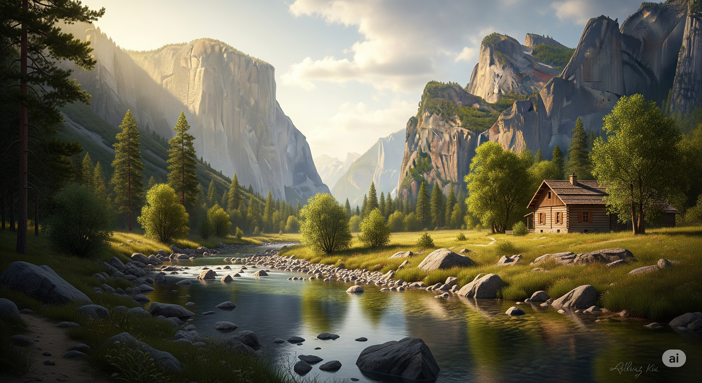
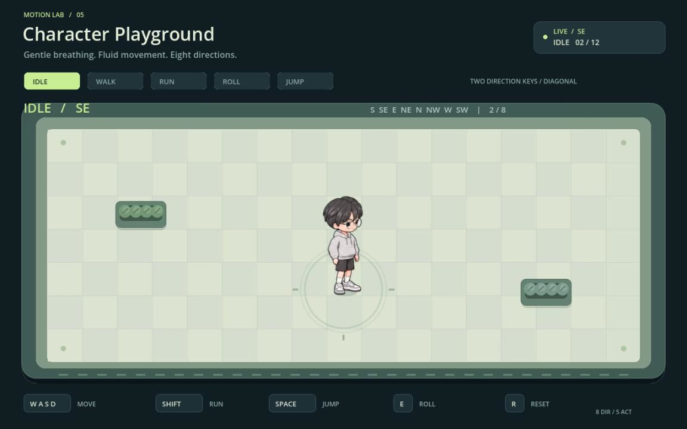
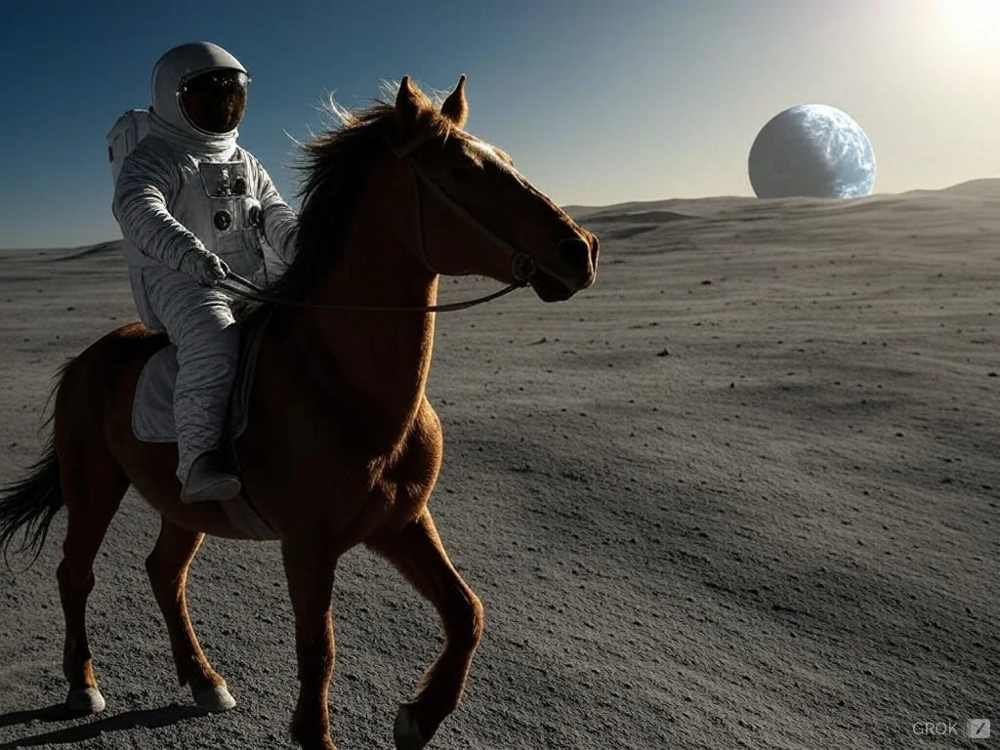

<!-- Generated by tools/write_community_catalog.py. Edit tools/templates/README.ja.md instead. -->
<!-- readme-tech-visualizer:start -->
<p align="center"><a href="https://jammyfu.github.io/awesome-ai-model-showcases/?lang=en"></a></p>
<!-- readme-tech-visualizer:end -->

[English](README.md) · [简体中文](README.zh-CN.md) · [繁體中文](README.zh-TW.md) · [日本語](README.ja.md)

# Awesome AI Model Showcases

**AI で作られたアニメーション、インタラクティブ作品、ゲーム。作品を見て、作者・プロンプト・ソースへ。**

**[ギャラリーを見る →](https://jammyfu.github.io/awesome-ai-model-showcases/?lang=en)** · [モデル別](#showcase) · [全目録](docs/catalog.ja.md)

<p>
<a href="#catalog"></a>
<a href="LICENSE"></a>
</p>

**[6つのモデル系列の許諾済み作品を大きく見る →](https://jammyfu.github.io/awesome-ai-model-showcases/licensed-gallery.ja.html)**

<a id="examples"></a>
## Claude が作った実際の作品

**Claude Opus 5.5** · Vincentwei1021 · 元プロジェクトの **GitHub stars は 3,434**（2026-11-11 確認）。

**ISOPOLIS · 街が育つ**

<a href="https://vincentwei1021.github.io/mg-styles-15/#03-isometric"></a>

光るタワーを中心に広がる、パステルカラーのアイソメトリック都市。風車、屋上の太陽光パネル、高架交通が街を彩ります。

**[映像を見る →](https://vincentwei1021.github.io/mg-styles-15/#03-isometric)** · [公開プロンプト](https://github.com/Vincentwei1021/mg-styles-15/blob/269f6ed788cf60aaf9c276b110c548d6e7d353e1/prompts/03-isometric.md) · [ソースコード](https://github.com/Vincentwei1021/mg-styles-15/tree/269f6ed788cf60aaf9c276b110c548d6e7d353e1/demos/03-isometric) · [作者の元画像](https://github.com/Vincentwei1021/mg-styles-15/blob/269f6ed788cf60aaf9c276b110c548d6e7d353e1/videos/03-isometric.jpg)

**KESTREL-9 · サイバーパンク HUD**

<a href="https://vincentwei1021.github.io/mg-styles-15/#22-hud"></a>

黒地にシアンで描かれた架空の動的インターフェース。地球儀、照準リング、信号グラフ、テレメトリーが並びます。

**[映像を見る →](https://vincentwei1021.github.io/mg-styles-15/#22-hud)** · [公開プロンプト](https://github.com/Vincentwei1021/mg-styles-15/blob/269f6ed788cf60aaf9c276b110c548d6e7d353e1/prompts/22-hud.md) · [ソースコード](https://github.com/Vincentwei1021/mg-styles-15/tree/269f6ed788cf60aaf9c276b110c548d6e7d353e1/demos/22-hud) · [作者の元画像](https://github.com/Vincentwei1021/mg-styles-15/blob/269f6ed788cf60aaf9c276b110c548d6e7d353e1/videos/22-hud.jpg)

同じプロジェクトの 2 作品です。stars は各作品の再生数やモデル横断の人気順位ではありません。作者が公開した映像フレームを無加工で掲載。[メディアの MIT 許諾](https://github.com/Vincentwei1021/mg-styles-15/blob/269f6ed788cf60aaf9c276b110c548d6e7d353e1/README.md#license) · [著作権・ライセンス全文](docs/licenses/Vincentwei1021-mg-styles-15-MIT.txt)。この特集は 183 件の目録とは別です。モデルは作者の申告で、生成の再実行はしていません。

[Claude](#claude) · [Gemini](#gemini) · [GPT Sol](#gpt-code) · [Grok](#grok) · [Qwen](#qwen) · [DeepSeek](#deepseek)

<a id="showcase"></a>
<a id="catalog"></a>
## モデル別に探す

6 ファミリーに **183 件の出典付き事例**を収録しています。各表では異なる題材を 3 件選び、プレビューへの入口、紹介、モデル、作者、出典を示します。掲載許諾が未確認のメディアは出典へのリンクのみで、埋め込み画像ではありません。全バージョンと記録は[全目録](docs/catalog.ja.md)をご覧ください。編集上の選定であり、モデル性能のランキングではありません。

バージョンは編集上の優先順位で並べ、出典が示す現在の重点バージョンを先に、同じバージョン内では出典の日付順にします。比較可能な人気指標はまだありません。[並び順の方針](docs/discovery-order.md)。

<a id="claude"></a>
### Claude · 146 件

[全件を見る](docs/catalog.ja.md#claude)

<a id="ver-claude-fable-5-2"></a>
- [Claude Fable 5.2](docs/catalog.ja.md#ver-claude-fable-5-2) · 137
<a id="ver-claude-mythos-5-2"></a>
- [Claude Mythos 5.2](docs/catalog.ja.md#ver-claude-mythos-5-2) · 0 · 出典付きの単独事例は未収録
<a id="ver-claude-opus-5-5"></a>
- [Claude Opus 5.5](docs/catalog.ja.md#ver-claude-opus-5-5) · 9

<table width="100%">
<thead><tr><th>プレビュー · 事例と紹介 · モデルと出典</th></tr></thead>
<tbody>
<tr><td><a href="https://x.com/quxiaoyin/status/2120341962314150207">出典で見る ↗</a><br><small>画像の掲載許諾は未確認</small><br><br><strong>AgentSkyを描く点光源の3D映像（Blenderとコード）</strong><br>Blender とコードで制作した点光の映像 · 動画収録<br><br>Claude Fable 5.2<br><small>出典による表記</small><br>@quxiaoyin（Xiaoyin Qu）<br><a href="docs/translations/x-quxiaoyin-fable52-agentsky-film.md#ja">ケース</a> · <a href="https://x.com/quxiaoyin/status/2120341962314150207">原投稿</a></td></tr>
<tr><td><a href="https://x.com/MengTo/status/2120316203738829180">出典で見る ↗</a><br><small>画像の掲載許諾は未確認</small><br><br><strong>Fable 5.2でThree.jsのアパートをBlenderに再現</strong><br>Claude と Blender で既存の Three.js の室内シーンを再現 · 画面収録<br><br>Claude Fable 5.2<br><small>出典による表記</small><br>@MengTo（Meng To）<br><a href="docs/translations/x-mengto-fable52-blender-apartment.md#ja">ケース</a> · <a href="https://x.com/MengTo/status/2120316203738829180">原投稿</a></td></tr>
<tr><td><a href="https://x.com/EvanMilenko/status/2120322640048959503">出典で見る ↗</a><br><small>画像の掲載許諾は未確認</small><br><br><strong>Three.jsでゼロから制作したドラゴンゲーム</strong><br>Three.js のドラゴンゲーム · プレイ映像<br><br>Claude Fable 5.2<br><small>出典による表記</small><br>@EvanMilenko（Evan）<br><a href="docs/translations/x-evanmilenko-fable52-dragon-game.md#ja">ケース</a> · <a href="https://x.com/EvanMilenko/status/2120322640048959503">原投稿</a></td></tr>
</tbody>
</table>

<a id="gemini"></a>
### Gemini · 6 件

[全件を見る](docs/catalog.ja.md#gemini)

<a id="ver-gemini-4-carbon"></a>
- [Gemini 4 Carbon](docs/catalog.ja.md#ver-gemini-4-carbon) · 5
<a id="ver-gemini-4-argon"></a>
- [Gemini 4 Argon](docs/catalog.ja.md#ver-gemini-4-argon) · 1

<table width="100%">
<thead><tr><th>プレビュー · 事例と紹介 · モデルと出典</th></tr></thead>
<tbody>
<tr><td><a href="https://commons.wikimedia.org/wiki/File:Illuminated_Valley_in_the_Afternoon_(Imagen_4.0).webp"></a><br><br><strong>午後の光に照らされた渓谷</strong><br>2025 年に Gemini アプリで制作した風景画。出典ページは Imagen 4.0、アップロード要約は 3.0 と記載し、正確な版は不明です。Gemini 4 Carbon ではありません。<br><small>追加の許諾済み作品 · 目録件数には含めません</small><br><small>原画像は変更せず、表示のみ縮小。</small><br><br>Imagen / Gemini · 2025<br><small>出典による表記</small><br>VulcanSphere<br><a href="https://commons.wikimedia.org/wiki/File:Illuminated_Valley_in_the_Afternoon_(Imagen_4.0).webp">原投稿</a> · <a href="https://creativecommons.org/publicdomain/zero/1.0/">CC0 1.0</a> · <a href="https://commons.wikimedia.org/w/index.php?title=File:Illuminated_Valley_in_the_Afternoon_(Imagen_4.0).webp&amp;oldid=1147349755">許諾の根拠</a><br><a href="docs/readme-preview-credits.md#licensed-gemini-imagen4-valley">クレジットと変更</a></td></tr>
<tr><td><a href="https://x.com/StatsWire/status/2120344850071540152">出典で見る ↗</a><br><small>画像の掲載許諾は未確認</small><br><br><strong>単一HTMLファイルで操作できる3Dニューヨーク巡遊（Three.js）</strong><br>Three.js の単一ファイルシーン · 画面収録動画<br><br>Gemini 4 Carbon<br><small>出典による表記</small><br>@StatsWire<br><a href="docs/translations/x-statswire-gemini-carbon-nyc-cruiser.md#ja">ケース</a> · <a href="https://x.com/StatsWire/status/2120344850071540152">原投稿</a></td></tr>
<tr><td><a href="https://x.com/DeryaTR_/status/2120393810941456710">出典で見る ↗</a><br><small>画像の掲載許諾は未確認</small><br><br><strong>Theme ParkのHDピクセルアート版リメイク（プレイ可能）</strong><br>HTML ピクセルアートの再現 · https://theme-park-hd.vercel.app でプレイ可能 · 動画収録<br><br>Gemini 4 Carbon<br><small>出典による表記</small><br>@DeryaTR_（Derya Unutmaz）<br><a href="docs/translations/x-deryatr-gemini-carbon-theme-park.md#ja">ケース</a> · <a href="https://x.com/DeryaTR_/status/2120393810941456710">原投稿</a></td></tr>
<tr><td><a href="https://x.com/ai_for_success/status/2120317619588972867">出典で見る ↗</a><br><small>画像の掲載許諾は未確認</small><br><br><strong>FreeCADとBlenderによるV8エンジン</strong><br>FreeCAD と Blender による V8 エンジン · デモ収録<br><br>Gemini 4 Carbon<br><small>出典による表記</small><br>@ai_for_success（AshutoshShrivastava）<br><a href="docs/translations/x-aiforsuccess-gemini-carbon-v8.md#ja">ケース</a> · <a href="https://x.com/ai_for_success/status/2120317619588972867">原投稿</a></td></tr>
</tbody>
</table>

<a id="gpt-code"></a>
### GPT-6.2 Sol · 14 件

[全件を見る](docs/catalog.ja.md#gpt-code)

<a id="ver-gpt-6-2-sol"></a>
- [GPT-6.2 Sol](docs/catalog.ja.md#ver-gpt-6-2-sol) · 11
<a id="ver-gpt-6-1-sol"></a>
- [GPT-6.1 Sol](docs/catalog.ja.md#ver-gpt-6-1-sol) · 3

<table width="100%">
<thead><tr><th>プレビュー · 事例と紹介 · モデルと出典</th></tr></thead>
<tbody>
<tr><td><a href="https://github.com/zhangrlll/codex-to-2d-sprites/blob/e7252c23b002bbd131385d5432d9422d87134167/README.md"></a><br><br><strong>GPT のキャラクター画像から Godot へ</strong><br>GPT のキャラクター画像を、Tripo AI と Codex 支援のアニメーション工程で操作可能な Godot キャラクターに。モデルの詳細バージョンは不明で、複数ツールによる制作です。<br><small>追加の許諾済み作品 · 目録件数には含めません</small><br><small>出典の原画像は変更せず、表示のみ縮小。</small><br><br>GPT Image → Tripo → Codex / Godot<br><small>出典による表記</small><br>zhangrlll<br><a href="https://github.com/zhangrlll/codex-to-2d-sprites/blob/e7252c23b002bbd131385d5432d9422d87134167/README.md">原投稿</a> · <a href="https://opensource.org/license/mit">MIT</a> · <a href="https://github.com/zhangrlll/codex-to-2d-sprites/blob/e7252c23b002bbd131385d5432d9422d87134167/README.en.md#3-license">許諾の根拠</a><br><a href="docs/readme-preview-credits.md#licensed-gpt-godot-character">クレジットと変更</a></td></tr>
<tr><td><a href="https://github.com/dan-lee-odinson/failure-is-not-an-option/blob/46a3922923b77a019b9c2729121501446b0595eb/README.md"></a><br><br><strong>Failure is Not an Option：打ち上げシーン</strong><br>Dan Lee-Odinson の監督のもと、Codex（GPT-6 Astra）が内蔵 Imagegen を使って制作したゲーム用イラスト。画像モデルは不明で、ゲームの実装は Claude が担当。<br><small>追加の許諾済み作品 · 目録件数には含めません</small><br><small>出典の原画像は変更せず、表示のみ縮小。</small><br><br>Codex (GPT-6 Astra) + Imagegen<br><small>出典による表記</small><br>Dan Lee-Odinson<br><a href="https://github.com/dan-lee-odinson/failure-is-not-an-option/blob/46a3922923b77a019b9c2729121501446b0595eb/README.md">原投稿</a> · <a href="https://creativecommons.org/licenses/by/4.0/">CC BY 4.0</a> · <a href="https://github.com/dan-lee-odinson/failure-is-not-an-option/blob/46a3922923b77a019b9c2729121501446b0595eb/LICENSE-CONTENT">許諾の根拠</a><br><a href="docs/readme-preview-credits.md#licensed-gpt-codex-launch-scene">クレジットと変更</a></td></tr>
<tr><td><a href="https://x.com/cfenghub/status/2120069654437921152">出典で見る ↗</a><br><small>画像の掲載許諾は未確認</small><br><br><strong>Three.js、GLSL、Blenderで制作した雨に濡れるローマのコロッセオ</strong><br>Three.js + GLSL + Blender · 単一 HTML · 動画収録<br><br>GPT-6.2 Sol<br><small>出典による表記</small><br>@cfenghub（CF长风）<br><a href="docs/translations/x-cfenghub-gpt62sol-colosseum.md#ja">ケース</a> · <a href="https://x.com/cfenghub/status/2120069654437921152">原投稿</a></td></tr>
<tr><td><a href="https://x.com/TokenGremlin/status/2119395930805879165">出典で見る ↗</a><br><small>画像の掲載許諾は未確認</small><br><br><strong>単一HTMLファイルのThree.jsブラックホールを一度で生成（作者はGPT-6.2 Solへルーティング）</strong><br>Three.js の単一 HTML ファイル · X の画面／動画収録<br><br>GPT-6.2 Sol<br><small>出典による表記</small><br>@TokenGremlin（Token Gremlin）<br><a href="docs/translations/x-tokengremlin-gpt62sol-threejs-blackhole.md#ja">ケース</a> · <a href="https://x.com/TokenGremlin/status/2119395930805879165">原投稿</a></td></tr>
<tr><td><a href="https://x.com/HarshithLucky3/status/2119418918616150080">出典で見る ↗</a><br><small>画像の掲載許諾は未確認</small><br><br><strong>SVGアニメ：自転車に乗るペリカンとカニ2匹（Codexルーティング）</strong><br>Codex で制作した SVG アニメーション · 動画収録<br><br>GPT-6.2 Sol<br><small>出典による表記</small><br>@HarshithLucky3（Harshith）<br><a href="docs/translations/x-harshithlucky3-gpt62sol-pelican-svg-animation.md#ja">ケース</a> · <a href="https://x.com/HarshithLucky3/status/2119418918616150080">原投稿</a></td></tr>
</tbody>
</table>

<a id="grok"></a>
### Grok · 11 件

[全件を見る](docs/catalog.ja.md#grok)

<a id="ver-grok-4-7"></a>
- [Grok 4.7](docs/catalog.ja.md#ver-grok-4-7) · 1
<a id="ver-grok-imagine-video"></a>
- [Grok Imagine Video](docs/catalog.ja.md#ver-grok-imagine-video) · 10

<table width="100%">
<thead><tr><th>プレビュー · 事例と紹介 · モデルと出典</th></tr></thead>
<tbody>
<tr><td><a href="https://commons.wikimedia.org/wiki/File:Astronaut_Riding_a_Horse_(Grok_Aurora).webp"></a><br><br><strong>月面で馬に乗る宇宙飛行士</strong><br>VulcanSphere は、2024 年 12 月に Grok Aurora のテキスト画像生成で制作したと報告しています。Grok 4.7 のコーディングや動画の事例ではありません。<br><small>追加の許諾済み作品 · 目録件数には含めません</small><br><small>原画像は変更せず、表示のみ縮小。</small><br><br>Grok Aurora (2024)<br><small>出典による表記</small><br>VulcanSphere<br><a href="https://commons.wikimedia.org/wiki/File:Astronaut_Riding_a_Horse_(Grok_Aurora).webp">原投稿</a> · <a href="https://creativecommons.org/publicdomain/zero/1.0/">CC0 1.0</a> · <a href="https://commons.wikimedia.org/w/index.php?title=File:Astronaut_Riding_a_Horse_(Grok_Aurora).webp&amp;oldid=1265346265">許諾の根拠</a><br><a href="docs/readme-preview-credits.md#licensed-grok-aurora-astronaut">クレジットと変更</a></td></tr>
<tr><td><a href="https://jamesgreene.com/models/">出典で見る ↗</a><br><small>画像の掲載許諾は未確認</small><br><br><strong>アイソメトリック都市の昼夜HTMLループ：Grok 4.7</strong><br>単体で動作する HTML／CSS／JS アニメーション（コードモデル。Grok Imagine Video ではない）<br><br>Grok 4.7<br><small>出典による表記</small><br>James Greene (model comparison archive)<br><a href="docs/translations/web-jamesgreene-code1-grok47-isometric-city.md#ja">ケース</a> · <a href="https://jamesgreene.com/models/">原投稿</a></td></tr>
<tr><td><a href="https://x.com/HaluAIArt/status/2118285947921989988">出典で見る ↗</a><br><small>画像の掲載許諾は未確認</small><br><br><strong>ダークなエレクトロ・ヒップホップのダンス映像</strong><br>原投稿の表記による Grok Imagine ネイティブ動画<br><br>Grok Imagine Video<br><small>出典による表記</small><br>@HaluAIArt（はる）<br><a href="docs/translations/x-haluaiart-grok-imagine-dark-electro-hip-hop-dance.md#ja">ケース</a> · <a href="https://x.com/HaluAIArt/status/2118285947921989988">原投稿</a></td></tr>
<tr><td><a href="https://x.com/whichaiwon/status/2118342571592446154">出典で見る ↗</a><br><small>画像の掲載許諾は未確認</small><br><br><strong>Grok Imagine Video 1.5 Liteのリップシンク検証</strong><br>原投稿の表記による Grok Imagine ネイティブ動画<br><br>Grok Imagine Video<br><small>出典による表記</small><br>@whichaiwon（Which AI Won）<br><a href="docs/translations/x-whichaiwon-grok-imagine-grok-imagine-video-1-5-lit.md#ja">ケース</a> · <a href="https://x.com/whichaiwon/status/2118342571592446154">原投稿</a></td></tr>
</tbody>
</table>

<a id="qwen"></a>
### Qwen · 3 件

[全件を見る](docs/catalog.ja.md#qwen)

<a id="ver-qwen4-max-preview"></a>
- [Qwen 4 Max Preview](docs/catalog.ja.md#ver-qwen4-max-preview) · 1
<a id="ver-qwen4-preview"></a>
- [Qwen 4.0 Preview](docs/catalog.ja.md#ver-qwen4-preview) · 1
<a id="ver-qwen3-8-27b"></a>
- [Qwen3.8 27B](docs/catalog.ja.md#ver-qwen3-8-27b) · 1

<table width="100%">
<thead><tr><th>プレビュー · 事例と紹介 · モデルと出典</th></tr></thead>
<tbody>
<tr><td><a href="https://github.com/Mats2208/qwen-image-local/blob/f26beee377d1861f5b5b35a7ea6efb3222d35c98/docs/index.html"></a><br><br><strong>チャルカス通りの雪の夜</strong><br>Qwen-Image-2.1 で街路写真を雪の夜景に編集。出典が報告する画像編集テストであり、Qwen4 のコーディング事例ではありません。<br><small>追加の許諾済み作品 · 目録件数には含めません</small><br><small>原画像は変更せず、表示のみ縮小。</small><br><br>Qwen-Image-2.1<br><small>出典による表記</small><br>Mbaro01 · Mats2208<br><a href="https://github.com/Mats2208/qwen-image-local/blob/f26beee377d1861f5b5b35a7ea6efb3222d35c98/docs/index.html">原投稿</a> · <a href="https://creativecommons.org/licenses/by-sa/4.0/">CC BY-SA 4.0</a> · <a href="https://github.com/Mats2208/qwen-image-local/blob/f26beee377d1861f5b5b35a7ea6efb3222d35c98/README.md#license">許諾の根拠</a><br><a href="docs/readme-preview-credits.md#licensed-qwen-image21-snowy-street">クレジットと変更</a></td></tr>
<tr><td><a href="https://x.com/leo114119/status/2120371909624033439">出典で見る ↗</a><br><small>画像の掲載許諾は未確認</small><br><br><strong>飛行機を操縦する孫悟空：HTMLの3Dデモ</strong><br>HTML と 3D アニメーションのデモ · 動画収録<br><br>Qwen 4 Max Preview<br><small>出典による表記</small><br>@leo114119（Leo）<br><a href="docs/translations/x-leo114119-qwen4max-wukong-plane.md#ja">ケース</a> · <a href="https://x.com/leo114119/status/2120371909624033439">原投稿</a></td></tr>
<tr><td><a href="https://x.com/coffeecup2020/status/2120113388629995921">出典で見る ↗</a><br><small>画像の掲載許諾は未確認</small><br><br><strong>Qwen 4.0 Previewによるサグラダ・ファミリアのデモ</strong><br>反復的な自己批評のデモ · 動画収録<br><br>Qwen 4.0 Preview<br><small>出典による表記</small><br>@coffeecup2020（David Y. Tan）<br><a href="docs/translations/x-coffeecup2020-qwen4-sagrada.md#ja">ケース</a> · <a href="https://x.com/coffeecup2020/status/2120113388629995921">原投稿</a></td></tr>
<tr><td><a href="https://jamesgreene.com/models/">出典で見る ↗</a><br><small>画像の掲載許諾は未確認</small><br><br><strong>アイソメトリック都市の昼夜HTMLループ：Qwen3.8 27B</strong><br>単体で動作する HTML／CSS／JS アニメーション<br><br>Qwen3.8 27B<br><small>出典による表記</small><br>James Greene (model comparison archive)<br><a href="docs/translations/web-jamesgreene-code1-qwen38-27b-isometric-city.md#ja">ケース</a> · <a href="https://jamesgreene.com/models/">原投稿</a></td></tr>
</tbody>
</table>

<a id="deepseek"></a>
### DeepSeek · 3 件

[全件を見る](docs/catalog.ja.md#deepseek)

<a id="ver-deepseek-v4-1-flash-1017"></a>
- [DeepSeek V4.1 Flash 1017](docs/catalog.ja.md#ver-deepseek-v4-1-flash-1017) · 1
<a id="ver-deepseek-v4-1-flash"></a>
- [DeepSeek V4.1 Flash](docs/catalog.ja.md#ver-deepseek-v4-1-flash) · 2

<table width="100%">
<thead><tr><th>プレビュー · 事例と紹介 · モデルと出典</th></tr></thead>
<tbody>
<tr><td><a href="https://github.com/jaymollica/frogs/blob/79369f4dd2a543009fe93d6d3b54327ab0e8817e/results/2026-09-27/svg/deepseek--deepseek-v4.1-flash--20260927-193108-7af3b.svg"></a><br><br><strong>FROGS：王冠をかぶった SVG のカエル</strong><br>出典が公開した DeepSeek V4.1 Flash の SVG ベンチマーク結果。Flash 1017 ではありません。元の構図では足先が切れていますが、王冠、顔、顎は明瞭です。<br><small>追加の許諾済み作品 · 目録件数には含めません</small><br><small>出典の SVG を Inkscape で幅800pxの PNG に変換。絵の変更はなく、公開元のサニタイズ処理を維持。</small><br><br>DeepSeek V4.1 Flash · 2026-09-27<br><small>出典による表記</small><br>Jay Mollica · FROGS<br><a href="https://github.com/jaymollica/frogs/blob/79369f4dd2a543009fe93d6d3b54327ab0e8817e/results/2026-09-27/svg/deepseek--deepseek-v4.1-flash--20260927-193108-7af3b.svg">原投稿</a> · <a href="https://creativecommons.org/licenses/by/4.0/">CC BY 4.0</a> · <a href="https://github.com/jaymollica/frogs/blob/79369f4dd2a543009fe93d6d3b54327ab0e8817e/LICENSE-DATA">許諾の根拠</a><br><a href="docs/readme-preview-credits.md#licensed-deepseek-crowned-frog">クレジットと変更</a></td></tr>
<tr><td><a href="https://jamesgreene.com/models/">出典で見る ↗</a><br><small>画像の掲載許諾は未確認</small><br><br><strong>アイソメトリック都市の昼夜HTMLループ：DeepSeek V4.1 Flash 1017</strong><br>単体で動作する HTML／CSS／JS アニメーション<br><br>DeepSeek V4.1 Flash 1017<br><small>出典による表記</small><br>James Greene (model comparison archive)<br><a href="docs/translations/web-jamesgreene-code1-deepseek-v41-flash-1017-isometric-city.md#ja">ケース</a> · <a href="https://jamesgreene.com/models/">原投稿</a></td></tr>
<tr><td><a href="https://x.com/LatentOperatorX/status/2120205377803518132">出典で見る ↗</a><br><small>画像の掲載許諾は未確認</small><br><br><strong>Three.jsによるエアバスA380の離陸：DeepSeek V4.1 Flash、Fable 5.2、GPT-6.1 Solを比較</strong><br>Three.js の単一シーン課題 · 比較動画<br><br>DeepSeek V4.1 Flash<br><small>出典による表記</small><br>@LatentOperatorX<br><a href="docs/translations/x-latentoperator-a380-deepseek-fable-sol.md#ja">ケース</a> · <a href="https://x.com/LatentOperatorX/status/2120205377803518132">原投稿</a></td></tr>
<tr><td><a href="https://x.com/LatentOperatorX/status/2120077800887746603">出典で見る ↗</a><br><small>画像の掲載許諾は未確認</small><br><br><strong>Three.jsのショベルカーがダンプに積み込み：DeepSeek HarnessとCommand Codeを比較</strong><br>Three.js の掘削機制作課題 · 比較動画<br><br>DeepSeek V4.1 Flash<br><small>出典による表記</small><br>@LatentOperatorX（Latent Operator）<br><a href="docs/translations/x-latentoperator-deepseek-excavator.md#ja">ケース</a> · <a href="https://x.com/LatentOperatorX/status/2120077800887746603">原投稿</a></td></tr>
</tbody>
</table>


<a id="latest"></a>
## 最近の原投稿

出典の日付が新しい 5 件です。収録順や品質ランキングではありません。同日は事例 ID 順とし、日付のない事例も全目録に残します。

2026-11-12 時点で比較可能な人気指標は未収集です。ここは出典の日付順で、人気ランキングではありません。

- **2026-11-11 · GPT Sol** · **Let Fable take Flight：HTML／Three.jsのプロシージャルアニメ（GPT-6.1 Sol Max）** · クレジット: @YFeng2022（LanFeng） · [ケース](docs/translations/x-yfeng-gpt61-sol-fable-take-flight.md#ja) · [原投稿](https://x.com/YFeng2022/status/2120324811549225082)
- **2026-11-11 · Gemini** · **単一HTMLファイルで操作できる3Dニューヨーク巡遊（Three.js）** · クレジット: @StatsWire · [ケース](docs/translations/x-statswire-gemini-carbon-nyc-cruiser.md#ja) · [原投稿](https://x.com/StatsWire/status/2120344850071540152)
- **2026-11-11 · Grok** · **Grok Imagine：pixstarのCybertruckお別れ映像（プロンプトは一部のみ）** · クレジット: @RadCyberTruck · [ケース](docs/translations/x-radcybertruck-grok-imagine-cybertruck-cry.md#ja) · [原投稿](https://x.com/RadCyberTruck/status/2120350558431445006)
- **2026-11-11 · Claude** · **AgentSkyを描く点光源の3D映像（Blenderとコード）** · クレジット: @quxiaoyin（Xiaoyin Qu） · [ケース](docs/translations/x-quxiaoyin-fable52-agentsky-film.md#ja) · [原投稿](https://x.com/quxiaoyin/status/2120341962314150207)
- **2026-11-11 · Claude** · **Fable 5.2とOpus 5.5：同じプロンプトによるThree.jsの船（横並び比較）** · クレジット: @paleknight（Vraj） · [ケース](docs/translations/x-paleknight-fable52-vs-opus55-ship.md#ja) · [原投稿](https://x.com/paleknight/status/2120368418805174639)


<a id="how-to-use"></a>
## ここから始める

1. **アイデアを探す。** 下のモデル別一覧から選ぶか、ギャラリーでタイトル、作者、モデルを検索します。
2. **根拠を確認する。** 事例を開き、原投稿、作者、作り方、プロンプトの公開状況（公開・一部公開・未公開）を確認します。
3. **自分の試作に備える。** 記録された方法を出発点にします。利用権限や設定によって結果は異なり、本目録は生成結果の再現や認証を行いません。

閲覧にアカウント、API キー、インストールは不要です。モデル名は出典の主張です。**コードのライセンスは第三者のメディアやプロンプトの利用権を与えません。**

[モデル](#showcase) · [最近の投稿](#latest) · [種類](#by-type) · [投稿する](#contribute) · [権利と言語](#rights)

<details>
<summary>モデル名と根拠の限界</summary>

欄の名前 **GPT-6.2 Sol** はリポジトリ所有者の確認に従う。2026-11-11 時点で OpenAI の公開ページは **GPT-6.1 Sol** のまま（[紹介](https://openai.com/index/introducing-gpt-6-1-sol/)、[Models](https://platform.openai.com/docs/models)）。公式の 6.2 発表は作らない。

Claude Mythos 5.2 と Qwen 3.8 Flash Next は一覧に名前がありますが、独立した出典付き事例はなく、件数には加えていません。プロンプトやモデル名は不完全、または出典の主張にとどまる場合があります。収録やダウンロードの成功は、生成の成功を証明しません。

</details>


<a id="by-type"></a>
## 種類別

<a id="type-gif"></a>
- [GIF](docs/showcase-index.md#gif) · **0**
<a id="type-animation"></a>
- [アニメーション](docs/showcase-index.md#animation) · **107**
<a id="type-html-3d"></a>
- [HTML / 3D](docs/showcase-index.md#html-3d) · **66**
<a id="type-minigame"></a>
- [ミニゲーム](docs/showcase-index.md#minigame) · **10**
<a id="type-image"></a>
- [画像](docs/showcase-index.md#image) · **0**


種類別の件数は既存のタグに基づき、モデルの能力全体を表すものではありません。0 件はそのタグの事例がないことを意味し、ゲームが HTML / 3D に分類されている場合もあります。[分類方法](tools/readme_presentation.py)。

<a id="collection-sites"></a>
<a id="related-projects"></a>
## さらに探す

- [全目録と事例収集サイト](docs/catalog.ja.md)：全事例、出典の根拠、区別された付録。
- [関連オープンソースプロジェクト](docs/related-projects.md)：ほかの事例集やプロンプト集。
- [機械可読の目録](docs/data/community-cases.json) · [LLM 向けプロジェクト案内](llms.txt)。

- [アイデア・人気作の再制作付録（主目録とは別枠）](https://jammyfu.github.io/awesome-ai-model-showcases/popular.html).

- [GPT Image の GIF アーカイブ · 51](collections/gpt-image-gifs/README.md) · 別コレクション.

<a id="contribute"></a>
## 事例の投稿・訂正

[事例を投稿する](https://github.com/jammyfu/awesome-ai-model-showcases/issues/new?template=case-submission.yml)際は、原作者、原投稿の URL、公開プロンプトまたは「未公開」の記載、モデルや制作方法の根拠を添えてください。コーディングは不要です。署名、リンク切れ、翻訳の訂正も歓迎します。

PR を送る場合は [CONTRIBUTING.md](CONTRIBUTING.md) を参照してください。出典一覧か 4 言語のテンプレートを編集し、再生成と差分レビューの後、[共通の検証コマンド](tools/verify.py)を実行します。

<a id="local-setup"></a>
<details>
<summary>ローカルでギャラリーを開く</summary>

既存の静的ギャラリーの閲覧には Python 3 だけが必要です。

```bash
git clone https://github.com/jammyfu/awesome-ai-model-showcases.git
cd awesome-ai-model-showcases
python3 -m http.server 8000 --directory docs
```

[localhost:8000](http://localhost:8000/?lang=en) を開きます。公開ホスティングには[許可済みメディアのビルド手順](MEDIA_RIGHTS.md#publication-and-playback-checks)を使い、元のアーカイブを直接配信しないでください。開発時の検証には [CONTRIBUTING.md](CONTRIBUTING.md) に記載の依存関係も必要です。

</details>

<a id="rights"></a>
<a id="faq"></a>
## 権利・収録範囲・言語

- **範囲：**一覧の更新日は **2026-11-11**。**12 件の未確認事例**はホームページの **183 件**に含めません。GIF サブプロジェクト、作り直し、失敗例、リポジトリの種となる例も別枠です。
- **メディア：**既存目録の **0 件に公開許可のあるローカルメディア**があります。上の Claude 特集の 2 画像は別途許諾を確認済みです。その他の目録項目は出典にリンクします。公開されていること、署名、ダウンロードは再利用の許可を意味しません。
- **ライセンス：**[MIT](LICENSE) はソースコードとプロジェクト独自の文書に適用され、第三者のメディア、プロンプト、商標、肖像には適用されません。[MEDIA_RIGHTS.md](MEDIA_RIGHTS.md) を確認してください。権利者は[訂正・削除を依頼](https://github.com/jammyfu/awesome-ai-model-showcases/issues/new)できます。
- **言語：**README と事例の根拠は English、简体中文、繁體中文、日本語に対応しています。AI 翻訳は**人による校閲前**で、原文も保存しています。ギャラリーの UI は **English / 简体中文のみ**です。[翻訳方針と対応状況](docs/translation-policy.md)。

この構成を再利用する場合は [README パターンとチェックリスト](docs/readme-pattern.md)を参照し、プロジェクト固有の記述を自分のリポジトリの根拠に置き換えてください。

[先頭へ ↑](#awesome-ai-model-showcases)
