<!-- Generated by tools/write_community_catalog.py. Edit tools/templates/README.ja.md instead. -->


[English](README.md) · [简体中文](README.zh-CN.md) · [繁體中文](README.zh-TW.md) · [日本語](README.ja.md)

<!-- readme-tech-visualizer:start -->
<p align="center"></p>
<!-- readme-tech-visualizer:end -->

# Awesome AI Model Showcases

**最新モデルの制作事例。原投稿、作者、プロンプト付き。**

Awesome AI Model Showcases は、Claude Fable 5.2 / Mythos 5.2、Gemini 4 Argon / Carbon、GPT-6.2 Sol、Grok、Qwen、DeepSeek などの最新世代と、いまも主流の前世代について、動く画像・アニメーション・HTML やゲームの demo・画像という公開の制作事例を、原投稿・作者・公開プロンプト・作り方つきで集めた目録です。

<p>
<a href="#catalog"></a>
<a href="README.md"></a>
<a href="LICENSE"></a>
</p>

**[ギャラリーを開く ↗](https://jammyfu.github.io/awesome-ai-model-showcases/?lang=en)** · **[ファミリー別に見る ↓](#showcase)** · **[事例を送る](https://github.com/jammyfu/awesome-ai-model-showcases/issues/new?template=case-submission.yml)**

独立したコミュニティの目録で、ベンダー公式ではありません。モデル名は出典の主張であり、こちらで改めて検証したものではありません。**第三者のメディアとプロンプトは、コードの MIT では覆われません。**

## 目次

### モデル別
- [Claude](#claude) — [Claude Fable 5.2](#ver-claude-fable-5-2) · [Claude Mythos 5.2](#ver-claude-mythos-5-2) · [Claude Opus 5.5](#ver-claude-opus-5-5)
- [Gemini](#gemini) — [Gemini 4 Carbon](#ver-gemini-4-carbon) · [Gemini 4 Argon](#ver-gemini-4-argon)
- [GPT-6.2 Sol](#gpt-code) — [GPT-6.2 Sol](#ver-gpt-6-2-sol) · [GPT-6.1 Sol](#ver-gpt-6-1-sol)
- [Grok](#grok) — [Grok 4.7](#ver-grok-4-7) · [Grok Imagine Video](#ver-grok-imagine-video)
- [Qwen](#qwen) — [Qwen3.8 27B](#ver-qwen3-8-27b)
- [DeepSeek](#deepseek) — [DeepSeek V4.1 Flash 1017](#ver-deepseek-v4-1-flash-1017) · [DeepSeek V4.1 Flash](#ver-deepseek-v4-1-flash)
- [GPT Image](#gpt-image) — [GPT Image 2.6](#ver-gpt-image-2-6)

### 種類別
- [GIF](#type-gif)
- [アニメーション](#type-animation)
- [HTML / 3D](#type-html-3d)
- [ミニゲーム](#type-minigame)
- [画像](#type-image)

### 新しい収録
- [日付のある新しい事例](#latest)
- [事例インデックス](docs/showcase-index.md)

- [事例収集サイト](#collection-sites)
- [使い方](#how-to-use)
- [投稿](#contribute)
- [メディアの権利](#rights)
- [FAQ](#faq)
- [証拠の全表](#catalog)

<a id="latest"></a>
## 新しい収録
完全な日付がある事例だけ。新しい順。日付がないものはここには出さない。

<table>
<tr>
<td align="center" width="33%">
<a href="https://x.com/YFeng2022/status/2120324811549225082"></a><br>
<strong><a href="docs/cases/x-yfeng-gpt61-sol-fable-take-flight/README.md">Let Fable take Flight — HTML/Three.js procedural animation (GPT-6.1 Sol Max)</a></strong><br>
クレジット: @YFeng2022（LanFeng）<br><a href="https://x.com/YFeng2022/status/2120324811549225082">原投稿</a>
</td>
<td align="center" width="33%">
<a href="https://x.com/StatsWire/status/2120344850071540152">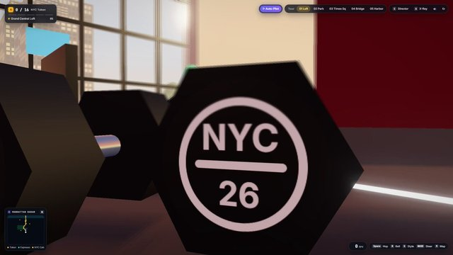</a><br>
<strong><a href="docs/cases/x-statswire-gemini-carbon-nyc-cruiser/README.md">Interactive 3D NYC cruiser tour in one HTML file (Three.js)</a></strong><br>
クレジット: @StatsWire<br><a href="https://x.com/StatsWire/status/2120344850071540152">原投稿</a>
</td>
<td align="center" width="33%">
<a href="https://x.com/RadCyberTruck/status/2120350558431445006">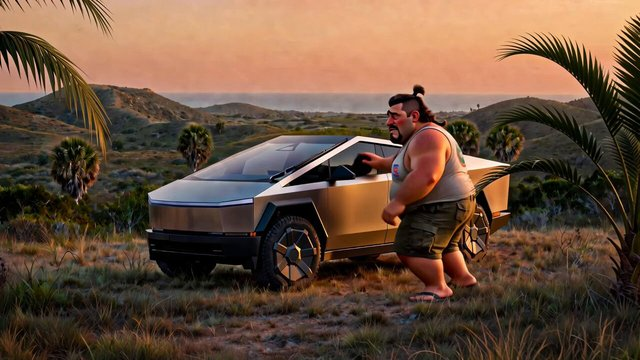</a><br>
<strong><a href="docs/cases/x-radcybertruck-grok-imagine-cybertruck-cry/README.md">Grok Imagine — pixstar Cybertruck farewell clip (partial prompt)</a></strong><br>
クレジット: @RadCyberTruck<br><a href="https://x.com/RadCyberTruck/status/2120350558431445006">原投稿</a>
</td>
</tr>
<tr>
<td align="center" width="33%">
<a href="https://x.com/paleknight/status/2120368418805174639">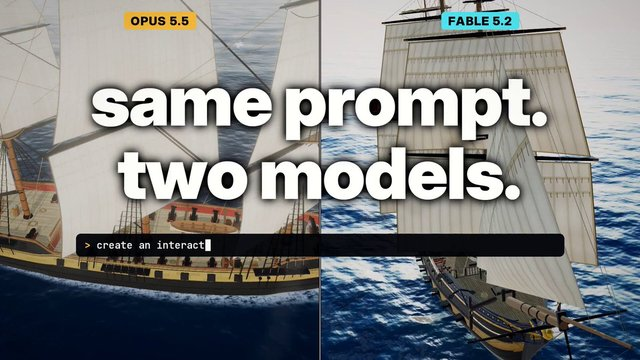</a><br>
<strong><a href="docs/cases/x-paleknight-fable52-vs-opus55-ship/README.md">Fable 5.2 vs Opus 5.5 — same prompt Three.js ship (side-by-side)</a></strong><br>
クレジット: @paleknight（Vraj）<br><a href="https://x.com/paleknight/status/2120368418805174639">原投稿</a>
</td>
<td align="center" width="33%">
<a href="https://x.com/MengTo/status/2120316203738829180">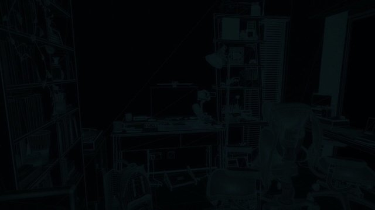</a><br>
<strong><a href="docs/cases/x-mengto-fable52-blender-apartment/README.md">Recreate a Three.js apartment in Blender with Fable 5.2</a></strong><br>
クレジット: @MengTo（Meng To）<br><a href="https://x.com/MengTo/status/2120316203738829180">原投稿</a>
</td>
<td align="center" width="33%">
<a href="https://x.com/coodddaaaa/status/2120363353142911078"></a><br>
<strong><a href="docs/cases/x-coodddaaaa-gemini-carbon-pelican-bike/README.md">Gemini Carbon · 鹈鹕骑自行车 HTML 动画测试</a></strong><br>
クレジット: @coodddaaaa（Joe William）<br><a href="https://x.com/coodddaaaa/status/2120363353142911078">原投稿</a>
</td>
</tr>
<tr>
<td align="center" width="33%">
<a href="https://ofox.ai/blog/claude-fable-5-2-svg-guide/">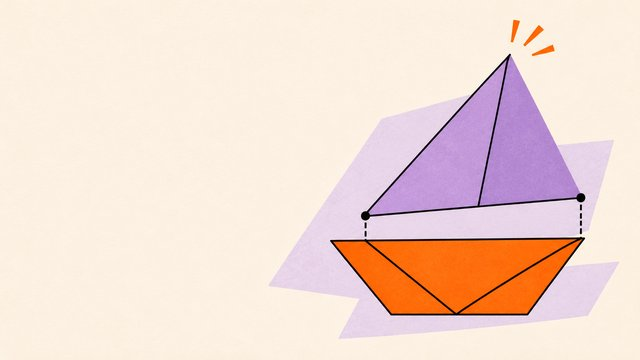</a><br>
<strong><a href="docs/cases/web-ofox-fable52-svg-sailboat/README.md">Editable SVG sailboat illustration with CSS motion (two API calls)</a></strong><br>
クレジット: Ofox<br><a href="https://ofox.ai/blog/claude-fable-5-2-svg-guide/">原投稿</a>
</td>
<td align="center" width="33%">
<a href="https://x.com/Raitox_tech/status/2120125234129084492">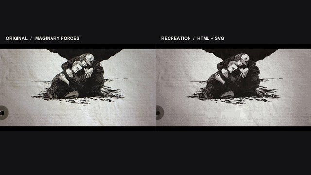</a><br>
<strong><a href="docs/cases/x-raitoox-sol-stranger-things-credits/README.md">Stranger Things 5 end credits recreated in HTML/CSS/JS + SVG (HyperFrames)</a></strong><br>
クレジット: @Raitox_tech<br><a href="https://x.com/Raitox_tech/status/2120125234129084492">原投稿</a>
</td>
</tr>
</table>


<a id="showcase"></a>
## モデルファミリー別の事例

各ファミリーから、すでに出典つきで入っている事例を 2〜3 件。在庫が少なければ、ある分だけ。事例のない版は空のままにします。

<a id="claude"></a>

## Claude

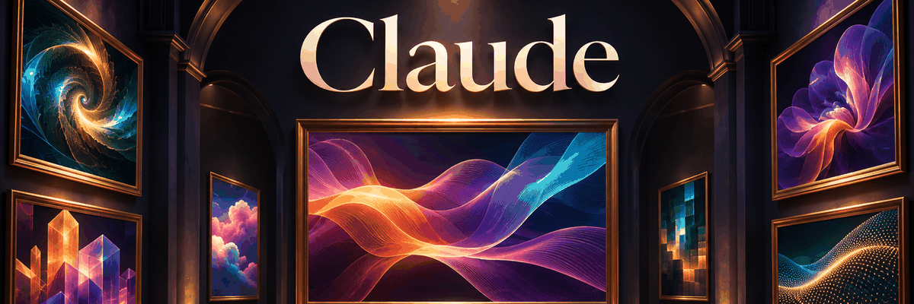

このファミリーの出典付き事例は 7 件。ここでは 3 件。残りは下の証拠表に入っています。

<a id="ver-claude-fable-5-2"></a>

### Claude Fable 5.2

<table>
<tr>
<td align="center" width="33%">
<a href="https://x.com/himanshutwtxs/status/2120017106804900304"></a><br>
<strong><a href="docs/cases/x-himanshutwtxs-fable52-motion-showreel/README.md">One-prompt motion designer showreel (timing, easing, shape, type)</a></strong><br>
クレジット: @himanshutwtxs<br><a href="https://x.com/himanshutwtxs/status/2120017106804900304">原投稿</a>
</td>
<td align="center" width="33%">
<a href="https://x.com/wshuyi/status/2120014892040417720">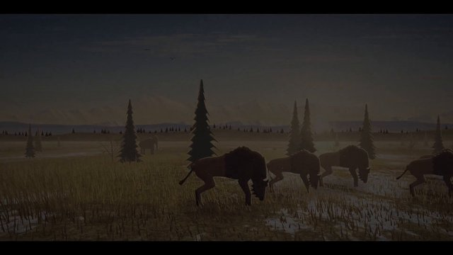</a><br>
<strong><a href="docs/cases/x-wshuyi-fable52-sabertooth-hunt/README.md">纯编程动画：剑齿虎捕猎野牛（自编程音效）</a></strong><br>
クレジット: @wshuyi<br><a href="https://x.com/wshuyi/status/2120014892040417720">原投稿</a>
</td>
</tr>
</table>

<a id="ver-claude-mythos-5-2"></a>

### Claude Mythos 5.2

インベントリにはこの版の名があるが、出典付きの単独事例はない。原文のまま引用する：

> Claude Mythos 5.2: announced, but no dedicated GIF/animation case with a verified primary URL included

<a id="ver-claude-opus-5-5"></a>

### Claude Opus 5.5

<table>
<tr>
<td align="center" width="33%">
<a href="https://jamesgreene.com/models/">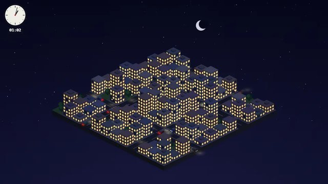</a><br>
<strong><a href="docs/cases/web-jamesgreene-code1-opus55-isometric-city/README.md">Isometric day/night city HTML loop — Claude Opus 5.5</a></strong><br>
クレジット: James Greene (model comparison archive)<br><a href="https://jamesgreene.com/models/">原投稿</a>
</td>
</tr>
</table>


<a id="gemini"></a>

## Gemini

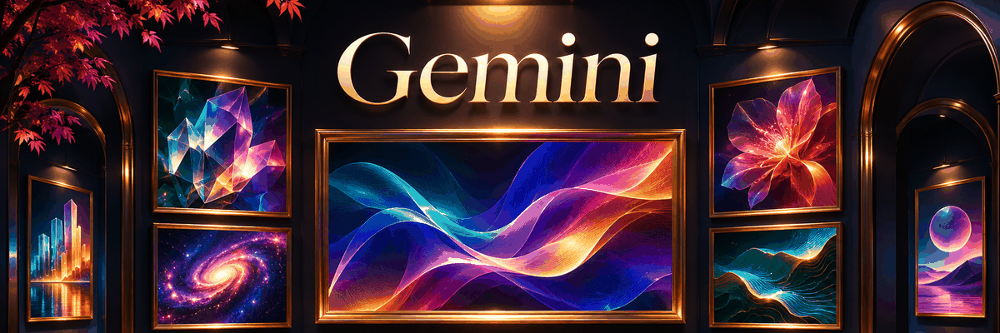

このファミリーの出典付き事例 3 件は、ここにすべてあります。同じ行が下の証拠表にもあります。

<a id="ver-gemini-4-carbon"></a>

### Gemini 4 Carbon

<table>
<tr>
<td align="center" width="33%">
<a href="https://x.com/coodddaaaa/status/2120363353142911078"></a><br>
<strong><a href="docs/cases/x-coodddaaaa-gemini-carbon-pelican-bike/README.md">Gemini Carbon · 鹈鹕骑自行车 HTML 动画测试</a></strong><br>
クレジット: @coodddaaaa（Joe William）<br><a href="https://x.com/coodddaaaa/status/2120363353142911078">原投稿</a>
</td>
<td align="center" width="33%">
<a href="https://x.com/StatsWire/status/2120344850071540152"></a><br>
<strong><a href="docs/cases/x-statswire-gemini-carbon-nyc-cruiser/README.md">Interactive 3D NYC cruiser tour in one HTML file (Three.js)</a></strong><br>
クレジット: @StatsWire<br><a href="https://x.com/StatsWire/status/2120344850071540152">原投稿</a>
</td>
</tr>
</table>

<a id="ver-gemini-4-argon"></a>

### Gemini 4 Argon

<table>
<tr>
<td align="center" width="33%">
<a href="https://jamesgreene.com/models/">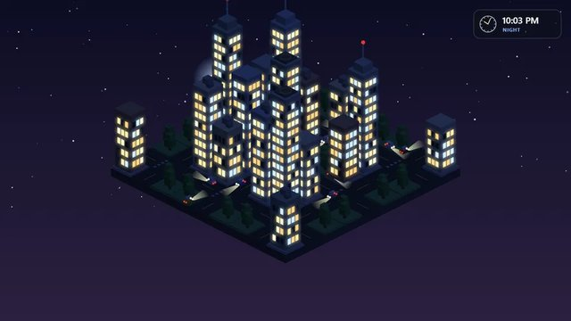</a><br>
<strong><a href="docs/cases/web-jamesgreene-code1-gemini4-argon-isometric-city/README.md">Isometric day/night city HTML loop — Gemini 4 Argon</a></strong><br>
クレジット: James Greene (model comparison archive)<br><a href="https://jamesgreene.com/models/">原投稿</a>
</td>
</tr>
</table>


<a id="gpt-code"></a>

## GPT-6.2 Sol


このファミリーの出典付き事例は 11 件。ここでは 3 件。残りは下の証拠表に入っています。

欄の名前 **GPT-6.2 Sol** はリポジトリ所有者の確認に従う。2026-11-11 時点で OpenAI の公開ページは **GPT-6.1 Sol** のまま（[紹介](https://openai.com/index/introducing-gpt-6-1-sol/)、[Models](https://platform.openai.com/docs/models)）。公式の 6.2 発表は作らない。

<a id="ver-gpt-6-2-sol"></a>

### GPT-6.2 Sol

<table>
<tr>
<td align="center" width="33%">
<a href="https://x.com/marcthecreatorr/status/2119503438405136765">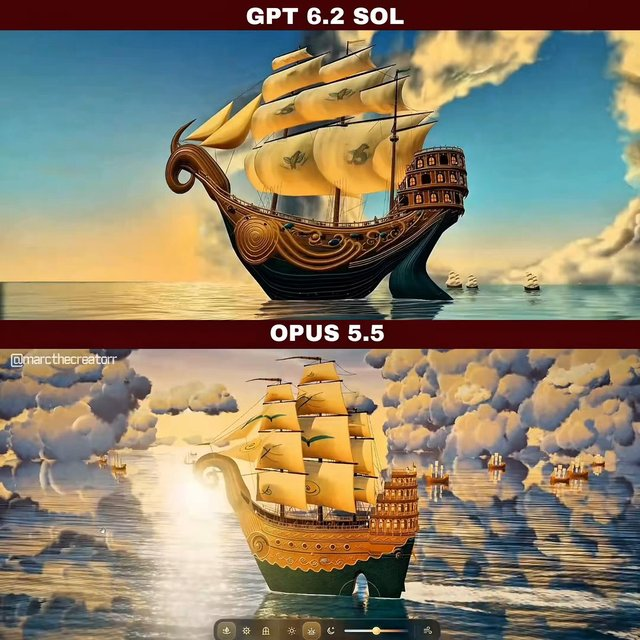</a><br>
<strong><a href="docs/cases/x-marcthecreatorr-gpt62sol-sailing-ship/README.md">GPT-6.2 Sol vs Opus 5.5 — interactive Three.js sailing ship (same prompt)</a></strong><br>
クレジット: @marcthecreatorr（Marcel）<br><a href="https://x.com/marcthecreatorr/status/2119503438405136765">原投稿</a>
</td>
<td align="center" width="33%">
<a href="https://x.com/HarshithLucky3/status/2119418918616150080">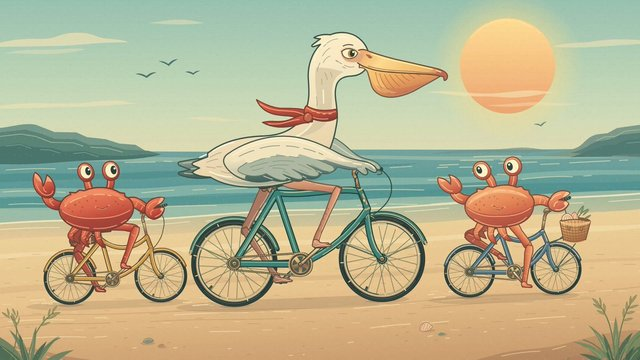</a><br>
<strong><a href="docs/cases/x-harshithlucky3-gpt62sol-pelican-svg-animation/README.md">SVG animation: pelican and 2 crabs riding bicycles (Codex routing)</a></strong><br>
クレジット: @HarshithLucky3（Harshith）<br><a href="https://x.com/HarshithLucky3/status/2119418918616150080">原投稿</a>
</td>
</tr>
</table>

<a id="ver-gpt-6-1-sol"></a>

### GPT-6.1 Sol

<table>
<tr>
<td align="center" width="33%">
<a href="https://jamesgreene.com/models/">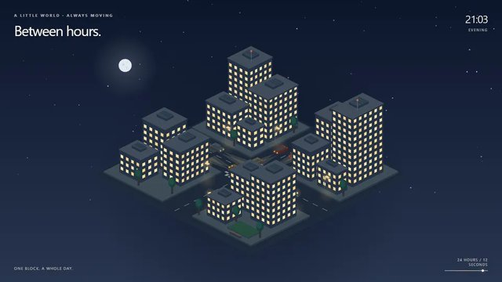</a><br>
<strong><a href="docs/cases/web-jamesgreene-code1-gpt61-sol-isometric-city/README.md">Isometric day/night city HTML loop — GPT-6.1 Sol</a></strong><br>
クレジット: James Greene (model comparison archive)<br><a href="https://jamesgreene.com/models/">原投稿</a>
</td>
</tr>
</table>


<a id="grok"></a>

## Grok

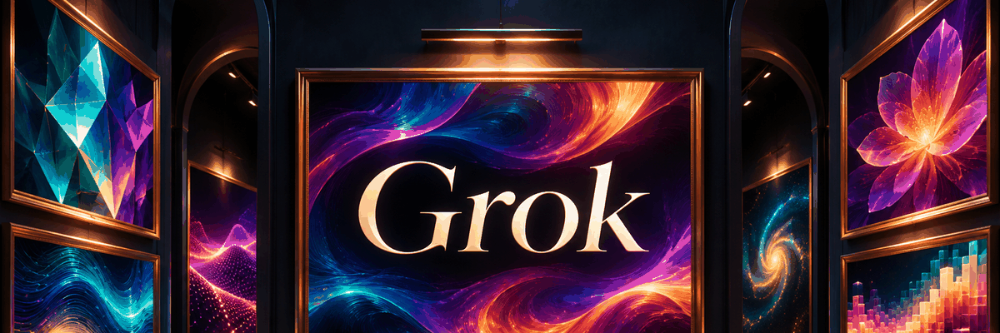

このファミリーの出典付き事例 2 件は、ここにすべてあります。同じ行が下の証拠表にもあります。

<a id="ver-grok-4-7"></a>

### Grok 4.7

<table>
<tr>
<td align="center" width="33%">
<a href="https://jamesgreene.com/models/">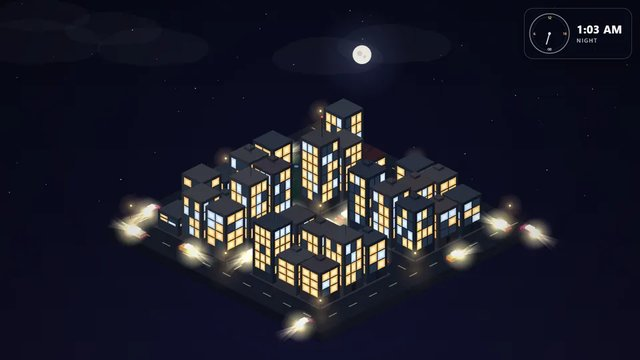</a><br>
<strong><a href="docs/cases/web-jamesgreene-code1-grok47-isometric-city/README.md">Isometric day/night city HTML loop — Grok 4.7</a></strong><br>
クレジット: James Greene (model comparison archive)<br><a href="https://jamesgreene.com/models/">原投稿</a>
</td>
</tr>
</table>

<a id="ver-grok-imagine-video"></a>

### Grok Imagine Video

<table>
<tr>
<td align="center" width="33%">
<a href="https://x.com/RadCyberTruck/status/2120350558431445006"></a><br>
<strong><a href="docs/cases/x-radcybertruck-grok-imagine-cybertruck-cry/README.md">Grok Imagine — pixstar Cybertruck farewell clip (partial prompt)</a></strong><br>
クレジット: @RadCyberTruck<br><a href="https://x.com/RadCyberTruck/status/2120350558431445006">原投稿</a>
</td>
</tr>
</table>


<a id="qwen"></a>

## Qwen

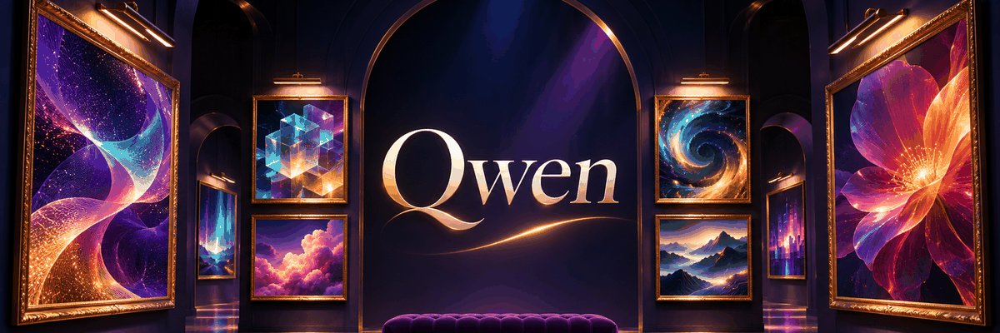

このファミリーの出典付き事例 1 件は、ここにすべてあります。同じ行が下の証拠表にもあります。

<a id="ver-qwen3-8-27b"></a>

### Qwen3.8 27B

<table>
<tr>
<td align="center" width="33%">
<a href="https://jamesgreene.com/models/">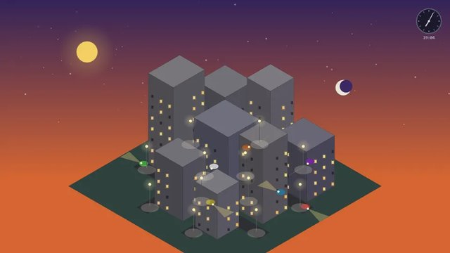</a><br>
<strong><a href="docs/cases/web-jamesgreene-code1-qwen38-27b-isometric-city/README.md">Isometric day/night city HTML loop — Qwen3.8 27B</a></strong><br>
クレジット: James Greene (model comparison archive)<br><a href="https://jamesgreene.com/models/">原投稿</a>
</td>
</tr>
</table>

インベントリには、単独事例のない版も書いてある。原文のまま：

> Qwen 3.8 Flash Next: no separate Flash Next HTML/GIF case verified beyond Qwen3.8 27B jamesgreene run


<a id="deepseek"></a>

## DeepSeek

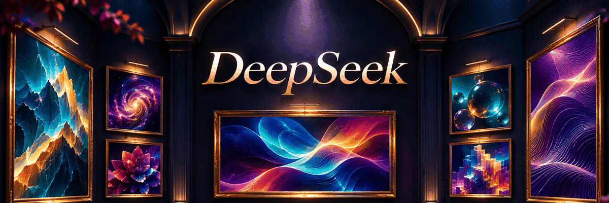

このファミリーの出典付き事例 2 件は、ここにすべてあります。同じ行が下の証拠表にもあります。

<a id="ver-deepseek-v4-1-flash-1017"></a>

### DeepSeek V4.1 Flash 1017

<table>
<tr>
<td align="center" width="33%">
<a href="https://jamesgreene.com/models/">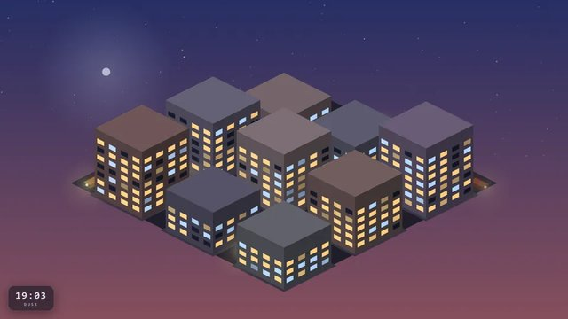</a><br>
<strong><a href="docs/cases/web-jamesgreene-code1-deepseek-v41-flash-1017-isometric-city/README.md">Isometric day/night city HTML loop — DeepSeek V4.1 Flash 1017</a></strong><br>
クレジット: James Greene (model comparison archive)<br><a href="https://jamesgreene.com/models/">原投稿</a>
</td>
</tr>
</table>

<a id="ver-deepseek-v4-1-flash"></a>

### DeepSeek V4.1 Flash

<table>
<tr>
<td align="center" width="33%">
<a href="https://x.com/LatentOperatorX/status/2120205377803518132">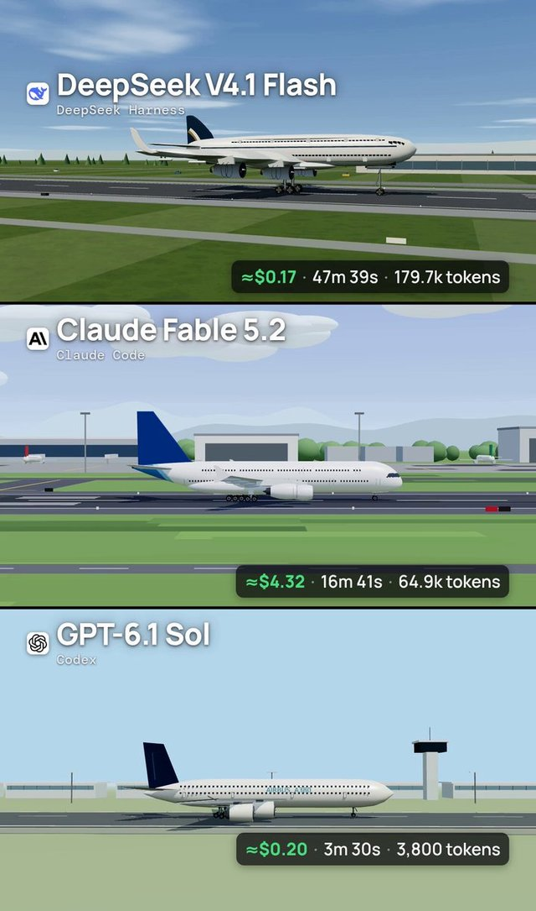</a><br>
<strong><a href="docs/cases/x-latentoperator-a380-deepseek-fable-sol/README.md">Airbus A380 takeoff in Three.js — DeepSeek V4.1 Flash vs Fable 5.2 vs GPT-6.1 So</a></strong><br>
クレジット: @LatentOperatorX<br><a href="https://x.com/LatentOperatorX/status/2120205377803518132">原投稿</a>
</td>
</tr>
</table>


<a id="gpt-image"></a>

## GPT Image


このファミリーの出典付き事例は 51 件。ここでは 3 件。残りは下の証拠表に入っています。

<a id="ver-gpt-image-2-6"></a>

### GPT Image 2.6

いまも主流の前世代。下の 3 枚は、すでにアーカイブしてあるローカルのメディアで、新しく生成したものではない。

<table>
<tr>
<td align="center" width="33%">
<a href="https://image.lightlyn.com/gpt-image-2-6?lang=en"></a><br>
<strong><a href="docs/cases/lightlyn-orange-cat-mascot-gif/README.md">キャラクターのステッカー</a></strong><br>
クレジット: Linger（Lightlyn Images）<br><sub>公開されているマスコット用プロンプト</sub><br>
<a href="docs/cases/lightlyn-orange-cat-mascot-gif/prompt.md">公開プロンプト</a> · <a href="https://image.lightlyn.com/gpt-image-2-6?lang=en">原投稿</a> · <a href="docs/cases/lightlyn-orange-cat-mascot-gif/media/01-gif.gif">GIF</a>
</td>
<td align="center" width="33%">
<a href="https://veevid.ai/blog/gpt-image-2-6-gif"></a><br>
<strong><a href="docs/cases/veevid-perfume-light-sweep-gif/README.md">プロダクトのループ</a></strong><br>
クレジット: Veevid Team<br><sub>固定カメラの光のスイープ</sub><br>
<a href="docs/cases/veevid-perfume-light-sweep-gif/prompt.md">公開プロンプト</a> · <a href="https://veevid.ai/blog/gpt-image-2-6-gif">原投稿</a> · <a href="docs/cases/veevid-perfume-light-sweep-gif/media/01-gif.gif">GIF</a>
</td>
<td align="center" width="33%">
<a href="https://note.com/ravivit_ai/n/nb8f40b5a21b9"></a><br>
<strong><a href="docs/cases/ravivit-paper-boat-gif/README.md">紙のボートのループ</a></strong><br>
クレジット: ラビビット | AI活用メディア（Ravivit）<br><sub>出典の動作説明。逐語の原文は未確認</sub><br>
<a href="docs/cases/ravivit-paper-boat-gif/prompt.md">出典の動作説明</a> · <a href="https://note.com/ravivit_ai/n/nb8f40b5a21b9">原投稿</a> · <a href="docs/cases/ravivit-paper-boat-gif/media/01-gif.gif">GIF</a>
</td>
</tr>
</table>

複数フレームであることだけを確認し、生成の再現はしていない。紙のボートは原文未確認のまま。プレビューは再利用の許可ではない。


<a id="by-type"></a>
## 種類別

<a id="type-gif"></a>
### GIF
この種類は 47 件。サムネイルがあるものから最大 4 件。
<table>
<tr>
<td align="center" width="33%">
<a href="https://developers.openai.com/api/docs/guides/image-prompting"></a><br>
<strong><a href="docs/cases/official-lantern-monkey-gif/README.md">原生循环GIF：提灯小猴抬灯/眨眼/回位，固定机位</a></strong><br>
クレジット: OpenAI<br><a href="https://developers.openai.com/api/docs/guides/image-prompting">原投稿</a>
</td>
<td align="center" width="33%">
<a href="https://www.reddit.com/r/OpenAI/comments/1xoh2u0/i_tried_the_new_image_26_gif_feature/"></a><br>
<strong><a href="docs/cases/reddit-anime-nod-gif/README.md">参考角色图→动漫点头闭眼循环</a></strong><br>
クレジット: 未知（r/OpenAI 帖作者；本轮JSON接口被拦未能取handle）<br><a href="https://www.reddit.com/r/OpenAI/comments/1xoh2u0/i_tried_the_new_image_26_gif_feature/">原投稿</a>
</td>
<td align="center" width="33%">
<a href="https://x.com/Krouxzz/status/2118283796181053637">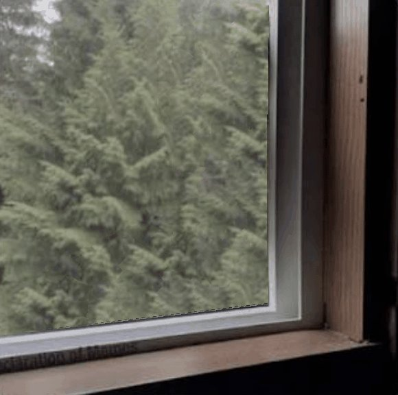</a><br>
<strong><a href="docs/cases/krouxzz-wave-ref/README.md">角色挥手循环</a></strong><br>
クレジット: @Krouxzz<br><a href="https://x.com/Krouxzz/status/2118283796181053637">原投稿</a>
</td>
</tr>
<tr>
<td align="center" width="33%">
<a href="https://image.lightlyn.com/gpt-image-2-6?lang=en">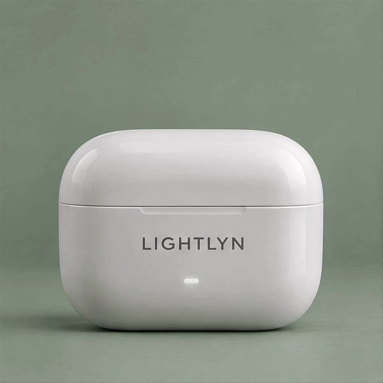</a><br>
<strong><a href="docs/cases/lightlyn-earbuds-case-gif/README.md">商品盒开合：耳机盒开盖→耳机浮起→回位无缝循环</a></strong><br>
クレジット: Linger（Lightlyn Images）<br><a href="https://image.lightlyn.com/gpt-image-2-6?lang=en">原投稿</a>
</td>
</tr>
</table>
[事例インデックス](docs/showcase-index.md#gif)

<a id="type-animation"></a>
### アニメーション
この種類は 7 件。サムネイルがあるものから最大 4 件。
<table>
<tr>
<td align="center" width="33%">
<a href="https://x.com/himanshutwtxs/status/2120017106804900304"></a><br>
<strong><a href="docs/cases/x-himanshutwtxs-fable52-motion-showreel/README.md">One-prompt motion designer showreel (timing, easing, shape, type)</a></strong><br>
クレジット: @himanshutwtxs<br><a href="https://x.com/himanshutwtxs/status/2120017106804900304">原投稿</a>
</td>
<td align="center" width="33%">
<a href="https://x.com/wshuyi/status/2120014892040417720"></a><br>
<strong><a href="docs/cases/x-wshuyi-fable52-sabertooth-hunt/README.md">纯编程动画：剑齿虎捕猎野牛（自编程音效）</a></strong><br>
クレジット: @wshuyi<br><a href="https://x.com/wshuyi/status/2120014892040417720">原投稿</a>
</td>
<td align="center" width="33%">
<a href="https://halilsekeroglu.com/en/fable/">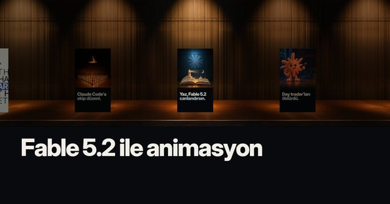</a><br>
<strong><a href="docs/cases/web-halil-fable52-animation-prompts/README.md">Four single-message Fable 5.2 animation prompts (logo / promo / cinematic / 3D)</a></strong><br>
クレジット: Halil Sekeroglu<br><a href="https://halilsekeroglu.com/en/fable/">原投稿</a>
</td>
</tr>
<tr>
<td align="center" width="33%">
<a href="https://ofox.ai/blog/claude-fable-5-2-svg-guide/"></a><br>
<strong><a href="docs/cases/web-ofox-fable52-svg-sailboat/README.md">Editable SVG sailboat illustration with CSS motion (two API calls)</a></strong><br>
クレジット: Ofox<br><a href="https://ofox.ai/blog/claude-fable-5-2-svg-guide/">原投稿</a>
</td>
</tr>
</table>
[事例インデックス](docs/showcase-index.md#animation)

<a id="type-html-3d"></a>
### HTML / 3D
この種類は 19 件。サムネイルがあるものから最大 4 件。
<table>
<tr>
<td align="center" width="33%">
<a href="https://x.com/MengTo/status/2120316203738829180"></a><br>
<strong><a href="docs/cases/x-mengto-fable52-blender-apartment/README.md">Recreate a Three.js apartment in Blender with Fable 5.2</a></strong><br>
クレジット: @MengTo（Meng To）<br><a href="https://x.com/MengTo/status/2120316203738829180">原投稿</a>
</td>
<td align="center" width="33%">
<a href="https://x.com/paleknight/status/2120368418805174639"></a><br>
<strong><a href="docs/cases/x-paleknight-fable52-vs-opus55-ship/README.md">Fable 5.2 vs Opus 5.5 — same prompt Three.js ship (side-by-side)</a></strong><br>
クレジット: @paleknight（Vraj）<br><a href="https://x.com/paleknight/status/2120368418805174639">原投稿</a>
</td>
<td align="center" width="33%">
<a href="https://jamesgreene.com/models/"></a><br>
<strong><a href="docs/cases/web-jamesgreene-code1-opus55-isometric-city/README.md">Isometric day/night city HTML loop — Claude Opus 5.5</a></strong><br>
クレジット: James Greene (model comparison archive)<br><a href="https://jamesgreene.com/models/">原投稿</a>
</td>
</tr>
<tr>
<td align="center" width="33%">
<a href="https://x.com/coodddaaaa/status/2120363353142911078"></a><br>
<strong><a href="docs/cases/x-coodddaaaa-gemini-carbon-pelican-bike/README.md">Gemini Carbon · 鹈鹕骑自行车 HTML 动画测试</a></strong><br>
クレジット: @coodddaaaa（Joe William）<br><a href="https://x.com/coodddaaaa/status/2120363353142911078">原投稿</a>
</td>
</tr>
</table>
[事例インデックス](docs/showcase-index.md#html-3d)

<a id="type-minigame"></a>
### ミニゲーム
この種類は 4 件。サムネイルがあるものから最大 4 件。
<table>
<tr>
<td align="center" width="33%">
<a href="https://x.com/Daft_Trade/status/2118283025498906800">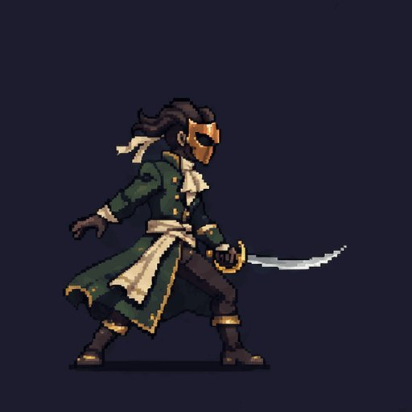</a><br>
<strong><a href="docs/cases/game-daft-pixel-combo/README.md">像素三连击 / 翻滚 / 法术（跳跃事后压背景）</a></strong><br>
クレジット: Daft_Trade @Daft_Trade · 作者声明 2.6；跳跃承认 flatten 去闪烁 · 4 条 MP4=1 案例 · 未观看<br><a href="https://x.com/Daft_Trade/status/2118283025498906800">原投稿</a>
</td>
<td align="center" width="33%">
<a href="https://x.com/maker_evan/status/2118222694345040253">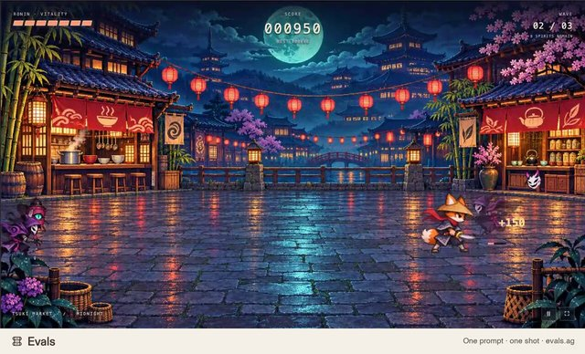</a><br>
<strong><a href="docs/cases/game-maker-evan-fox-ronin/README.md">狐浪人网页游戏：2.6 出表、另一 agent 切帧</a></strong><br>
クレジット: maker_evan @maker_evan · 游戏 agent one-shot 已公开；图像 prompt 未公开 · 未观看 MP4<br><a href="https://x.com/maker_evan/status/2118222694345040253">原投稿</a>
</td>
<td align="center" width="33%">
<a href="https://github.com/vargHQ/skills/blob/main/gpt-image-sprite-sheet/SKILL.md">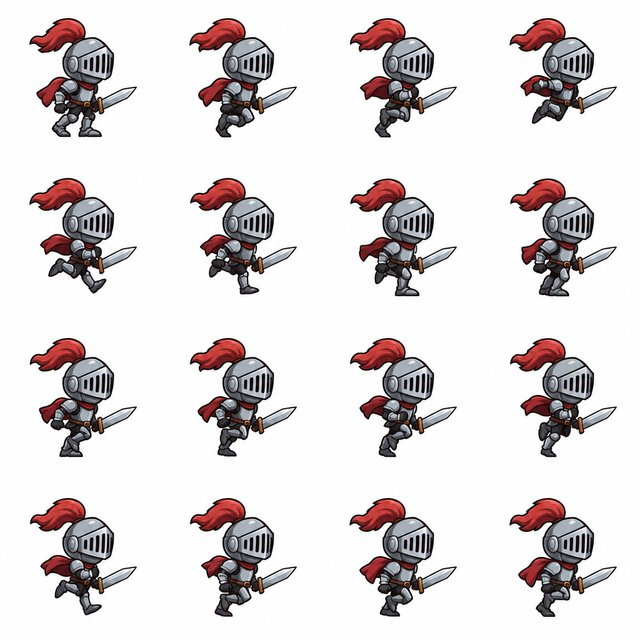</a><br>
<strong><a href="docs/cases/game-varg-knight-run/README.md">骑士跑循环：作者声明 2.6 出表再切帧</a></strong><br>
クレジット: vargHQ gpt-image-sprite-sheet · 作者声明 gpt_image_2_6 · 非 OpenAI 官方验证 · 未复测<br><a href="https://github.com/vargHQ/skills/blob/main/gpt-image-sprite-sheet/SKILL.md">原投稿</a>
</td>
</tr>
<tr>
<td align="center" width="33%">
<a href="https://x.com/xiaomovps/status/2118274032227471705">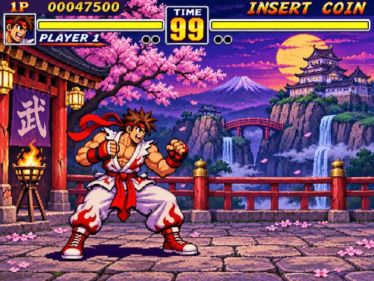</a><br>
<strong><a href="docs/cases/game-xiaomovps-fighter/README.md">复古格斗出拳 / 蓄力循环</a></strong><br>
クレジット: 小墨同学 @xiaomovps · 作者声明 Images 2.6 · X animated_gif→MP4 · 未见引擎内运行<br><a href="https://x.com/xiaomovps/status/2118274032227471705">原投稿</a>
</td>
</tr>
</table>
[事例インデックス](docs/showcase-index.md#minigame)

<a id="type-image"></a>
### 画像
この種類は 0 件。サムネイルがあるものから最大 4 件。
[事例インデックス](docs/showcase-index.md#image)


<a id="collection-sites"></a>
## 事例収集サイト

各モデルの GIF、アニメーション、HTML demo を集めたり比べたりしているサイトです（Showcase collection sites）。リンクを返すだけで、スクレイピングして再ホストしません。説明文は [`playbooks/research/showcase-collection-sites.json`](playbooks/research/showcase-collection-sites.json) に書いてある原文のままです。

**GPT-6.2 Sol**
- [OpenAI Developers Showcase](https://developers.openai.com/showcase) — Official OpenAI community demo gallery (games, 3D scenes, tools); not GPT-6.2-specific, useful Sol/Codex-era context.
- [James Greene · AI model comparison](https://jamesgreene.com/models/) — Same-brief multi-model HTML/animation archive including Sol-family isometric city runs with openable pages.
- [Atelier — the model exhibition](https://marmikshah.github.io/atelier/) — Shared brief × model grid of ten-frame looping sprite animations, including a GPT-6.1 Sol column.
- [AGI Hunt · GPT-6.2 Sol Three.js reports](https://agihunt.info/en/p/1a1bb426b5d29845aa6a62b76dd) — Aggregator card for TokenGremlin’s GPT-6.2 Sol one-shot Three.js black-hole / HTML demos from X.
- [AGI Hunt · GPT-6.2 Sol village HTML report](https://agihunt.info/en/p/1a1bb89900a97844bb6b978dbb4) — Aggregator for user-reported GPT-6.2 Sol single-file Three.js village demos.
- [OmniaKey · GPT-6.2 Sol status notes](https://omniakey.com/blog/gpt-6-2-sol) — Roundup stating OpenAI public catalog still lists GPT-6.1 Sol and summarizing unconfirmed 6.2 routing reports.
- [João Queirós · GPT-6.2 Sol preview evidence review](https://www.ai.joaoqueiros.com/blog/gpt-6-2-sol-preview-worldofai-demos-evidence) — Evidence-focused write-up of World of AI / community demos without treating them as an official 6.2 release.
- [TokenGremlin X — primary greyscale sighting thread](https://x.com/TokenGremlin/status/2119395930805879165) — Widely cited primary X post claiming routing to GPT-6.2 Sol with Three.js HTML proof clips.

**Claude**
- [liang8989/awesome-fable5-2-videos](https://github.com/liang8989/awesome-fable5-2-videos) — Curated Claude Fable 5.2 motion/3D/game videos from X with credits and published prompts when available.
- [DramaSo · Fable 5.2 prompts & videos](https://drama.so/prompts/fable-5-2) — Community gallery of Fable 5.2 code/animation works with creator credits and some verbatim prompts.

**Gemini**
- [James Greene · AI model comparison](https://jamesgreene.com/models/) — Includes Gemini 4 Argon (and other Gemini) HTML animation runs under shared briefs.

**横断**
- [James Greene · AI model comparison](https://jamesgreene.com/models/) — Cross-family same-prompt HTML/SVG/animation leaderboard with downloadable pages and MP4 recordings.


<a id="how-to-use"></a>
## この目録でできること

1. **ファミリーを選び、版を見る。** 上の目次が入口です。
2. **事例を開く。** `docs/cases/<id>/` に作者、原投稿、`prompt.md` があります。中身は公開された原文か、出典が一部だけ示した場合の抜粋か、未公開であることの明示です。ファイルがあることは、全文があることではありません。
3. **作り方を読む。** ネイティブなアニメーション、HTML やゲームの demo、スプライトシート、後処理は別の工程です。再現できるかは、そのモデルを使えるかによります。

閲覧にアカウントも API キーもインストールも要りません。検索が減ったら **Star** を。出典の追加やクレジットの訂正も歓迎です。

<a id="local-setup"></a>
## ローカルで見るには

Python 3 だけで静的ギャラリーを配信できます。閲覧時に画像は生成せず、API も呼びません。

```bash
git clone https://github.com/jammyfu/awesome-ai-model-showcases.git
cd awesome-ai-model-showcases
python3 -m http.server 8000 --directory docs
```

**[http://localhost:8000/?lang=en](http://localhost:8000/?lang=en)** を開きます。`?lang=zh` は簡体字のギャラリーです。ウェブ側に繁体字と日本語の UI はまだなく、その二言語は README です。

<details>
<summary><strong>貢献者向け：構成と検証</strong></summary>

```text
docs/cases/<id>/          元メディアまたは出典メモ、prompt.md、post.md、クレジット
docs/data/                生成された目録とローカルメディア一覧
playbooks/research/       出典インベントリと証拠
playbooks/community-cases.md  証拠インデックス
tools/templates/          README テンプレート：en、zh-CN、zh-TW、ja
tools/                    生成、メディア検査、検証
```

サイトは GitHub Pages 上の HTML、CSS、JavaScript です。Python + Pillow が画像を検査します。`ffprobe` があれば MP4 を見ます。なければローカルでは ISO-BMFF に戻します。CI は ffmpeg を入れます。

```bash
python3 -m pip install -r requirements-dev.txt
python3 tools/write_community_catalog.py
# 生成結果をステージしてから、鮮度チェックを走らせる。
git add README.md README.zh-CN.md README.zh-TW.md README.ja.md playbooks/community-cases.md docs/data/community-cases.json docs/data/cases.js llms.txt docs/llms.txt docs/github-about.json
python3 tools/verify.py
```

直すのは出典インベントリとテンプレートです。生成済みの README や目録は直接編集しません。手順は [CONTRIBUTING.md](CONTRIBUTING.md)。

</details>

<a id="contribute"></a>
## 事例を送るには

**[投稿フォーム](https://github.com/jammyfu/awesome-ai-model-showcases/issues/new?template=case-submission.yml)** を開きます。コードは不要です。作者、出典 URL、メディアのリンク、公開プロンプトまたは「未公開」、モデルと工程の根拠を書いてください。

PR にする場合は [CONTRIBUTING.md](CONTRIBUTING.md) に従います。クレジット、リンク切れ、プロンプトの文言、四言語の README の訂正も役に立ちます。紹介した作者の名前は残します。

<a id="catalog"></a>
## 目録の概数

**収録 77 件。** モデルファミリー、その中で版。新しいファミリーを先に置きます。GPT Image 2.6 は、いまも主流で、ローカルにアーカイブしてある前世代です（X 以外の複数フレーム GIF 20 · ゲームは作者申告 4）。**未確認 12 件**は主表に入れません。

| モデルファミリー | 件数 | 主表の外 | 件数 |
|---|---:|---|---:|
| Claude（Fable 5.2 / Mythos 5.2 / Opus 5.5） | **7** | 未確認 | 12 |
| Gemini（4 Carbon / 4 Argon） | **3** | プロンプトのみ | 1 |
| GPT-6.2 Sol / Astra（コード。公開文書は GPT-6.1 Sol） | **11** | 重複 / 不採用 | 9 |
| Grok（4.7 / Imagine） | **2** | 2.5 / 宣伝 / 複数モデル / 失敗 / Morphic / X 以外の候補 | 50 |
| Qwen（3.8） | **1** | リポジトリの種（ローカル例） | 6 |
| DeepSeek（V4.1 Flash） | **2** | | |
| **GPT Image 2.6**（いまも主流。ローカルアーカイブ） | **51** | | |
| · X の作者申告 2.6 | **25** | | |
| · X 以外の実 GIF | **20** | | |
| · 収録済みの長文 / 単発投稿 | **2** | | |
| · ゲーム · 作者申告 | **4** | | |
| **主表合計** | **77** | | |

件数は [一つの生成目録](docs/data/community-cases.json) から来ます。出典インベントリの最終更新：**2026-11-11**。合計は収録数であり、生成成功の確認数ではありません。**77 件のうち 50 件にローカルのメディアがあります。** [Luffy の記事](docs/cases/luffy-x-article/README.md) はプロンプトを保管していますが、添付は取得できていません。他ファミリーの本体ファイルは、個別の許諾がない限り出典リンクです。`assets/thumbs/` のサムネイルはクレジット付きで原投稿へ戻る小さいコピーです。一覧は [docs/showcase-index.md](docs/showcase-index.md) です。

### 出典と証拠の全表

下のファミリーを開くか、[検索できるウェブ目録](https://jammyfu.github.io/awesome-ai-model-showcases/?lang=en) を使います。タイトルと根拠の引用は出典の言語のままです。同じ行は [独立インデックス](playbooks/community-cases.md) にもあります。

<details>
<summary><strong>Family · GPT Image 2.6 — X の作者申告（25 件、添付ごとに分割しない）</strong></summary>

| # | 作者 | 内容 | 原投稿 | メディア | prompt | モデル根拠 | 作り方 | 検証 | ライセンス |
|---:|---|---|---|---|---|---|---|---|---|
| 1 | @Gorden_Sun（Gorden Sun） | `x-gorden-sun-rice-gif` 参考角色图一句话生成「吃白米饭+真香」中文配字循环 GIF 表情包 | [出典](https://x.com/Gorden_Sun/status/2118166046175908016) | [ケース](docs/cases/x-gorden-sun-rice-gif/README.md) · [ファイル](docs/cases/x-gorden-sun-rice-gif/media/01-poster.jpg) | [短い / 部分](docs/cases/x-gorden-sun-rice-gif/prompt.md) | 作者声明 2.6：GPT新出的GPT Image 2.6，可以一句话生成表情包动 | 作者称直出 GIF · X 附件实际 MP4 | 作者声明 + 媒体元数据已核 · 未观看 · 未复测 | ライセンス不明 |
| 2 | @op7418（歸藏(guizang.ai)） | `x-op7418-fatfish-pack` 大肥鱼角色参考图 + 结构化模板批量出循环 GIF 表情包（主题可填空） | [出典](https://x.com/op7418/status/2118181775688241456) | [ケース](docs/cases/x-op7418-fatfish-pack/README.md) · [ファイル](docs/cases/x-op7418-fatfish-pack/media/01-poster.jpg) | [原文](docs/cases/x-op7418-fatfish-pack/prompt.md) | 作者声明 2.6：GPT-image-2.6 今天发布了，主要的新特性就是能够直 | 作者称直出 GIF · X 附件实际 MP4 | 作者声明 + 媒体元数据已核 · 未观看 · 未复测 | ライセンス不明 |
| 3 | @abc123953468547（A1terE&o） | `x-abc123-static-to-gif` 上传静态表情包原图，一句话做成无限循环 GIF，强调角色一致性（与大肥鱼同模板族，仍单列原帖） | [出典](https://x.com/abc123953468547/status/2118188053793837265) | [ケース](docs/cases/x-abc123-static-to-gif/README.md) · [ファイル](docs/cases/x-abc123-static-to-gif/media/01-poster.jpg) | [原文](docs/cases/x-abc123-static-to-gif/prompt.md) | 作者声明 2.6：刚发布的 GPT-image-2.6 真牛逼！！我只用了一句话 | 作者称直出 GIF · X 附件实际 MP4 | 作者声明 + 媒体元数据已核 · 未观看 · 未复测 | ライセンス不明 |
| 4 | @thinkszyg（爆裂队长NEXT） | `x-thinkszyg-paperboat-verify` 用纸船循环 GIF 验证账号是否已推送 Images 2.6；并附六宫格 sprite sheet 提示词模板（与 Ra | [出典](https://x.com/thinkszyg/status/2118166234495947044) | [ケース](docs/cases/x-thinkszyg-paperboat-verify/README.md) · [ファイル](docs/cases/x-thinkszyg-paperboat-verify/media/01-poster.jpg) | [原文](docs/cases/x-thinkszyg-paperboat-verify/prompt.md) | 作者声明 2.6：ChatGPT 上了 Images 2.6…GIF 是 2.6 | 作者称直出 GIF · X 附件实际 MP4 | 作者声明 + 媒体元数据已核 · 未观看 · 未复测 | ライセンス不明 |
| 5 | @gdb（Greg Brockman） | `x-gdb-images26-gif` OpenAI 联合创始人展示 Images 2.6 GIF 演示 | [出典](https://x.com/gdb/status/2118174986544488876) | [ケース](docs/cases/x-gdb-images26-gif/README.md) · [ファイル](docs/cases/x-gdb-images26-gif/media/01-poster.jpg) | [未公開](docs/cases/x-gdb-images26-gif/prompt.md) | 作者声明 2.6：chatgpt images 2.6 is here! | 作者称直出 GIF · X 附件实际 MP4 | 作者声明 + 媒体元数据已核 · 未观看 · 未复测 | ライセンス不明 |
| 6 | @moltikuji（もる@ポケカ・フロム） | `x-moltikuji-oc-eyebrow` 日文：用 Images 2.6 把自家角色做成 GIF，反馈眉毛一致性问题 | [出典](https://x.com/moltikuji/status/2118187059102027921) | [ケース](docs/cases/x-moltikuji-oc-eyebrow/README.md) · [ファイル](docs/cases/x-moltikuji-oc-eyebrow/media/01-poster.jpg) | [未公開](docs/cases/x-moltikuji-oc-eyebrow/prompt.md) | 作者声明 2.6：昨日出たChatGPT Images 2.6（GPT Imag | 作者称直出 GIF · X 附件实际 MP4 | 作者声明 + 媒体元数据已核 · 未观看 · 未复测 | ライセンス不明 |
| 7 | @heycesr（cesar.wtf） | `x-heycesr-photo-animate` 真实照片（左）→ GPT Image 2.6 动画化（右），经 @tryidem 调用 | [出典](https://x.com/heycesr/status/2118391412639371290) | [ケース](docs/cases/x-heycesr-photo-animate/README.md) · [ファイル](docs/cases/x-heycesr-photo-animate/media/01-poster.jpg) | [未公開](docs/cases/x-heycesr-photo-animate/prompt.md) | 作者声明 2.6：i've been testing the new gpt i | 作者称直出 GIF · X 附件实际 MP4 | 作者声明 + 媒体元数据已核 · 未观看 · 未复测 | ライセンス不明 |
| 8 | @kqyno7（Kai） | `x-kqyno7-frieren` 用芙莉莲角色试原生 GIF，作者称表情动作自然 | [出典](https://x.com/kqyno7/status/2118160063835815981) | [ケース](docs/cases/x-kqyno7-frieren/README.md) · [ファイル](docs/cases/x-kqyno7-frieren/media/01-poster.jpg) | [未公開](docs/cases/x-kqyno7-frieren/prompt.md) | 作者声明 2.6：GPT Image 2.6 上线，支持 GIF 生成…刚拿芙莉 | 作者称直出 GIF · X 附件实际 MP4 | 作者声明 + 媒体元数据已核 · 未观看 · 未复测 | ライセンス不明 |
| 9 | @Adam38363368936（Adam也叫吉米） | `x-adam-7plays-thread` 七玩法串：真人动态表情、物理科普、产品展示、操作教程、天文动画、商业图表、打工人情绪包；每条附结果 GIF | [出典](https://x.com/Adam38363368936/status/2118269020369817856) | [ケース](docs/cases/x-adam-7plays-thread/README.md) · [ファイル](docs/cases/x-adam-7plays-thread/media/01-poster.jpg) | [未公開](docs/cases/x-adam-7plays-thread/prompt.md) | 作者声明 2.6：全网最全！GPT Image 2.6 的 GIF 功能实用玩法 | 作者称直出 GIF · X 附件实际 MP4 | 作者声明 + 媒体元数据已核 · 未观看 · 未复测 | ライセンス不明 |
| 10 | @zone__online（SleepyZone） | `x-zone-nonsticker-plays` 非表情包向：舞蹈拆解、历史科普、像素动作、角色变身 | [出典](https://x.com/zone__online/status/2118264293678608774) | [ケース](docs/cases/x-zone-nonsticker-plays/README.md) · [ファイル](docs/cases/x-zone-nonsticker-plays/media/01-dynamic.mp4) | [未公開](docs/cases/x-zone-nonsticker-plays/prompt.md) | 作者声明 2.6：GPT Image 2.6已经支持生成动图啦…挖到了不一样的玩 | 作者称直出 GIF · X 附件实际 MP4 | 作者声明 + 媒体元数据已核 · 未观看 · 未复测 | ライセンス不明 |
| 11 | @meow2149（meow） | `x-meow2149-ai-girl-stickers` AI 娘四连循环表情包 GIF | [出典](https://x.com/meow2149/status/2118254460187373747) | [ケース](docs/cases/x-meow2149-ai-girl-stickers/README.md) · [ファイル](docs/cases/x-meow2149-ai-girl-stickers/media/01-poster.jpg) | [未公開](docs/cases/x-meow2149-ai-girl-stickers/prompt.md) | 作者声明 2.6：GPT Image 2.6 这次真的有点东西！以后做 AI 娘 | 作者称直出 GIF · X 附件实际 MP4 | 作者声明 + 媒体元数据已核 · 未观看 · 未复测 | ライセンス不明 |
| 12 | @vm3jp6u04（許文彥） | `x-vm3jp6u04-schnauzer` 雪纳瑞狗 GIF + Images 2.6 四步用法说明 | [出典](https://x.com/vm3jp6u04/status/2118390692347363396) | [ケース](docs/cases/x-vm3jp6u04-schnauzer/README.md) · [ファイル](docs/cases/x-vm3jp6u04-schnauzer/media/01-poster.jpg) | [未公開](docs/cases/x-vm3jp6u04-schnauzer/prompt.md) | 作者声明 2.6：ChatGPT can now make animated G | 作者称直出 GIF · X 附件实际 MP4 | 作者声明 + 媒体元数据已核 · 未观看 · 未复测 | ライセンス不明 |
| 13 | @SeaArt_Ai（SeaArt.Ai🐋） | `x-seaart-doodle-gif` 涂鸦草图 → 循环 GIF；宣称可用提示词控制时长 | [出典](https://x.com/SeaArt_Ai/status/2118267088284659733) | [ケース](docs/cases/x-seaart-doodle-gif/README.md) · [ファイル](docs/cases/x-seaart-doodle-gif/media/01-poster.jpg) | [未公開](docs/cases/x-seaart-doodle-gif/prompt.md) | 作者声明 2.6：GPT Image 2.6 turned this doodl | 作者称直出 GIF · X 附件实际 MP4 | 作者声明 + 媒体元数据已核 · 未观看 · 未复测 | ライセンス不明 |
| 14 | @xulijian1994（Kxians） | `x-xulijian-avatar-stickers` X 头像 → Q 版动态表情包两则 | [出典](https://x.com/xulijian1994/status/2118193018167828815) | [ケース](docs/cases/x-xulijian-avatar-stickers/README.md) · [ファイル](docs/cases/x-xulijian-avatar-stickers/media/01-poster.jpg) | [未公開](docs/cases/x-xulijian-avatar-stickers/prompt.md) | 作者声明 2.6：GPT-Image-2.6 现在可以直接生成 GIF 动图了… | 作者称直出 GIF · X 附件实际 MP4 | 作者声明 + 媒体元数据已核 · 未观看 · 未复测 | ライセンス不明 |
| 15 | @plasm0（ρŁ𝐀𝔰Ｍʘ） | `x-plasm0-animated-gif` 简短标注「GPT Image 2.6 animated GIF」+ 引用官方帖 | [出典](https://x.com/plasm0/status/2118177268870562241) | [ケース](docs/cases/x-plasm0-animated-gif/README.md) · [ファイル](docs/cases/x-plasm0-animated-gif/media/01-poster.jpg) | [未公開](docs/cases/x-plasm0-animated-gif/prompt.md) | 作者声明 2.6：GPT Image 2.6 animated GIF | 作者称直出 GIF · X 附件实际 MP4 | 作者声明 + 媒体元数据已核 · 未观看 · 未复测 | ライセンス不明 |
| 16 | @NewsAsArt（News As Cartoon） | `x-newsasart-claim-gif` 新闻卡风格帖，作者声称附件 GIF 由 Image 2.6 制作 | [出典](https://x.com/NewsAsArt/status/2118236954383028693) | [ケース](docs/cases/x-newsasart-claim-gif/README.md) · [ファイル](docs/cases/x-newsasart-claim-gif/media/01-poster.jpg) | [未公開](docs/cases/x-newsasart-claim-gif/prompt.md) | 作者声明 2.6：And the gif attached is of cour | 作者称直出 GIF · X 附件实际 MP4 | 作者声明 + 媒体元数据已核 · 未观看 · 未复测 | ライセンス不明 |
| 17 | @MiraMusic_AI（MiraMusic） | `x-miramusic-stretch` 日文：从零提示词生成「拉伸」循环 GIF，附风格约束 | [出典](https://x.com/MiraMusic_AI/status/2118168013618987298) | [ケース](docs/cases/x-miramusic-stretch/README.md) · [ファイル](docs/cases/x-miramusic-stretch/media/01-poster.jpg) | [原文](docs/cases/x-miramusic-stretch/prompt.md) | 作者声明 2.6：GPTimage2.6 进化してるー！あと生成スピードが速い！ | 作者称直出 GIF · X 附件实际 MP4 | 作者声明 + 媒体元数据已核 · 未观看 · 未复测 | ライセンス不明 |
| 18 | @okan_aitool（あゆ｜キャラパレ運営） | `x-okan-aitool-wave-laugh` 日文：一图+超短提示词「このキャラをGIFで動かして。手を振って笑う」（与 Krouxzz 挥手同类动作，不合并删帖） | [出典](https://x.com/okan_aitool/status/2118201578406772887) | [ケース](docs/cases/x-okan-aitool-wave-laugh/README.md) · [ファイル](docs/cases/x-okan-aitool-wave-laugh/media/01-poster.jpg) | [短い / 部分](docs/cases/x-okan-aitool-wave-laugh/prompt.md) | 作者声明 2.6：＼ChatGPTのImage 2.6アプデ！！／ …プロンプト | 作者称直出 GIF · X 附件实际 MP4 | 作者声明 + 媒体元数据已核 · 未观看 · 未复测 | ライセンス不明 |
| 19 | @mirai_ai2050（藍澤 ミライ） | `x-mirai-ai2050-frame-test` 日文：同角色测 16/32 帧与尺寸；完整规格化 prompt 在评论 | [出典](https://x.com/mirai_ai2050/status/2118213713761292432) | [ケース](docs/cases/x-mirai-ai2050-frame-test/README.md) · [ファイル](docs/cases/x-mirai-ai2050-frame-test/media/02-poster.jpg) | [原文](docs/cases/x-mirai-ai2050-frame-test/prompt.md) | 作者声明 2.6：今日から使えるようになったGPT Image 2.6でGIFを | 作者称直出 GIF · X 附件实际 MP4 | 作者声明 + 媒体元数据已核 · 未观看 · 未复测 | ライセンス不明 |
| 20 | @nonieengel（Leonie Engel） | `x-nonieengel-reaction-set` 英文：角色照+风格参考 → 一套 10 个 reaction GIF；prompt 在回复（正文截断） | [出典](https://x.com/nonieengel/status/2118382251226562570) | [ケース](docs/cases/x-nonieengel-reaction-set/README.md) · [ファイル](docs/cases/x-nonieengel-reaction-set/media/01-poster.jpg) | [原文](docs/cases/x-nonieengel-reaction-set/prompt.md) | 作者声明 2.6：You can just upload one charact | 作者称直出 GIF · X 附件实际 MP4 | 作者声明 + 媒体元数据已核 · 未观看 · 未复测 | ライセンス不明 |
| 21 | @IHayato（イケハヤ） | `x-ihayato-markup-gif` 日文高互动：标记编辑演示 + 角色「まばたきして、ふわっと揺れて」GIF（markup + GIF；与 mirai 规格 | [出典](https://x.com/IHayato/status/2118151619212890291) | [ケース](docs/cases/x-ihayato-markup-gif/README.md) · [ファイル](docs/cases/x-ihayato-markup-gif/media/01-poster.jpg) | [短い / 部分](docs/cases/x-ihayato-markup-gif/prompt.md) | 作者声明 2.6：GPT Image 2.6が出たので、さっそく試してみました。 | 作者称直出 GIF · X 附件实际 MP4 | 作者声明 + 媒体元数据已核 · 未观看 · 未复测 | ライセンス不明 |
| 22 | @dokken92047824（HeartlessCat） | `x-dokken-guitar` 日文：附图+超短「アコギを弾く男性」出吉他手 GIF | [出典](https://x.com/dokken92047824/status/2118293666456559762) | [ケース](docs/cases/x-dokken-guitar/README.md) · [ファイル](docs/cases/x-dokken-guitar/media/01-poster.jpg) | [短い / 部分](docs/cases/x-dokken-guitar/prompt.md) | 作者声明 2.6：Open AIが…GPT Images 2.6を発表し、GIF | 作者称直出 GIF · X 附件实际 MP4 | 作者声明 + 媒体元数据已核 · 未观看 · 未复测 | ライセンス不明 |
| 23 | @supertask_jp（Tasuku Takahashi） | `x-supertask-arch-timelapse` 日文：建筑效果图 → 日没时光流逝 GIF | [出典](https://x.com/supertask_jp/status/2118241124133532077) | [ケース](docs/cases/x-supertask-arch-timelapse/README.md) · [ファイル](docs/cases/x-supertask-arch-timelapse/media/01-poster.jpg) | [短い / 部分](docs/cases/x-supertask-arch-timelapse/prompt.md) | 作者声明 2.6：GPT Image 2.6で建築パースの日没タイムラプスを作っ | 作者称直出 GIF · X 附件实际 MP4 | 作者声明 + 媒体元数据已核 · 未观看 · 未复测 | ライセンス不明 |
| 24 | @xepher113（ふぁーねりあん） | `x-xepher113-oc12` 日文 OC：称约 12 帧，借用他人角色图 | [出典](https://x.com/xepher113/status/2118177063727411603) | [ケース](docs/cases/x-xepher113-oc12/README.md) · [ファイル](docs/cases/x-xepher113-oc12/media/01-poster.jpg) | [未公開](docs/cases/x-xepher113-oc12/prompt.md) | 作者声明 2.6：チャッピーのgif生成試してみた これは12コマくらい？ | 作者称直出 GIF · X 附件实际 MP4 | 作者声明 + 媒体元数据已核 · 未观看 · 未复测 | ライセンス不明 |
| 25 | @yulikay（Yuli Kay） | `x-yulikay-toast` 「GPT Images 2.6 is here + GIFs」附 animated_gif | [出典](https://x.com/yulikay/status/2118322092709994503) | [ケース](docs/cases/x-yulikay-toast/README.md) · [ファイル](docs/cases/x-yulikay-toast/media/01-poster.jpg) | [未公開](docs/cases/x-yulikay-toast/prompt.md) | 作者声明 2.6：GPT Images 2.6 is here 🥂 + GIFs | 作者称直出 GIF · X 附件实际 MP4 | 作者声明 + 媒体元数据已核 · 未观看 · 未复测 | ライセンス不明 |

</details>

<details>
<summary><strong>Family · GPT Image 2.6 — X 以外の実 GIF（20）</strong></summary>

| # | 作者 | 内容 | 原投稿 | メディア | prompt | モデル根拠 | 作り方 | 検証 | ライセンス |
|---:|---|---|---|---|---|---|---|---|---|
| 1 | OpenAI | `official-lantern-monkey-gif` 原生循环GIF：提灯小猴抬灯/眨眼/回位，固定机位 | [出典](https://developers.openai.com/api/docs/guides/image-prompting) | [ケース](docs/cases/official-lantern-monkey-gif/README.md) · [ファイル](docs/cases/official-lantern-monkey-gif/media/01-gif.gif) | [原文](docs/cases/official-lantern-monkey-gif/prompt.md) | GPT Image 2.6 Sunburst（gpt-image-2.6-sun | 原生 GIF 直链（Pillow 多帧已核） | 页面模型依据 + GIF 多帧探测 · 未复测生成 | ライセンス不明 |
| 2 | Linger（Lightlyn Images） | `lightlyn-orange-cat-mascot-gif` 品牌吉祥物挥手+眨眼无缝循环GIF | [出典](https://image.lightlyn.com/gpt-image-2-6?lang=en) | [ケース](docs/cases/lightlyn-orange-cat-mascot-gif/README.md) · [ファイル](docs/cases/lightlyn-orange-cat-mascot-gif/media/01-gif.gif) | [原文](docs/cases/lightlyn-orange-cat-mascot-gif/prompt.md) | GPT Image 2.6 Flare（页面写 2.6 Flare · 20.9 | 原生 GIF 直链（Pillow 多帧已核） | 页面模型依据 + GIF 多帧探测 · 未复测生成 | ライセンス不明 |
| 3 | Linger（Lightlyn Images） | `lightlyn-earbuds-case-gif` 商品盒开合：耳机盒开盖→耳机浮起→回位无缝循环 | [出典](https://image.lightlyn.com/gpt-image-2-6?lang=en) | [ケース](docs/cases/lightlyn-earbuds-case-gif/README.md) · [ファイル](docs/cases/lightlyn-earbuds-case-gif/media/01-gif.gif) | [原文](docs/cases/lightlyn-earbuds-case-gif/prompt.md) | GPT Image 2.6 Sunburst（2.6 Sunburst · 38 | 原生 GIF 直链（Pillow 多帧已核） | 页面模型依据 + GIF 多帧探测 · 未复测生成 | ライセンス不明 |
| 4 | Linger（Lightlyn Images） | `lightlyn-photo-steam-gif` 实拍图只动蒸汽与光，杯/桌/窗锁死 | [出典](https://image.lightlyn.com/gpt-image-2-6?lang=en) | [ケース](docs/cases/lightlyn-photo-steam-gif/README.md) · [ファイル](docs/cases/lightlyn-photo-steam-gif/media/01-gif.gif) | [原文](docs/cases/lightlyn-photo-steam-gif/prompt.md) | GPT Image 2.6 Flare（with photo uploaded） | 原生 GIF 直链（Pillow 多帧已核） | 页面模型依据 + GIF 多帧探测 · 未复测生成 | ライセンス不明 |
| 5 | Veevid Team | `veevid-perfume-light-sweep-gif` 产品流光：香水瓶固定，光带扫过+尘粒上浮 | [出典](https://veevid.ai/blog/gpt-image-2-6-gif) | [ケース](docs/cases/veevid-perfume-light-sweep-gif/README.md) · [ファイル](docs/cases/veevid-perfume-light-sweep-gif/media/01-gif.gif) | [原文](docs/cases/veevid-perfume-light-sweep-gif/prompt.md) | GPT Image 2.6 Flare（文称自跑 Flare） | 原生 GIF 直链（Pillow 多帧已核） | 页面模型依据 + GIF 多帧探测 · 未复测生成 | ライセンス不明 |
| 6 | Veevid Team | `veevid-cactus-mascot-gif` 精灵表结构提示词→仙人掌吉祥物挥手循环（9帧） | [出典](https://veevid.ai/blog/gpt-image-2-6-gif) | [ケース](docs/cases/veevid-cactus-mascot-gif/README.md) · [ファイル](docs/cases/veevid-cactus-mascot-gif/media/01-gif.gif) | [原文](docs/cases/veevid-cactus-mascot-gif/prompt.md) | GPT Image 2.6 Flare | 原生 GIF 直链（Pillow 多帧已核） | 页面模型依据 + GIF 多帧探测 · 未复测生成 | ライセンス不明 |
| 7 | Veevid Team | `veevid-fox-mascot-gif` 贴纸风狐狸吉祥物挥手眨眼 | [出典](https://veevid.ai/blog/gpt-image-2-6-gif) | [ケース](docs/cases/veevid-fox-mascot-gif/README.md) · [ファイル](docs/cases/veevid-fox-mascot-gif/media/01-gif.gif) | [原文](docs/cases/veevid-fox-mascot-gif/prompt.md) | GPT Image 2.6（页面示例，Veevid上跑2.6 GIF输出） | 原生 GIF 直链（Pillow 多帧已核） | 页面模型依据 + GIF 多帧探测 · 未复测生成 | ライセンス不明 |
| 8 | Veevid Team | `veevid-coffee-steam-gif` 咖啡杯蒸汽上升循环（文生GIF） | [出典](https://veevid.ai/blog/gpt-image-2-6-gif) | [ケース](docs/cases/veevid-coffee-steam-gif/README.md) · [ファイル](docs/cases/veevid-coffee-steam-gif/media/01-gif.gif) | [原文](docs/cases/veevid-coffee-steam-gif/prompt.md) | GPT Image 2.6（Veevid示例） | 原生 GIF 直链（Pillow 多帧已核） | 页面模型依据 + GIF 多帧探测 · 未复测生成 | ライセンス不明 |
| 9 | Veevid Team | `veevid-dog-photo-wag-gif` 上传实拍狗→摇尾眨眼温和循环 | [出典](https://veevid.ai/blog/gpt-image-2-6-gif) | [ケース](docs/cases/veevid-dog-photo-wag-gif/README.md) · [ファイル](docs/cases/veevid-dog-photo-wag-gif/media/01-gif.gif) | [原文](docs/cases/veevid-dog-photo-wag-gif/prompt.md) | GPT Image 2.6 image-to-GIF | 原生 GIF 直链（Pillow 多帧已核） | 页面模型依据 + GIF 多帧探测 · 未复测生成 | ライセンス不明 |
| 10 | Veevid Team | `veevid-robot-sketch-gif` 线稿变挥手机器人，保留墨线纸感 | [出典](https://veevid.ai/blog/gpt-image-2-6-gif) | [ケース](docs/cases/veevid-robot-sketch-gif/README.md) · [ファイル](docs/cases/veevid-robot-sketch-gif/media/01-gif.gif) | [原文](docs/cases/veevid-robot-sketch-gif/prompt.md) | GPT Image 2.6（文承认线稿本身也用2.6生成作替身） | 原生 GIF 直链（Pillow 多帧已核） | 页面模型依据 + GIF 多帧探测 · 未复测生成 | ライセンス不明 |
| 11 | ラビビット / AI活用メディア（Ravivit） | `ravivit-paper-boat-gif` API原生GIF：白纸船水面轻摇，固定机位；16帧×120ms | [出典](https://note.com/ravivit_ai/n/nb8f40b5a21b9) | [ケース](docs/cases/ravivit-paper-boat-gif/README.md) · [ファイル](docs/cases/ravivit-paper-boat-gif/media/01-gif.gif) | [原文](docs/cases/ravivit-paper-boat-gif/prompt.md) | Images 2.6 / GPT Image 2.6（API生成，文内写明） | 原生 GIF 直链（Pillow 多帧已核） | 页面模型依据 + GIF 多帧探测 · 未复测生成 | ライセンス不明 |
| 12 | 未知（r/OpenAI 帖作者；本轮JSON接口被拦未能取handle） | `reddit-anime-nod-gif` 参考角色图→动漫点头闭眼循环 | [出典](https://www.reddit.com/r/OpenAI/comments/1xoh2u0/i_tried_the_new_image_26_gif_feature/) | [ケース](docs/cases/reddit-anime-nod-gif/README.md) · [ファイル](docs/cases/reddit-anime-nod-gif/media/01-gif.gif) | [原文](docs/cases/reddit-anime-nod-gif/prompt.md) | Image 2.6 GIF feature（帖标题与正文自称） | 原生 GIF 直链（Pillow 多帧已核） | 页面模型依据 + GIF 多帧探测 · 未复测生成 | ライセンス不明 |
| 13 | ailingqu / awesome-ai-gif-prompts | `ailingqu-jelly-bear-wobble` Jelly bear wobble / Q 弹果冻熊摇晃 | [出典](https://github.com/ailingqu/awesome-ai-gif-prompts/blob/a20f88b18a9abe8cd1531fb8a8e738a5a4701ce2/gifs/jelly-bear-wobble.gif) | [ケース](docs/cases/ailingqu-jelly-bear-wobble/README.md) · [ファイル](docs/cases/ailingqu-jelly-bear-wobble/media/01-gif.gif) | [原文](docs/cases/ailingqu-jelly-bear-wobble/prompt.md) | Author reports GPT Image 2.6; not authen | Published GIF; provider not recorded | GIF hashes/frames checked; frame she | CC BY 4.0 |
| 14 | ailingqu / awesome-ai-gif-prompts | `ailingqu-flower-macro-flash` Flower macro flash cut / 花卉微距快闪 | [出典](https://github.com/ailingqu/awesome-ai-gif-prompts/blob/a20f88b18a9abe8cd1531fb8a8e738a5a4701ce2/gifs/flower-macro-flash.gif) | [ケース](docs/cases/ailingqu-flower-macro-flash/README.md) · [ファイル](docs/cases/ailingqu-flower-macro-flash/media/01-gif.gif) | [原文](docs/cases/ailingqu-flower-macro-flash/prompt.md) | Author reports GPT Image 2.6; not authen | Published GIF; provider not recorded | GIF hashes/frames checked; frame she | CC BY 4.0 |
| 15 | ailingqu / awesome-ai-gif-prompts | `ailingqu-cat-brand-reel` Cat-head logo brand reel / 猫头 Logo 品牌快闪 | [出典](https://github.com/ailingqu/awesome-ai-gif-prompts/blob/a20f88b18a9abe8cd1531fb8a8e738a5a4701ce2/gifs/cat-brand-reel.gif) | [ケース](docs/cases/ailingqu-cat-brand-reel/README.md) · [ファイル](docs/cases/ailingqu-cat-brand-reel/media/01-gif.gif) | [原文](docs/cases/ailingqu-cat-brand-reel/prompt.md) | Author reports GPT Image 2.6; not authen | Published GIF; provider not recorded | GIF hashes/frames checked; frame she | CC BY 4.0 |
| 16 | ailingqu / awesome-ai-gif-prompts | `ailingqu-window-day-to-night` Reading by the window, day to night / 窗边读书·白天到夜晚 | [出典](https://github.com/ailingqu/awesome-ai-gif-prompts/blob/a20f88b18a9abe8cd1531fb8a8e738a5a4701ce2/gifs/window-day-to-night.gif) | [ケース](docs/cases/ailingqu-window-day-to-night/README.md) · [ファイル](docs/cases/ailingqu-window-day-to-night/media/01-gif.gif) | [原文](docs/cases/ailingqu-window-day-to-night/prompt.md) | Author reports GPT Image 2.6; not authen | Published GIF; provider not recorded | GIF hashes/frames checked; frame she | CC BY 4.0 |
| 17 | ailingqu / awesome-ai-gif-prompts | `ailingqu-glass-butterfly` Glass butterfly with shifting shadows / 玻璃蝴蝶与投影 | [出典](https://github.com/ailingqu/awesome-ai-gif-prompts/blob/a20f88b18a9abe8cd1531fb8a8e738a5a4701ce2/gifs/glass-butterfly.gif) | [ケース](docs/cases/ailingqu-glass-butterfly/README.md) · [ファイル](docs/cases/ailingqu-glass-butterfly/media/01-gif.gif) | [原文](docs/cases/ailingqu-glass-butterfly/prompt.md) | Author reports GPT Image 2.6; not authen | Source records via=chatgpt-image-2.c | GIF hashes/frames checked; frame she | CC BY 4.0 |
| 18 | ailingqu / awesome-ai-gif-prompts | `ailingqu-ink-wash-horse` Ink-wash galloping horse / 水墨奔马 | [出典](https://github.com/ailingqu/awesome-ai-gif-prompts/blob/a20f88b18a9abe8cd1531fb8a8e738a5a4701ce2/gifs/ink-wash-horse.gif) | [ケース](docs/cases/ailingqu-ink-wash-horse/README.md) · [ファイル](docs/cases/ailingqu-ink-wash-horse/media/01-gif.gif) | [原文](docs/cases/ailingqu-ink-wash-horse/prompt.md) | Author reports GPT Image 2.6; not authen | Source records via=chatgpt-image-2.c | GIF hashes/frames checked; frame she | CC BY 4.0 |
| 19 | ailingqu / awesome-ai-gif-prompts | `ailingqu-pixel-slime-boss` 8-bit slime boss battle / 8-bit 史莱姆 Boss 战 | [出典](https://github.com/ailingqu/awesome-ai-gif-prompts/blob/a20f88b18a9abe8cd1531fb8a8e738a5a4701ce2/gifs/pixel-slime-boss.gif) | [ケース](docs/cases/ailingqu-pixel-slime-boss/README.md) · [ファイル](docs/cases/ailingqu-pixel-slime-boss/media/01-gif.gif) | [原文](docs/cases/ailingqu-pixel-slime-boss/prompt.md) | Author reports GPT Image 2.6; not authen | Source records via=chatgpt-image-2.c | GIF hashes/frames checked; frame she | CC BY 4.0 |
| 20 | ailingqu / awesome-ai-gif-prompts | `ailingqu-ai-typing-indicator` AI assistant typing indicator / AI 助手正在输入 | [出典](https://github.com/ailingqu/awesome-ai-gif-prompts/blob/a20f88b18a9abe8cd1531fb8a8e738a5a4701ce2/gifs/ai-typing-indicator.gif) | [ケース](docs/cases/ailingqu-ai-typing-indicator/README.md) · [ファイル](docs/cases/ailingqu-ai-typing-indicator/media/01-gif.gif) | [原文](docs/cases/ailingqu-ai-typing-indicator/prompt.md) | Author reports GPT Image 2.6; not authen | Source records via=chatgpt-image-2.c | GIF hashes/frames checked; frame she | CC BY 4.0 |

</details>

<details>
<summary><strong>Family · GPT Image 2.6 — すでに収録済みの長文 / 単発投稿（2）</strong></summary>

| # | 作者 | 内容 | 原投稿 | メディア | prompt | モデル根拠 | 作り方 | 検証 | ライセンス |
|---:|---|---|---|---|---|---|---|---|---|
| 1 | @Krouxzz | `krouxzz-wave-ref` 角色挥手循环 | [出典](https://x.com/Krouxzz/status/2118283796181053637) | [ケース](docs/cases/krouxzz-wave-ref/README.md) · [ファイル](docs/cases/krouxzz-wave-ref/media/03-poster-live.jpg) | [原文](docs/cases/krouxzz-wave-ref/prompt.md) | 作者声明 2.6 | 作者称 looping GIF · X 附件实际 MP4（已本地归档） | 已在库 · 作者声明 · 未观看附件 | ライセンス不明 |
| 2 | @0xluffy_eth | `luffy-x-article` 路飞 X Article：榨干 Image 2.6 的 10 个神级玩法（多玩法一组） | [出典](https://x.com/i/article/2118269816821919744) | [ケース](docs/cases/luffy-x-article/README.md) | [原文](docs/cases/luffy-x-article/prompt.md) | 作者声明 2.6 | 社区长文；原文提示词已本地全文归档；库存无附件 URL，文章接口尝试未取 | 已在库 · 提示词逐字 · 库存无附件 URL · 接口未取得 · 不能 | ライセンス不明 |

</details>

<details>
<summary><strong>Family · GPT Image 2.6 — ゲーム動作シーケンス · 作者申告（4、公式検証ではない）</strong></summary>

| # | 作者 | 内容 | 原投稿 | メディア | prompt | モデル根拠 | 作り方 | 検証 | ライセンス |
|---:|---|---|---|---|---|---|---|---|---|
| 1 | Daft_Trade @Daft_Trade · 作者声明 2.6；跳跃承认 flatten 去闪烁 · 4 条 MP4=1 案例 · 未观看 | `game-daft-pixel-combo` 像素三连击 / 翻滚 / 法术（跳跃事后压背景） | [出典](https://x.com/Daft_Trade/status/2118283025498906800) | [ケース](docs/cases/game-daft-pixel-combo/README.md) · [ファイル](docs/cases/game-daft-pixel-combo/media/01-dynamic.mp4) | [未公開](docs/cases/game-daft-pixel-combo/prompt.md) | 作者声明 GPT Image 2.6（非官方验证；跳跃有事后修帧；本仓未观看） | native_gif_direct_claimed | 作者声明 2.6 · 非官方验证 · 未观看 | ライセンス不明 |
| 2 | maker_evan @maker_evan · 游戏 agent one-shot 已公开；图像 prompt 未公开 · 未观看 MP4 | `game-maker-evan-fox-ronin` 狐浪人网页游戏：2.6 出表、另一 agent 切帧 | [出典](https://x.com/maker_evan/status/2118222694345040253) | [ケース](docs/cases/game-maker-evan-fox-ronin/README.md) · [ファイル](docs/cases/game-maker-evan-fox-ronin/media/03-still.jpg) | [原文](docs/cases/game-maker-evan-fox-ronin/prompt.md) | 作者声明 GPT Image 2.6 出表（切帧/游戏是 GPT-6.1 Sol | sheet_then_agent_cut | 作者声明 2.6 · 非官方验证 · 未观看 | ライセンス不明 |
| 3 | 小墨同学 @xiaomovps · 作者声明 Images 2.6 · X animated_gif→MP4 · 未见引擎内运行 | `game-xiaomovps-fighter` 复古格斗出拳 / 蓄力循环 | [出典](https://x.com/xiaomovps/status/2118274032227471705) | [ケース](docs/cases/game-xiaomovps-fighter/README.md) · [ファイル](docs/cases/game-xiaomovps-fighter/media/03-still.jpg) | [未公開](docs/cases/game-xiaomovps-fighter/prompt.md) | 作者声明 GPT Images 2.6（非官方验证；本仓未观看、未复测） | native_gif_and_or_sprite_claimed | 作者声明 2.6 · 非官方验证 · 未观看 | ライセンス不明 |
| 4 | vargHQ gpt-image-sprite-sheet · 作者声明 gpt_image_2_6 · 非 OpenAI 官方验证 · 未复测 | `game-varg-knight-run` 骑士跑循环：作者声明 2.6 出表再切帧 | [出典](https://github.com/vargHQ/skills/blob/main/gpt-image-sprite-sheet/SKILL.md) | [ケース](docs/cases/game-varg-knight-run/README.md) · [ファイル](docs/cases/game-varg-knight-run/media/01-sheet.png) | [原文](docs/cases/game-varg-knight-run/prompt.md) | 作者声明 gpt_image_2_6（非官方验证；本仓未复测） | sheet_then_slice | 作者声明 2.6 · 非官方验证 · 未观看 | ライセンス不明 |

</details>

<details>
<summary><strong>Family · Claude — Fable 5.2 / Opus 5.5 / Mythos 5.2 (7)</strong></summary>

| # | 作者 | 内容 | 原投稿 | メディア | prompt | モデル根拠 | 作り方 | 検証 | ライセンス |
|---:|---|---|---|---|---|---|---|---|---|
| 1 | @himanshutwtxs | `x-himanshutwtxs-fable52-motion-showreel` One-prompt motion designer showreel (timing, easing, shape,  | [出典](https://x.com/himanshutwtxs/status/2120017106804900304) | [ケース](docs/cases/x-himanshutwtxs-fable52-motion-showreel/README.md) | [原文](docs/cases/x-himanshutwtxs-fable52-motion-showreel/prompt.md) | Author/community catalog claim: Claude F | Code-driven motion graphics · captur | Primary X URL working · prompt publi | Source link only |
| 2 | @wshuyi | `x-wshuyi-fable52-sabertooth-hunt` 纯编程动画：剑齿虎捕猎野牛（自编程音效） | [出典](https://x.com/wshuyi/status/2120014892040417720) | [ケース](docs/cases/x-wshuyi-fable52-sabertooth-hunt/README.md) | [原文](docs/cases/x-wshuyi-fable52-sabertooth-hunt/prompt.md) | Author/community catalog claim: Claude F | Pure code animation + synthesized SF | Primary X URL working · verbatim pro | Source link only |
| 3 | @MengTo（Meng To） | `x-mengto-fable52-blender-apartment` Recreate a Three.js apartment in Blender with Fable 5.2 | [出典](https://x.com/MengTo/status/2120316203738829180) | [ケース](docs/cases/x-mengto-fable52-blender-apartment/README.md) | [未公開](docs/cases/x-mengto-fable52-blender-apartment/prompt.md) | Author claim: Fable 5.2 (also mentions p | Claude + Blender recreation of an ex | Primary X URL + media metadata · pro | Source link only |
| 4 | @paleknight（Vraj） | `x-paleknight-fable52-vs-opus55-ship` Fable 5.2 vs Opus 5.5 — same prompt Three.js ship (side-by-s | [出典](https://x.com/paleknight/status/2120368418805174639) | [ケース](docs/cases/x-paleknight-fable52-vs-opus55-ship/README.md) | [未公開](docs/cases/x-paleknight-fable52-vs-opus55-ship/prompt.md) | Author claim: Fable 5.2 and Opus 5.5, sa | Three.js ship animation · comparison | Primary X URL · same-prompt claim ·  | Source link only |
| 5 | Halil Sekeroglu | `web-halil-fable52-animation-prompts` Four single-message Fable 5.2 animation prompts (logo / prom | [出典](https://halilsekeroglu.com/en/fable/) | [ケース](docs/cases/web-halil-fable52-animation-prompts/README.md) | [原文](docs/cases/web-halil-fable52-animation-prompts/prompt.md) | Author page: Animation with Fable 5.2 ·  | Single-message HTML/SVG/Three.js/Can | Public page with verbatim prompts ·  | Source link only |
| 6 | Ofox | `web-ofox-fable52-svg-sailboat` Editable SVG sailboat illustration with CSS motion (two API  | [出典](https://ofox.ai/blog/claude-fable-5-2-svg-guide/) | [ケース](docs/cases/web-ofox-fable52-svg-sailboat/README.md) | [短い / 部分](docs/cases/web-ofox-fable52-svg-sailboat/prompt.md) | Ofox test: anthropic/claude-fable-5.2 (l | SVG code generation → browser CSS ke | Guide publishes validation table + n | Source link only |
| 7 | James Greene (model comparison archive) | `web-jamesgreene-code1-opus55-isometric-city` Isometric day/night city HTML loop — Claude Opus 5.5 | [出典](https://jamesgreene.com/models/) | [ケース](docs/cases/web-jamesgreene-code1-opus55-isometric-city/README.md) | [原文](docs/cases/web-jamesgreene-code1-opus55-isometric-city/prompt.md) | jamesgreene.com labeled run: Claude Opus | Self-contained HTML/CSS/JS animation | Public HTML artifact + shared brief  | Source link only |

</details>

<details>
<summary><strong>Family · Gemini — 4 Carbon / 4 Argon (3)</strong></summary>

| # | 作者 | 内容 | 原投稿 | メディア | prompt | モデル根拠 | 作り方 | 検証 | ライセンス |
|---:|---|---|---|---|---|---|---|---|---|
| 1 | James Greene (model comparison archive) | `web-jamesgreene-code1-gemini4-argon-isometric-city` Isometric day/night city HTML loop — Gemini 4 Argon | [出典](https://jamesgreene.com/models/) | [ケース](docs/cases/web-jamesgreene-code1-gemini4-argon-isometric-city/README.md) | [原文](docs/cases/web-jamesgreene-code1-gemini4-argon-isometric-city/prompt.md) | jamesgreene.com labeled run: Gemini 4 Ar | Self-contained HTML/CSS/JS animation | Public HTML artifact + shared brief  | Source link only |
| 2 | @coodddaaaa（Joe William） | `x-coodddaaaa-gemini-carbon-pelican-bike` Gemini Carbon · 鹈鹕骑自行车 HTML 动画测试 | [出典](https://x.com/coodddaaaa/status/2120363353142911078) | [ケース](docs/cases/x-coodddaaaa-gemini-carbon-pelican-bike/README.md) | [未公開](docs/cases/x-coodddaaaa-gemini-carbon-pelican-bike/prompt.md) | Author claim: Gemini Carbon, High · Gemi | HTML animation + model-made demo vid | Primary X URL · prompt unpublished · | Source link only |
| 3 | @StatsWire | `x-statswire-gemini-carbon-nyc-cruiser` Interactive 3D NYC cruiser tour in one HTML file (Three.js) | [出典](https://x.com/StatsWire/status/2120344850071540152) | [ケース](docs/cases/x-statswire-gemini-carbon-nyc-cruiser/README.md) | [未公開](docs/cases/x-statswire-gemini-carbon-nyc-cruiser/prompt.md) | Author claim: Gemini 4 Carbon · single . | Three.js single-file scene · screen- | Primary X URL · prompt unpublished · | Source link only |

</details>

<details>
<summary><strong>Family · GPT-6.2 Sol / Astra (code models) — GPT-6.2 Sol (owner) · OpenAI pages still list GPT-6.1 Sol (11)</strong></summary>

> 欄の名前 **GPT-6.2 Sol** はリポジトリ所有者の確認に従う。2026-11-11 時点で OpenAI の公開ページは **GPT-6.1 Sol** のまま（[紹介](https://openai.com/index/introducing-gpt-6-1-sol/)、[Models](https://platform.openai.com/docs/models)）。公式の 6.2 発表は作らない。

| # | 作者 | 内容 | 原投稿 | メディア | prompt | モデル根拠 | 作り方 | 検証 | ライセンス |
|---:|---|---|---|---|---|---|---|---|---|
| 1 | James Greene (model comparison archive) | `web-jamesgreene-code1-gpt61-sol-isometric-city` Isometric day/night city HTML loop — GPT-6.1 Sol | [出典](https://jamesgreene.com/models/) | [ケース](docs/cases/web-jamesgreene-code1-gpt61-sol-isometric-city/README.md) | [原文](docs/cases/web-jamesgreene-code1-gpt61-sol-isometric-city/prompt.md) | jamesgreene.com labeled run: GPT-6.1 Sol | Self-contained HTML/CSS/JS animation | Public HTML artifact + shared brief  | Source link only |
| 2 | Marmik Shah (Atelier exhibition) | `web-atelier-gpt61-sol-ten-frame-loops` Atelier — ten-frame looping sprite briefs (GPT-6.1 Sol max e | [出典](https://marmikshah.github.io/atelier/) | [ケース](docs/cases/web-atelier-gpt61-sol-ten-frame-loops/README.md) | [短い / 部分](docs/cases/web-atelier-gpt61-sol-ten-frame-loops/prompt.md) | Exhibition column: OpenAI GPT-6.1 Sol ma | Ten-frame looping animations (1 fps) | Public exhibition page · briefs on s | Source link only |
| 3 | @YFeng2022（LanFeng） | `x-yfeng-gpt61-sol-fable-take-flight` Let Fable take Flight — HTML/Three.js procedural animation ( | [出典](https://x.com/YFeng2022/status/2120324811549225082) | [ケース](docs/cases/x-yfeng-gpt61-sol-fable-take-flight/README.md) | [未公開](docs/cases/x-yfeng-gpt61-sol-fable-take-flight/prompt.md) | Author claim: GPT-6.1 Sol Max via Codex  | HTML + Three.js procedural · Python- | Primary X URL · author says prompt i | Source link only |
| 4 | @Raitox_tech | `x-raitoox-sol-stranger-things-credits` Stranger Things 5 end credits recreated in HTML/CSS/JS + SVG | [出典](https://x.com/Raitox_tech/status/2120125234129084492) | [ケース](docs/cases/x-raitoox-sol-stranger-things-credits/README.md) | [未公開](docs/cases/x-raitoox-sol-stranger-things-credits/prompt.md) | Author text says '6.2 sol ULTRA' but cit | Codex · SVG trace of studio art · Hy | Primary X URL · unofficial 6.2 Sol w | Source link only |
| 5 | @TokenGremlin（Token Gremlin） | `x-tokengremlin-gpt62sol-threejs-blackhole` One-shot Three.js black hole in a single HTML file (author r | [出典](https://x.com/TokenGremlin/status/2119395930805879165) | [ケース](docs/cases/x-tokengremlin-gpt62sol-threejs-blackhole/README.md) | [未公開](docs/cases/x-tokengremlin-gpt62sol-threejs-blackhole/prompt.md) | Author: "I'm being routed to GPT-6.2 Sol | Three.js single HTML file · screen/v | Primary X URL working · author routi | Source link only |
| 6 | @TokenGremlin（Token Gremlin） | `x-tokengremlin-gpt62sol-threejs-scenes-html` Three.js scenes from one prompt packed into one HTML file (c | [出典](https://x.com/TokenGremlin/status/2119371334878744648) | [ケース](docs/cases/x-tokengremlin-gpt62sol-threejs-scenes-html/README.md) | [未公開](docs/cases/x-tokengremlin-gpt62sol-threejs-scenes-html/prompt.md) | Author attributes demos to GPT-6.2 Sol s | Single-prompt Three.js → one HTML fi | Primary X URL · widely quoted sighti | Source link only |
| 7 | @marcthecreatorr（Marcel） | `x-marcthecreatorr-gpt62sol-sailing-ship` GPT-6.2 Sol vs Opus 5.5 — interactive Three.js sailing ship  | [出典](https://x.com/marcthecreatorr/status/2119503438405136765) | [ケース](docs/cases/x-marcthecreatorr-gpt62sol-sailing-ship/README.md) | [短い / 部分](docs/cases/x-marcthecreatorr-gpt62sol-sailing-ship/prompt.md) | Author timed GPT 6.2 Sol (~27m, $3) vs O | Three.js interactive ship · comparis | Primary X URL · shared short prompt  | Source link only |
| 8 | @teddyaisi（Teddy） | `x-teddyaisi-gpt62sol-interactive-city` One-prompt interactive Three.js city in a single offline HTM | [出典](https://x.com/teddyaisi/status/2119503047646908664) | [ケース](docs/cases/x-teddyaisi-gpt62sol-interactive-city/README.md) | [未公開](docs/cases/x-teddyaisi-gpt62sol-interactive-city/prompt.md) | Author: first GPT-6.2 Sol one-prompt tes | Fully interactive Three.js · single  | Primary X URL · prompt unpublished · | Source link only |
| 9 | @qingzhoucloud（产品晓东） | `x-qingzhoucloud-gpt62sol-floating-castle` GPT-6.2 Sol 3D floating castle built with HTML + Three.js | [出典](https://x.com/qingzhoucloud/status/2119441137576579448) | [ケース](docs/cases/x-qingzhoucloud-gpt62sol-floating-castle/README.md) | [未公開](docs/cases/x-qingzhoucloud-gpt62sol-floating-castle/prompt.md) | Author claim: GPT-6.2 Sol · html + three | HTML + Three.js scene capture | Primary X URL · prompt unpublished | Source link only |
| 10 | @HarshithLucky3（Harshith） | `x-harshithlucky3-gpt62sol-pelican-svg-animation` SVG animation: pelican and 2 crabs riding bicycles (Codex ro | [出典](https://x.com/HarshithLucky3/status/2119418918616150080) | [ケース](docs/cases/x-harshithlucky3-gpt62sol-pelican-svg-animation/README.md) | [短い / 部分](docs/cases/x-harshithlucky3-gpt62sol-pelican-svg-animation/prompt.md) | Author: "GPT 6.2 Sol max (or another mod | SVG animation via Codex · recorded v | Primary X URL · short prompt publish | Source link only |
| 11 | @cherriessire | `x-cherriessire-gpt62sol-moon-aurora-threejs` Self-contained Three.js moon scene with red aurora in one HT | [出典](https://x.com/cherriessire/status/2119488351057121420) | [ケース](docs/cases/x-cherriessire-gpt62sol-moon-aurora-threejs/README.md) | [未公開](docs/cases/x-cherriessire-gpt62sol-moon-aurora-threejs/prompt.md) | Author: GPT 6.2 Sol after seeing routing | Self-contained Three.js HTML render  | Primary X URL · prompt unpublished | Source link only |

</details>

<details>
<summary><strong>Family · Grok — Grok 4.7 / Imagine Video (2)</strong></summary>

| # | 作者 | 内容 | 原投稿 | メディア | prompt | モデル根拠 | 作り方 | 検証 | ライセンス |
|---:|---|---|---|---|---|---|---|---|---|
| 1 | James Greene (model comparison archive) | `web-jamesgreene-code1-grok47-isometric-city` Isometric day/night city HTML loop — Grok 4.7 | [出典](https://jamesgreene.com/models/) | [ケース](docs/cases/web-jamesgreene-code1-grok47-isometric-city/README.md) | [原文](docs/cases/web-jamesgreene-code1-grok47-isometric-city/prompt.md) | jamesgreene.com labeled run: Grok 4.7 | Self-contained HTML/CSS/JS animation | Public HTML artifact + shared brief | Source link only |
| 2 | @RadCyberTruck | `x-radcybertruck-grok-imagine-cybertruck-cry` Grok Imagine — pixstar Cybertruck farewell clip (partial pro | [出典](https://x.com/RadCyberTruck/status/2120350558431445006) | [ケース](docs/cases/x-radcybertruck-grok-imagine-cybertruck-cry/README.md) | [短い / 部分](docs/cases/x-radcybertruck-grok-imagine-cybertruck-cry/prompt.md) | Author labels post 'Grok Imagine prompt' | Grok Imagine native video generation | Primary X URL · prompt truncated in  | Source link only |

</details>

<details>
<summary><strong>Family · Qwen — Qwen3.8 (1)</strong></summary>

| # | 作者 | 内容 | 原投稿 | メディア | prompt | モデル根拠 | 作り方 | 検証 | ライセンス |
|---:|---|---|---|---|---|---|---|---|---|
| 1 | James Greene (model comparison archive) | `web-jamesgreene-code1-qwen38-27b-isometric-city` Isometric day/night city HTML loop — Qwen3.8 27B | [出典](https://jamesgreene.com/models/) | [ケース](docs/cases/web-jamesgreene-code1-qwen38-27b-isometric-city/README.md) | [原文](docs/cases/web-jamesgreene-code1-qwen38-27b-isometric-city/prompt.md) | jamesgreene.com labeled run: Qwen3.8 27B | Self-contained HTML/CSS/JS animation | Public HTML artifact + shared brief | Source link only |

</details>

<details>
<summary><strong>Family · DeepSeek — V4.1 Flash (2)</strong></summary>

| # | 作者 | 内容 | 原投稿 | メディア | prompt | モデル根拠 | 作り方 | 検証 | ライセンス |
|---:|---|---|---|---|---|---|---|---|---|
| 1 | James Greene (model comparison archive) | `web-jamesgreene-code1-deepseek-v41-flash-1017-isometric-city` Isometric day/night city HTML loop — DeepSeek V4.1 Flash 101 | [出典](https://jamesgreene.com/models/) | [ケース](docs/cases/web-jamesgreene-code1-deepseek-v41-flash-1017-isometric-city/README.md) | [原文](docs/cases/web-jamesgreene-code1-deepseek-v41-flash-1017-isometric-city/prompt.md) | jamesgreene.com labeled run: DeepSeek V4 | Self-contained HTML/CSS/JS animation | Public HTML artifact + shared brief | Source link only |
| 2 | @LatentOperatorX | `x-latentoperator-a380-deepseek-fable-sol` Airbus A380 takeoff in Three.js — DeepSeek V4.1 Flash vs Fab | [出典](https://x.com/LatentOperatorX/status/2120205377803518132) | [ケース](docs/cases/x-latentoperator-a380-deepseek-fable-sol/README.md) | [短い / 部分](docs/cases/x-latentoperator-a380-deepseek-fable-sol/prompt.md) | Author timed DeepSeek V4.1 Flash (+ Harn | Three.js single-scene challenge · co | Primary X URL · short shared prompt  | Source link only |

</details>

<details>
<summary><strong>付録 A — 未確認（12）</strong></summary>

| # | 作者 | 内容 | 原投稿 | メディア | prompt | モデル根拠 | 作り方 | 検証 | ライセンス |
|---:|---|---|---|---|---|---|---|---|---|
| 1 | @chaoranya（超然） | `x-chaoranya-orange-cat` 一句话橘猫打招呼循环 GIF；含参考宠物照与九宫格再挑格做 GIF 的教程流程 | [出典](https://x.com/chaoranya/status/2118391093633159437) | [mp4](https://video.twimg.com/amplify_video/2118391079322185728/vid/avc1/412x412/absMXH64ALixA_yX.mp4) | 原文 | 作者声明 2.6：GPT Image 2.6｜一句话，把橘猫做成动态表情包 | 作者称直出 GIF · X 附件实际 MP4 | 作者声明 + 媒体元数据已核 · 未观看 · 未复测 | ライセンス不明 |
| 2 | @batzdu（batzdu） | `x-batzdu-demo-gif` 引用官方帖附 animated_gif，正文无字 | [出典](https://x.com/batzdu/status/2118142933924827638) | [mp4](https://video.twimg.com/tweet_video/HWUnxHsWsAA_2Ar.mp4) | 未公開 | 作者声明 2.6：（无正文，仅引用 OpenAI 发布帖） | 作者称直出 GIF · X 附件实际 MP4 | 作者声明 + 媒体元数据已核 · 未观看 · 未复测 | ライセンス不明 |
| 3 | @_aidan_clark_（Aidan Clark） | `x-aidan-clark-gif` 引用官方帖附 animated_gif，正文无字 | [出典](https://x.com/_aidan_clark_/status/2118180063804105025) | [mp4](https://video.twimg.com/tweet_video/HWVJieRbsAEcDMY.mp4) | 未公開 | 作者声明 2.6：（无正文，仅引用 OpenAI 发布帖） | 作者称直出 GIF · X 附件实际 MP4 | 作者声明 + 媒体元数据已核 · 未观看 · 未复测 | ライセンス不明 |
| 4 | @AndrewMayne（Andrew Mayne） | `x-andrew-mayne-checks-out` 「Checks out…」+GIF 引用官方 | [出典](https://x.com/AndrewMayne/status/2118137348307485048) | [mp4](https://video.twimg.com/tweet_video/HWUir6dXcAAKU3m.mp4) | 未公開 | 作者声明 2.6：Checks out… | 作者称直出 GIF · X 附件实际 MP4 | 作者声明 + 媒体元数据已核 · 未观看 · 未复测 | ライセンス不明 |
| 5 | @bt21_ok（애니는 과학이다 · 서보카인드 KR） | `x-bt21-ok-flask-light` 韩文 OC 烧瓶发光 GIF；称约16帧/1.5秒 | [出典](https://x.com/bt21_ok/status/2118391303872639364) | [mp4](https://video.twimg.com/tweet_video/HWYJp9pa8AAan9l.mp4) | 未公開 | 作者声明 2.6：引用 OpenAI 发布帖；同线程另帖写 Images 2.6 | 作者称直出 GIF · X 附件实际 MP4 | 作者声明 + 媒体元数据已核 · 未观看 · 未复测 | ライセンス不明 |
| 6 | @hackdeacon（黑衣执事） | `x-hackdeacon-test` 「GPT Image 2.6 GIF 测试」+animated_gif | [出典](https://x.com/hackdeacon/status/2118396692500537383) | [mp4](https://video.twimg.com/tweet_video/HWYOhU8aoAEuxwK.mp4) | 未公開 | 作者声明 2.6：GPT Image 2.6 GIF 测试 | 作者称直出 GIF · X 附件实际 MP4 | 作者声明 + 媒体元数据已核 · 未观看 · 未复测 | ライセンス不明 |
| 7 | @jiaojiaojio（JIO JIO） | `x-jiaojiaojio-fora` 给 memecoin 角色 Fora 做 GIF | [出典](https://x.com/jiaojiaojio/status/2118391023911289212) | [mp4](https://video.twimg.com/tweet_video/HWYJZVgbEAAsTjm.mp4) | 未公開 | 作者声明 2.6：image 2.6更新啦 给fora做个gif | 作者称直出 GIF · X 附件实际 MP4 | 作者声明 + 媒体元数据已核 · 未观看 · 未复测 | ライセンス不明 |
| 8 | @web30708（HP） | `x-web30708-wechat-listing` 称用 2.6 做微信表情「猫会飞但不太会」；帖内仅商店截图静图 | [出典](https://x.com/web30708/status/2118338310649385317) | [unknown](https://pbs.twimg.com/media/HWXZAq0aoAE1A_A.png) | 未公開 | 作者声明 2.6：我用GPT Image 2.6 搓的 GIF 表情包图已经上架 | 未知 | 作者声明 + 媒体元数据已核 · 未观看 · 未复测 | ライセンス不明 |
| 9 | @halozhangyu（AI军火库） | `x-halozhangyu-fatfish-9` 大肥鱼九表情包；中转站推广；疑似复用归藏玩法 | [出典](https://x.com/halozhangyu/status/2118327841410408546) | [mp4](https://video.twimg.com/tweet_video/HWXP5g1XoAAJeya.mp4) | 未公開 | 作者声明 2.6：GPT Image 2.6…丢张大肥鱼参考图，一句话，GIF  | 作者称直出 GIF · X 附件实际 MP4 | 作者声明 + 媒体元数据已核 · 未观看 · 未复测 | ライセンス不明 |
| 10 | @YouArtStudio（YouArt） | `x-youart-platform-video` 第三方平台上线 2.6 GIF 产品宣传视频 | [出典](https://x.com/YouArtStudio/status/2118391856799056265) | [mp4](https://video.twimg.com/ext_tw_video/2118391816193978368/pu/vid/avc1/1280x720/u_4dyoMtfYhB6fUD.mp4?tag=12) | 未公開 | 作者声明 2.6：GPT Image 2.6 is now on YouArt | 作者称直出 GIF · X 附件实际 MP4 | 作者声明 + 媒体元数据已核 · 未观看 · 未复测 | ライセンス不明 |
| 11 | @AntSeed（Antseed） | `x-antseed-demo-video` 短视频演示（约4.7s）引用官方帖 | [出典](https://x.com/AntSeed/status/2118396169336275186) | [mp4](https://video.twimg.com/amplify_video/2118396129251311617/vid/avc1/600x336/hz3nPINwKQ8usrwo.mp4) | 未公開 | 作者声明 2.6：GPT Images 2.6 is here! | 作者称直出 GIF · X 附件实际 MP4 | 作者声明 + 媒体元数据已核 · 未观看 · 未复测 | ライセンス不明 |
| 12 | @iskunzhenbai（Isk真白） | `x-iskunzhenbai-fatfish-reply` 归藏大肥鱼帖回复：简单中文描述驱动呆毛/耳朵/眨眼，附 2 条 animated_gif | [出典](https://x.com/iskunzhenbai/status/2118239397766484445) | [mp4](https://video.twimg.com/tweet_video/HWV_fleaYAAlsDP.mp4) | 短い / 部分 | 作者声明 2.6：@op7418 我用了一个简单的描述尝试了做一下：根据图中角色 | 作者称直出 GIF · X 附件实际 MP4 | 作者声明 + 媒体元数据已核 · 未观看 · 未复测 | ライセンス不明 |

</details>

<details>
<summary><strong>付録 B — プロンプトのみ / 不採用</strong></summary>

| # | 作者 | 内容 | 原投稿 | メディア | prompt | モデル根拠 | 作り方 | 検証 | ライセンス |
|---:|---|---|---|---|---|---|---|---|---|
| 1 | @NeuroFoxxx（NeuroFoxxx） | `x-neurofoxxx-prompt-reply` 照片/草图 → 循环 GIF 的可复制英文提示词（回复贴） | [出典](https://x.com/NeuroFoxxx/status/2118395253329657904) | [出典](https://x.com/NeuroFoxxx/status/2118395253329657904) | 原文 | 作者声明 2.6：Try this in ChatGPT Images 2.6: | 先上传图 → 粘贴无缝循环提示词 | 作者声明 + 媒体元数据已核 · 未观看 · 未复测 | ライセンス不明 |
| 2 | x-luffy-already | `x-luffy-already` 交办已收；仓库 sources 与 ideas 已收录文章玩法；不列为新增 | [出典](https://x.com/0xluffy_eth/status/2118274913337552992) | [出典](https://x.com/0xluffy_eth/status/2118274913337552992) | — | 不入库 | 重复/不合格 | 探子剔除 | ライセンス不明 |
| 3 | x-krouxzz-already | `x-krouxzz-already` 仓库 sources.md / krouxzz-wave-ref 已收录；prompt「Make a looping G | [出典](https://x.com/Krouxzz/status/2118283796181053637) | [出典](https://x.com/Krouxzz/status/2118283796181053637) | — | 不入库 | 重复/不合格 | 探子剔除 | ライセンス不明 |
| 4 | x-promptlyai-midjourney-mix | `x-promptlyai-midjourney-mix` 作者写「Midjourney + GPT Images 2.6」，无法确认动图是否纯 2.6 产物 | [出典](https://x.com/PromptlyAI_YT/status/2118389133446173155) | [出典](https://x.com/PromptlyAI_YT/status/2118389133446173155) | — | 不入库 | 重复/不合格 | 探子剔除 | ライセンス不明 |
| 5 | x-omniallai-reseller | `x-omniallai-reseller` 第三方 API 分销文案，列出非官方命名（exact 等）与自有 endpoint，不宜当一手官方 2.6 案例 | [出典](https://x.com/omniallai/status/2118208307563528350) | [出典](https://x.com/omniallai/status/2118208307563528350) | — | 不入库 | 重复/不合格 | 探子剔除 | ライセンス不明 |
| 6 | x-tuzi-ai-reseller | `x-tuzi-ai-reseller` 中转 API 推广 | [出典](https://x.com/tuzi_ai/status/2118201124515959106) | [出典](https://x.com/tuzi_ai/status/2118201124515959106) | — | 不入库 | 重复/不合格 | 探子剔除 | ライセンス不明 |
| 7 | x-fal-platform | `x-fal-platform` fal 平台上线宣传视频；可作旁证但非社区一手玩法 GIF 案例（互动高，可选后续单列平台源） | [出典](https://x.com/fal/status/2118127874926407952) | [出典](https://x.com/fal/status/2118127874926407952) | — | 不入库 | 重复/不合格 | 探子剔除 | ライセンス不明 |
| 8 | x-news-reposts-cluster | `x-news-reposts-cluster` 大量多语新闻转述帖（含官方 35s 宣传视频二次传播），无原创玩法/无自生成 GIF：如 RoundtableSpace | — | — | — | 不入库 | 重复/不合格 | 探子剔除 | ライセンス不明 |
| 9 | x-luffy-simplified-prompt-repost | `x-luffy-simplified-prompt-repost` 路飞发布简化大肥鱼模板（与归藏模板同族）；无新 GIF 附件，属提示词扩散；不作为新增媒体案例 | [出典](https://x.com/0xluffy_eth/status/2118235547454083357) | [出典](https://x.com/0xluffy_eth/status/2118235547454083357) | — | 不入库 | 重复/不合格 | 探子剔除 | ライセンス不明 |
| 10 | x-masyu-niji-mix | `x-masyu-niji-mix` 作者写明 企画・プロンプト→ChatGPT / イラスト→niji•journey / GIF化→GPT Image 2 | [出典](https://x.com/__masyu0225/status/2118241265213165676) | [出典](https://x.com/__masyu0225/status/2118241265213165676) | — | 不入库 | 重复/不合格 | 探子剔除 | ライセンス不明 |

</details>

<details>
<summary><strong>付録 C — 主表の成功に混ぜない：2.5 / 宣伝 / 複数モデル / 失敗 / X 以外の候補 / Morphic</strong></summary>

| # | 作者 | 内容 | 原投稿 | メディア | prompt | モデル根拠 | 作り方 | 検証 | ライセンス |
|---:|---|---|---|---|---|---|---|---|---|
| 1 | maker_evan @maker_evan · 多模型后处理 walk cycle · 纯代码对照不算 2.6 · 未观看 MP4 | `game-maker-evan-walk-cycle` 像素 walk cycle 对照（含其他模型修帧） | [出典](https://x.com/maker_evan/status/2118235403430027495) | [mp4](https://video.twimg.com/amplify_video/2118232769663025152/vid/avc1/1920x724/ayooWwkfOTLQNASb.mp4) | 未公開 | 作者声明两条 GPT Image 2.6 + Claude Opus 5.5 后 | sheet_then_agent_postprocess | 多模型后处理 · 不是纯 2.6 | ライセンス不明 |
| 2 | SSSS.CRYPTOMAN @SSSS_CRYPTOMAN · 原帖写明 GPT Image 2.5 · 不是 2.6 · 默认隐藏 · 未观看 MP4 | `game-ssss-4x4-spec` 【2.5 历史规格】游戏 4×4 分镜表 | [出典](https://x.com/SSSS_CRYPTOMAN/status/2097797456117539136) | [mp4](https://video.twimg.com/tweet_video/HRzfplxaYAAEzX5.mp4) | 原文 | GPT Image 2.5（原帖写明；不是 Image 2.6） | sheet_then_slice | GPT Image 2.5 · 不是 2.6 | ライセンス不明 |
| 3 | Higgsfield @higgsfield_ai · 9 帖=1 组宣传演示 · 未观看 MP4 · 无原文 prompt | `game-higgsfield-boxing` 宣传方 9 帖游戏演示（1 组，非 9 案） | [出典](https://x.com/higgsfield_ai/status/2118154923070439759) | [mp4](https://video.twimg.com/amplify_video/2118154871027445760/vid/avc1/960x720/Bq_LlhwmfHmeaEya.mp4) | 未公開 | 宣传方宣称 ChatGPT Images 2.6（未观看；非官方验证） | native_gif_claimed | 宣传方宣称 · 未观看 | ライセンス不明 |
| 4 | AM09:21 @AM09_21 · 作者声明 2.6 GIF 失败验证 · 未观看 MP4 | `game-am09-sprite-failure` 失败样本：动态+静态同帧会崩 | [出典](https://x.com/AM09_21/status/2118143217434800219) | [mp4](https://video.twimg.com/tweet_video/HWUoBnhaUAALYln.mp4) | 未公開 | 作者声明 GPT Image 2.6 GIF（失败/注意事项；非成功落地） | native_gif_claimed | 失败样本 · 不计成功 | ライセンス不明 |
| 5 | WrongNebula · Sunburst/Flare 像素动画失败 · 未观看 MP4 | `game-wrongnebula-pixel-failure` 失败样本：像素动画 not there yet | [出典](https://x.com/WrongNebula/status/2118164394400182755) | [mp4](https://video.twimg.com/tweet_video/HWU7Qt2a4AARF_K.mp4) | 未公開 | 作者声明 GPT Image 2.6 Sunburst/Flare（失败结论：不 | native_gif_or_sheet_tests | 失败样本 · 不计成功 | ライセンス不明 |
| 6 | itvincent | `v2ex-pelican-bike` 一句话鹈鹕骑自行车GIF | [出典](https://www.v2ex.com/t/1254763) | [gif](https://i.imgur.com/ZthxiAB.gif) | 短い / 部分 | GPT Image 2.6（楼主自称） | 不混入已收集主表 | 候选/排除 | ライセンス不明 |
| 7 | K,z Lick（原文案例；Atlas转载） | `atlas-robot-wave-pre26` 粘土机器人八帧挥手（本地拼GIF） | [出典](https://www.atlascloud.ai/blog/tips/gpt-image-2.6-image-to-gif) | [unknown](https://static.atlascloud.ai/uploads/01_robot_wave_d7b491e387.gif) | 未公開 | 非Images 2.6（Atlas明文） | 不混入已收集主表 | 候选/排除 | ライセンス不明 |
| 8 | Isana（Atlas转载） | `atlas-teacup-pre26` 角色举茶杯循环 | [出典](https://www.atlascloud.ai/blog/tips/gpt-image-2.6-image-to-gif) | [unknown](https://static.atlascloud.ai/uploads/02_tea_cup_loop_6581c7b529.gif) | 未公開 | 非Images 2.6 | 不混入已收集主表 | 候选/排除 | ライセンス不明 |
| 9 | Morphic | `morphic-sprite-prompts-run-on-25` 2.6向提示词库（面包师分镜/剪纸锦鲤等） | [出典](https://morphic.com/resources/prompts/chatgpt-images-2-6-prompts) | [出典](https://morphic.com/resources/prompts/chatgpt-images-2-6-prompts) | 未公開 | 提示词面向2.6；示例跑在GPT Image 2.5 / Ideogram Ve | 不混入已收集主表 | 候选/排除 | ライセンス不明 |
| 10 | Cocoloop Editorial | `cocoloop-boat-sheet-unconfirmed` Codex要GIF却得PNG→六宫格纸船本地拼GIF | [出典](https://news.cocoloop.cn/en/2026/11/chatgpt-gif-six-frame-sheet/) | [出典](https://news.cocoloop.cn/en/2026/11/chatgpt-gif-six-frame-sheet/) | 未公開 | 无法确认是否真跑到2.6 | 不混入已收集主表 | 候选/排除 | ライセンス不明 |
| 11 | Makari｜AIイラスト | `makari-note-jp-cases` LINE贴纸/致谢字GIF/商品前后对比GIF（日文实测） | [出典](https://note.com/makari_5108010/n/nbfdb5c15e70b) | [出典](https://note.com/makari_5108010/n/nbfdb5c15e70b) | 未公開 | ChatGPT Images 2.6（自称） | 不混入已收集主表 | 候选/排除 | ライセンス不明 |
| 12 | WEEL（田村 洋樹监修） | `weel-jp-emotion-gifs` 静图→喜怒哀乐四套GIF；参照图@调用 | [出典](https://weel.co.jp/media/tech/chatgpt-images-2-6/) | [出典](https://weel.co.jp/media/tech/chatgpt-images-2-6/) | 未公開 | ChatGPT Images 2.6 | 不混入已收集主表 | 候选/排除 | ライセンス不明 |
| 13 | OpenArt（公告署名 Created by OpenArt） | `openart-launch-sprite-videos` 股价表情六宫格精灵表提示词（涨/跌） | [出典](https://openai.com/index/introducing-images-2-6/) | [出典](https://openai.com/index/introducing-images-2-6/) | 短い / 部分 | Images 2.6 能力展示 | 不混入已收集主表 | 候选/排除 | ライセンス不明 |
| 14 | xianyu110 | `xianyu110-mirror-gallery` 官方文档案例镜像仓（含提灯GIF镜像） | [出典](https://github.com/xianyu110/awesome-gpt-images-2.6) | [unknown](https://raw.githubusercontent.com/xianyu110/awesome-gpt-images-2.6/main/images/monkey-lantern-gpt-image-2-6-sunburst.gif) | 未公開 | 镜像自官方2.6文档 | 不混入已收集主表 | 候选/排除 | ライセンス不明 |
| 15 | sparkpix.ai | `sparkpix-wave-gif` 肖像轻挥手 | [出典](https://sparkpix.ai/gpt-image-2-6) | [webp](https://cdn.sparkpix.ai/showcases/gpt-image-2-6/wave-gif-c349481d.webp) | [出典で公開](https://sparkpix.ai/gpt-image-2-6) | Publisher states all examples were produ | Publisher claims native GIF; only We | 2026-11-07 source record; not newly  | ライセンス不明 |
| 16 | sparkpix.ai | `sparkpix-coffee-gif` 咖啡蒸汽与纱帘局部运动 | [出典](https://sparkpix.ai/gpt-image-2-6) | [webp](https://cdn.sparkpix.ai/showcases/gpt-image-2-6/coffee-gif-783cd7b1.webp) | [出典で公開](https://sparkpix.ai/gpt-image-2-6) | Publisher states all examples were produ | Publisher claims native GIF; only We | 2026-11-07 source record; not newly  | ライセンス不明 |
| 17 | sparkpix.ai | `sparkpix-dog-gif` 金毛摇尾与歪头 | [出典](https://sparkpix.ai/gpt-image-2-6) | [webp](https://cdn.sparkpix.ai/showcases/gpt-image-2-6/dog-gif-41fb01f5.webp) | [出典で公開](https://sparkpix.ai/gpt-image-2-6) | Publisher states all examples were produ | Publisher claims native GIF; only We | 2026-11-07 source record; not newly  | ライセンス不明 |
| 18 | sparkpix.ai | `sparkpix-sneaker-gif` 白色运动鞋旋转展台 | [出典](https://sparkpix.ai/gpt-image-2-6) | [webp](https://cdn.sparkpix.ai/showcases/gpt-image-2-6/sneaker-gif-849b3159.webp) | [出典で公開](https://sparkpix.ai/gpt-image-2-6) | Publisher states all examples were produ | Publisher claims native GIF; only We | 2026-11-07 source record; not newly  | ライセンス不明 |
| 19 | sparkpix.ai | `sparkpix-sticker-gif` 猫咪挥爪与 HI! 跳字贴纸 | [出典](https://sparkpix.ai/gpt-image-2-6) | [webp](https://cdn.sparkpix.ai/showcases/gpt-image-2-6/sticker-gif-b6e0fa56.webp) | [出典で公開](https://sparkpix.ai/gpt-image-2-6) | Publisher states all examples were produ | Publisher claims native GIF; only We | 2026-11-07 source record; not newly  | ライセンス不明 |
| 20 | sparkpix.ai | `sparkpix-boat-gif` 红纸船海浪循环 | [出典](https://sparkpix.ai/gpt-image-2-6) | [webp](https://cdn.sparkpix.ai/showcases/gpt-image-2-6/boat-gif-942576f6.webp) | [出典で公開](https://sparkpix.ai/gpt-image-2-6) | Publisher states all examples were produ | Publisher claims native GIF; only We | 2026-11-07 source record; not newly  | ライセンス不明 |
| 21 | Ofox | `ofox-orange-bird-native-gif` 橙鸟抬翅回位原生 GIF | [出典](https://ofox.ai/blog/gpt-image-2-6-gif-guide/) | [gif](https://ofox.ai/blog/_assets/downloads/image26-gif-complete/ofox-native-bird.gif) | [出典で公開](https://ofox.ai/blog/_assets/downloads/image26-gif-complete/ofox-request.json) | Public request JSON explicitly sets open | Supplier API test: output_format=gif | 2026-11-07 source record; not newly  | ライセンス不明 |
| 22 | Gregory Wieber / @dreamwieber | `gpt-image-2-6-claymation-kitten-ball-pit-gif` 黏土定格风小猫在球池中玩耍 | [出典](https://x.com/dreamwieber/status/2118191599872344467) | [gif](https://raw.githubusercontent.com/ai-boost/awesome-image-video-prompts/main/previews/gpt-image-2-6-claymation-kitten-ball-pit-gif.gif) | [集約ページのみ](https://github.com/ai-boost/awesome-image-video-prompts/blob/main/prompts/image/gpt-image-2-6-claymation-kitten-ball-pit-gif.yaml) | Secondary AgentCraft catalog labels GPT  | AgentCraft says previews were recons | Secondary label; primary post unveri | ライセンス不明 |
| 23 | Lucy / @princess414141 | `gpt-image-2-6-dancing-frog-top-hat` 戴礼帽跳舞的卡通青蛙 | [出典](https://x.com/princess414141/status/2118144125354877152) | [gif](https://raw.githubusercontent.com/ai-boost/awesome-image-video-prompts/main/previews/gpt-image-2-6-dancing-frog-top-hat.gif) | [集約ページのみ](https://github.com/ai-boost/awesome-image-video-prompts/blob/main/prompts/image/gpt-image-2-6-dancing-frog-top-hat.yaml) | Secondary AgentCraft catalog labels GPT  | AgentCraft says previews were recons | Secondary label; primary post unveri | ライセンス不明 |
| 24 | 鱼哥 / @MrGafish | `gpt-image-2-6-diligent-bee-daily-checkin-gif` 卡通小蜜蜂在手机上发帖打卡 | [出典](https://x.com/MrGafish/status/2118217749680025722) | [gif](https://raw.githubusercontent.com/ai-boost/awesome-image-video-prompts/main/previews/gpt-image-2-6-diligent-bee-daily-checkin-gif.gif) | [集約ページのみ](https://github.com/ai-boost/awesome-image-video-prompts/blob/main/prompts/image/gpt-image-2-6-diligent-bee-daily-checkin-gif.yaml) | Secondary AgentCraft catalog labels GPT  | AgentCraft says previews were recons | Secondary label; primary post unveri | ライセンス不明 |
| 25 | Koei / こうえい / @koe_ai414 | `gpt-image-2-6-elderly-man-splitting-firewood-gif` 雪中庭院里老人劈柴 | [出典](https://x.com/koe_ai414/status/2118153765094351279) | [gif](https://raw.githubusercontent.com/ai-boost/awesome-image-video-prompts/main/previews/gpt-image-2-6-elderly-man-splitting-firewood-gif.gif) | [集約ページのみ](https://github.com/ai-boost/awesome-image-video-prompts/blob/main/prompts/image/gpt-image-2-6-elderly-man-splitting-firewood-gif.yaml) | Secondary AgentCraft catalog labels GPT  | AgentCraft says previews were recons | Secondary label; primary post unveri | ライセンス不明 |
| 26 | リマレレ / @rem_rev | `gpt-image-2-6-heisei-flip-phone-decomail-gif` 东京街头折叠手机屏幕播放平成风格动画 | [出典](https://x.com/rem_rev/status/2118252486360498485) | [gif](https://raw.githubusercontent.com/ai-boost/awesome-image-video-prompts/main/previews/gpt-image-2-6-heisei-flip-phone-decomail-gif.gif) | [集約ページのみ](https://github.com/ai-boost/awesome-image-video-prompts/blob/main/prompts/image/gpt-image-2-6-heisei-flip-phone-decomail-gif.yaml) | Secondary AgentCraft catalog labels GPT  | AgentCraft says previews were recons | Secondary label; primary post unveri | ライセンス不明 |
| 27 | 知识猫 / @GeekCatX | `gpt-image-2-6-idiom-riddle-ceramic-shelf-gif` 四件陶瓷摆件依次跳动的成语猜谜 | [出典](https://x.com/GeekCatX/status/2118160560290480519) | [gif](https://raw.githubusercontent.com/ai-boost/awesome-image-video-prompts/main/previews/gpt-image-2-6-idiom-riddle-ceramic-shelf-gif.gif) | [集約ページのみ](https://github.com/ai-boost/awesome-image-video-prompts/blob/main/prompts/image/gpt-image-2-6-idiom-riddle-ceramic-shelf-gif.yaml) | Secondary AgentCraft catalog labels GPT  | AgentCraft says previews were recons | Secondary label; primary post unveri | ライセンス不明 |
| 28 | 鄭鈞霆 / @ZHENGJUNTING92 | `gpt-image-2-6-luminol-beaker-vortex-gif` 烧杯漩涡随滴入液体变成蓝绿紫荧光 | [出典](https://x.com/ZHENGJUNTING92/status/2118252052556255364) | [gif](https://raw.githubusercontent.com/ai-boost/awesome-image-video-prompts/main/previews/gpt-image-2-6-luminol-beaker-vortex-gif.gif) | [集約ページのみ](https://github.com/ai-boost/awesome-image-video-prompts/blob/main/prompts/image/gpt-image-2-6-luminol-beaker-vortex-gif.yaml) | Secondary AgentCraft catalog labels GPT  | AgentCraft says previews were recons | Secondary label; primary post unveri | ライセンス不明 |
| 29 | Gregory Wieber / @dreamwieber | `gpt-image-2-6-nyc-snow-globe-gif` 纽约雪景水晶球，雪花飘落 | [出典](https://x.com/dreamwieber/status/2118190877567037732) | [gif](https://raw.githubusercontent.com/ai-boost/awesome-image-video-prompts/main/previews/gpt-image-2-6-nyc-snow-globe-gif.gif) | [集約ページのみ](https://github.com/ai-boost/awesome-image-video-prompts/blob/main/prompts/image/gpt-image-2-6-nyc-snow-globe-gif.yaml) | Secondary AgentCraft catalog labels GPT  | AgentCraft says previews were recons | Secondary label; primary post unveri | ライセンス不明 |
| 30 | じゃむまる / @jammaru_lab | `gpt-image-2-6-osaka-castle-construction-gif` 大阪城从石垣逐层建成天守阁 | [出典](https://x.com/jammaru_lab/status/2118153279821787623) | [gif](https://raw.githubusercontent.com/ai-boost/awesome-image-video-prompts/main/previews/gpt-image-2-6-osaka-castle-construction-gif.gif) | [集約ページのみ](https://github.com/ai-boost/awesome-image-video-prompts/blob/main/prompts/image/gpt-image-2-6-osaka-castle-construction-gif.yaml) | Secondary AgentCraft catalog labels GPT  | AgentCraft says previews were recons | Secondary label; primary post unveri | ライセンス不明 |
| 31 | ヤレヤル / @YaReYaRu30Life | `gpt-image-2-6-pixel-hero-sword-swing-gif` 像素风勇者挥舞发光剑 | [出典](https://x.com/YaReYaRu30Life/status/2118166505603153922) | [gif](https://raw.githubusercontent.com/ai-boost/awesome-image-video-prompts/main/previews/gpt-image-2-6-pixel-hero-sword-swing-gif.gif) | [集約ページのみ](https://github.com/ai-boost/awesome-image-video-prompts/blob/main/prompts/image/gpt-image-2-6-pixel-hero-sword-swing-gif.yaml) | Secondary AgentCraft catalog labels GPT  | AgentCraft says previews were recons | Secondary label; primary post unveri | ライセンス不明 |
| 32 | DEXTUNE / @dextune | `gpt-image-2-6-pixel-jungle-radar-outpost-gif` 像素风丛林哨站与卫星天线扫描 | [出典](https://x.com/dextune/status/2118523179702624694) | [gif](https://raw.githubusercontent.com/ai-boost/awesome-image-video-prompts/main/previews/gpt-image-2-6-pixel-jungle-radar-outpost-gif.gif) | [集約ページのみ](https://github.com/ai-boost/awesome-image-video-prompts/blob/main/prompts/image/gpt-image-2-6-pixel-jungle-radar-outpost-gif.yaml) | Secondary AgentCraft catalog labels GPT  | Published prompt explicitly requests | Secondary label; primary post unveri | ライセンス不明 |
| 33 | XinYuAI / @Superboy4949 | `gpt-image-2-6-steaming-ramen-bowl-chopsticks` 深色木台上冒热气的拉面碗 | [出典](https://x.com/Superboy4949/status/2118627045379105006) | [gif](https://raw.githubusercontent.com/ai-boost/awesome-image-video-prompts/main/previews/gpt-image-2-6-steaming-ramen-bowl-chopsticks.gif) | [集約ページのみ](https://github.com/ai-boost/awesome-image-video-prompts/blob/main/prompts/image/gpt-image-2-6-steaming-ramen-bowl-chopsticks.yaml) | Secondary catalog labels 2.6; transcribe | Only Step 1 still-image prompt is tr | Secondary label; primary post unveri | ライセンス不明 |
| 34 | PTTL team | `pttl-pelican-loop` 鹈鹕在 Kerkini 湖船篷上展翅 | [出典](https://www.pttl.gr/en/chatgpt-images-2-6-gif-animation/) | [webp](https://www.pttl.gr/wp-content/uploads/2026/11/kerkini-dalmatian-pelican-boat-loop.webp) | [出典で公開](https://www.pttl.gr/en/chatgpt-images-2-6-gif-animation/) | First-party article presents two self-ge | Author claims text-to-GIF in ChatGPT | 2026-11-07 source record; not newly  | ライセンス不明 |
| 35 | PTTL team | `pttl-owl-loop` 月夜树枝上兴奋跳跃的猫头鹰 | [出典](https://www.pttl.gr/en/chatgpt-images-2-6-gif-animation/) | [webp](https://www.pttl.gr/wp-content/uploads/2026/11/excited-owl-moonlight-loop.webp) | [出典で公開](https://www.pttl.gr/en/chatgpt-images-2-6-gif-animation/) | First-party article presents two self-ge | Author claims text-to-GIF in ChatGPT | 2026-11-07 source record; not newly  | ライセンス不明 |
| 36 | Graham Barlow / TechRadar | `techradar-chester-gif-iteration` Chester 宠物照动画：万圣节眨眼、施法与月球蝴蝶 | [出典](https://www.techradar.com/ai-platforms-assistants/chatgpt/chatgpt-images-2-6-is-here-and-it-can-turn-your-photos-into-animated-gifs-so-i-tried-it-on-my-cat) | [gif](https://cdn.mos.cms.futurecdn.net/i2zJ45jTyLsVLybbTM62BL.gif) | [出典で公開](https://www.techradar.com/ai-platforms-assistants/chatgpt/chatgpt-images-2-6-is-here-and-it-can-turn-your-photos-into-animated-gifs-so-i-tried-it-on-my-cat) | 2026-11-05 journalist's first-party Imag | Photo to GIF, motion revision, named | 2026-11-07 source record; not newly  | ライセンス不明 |
| 37 | 布留川英一 / Hidekazu Furukawa / @npaka123 | `npaka-dance-edit-workflow` 猫跳舞与参考角色动画，再改为笑脸 | [出典](https://note.com/npaka/n/n7e86091b23c3) | [出典](https://note.com/npaka/n/n7e86091b23c3) | [出典で公開](https://note.com/npaka/n/n7e86091b23c3) | Author's own note embeds his own X posts | Text-to-cat dance, reference-charact | 2026-11-07 source record; not newly  | ライセンス不明 |
| 38 | Opusly | `opusly-tgif-cat-demo` 免费账户 TGIF 礼帽橘猫舞蹈实测 | [出典](https://www.opusly.ai/blog/how-to-make-a-gif-in-chatgpt) | [webp_screenshot](https://www.opusly.ai/blog/chatgpt-gif/chatgpt-gif-result.webp) | [出典で公開](https://www.opusly.ai/blog/how-to-make-a-gif-in-chatgpt) | Publisher states 2026-11-05 free ChatGPT | Text-to-cat dance; public asset is p | 2026-11-07 source record; not newly  | ライセンス不明 |
| 39 | vargHQ / vargai Inc. | `varg-pip-wave-hop` Pip mascot waves twice and hops / Pip 吉祥物挥手两次后小跳 | [出典](https://github.com/vargHQ/skills/blob/main/gpt-image-gif/SKILL.md) | [gif](https://s3.varg.ai/files/194b94d0-58ff-4e8b-91de-4f1959d04013/file_4fbc831c7e61.gif) | [出典で公開](https://github.com/vargHQ/skills/blob/main/gpt-image-gif/SKILL.md) | Source reports gpt_image_2_6; not authen | Documentation request example, media | 2026-11-07 source record; media not  | ライセンス不明 |
| 40 | vargHQ / vargai Inc. | `varg-thanks-sticker` Pip THANKS! transparent bowing sticker / Pip 合掌鞠躬 THANKS! 透明 | [出典](https://github.com/vargHQ/skills/blob/main/gpt-image-sticker-pack/SKILL.md) | [gif](https://s3.varg.ai/files/194b94d0-58ff-4e8b-91de-4f1959d04013/file_2cfe66f52749.gif) | [出典で公開](https://github.com/vargHQ/skills/blob/main/gpt-image-sticker-pack/SKILL.md) | Source reports gpt_image_2_6; not authen | Documentation request example, media | 2026-11-07 source record; media not  | ライセンス不明 |
| 41 | web | `openai-social-png` openai-social-png | [出典](https://images.ctfassets.net/kftzwdyauwt9/.../images-2-6-social.png) | [出典](https://images.ctfassets.net/kftzwdyauwt9/.../images-2-6-social.png) | 未公開 | 候选/排除 | 不混入已收集主表 | 候选/排除 | ライセンス不明 |
| 42 | web | `nowrap-429` nowrap-429 | [出典](https://nowrap.ai/tools/chatgpt-images-2-6) | [出典](https://nowrap.ai/tools/chatgpt-images-2-6) | 未公開 | 候选/排除 | 不混入已收集主表 | 候选/排除 | ライセンス不明 |
| 43 | web | `github-sdk-only` vercel/ai PR、openai-python类型定义等为工程支持非案例GIF | — | — | 未公開 | 候选/排除 | 不混入已收集主表 | 候选/排除 | ライセンス不明 |
| 44 | Morphic | `baker-mascot-sprite` 面包师吉祥物分镜表 | [出典](https://morphic.com/resources/prompts/chatgpt-images-2-6-prompts) | [出典](https://morphic.com/resources/prompts/chatgpt-images-2-6-prompts) | 有面向 2.6 的提示词 | 示例跑在 2.5 / Ideogram · 不是 2.6 成品 | 提示词卡 · SVG 概念封面 | 示例非 2.6 | ライセンス不明 |
| 45 | Morphic | `papercraft-koi` 剪纸锦鲤环游 | [出典](https://morphic.com/resources/prompts/chatgpt-images-2-6-prompts) | [出典](https://morphic.com/resources/prompts/chatgpt-images-2-6-prompts) | 有面向 2.6 的提示词 | 示例跑在 2.5 / Ideogram · 不是 2.6 成品 | 提示词卡 · SVG 概念封面 | 示例非 2.6 | ライセンス不明 |
| 46 | Morphic | `character-ref-sheet` 吉祥物三视图设定表 | [出典](https://morphic.com/resources/how-to/chatgpt-images-2-6-guide) | [出典](https://morphic.com/resources/how-to/chatgpt-images-2-6-guide) | 有面向 2.6 的提示词 | 示例跑在 2.5 / Ideogram · 不是 2.6 成品 | 提示词卡 · SVG 概念封面 | 示例非 2.6 | ライセンス不明 |
| 47 | Morphic | `packaging-dieline` 茶叶盒展开刀模 | [出典](https://morphic.com/resources/prompts/chatgpt-images-2-6-prompts) | [出典](https://morphic.com/resources/prompts/chatgpt-images-2-6-prompts) | 有面向 2.6 的提示词 | 示例跑在 2.5 / Ideogram · 不是 2.6 成品 | 提示词卡 · SVG 概念封面 | 示例非 2.6 | ライセンス不明 |
| 48 | Morphic | `labelled-bakery-cutaway` 六区标注烘焙剖面 | [出典](https://morphic.com/resources/how-to/chatgpt-images-2-6-guide) | [出典](https://morphic.com/resources/how-to/chatgpt-images-2-6-guide) | 有面向 2.6 的提示词 | 示例跑在 2.5 / Ideogram · 不是 2.6 成品 | 提示词卡 · SVG 概念封面 | 示例非 2.6 | ライセンス不明 |
| 49 | Morphic | `winter-edition-edit` 只改一处的冬季版 | [出典](https://morphic.com/resources/prompts/chatgpt-images-2-6-prompts) | [出典](https://morphic.com/resources/prompts/chatgpt-images-2-6-prompts) | 有面向 2.6 的提示词 | 示例跑在 2.5 / Ideogram · 不是 2.6 成品 | 提示词卡 · SVG 概念封面 | 示例非 2.6 | ライセンス不明 |
| 50 | Morphic | `autumn-bake-poster` 橱窗里的精确字海报 | [出典](https://morphic.com/resources/prompts/chatgpt-images-2-6-prompts) | [出典](https://morphic.com/resources/prompts/chatgpt-images-2-6-prompts) | 有面向 2.6 的提示词 | 示例跑在 2.5 / Ideogram · 不是 2.6 成品 | 提示词卡 · SVG 概念封面 | 示例非 2.6 | ライセンス不明 |

</details>

<details>
<summary><strong>付録 D — リポジトリの種 GIF（ローカル例。コミュニティ収集の本体ではない）</strong></summary>

| # | 作者 | 内容 | 原投稿 | メディア | prompt | モデル根拠 | 作り方 | 検証 | ライセンス |
|---:|---|---|---|---|---|---|---|---|---|
| 1 | 仓库种子（本仓示例，不是社区征集主清单） | `pixel-head-pat` 像素人物摸头 / Pixel Head Pat | [出典](https://github.com/jammyfu/awesome-ai-model-showcases/blob/main/docs/gifs/pixel-head-pat.gif) | [ケース](docs/gifs/pixel-head-pat.gif) | reconstructed | ChatGPT Images 2.6 (exact checkpoint not | 本仓种子 GIF | 本地 Pillow 多帧 · 非社区原作者案例 | ライセンス不明 |
| 2 | 仓库种子（本仓示例，不是社区征集主清单） | `cat-screen-crack` 怒猫撞裂屏幕 / Cat Cracks the Screen | [出典](https://github.com/jammyfu/awesome-ai-model-showcases/blob/main/docs/gifs/cat-screen-crack.gif) | [ケース](docs/gifs/cat-screen-crack.gif) | reconstructed | ChatGPT Images 2.6 (exact checkpoint not | 本仓种子 GIF | 本地 Pillow 多帧 · 非社区原作者案例 | ライセンス不明 |
| 3 | 仓库种子（本仓示例，不是社区征集主清单） | `cat-headbutt` 猫咪撞镜头 / Cat Headbutt | [出典](https://github.com/jammyfu/awesome-ai-model-showcases/blob/main/docs/gifs/cat-headbutt.gif) | [ケース](docs/gifs/cat-headbutt.gif) | reconstructed | ChatGPT Images 2.6 (exact checkpoint not | 本仓种子 GIF | 本地 Pillow 多帧 · 非社区原作者案例 | ライセンス不明 |
| 4 | 仓库种子（本仓示例，不是社区征集主清单） | `kangaroo-pat` 袋鼠摸头 / Kangaroo Head Pat | [出典](https://github.com/jammyfu/awesome-ai-model-showcases/blob/main/docs/gifs/kangaroo-pat.gif) | [ケース](docs/gifs/kangaroo-pat.gif) | reconstructed | ChatGPT Images 2.6 (exact checkpoint not | 本仓种子 GIF | 本地 Pillow 多帧 · 非社区原作者案例 | ライセンス不明 |
| 5 | 仓库种子（本仓示例，不是社区征集主清单） | `martial-arts-combo` 太极五连鞭 / Martial Arts Combo | [出典](https://github.com/jammyfu/awesome-ai-model-showcases/blob/main/docs/gifs/martial-arts-combo.gif) | [ケース](docs/gifs/martial-arts-combo.gif) | reconstructed | ChatGPT Images 2.6 (exact checkpoint not | 本仓种子 GIF | 本地 Pillow 多帧 · 非社区原作者案例 | ライセンス不明 |
| 6 | 仓库种子（本仓示例，不是社区征集主清单） | `head-pat-caption` 摸头表情包 / Captioned Head Pat | [出典](https://github.com/jammyfu/awesome-ai-model-showcases/blob/main/docs/gifs/head-pat-caption.gif) | [ケース](docs/gifs/head-pat-caption.gif) | reconstructed | ChatGPT Images 2.6 (exact checkpoint not | 本仓种子 GIF | 本地 Pillow 多帧 · 非社区原作者案例 | ライセンス不明 |

</details>

<a id="faq"></a>
## これは何のリポジトリか

最新世代と、いまも主流の前世代の、出典つき制作事例を、ファミリーと版で並べた目録です。このリポジトリ自身のプレイブック集ではありません。**GPT Image 2.6** は埋まっているファミリーの一つで、正面玄関ではありません。Claude、Gemini、GPT-6.2 Sol、Grok、Qwen、DeepSeek に新しい出典つき事例があります。GPT-6.2 Sol という欄名は所有者の確認に従い、OpenAI の公開ページは最終確認時点で GPT-6.1 Sol のままです。各レコードは作者、出典、取得できたローカルメディア、プロンプトの有無、モデル根拠、作り方、検証状態を一緒に持ちます。出典のモデル名は主張として残します。

## できないこと

- ここで画像を生成したり、API アプリとして使ったりすること。
- モデルの出所を証明したり、ウェブを網羅したと主張したりすること。作者の主張 ≠ 公式検証。公式に検証された 2.6 のゲーム出力は **0**。
- X の「GIF」表示をファイル形式の証拠にすること。保管した添付の多くは MP4 で、視聴や再現は終えていません。
- 再制作、SVG のコンセプト、書き換えたプロンプトをコミュニティの原作として扱うこと。[アイデアと人気 GIF の再演](https://jammyfu.github.io/awesome-ai-model-showcases/ideas.html) と 6 件のローカル種 GIF は主表の外です。
- 事例のない版（Claude Mythos 5.2 を含む）を、インベントリにない事例で埋めること。

<a id="rights"></a>
## ライセンスの境界

メディアの権利はこうです。[MIT](LICENSE) はソースコードと、このプロジェクトが書いた文書だけを覆います。第三者のメディア、プロンプト、商標、肖像は含みません。個別の許諾がない保管ファイルは **ライセンス不明** のままです。公開されていることは、作者の許可でも CC0 でもありません。

再利用の前に [MEDIA_RIGHTS.md](MEDIA_RIGHTS.md) を読んでください。権利者は事例の URL を添えて [Issue](https://github.com/jammyfu/awesome-ai-model-showcases/issues/new) を開き、クレジットの修正か削除を求められます。

## どの言語版があるか

**English、简体中文、繁體中文、日本語** は一つのインベントリを共有し、件数も同じです。引用とプロンプトは出典の言語のままです。ウェブ目録は `?lang=en` / `?lang=zh` だけです。アイデアと人気作の再演は中国語が先で、第二の同期目録ではありません。

[先頭へ ↑](#awesome-ai-model-showcases)
