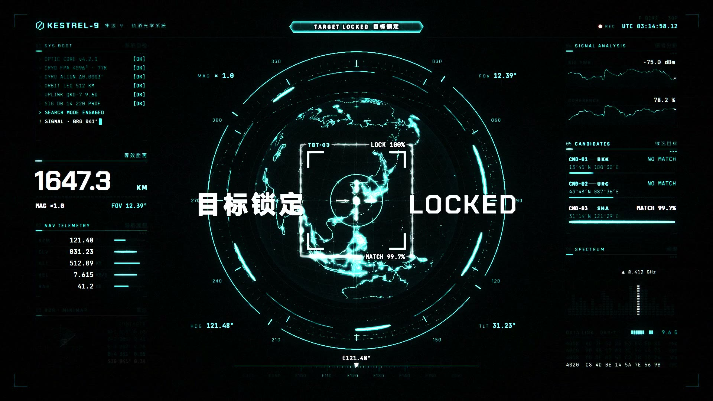
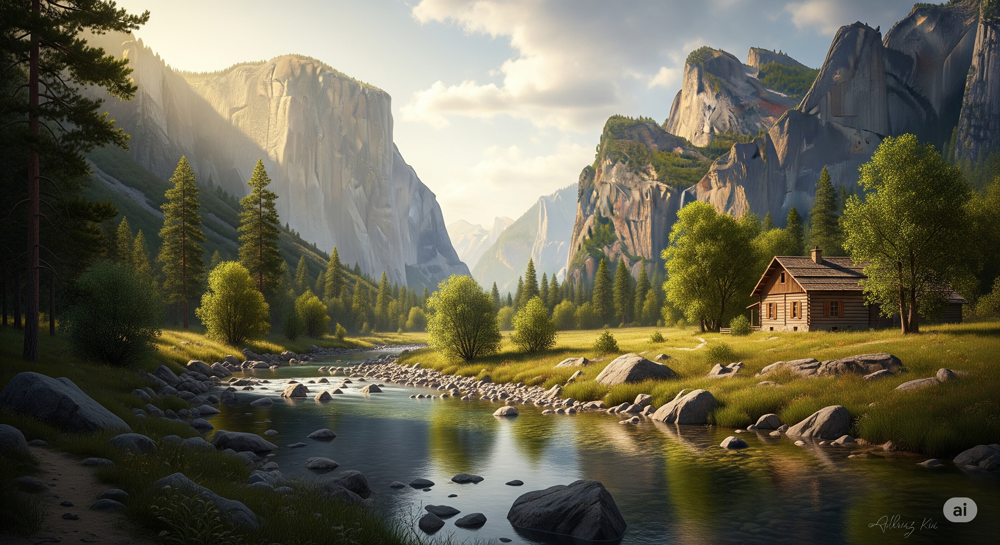
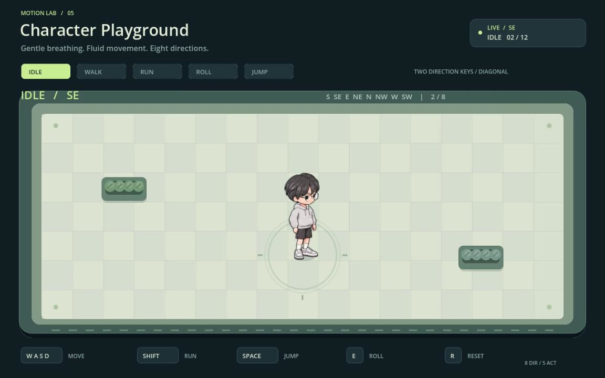
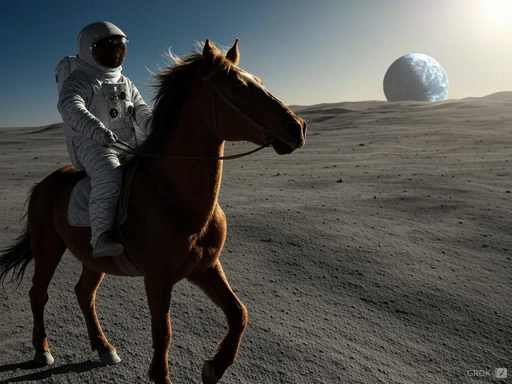

<!-- Generated by tools/write_community_catalog.py. Edit tools/templates/README.ko.md instead. -->
<!-- readme-tech-visualizer:start -->
<p align="center"><a href="https://jammyfu.github.io/awesome-ai-model-showcases/licensed-gallery.ko.html"></a></p>
<!-- readme-tech-visualizer:end -->

[English](README.md) · [简体中文](README.zh-CN.md) · [繁體中文](README.zh-TW.md) · [日本語](README.ja.md) · [한국어](README.ko.md)

# Awesome AI Model Showcases

**AI로 만든 애니메이션, 인터랙티브 데모와 게임. 결과를 먼저 보고 제작자, 프롬프트와 출처를 찾아보세요.**

**[한국어 작품 갤러리 →](https://jammyfu.github.io/awesome-ai-model-showcases/licensed-gallery.ko.html)** · [모델별 보기](#showcase) · [전체 목록](docs/catalog.ko.md) · [검색 갤러리 (영어)](https://jammyfu.github.io/awesome-ai-model-showcases/?lang=en)

<p>
<a href="#catalog"></a>
<a href="LICENSE"></a>
</p>

**[6개 모델 계열의 작품을 큰 이미지로 보기 →](https://jammyfu.github.io/awesome-ai-model-showcases/licensed-gallery.ko.html)**

<a id="examples"></a>
## Claude로 만든 작품부터 보기

**Claude Opus 5.5** · Vincentwei1021 · 원본 프로젝트 **GitHub stars 3,434개** (2026-11-11 기준).

**ISOPOLIS · 자라나는 도시**

<a href="https://vincentwei1021.github.io/mg-styles-15/#03-isometric"></a>

빛나는 탑 주위로 파스텔톤 등각 투영 도시가 성장합니다. 풍력 발전기, 태양광 지붕과 고가 교통망이 어우러집니다.

**[영상 보기 →](https://vincentwei1021.github.io/mg-styles-15/#03-isometric)** · [공개 프롬프트](https://github.com/Vincentwei1021/mg-styles-15/blob/269f6ed788cf60aaf9c276b110c548d6e7d353e1/prompts/03-isometric.md) · [소스 코드](https://github.com/Vincentwei1021/mg-styles-15/tree/269f6ed788cf60aaf9c276b110c548d6e7d353e1/demos/03-isometric) · [제작자 원본 이미지](https://github.com/Vincentwei1021/mg-styles-15/blob/269f6ed788cf60aaf9c276b110c548d6e7d353e1/videos/03-isometric.jpg)

**KESTREL-9 · 사이버펑크 HUD**

<a href="https://vincentwei1021.github.io/mg-styles-15/#22-hud"></a>

검은 바탕에 청록색을 사용한 가상의 인터페이스에서 지구본, 조준 고리, 신호 차트와 원격 측정 정보가 움직입니다.

**[영상 보기 →](https://vincentwei1021.github.io/mg-styles-15/#22-hud)** · [공개 프롬프트](https://github.com/Vincentwei1021/mg-styles-15/blob/269f6ed788cf60aaf9c276b110c548d6e7d353e1/prompts/22-hud.md) · [소스 코드](https://github.com/Vincentwei1021/mg-styles-15/tree/269f6ed788cf60aaf9c276b110c548d6e7d353e1/demos/22-hud) · [제작자 원본 이미지](https://github.com/Vincentwei1021/mg-styles-15/blob/269f6ed788cf60aaf9c276b110c548d6e7d353e1/videos/22-hud.jpg)

같은 프로젝트의 영상 두 편입니다. 저장소 stars는 개별 영상 조회 수나 모델 간 인기 순위가 아닙니다. 제작자가 공개한 영상 프레임을 수정 없이 사용했습니다. [미디어 MIT 허가](https://github.com/Vincentwei1021/mg-styles-15/blob/269f6ed788cf60aaf9c276b110c548d6e7d353e1/README.md#license) · [저작권과 라이선스 전문](docs/licenses/Vincentwei1021-mg-styles-15-MIT.txt). 별도 추천 작품이므로 183개 사례 집계에는 포함하지 않습니다. 모델 정보는 제작자의 주장이고 생성을 다시 실행하지 않았습니다.

[Claude](#claude) · [Gemini](#gemini) · [GPT Sol](#gpt-code) · [Grok](#grok) · [Qwen](#qwen) · [DeepSeek](#deepseek)

<a id="showcase"></a>
<a id="catalog"></a>
## 모델별 보기

6개 계열에 **출처가 있는 사례 183개**를 모았습니다. 각 표에서는 서로 다른 주제의 사례 세 개를 미리보기 링크, 소개, 모델 표기, 제작자, 출처와 함께 안내합니다. 게시 허가가 확인되지 않은 미디어는 삽입 미리보기가 아니라 원문 링크로 제공합니다. 모든 버전과 기록은 [전체 목록](docs/catalog.ko.md)에 있습니다. 편집상 탐색 구조이지 모델 순위가 아닙니다.

버전은 출처에서 표기한 주요 최신 버전을 먼저 두고, 같은 버전 안에서는 출처 날짜순으로 배열합니다. 비교 가능한 인기도 자료는 아직 없습니다. [정렬 원칙 (영어)](docs/discovery-order.md).

<a id="claude"></a>
### Claude · 146 개

[전체 보기](docs/catalog.ko.md#claude)

<a id="ver-claude-fable-5-2"></a>
- [Claude Fable 5.2](docs/catalog.ko.md#ver-claude-fable-5-2) · 137
<a id="ver-claude-mythos-5-2"></a>
- [Claude Mythos 5.2](docs/catalog.ko.md#ver-claude-mythos-5-2) · 0 · 출처가 있는 독립 사례 없음
<a id="ver-claude-opus-5-5"></a>
- [Claude Opus 5.5](docs/catalog.ko.md#ver-claude-opus-5-5) · 9

<table width="100%">
<thead><tr><th>미리보기 · 사례와 소개 · 모델과 출처</th></tr></thead>
<tbody>
<tr><td><a href="https://x.com/quxiaoyin/status/2120341962314150207">원문에서 결과 보기 ↗</a><br><small>미리보기 재게시 허가 확인 대기</small><br><br><strong>AgentSky를 다룬 점광원 3D 영상(Blender와 코드)</strong><br>Blender와 코드로 만든 점광원 영상, 녹화 영상<br><br>Claude Fable 5.2<br><small>출처의 모델 표기</small><br>@quxiaoyin（Xiaoyin Qu）<br><a href="docs/translations/x-quxiaoyin-fable52-agentsky-film.md#ko">사례</a> · <a href="https://x.com/quxiaoyin/status/2120341962314150207">원문 게시물</a></td></tr>
<tr><td><a href="https://x.com/MengTo/status/2120316203738829180">원문에서 결과 보기 ↗</a><br><small>미리보기 재게시 허가 확인 대기</small><br><br><strong>Fable 5.2로 Three.js 아파트를 Blender에 재현</strong><br>Claude + Blender로 기존 Three.js 아파트 장면 재현, 화면 캡처<br><br>Claude Fable 5.2<br><small>출처의 모델 표기</small><br>@MengTo（Meng To）<br><a href="docs/translations/x-mengto-fable52-blender-apartment.md#ko">사례</a> · <a href="https://x.com/MengTo/status/2120316203738829180">원문 게시물</a></td></tr>
<tr><td><a href="https://x.com/EvanMilenko/status/2120322640048959503">원문에서 결과 보기 ↗</a><br><small>미리보기 재게시 허가 확인 대기</small><br><br><strong>Three.js로 처음부터 만든 드래곤 게임</strong><br>Three.js 드래곤 게임, 플레이 화면 캡처<br><br>Claude Fable 5.2<br><small>출처의 모델 표기</small><br>@EvanMilenko（Evan）<br><a href="docs/translations/x-evanmilenko-fable52-dragon-game.md#ko">사례</a> · <a href="https://x.com/EvanMilenko/status/2120322640048959503">원문 게시물</a></td></tr>
</tbody>
</table>

<a id="gemini"></a>
### Gemini · 6 개

[전체 보기](docs/catalog.ko.md#gemini)

<a id="ver-gemini-4-carbon"></a>
- [Gemini 4 Carbon](docs/catalog.ko.md#ver-gemini-4-carbon) · 5
<a id="ver-gemini-4-argon"></a>
- [Gemini 4 Argon](docs/catalog.ko.md#ver-gemini-4-argon) · 1

<table width="100%">
<thead><tr><th>미리보기 · 사례와 소개 · 모델과 출처</th></tr></thead>
<tbody>
<tr><td><a href="https://commons.wikimedia.org/wiki/File:Illuminated_Valley_in_the_Afternoon_(Imagen_4.0).webp"></a><br><br><strong>햇살이 비추는 오후의 계곡</strong><br>2025년 Gemini 앱으로 만든 풍경입니다. 출처 페이지는 Imagen 4.0이라고 하지만 업로드 요약에는 3.0이라고 되어 있어 정확한 버전은 불확실합니다. Gemini 4 Carbon의 결과물이 아닙니다.<br><small>추가 수록 작품 (게시 허가 확인) · 목록 집계에서 제외</small><br><small>원본 이미지를 수정하지 않고 작게 표시했습니다.</small><br><br>Imagen / Gemini · 2025<br><small>출처의 모델 표기</small><br>VulcanSphere<br><a href="https://commons.wikimedia.org/wiki/File:Illuminated_Valley_in_the_Afternoon_(Imagen_4.0).webp">원문 게시물</a> · <a href="https://creativecommons.org/publicdomain/zero/1.0/">CC0 1.0</a> · <a href="https://commons.wikimedia.org/w/index.php?title=File:Illuminated_Valley_in_the_Afternoon_(Imagen_4.0).webp&amp;oldid=1147349755">게시 허가 근거</a><br><a href="docs/readme-preview-credits.md#licensed-gemini-imagen4-valley">저작자 표시 및 변경 사항</a></td></tr>
<tr><td><a href="https://x.com/StatsWire/status/2120344850071540152">원문에서 결과 보기 ↗</a><br><small>미리보기 재게시 허가 확인 대기</small><br><br><strong>HTML 파일 하나로 만든 인터랙티브 3D 뉴욕 순항 투어(Three.js)</strong><br>Three.js 단일 파일 장면, 화면 녹화 영상<br><br>Gemini 4 Carbon<br><small>출처의 모델 표기</small><br>@StatsWire<br><a href="docs/translations/x-statswire-gemini-carbon-nyc-cruiser.md#ko">사례</a> · <a href="https://x.com/StatsWire/status/2120344850071540152">원문 게시물</a></td></tr>
<tr><td><a href="https://x.com/DeryaTR_/status/2120393810941456710">원문에서 결과 보기 ↗</a><br><small>미리보기 재게시 허가 확인 대기</small><br><br><strong>Theme Park HD 픽셀 아트 리메이크(플레이 가능)</strong><br>HTML 픽셀 아트 리메이크, https://theme-park-hd.vercel.app 에서 플레이 가능, 녹화 영상<br><br>Gemini 4 Carbon<br><small>출처의 모델 표기</small><br>@DeryaTR_（Derya Unutmaz）<br><a href="docs/translations/x-deryatr-gemini-carbon-theme-park.md#ko">사례</a> · <a href="https://x.com/DeryaTR_/status/2120393810941456710">원문 게시물</a></td></tr>
<tr><td><a href="https://x.com/ai_for_success/status/2120317619588972867">원문에서 결과 보기 ↗</a><br><small>미리보기 재게시 허가 확인 대기</small><br><br><strong>FreeCAD와 Blender로 만든 V8 엔진</strong><br>FreeCAD + Blender V8 엔진, 녹화 데모<br><br>Gemini 4 Carbon<br><small>출처의 모델 표기</small><br>@ai_for_success（AshutoshShrivastava）<br><a href="docs/translations/x-aiforsuccess-gemini-carbon-v8.md#ko">사례</a> · <a href="https://x.com/ai_for_success/status/2120317619588972867">원문 게시물</a></td></tr>
</tbody>
</table>

<a id="gpt-code"></a>
### GPT-6.2 Sol · 14 개

[전체 보기](docs/catalog.ko.md#gpt-code)

<a id="ver-gpt-6-2-sol"></a>
- [GPT-6.2 Sol](docs/catalog.ko.md#ver-gpt-6-2-sol) · 11
<a id="ver-gpt-6-1-sol"></a>
- [GPT-6.1 Sol](docs/catalog.ko.md#ver-gpt-6-1-sol) · 3

<table width="100%">
<thead><tr><th>미리보기 · 사례와 소개 · 모델과 출처</th></tr></thead>
<tbody>
<tr><td><a href="https://github.com/zhangrlll/codex-to-2d-sprites/blob/e7252c23b002bbd131385d5432d9422d87134167/README.md"></a><br><br><strong>GPT에서 Godot까지: 캐릭터 놀이터</strong><br>GPT 캐릭터 이미지를 Tripo AI와 Codex 지원 애니메이션 작업 과정을 통해 조작 가능한 Godot 캐릭터로 만들었습니다. 정확한 모델 버전은 명시되지 않았으며 여러 도구를 사용한 프로젝트입니다.<br><small>추가 수록 작품 (게시 허가 확인) · 목록 집계에서 제외</small><br><small>출처 원본 이미지를 수정하지 않고 작게 표시했습니다.</small><br><br>GPT Image → Tripo → Codex / Godot<br><small>출처의 모델 표기</small><br>zhangrlll<br><a href="https://github.com/zhangrlll/codex-to-2d-sprites/blob/e7252c23b002bbd131385d5432d9422d87134167/README.md">원문 게시물</a> · <a href="https://opensource.org/license/mit">MIT</a> · <a href="https://github.com/zhangrlll/codex-to-2d-sprites/blob/e7252c23b002bbd131385d5432d9422d87134167/README.en.md#3-license">게시 허가 근거</a><br><a href="docs/readme-preview-credits.md#licensed-gpt-godot-character">저작자 표시 및 변경 사항</a></td></tr>
<tr><td><a href="https://github.com/dan-lee-odinson/failure-is-not-an-option/blob/46a3922923b77a019b9c2729121501446b0595eb/README.md"></a><br><br><strong>Failure is Not an Option: 발사 장면</strong><br>Dan Lee-Odinson의 지휘 아래 Codex (GPT-6 Astra)가 내장 Imagegen으로 제작한 게임 일러스트입니다. 이미지 모델은 명시되지 않았으며 게임 구현은 Claude가 담당합니다.<br><small>추가 수록 작품 (게시 허가 확인) · 목록 집계에서 제외</small><br><small>출처 원본 이미지를 수정하지 않고 작게 표시했습니다.</small><br><br>Codex (GPT-6 Astra) + Imagegen<br><small>출처의 모델 표기</small><br>Dan Lee-Odinson<br><a href="https://github.com/dan-lee-odinson/failure-is-not-an-option/blob/46a3922923b77a019b9c2729121501446b0595eb/README.md">원문 게시물</a> · <a href="https://creativecommons.org/licenses/by/4.0/">CC BY 4.0</a> · <a href="https://github.com/dan-lee-odinson/failure-is-not-an-option/blob/46a3922923b77a019b9c2729121501446b0595eb/LICENSE-CONTENT">게시 허가 근거</a><br><a href="docs/readme-preview-credits.md#licensed-gpt-codex-launch-scene">저작자 표시 및 변경 사항</a></td></tr>
<tr><td><a href="https://x.com/cfenghub/status/2120069654437921152">원문에서 결과 보기 ↗</a><br><small>미리보기 재게시 허가 확인 대기</small><br><br><strong>Three.js, GLSL, Blender로 만든 비에 젖은 로마 콜로세움</strong><br>Three.js + GLSL + Blender, 단일 HTML, 녹화 영상<br><br>GPT-6.2 Sol<br><small>출처의 모델 표기</small><br>@cfenghub（CF长风）<br><a href="docs/translations/x-cfenghub-gpt62sol-colosseum.md#ko">사례</a> · <a href="https://x.com/cfenghub/status/2120069654437921152">원문 게시물</a></td></tr>
<tr><td><a href="https://x.com/TokenGremlin/status/2119395930805879165">원문에서 결과 보기 ↗</a><br><small>미리보기 재게시 허가 확인 대기</small><br><br><strong>단일 HTML 파일의 원샷 Three.js 블랙홀(작성자는 GPT-6.2 Sol로 라우팅됐다고 주장)</strong><br>Three.js 단일 HTML 파일, X 화면/영상 캡처<br><br>GPT-6.2 Sol<br><small>출처의 모델 표기</small><br>@TokenGremlin（Token Gremlin）<br><a href="docs/translations/x-tokengremlin-gpt62sol-threejs-blackhole.md#ko">사례</a> · <a href="https://x.com/TokenGremlin/status/2119395930805879165">원문 게시물</a></td></tr>
<tr><td><a href="https://x.com/HarshithLucky3/status/2119418918616150080">원문에서 결과 보기 ↗</a><br><small>미리보기 재게시 허가 확인 대기</small><br><br><strong>SVG 애니메이션: 자전거 타는 펠리컨과 게 2마리(Codex 라우팅)</strong><br>Codex로 만든 SVG 애니메이션, 녹화 영상<br><br>GPT-6.2 Sol<br><small>출처의 모델 표기</small><br>@HarshithLucky3（Harshith）<br><a href="docs/translations/x-harshithlucky3-gpt62sol-pelican-svg-animation.md#ko">사례</a> · <a href="https://x.com/HarshithLucky3/status/2119418918616150080">원문 게시물</a></td></tr>
</tbody>
</table>

<a id="grok"></a>
### Grok · 11 개

[전체 보기](docs/catalog.ko.md#grok)

<a id="ver-grok-4-7"></a>
- [Grok 4.7](docs/catalog.ko.md#ver-grok-4-7) · 1
<a id="ver-grok-imagine-video"></a>
- [Grok Imagine Video](docs/catalog.ko.md#ver-grok-imagine-video) · 10

<table width="100%">
<thead><tr><th>미리보기 · 사례와 소개 · 모델과 출처</th></tr></thead>
<tbody>
<tr><td><a href="https://commons.wikimedia.org/wiki/File:Astronaut_Riding_a_Horse_(Grok_Aurora).webp"></a><br><br><strong>달에서 말을 타는 우주비행사</strong><br>VulcanSphere는 2024년 12월 Grok Aurora로 이 텍스트 기반 이미지를 생성했다고 밝혔습니다. Grok 4.7 코딩이나 동영상 예시가 아닙니다.<br><small>추가 수록 작품 (게시 허가 확인) · 목록 집계에서 제외</small><br><small>원본 이미지를 수정하지 않고 작게 표시했습니다.</small><br><br>Grok Aurora (2024)<br><small>출처의 모델 표기</small><br>VulcanSphere<br><a href="https://commons.wikimedia.org/wiki/File:Astronaut_Riding_a_Horse_(Grok_Aurora).webp">원문 게시물</a> · <a href="https://creativecommons.org/publicdomain/zero/1.0/">CC0 1.0</a> · <a href="https://commons.wikimedia.org/w/index.php?title=File:Astronaut_Riding_a_Horse_(Grok_Aurora).webp&amp;oldid=1265346265">게시 허가 근거</a><br><a href="docs/readme-preview-credits.md#licensed-grok-aurora-astronaut">저작자 표시 및 변경 사항</a></td></tr>
<tr><td><a href="https://jamesgreene.com/models/">원문에서 결과 보기 ↗</a><br><small>미리보기 재게시 허가 확인 대기</small><br><br><strong>아이소메트릭 도시의 낮과 밤 HTML 루프 — Grok 4.7</strong><br>독립 실행형 HTML/CSS/JS 애니메이션(코드 모델이며 Grok Imagine Video가 아님)<br><br>Grok 4.7<br><small>출처의 모델 표기</small><br>James Greene (model comparison archive)<br><a href="docs/translations/web-jamesgreene-code1-grok47-isometric-city.md#ko">사례</a> · <a href="https://jamesgreene.com/models/">원문 게시물</a></td></tr>
<tr><td><a href="https://x.com/HaluAIArt/status/2118285947921989988">원문에서 결과 보기 ↗</a><br><small>미리보기 재게시 허가 확인 대기</small><br><br><strong>다크 일렉트로 힙합 댄스 영상</strong><br>원 게시물에 명시된 Grok Imagine 네이티브 영상<br><br>Grok Imagine Video<br><small>출처의 모델 표기</small><br>@HaluAIArt（はる）<br><a href="docs/translations/x-haluaiart-grok-imagine-dark-electro-hip-hop-dance.md#ko">사례</a> · <a href="https://x.com/HaluAIArt/status/2118285947921989988">원문 게시물</a></td></tr>
<tr><td><a href="https://x.com/whichaiwon/status/2118342571592446154">원문에서 결과 보기 ↗</a><br><small>미리보기 재게시 허가 확인 대기</small><br><br><strong>Grok Imagine Video 1.5 Lite 립싱크 테스트</strong><br>원 게시물에 명시된 Grok Imagine 네이티브 영상<br><br>Grok Imagine Video<br><small>출처의 모델 표기</small><br>@whichaiwon（Which AI Won）<br><a href="docs/translations/x-whichaiwon-grok-imagine-grok-imagine-video-1-5-lit.md#ko">사례</a> · <a href="https://x.com/whichaiwon/status/2118342571592446154">원문 게시물</a></td></tr>
</tbody>
</table>

<a id="qwen"></a>
### Qwen · 3 개

[전체 보기](docs/catalog.ko.md#qwen)

<a id="ver-qwen4-max-preview"></a>
- [Qwen 4 Max Preview](docs/catalog.ko.md#ver-qwen4-max-preview) · 1
<a id="ver-qwen4-preview"></a>
- [Qwen 4.0 Preview](docs/catalog.ko.md#ver-qwen4-preview) · 1
<a id="ver-qwen3-8-27b"></a>
- [Qwen3.8 27B](docs/catalog.ko.md#ver-qwen3-8-27b) · 1

<table width="100%">
<thead><tr><th>미리보기 · 사례와 소개 · 모델과 출처</th></tr></thead>
<tbody>
<tr><td><a href="https://github.com/Mats2208/qwen-image-local/blob/f26beee377d1861f5b5b35a7ea6efb3222d35c98/docs/index.html"></a><br><br><strong>Charcas 거리의 눈 내리는 밤</strong><br>Qwen-Image-2.1로 거리 사진을 눈 내리는 밤 풍경으로 편집했습니다. 출처가 밝힌 이미지 편집 벤치마크이며 Qwen4 코딩 데모가 아닙니다.<br><small>추가 수록 작품 (게시 허가 확인) · 목록 집계에서 제외</small><br><small>원본 이미지를 수정하지 않고 작게 표시했습니다.</small><br><br>Qwen-Image-2.1<br><small>출처의 모델 표기</small><br>Mbaro01 · Mats2208<br><a href="https://github.com/Mats2208/qwen-image-local/blob/f26beee377d1861f5b5b35a7ea6efb3222d35c98/docs/index.html">원문 게시물</a> · <a href="https://creativecommons.org/licenses/by-sa/4.0/">CC BY-SA 4.0</a> · <a href="https://github.com/Mats2208/qwen-image-local/blob/f26beee377d1861f5b5b35a7ea6efb3222d35c98/README.md#license">게시 허가 근거</a><br><a href="docs/readme-preview-credits.md#licensed-qwen-image21-snowy-street">저작자 표시 및 변경 사항</a></td></tr>
<tr><td><a href="https://x.com/leo114119/status/2120371909624033439">원문에서 결과 보기 ↗</a><br><small>미리보기 재게시 허가 확인 대기</small><br><br><strong>비행기를 조종하는 손오공: HTML 3D 데모</strong><br>HTML + 3D 애니메이션 데모, 녹화 영상<br><br>Qwen 4 Max Preview<br><small>출처의 모델 표기</small><br>@leo114119（Leo）<br><a href="docs/translations/x-leo114119-qwen4max-wukong-plane.md#ko">사례</a> · <a href="https://x.com/leo114119/status/2120371909624033439">원문 게시물</a></td></tr>
<tr><td><a href="https://x.com/coffeecup2020/status/2120113388629995921">원문에서 결과 보기 ↗</a><br><small>미리보기 재게시 허가 확인 대기</small><br><br><strong>Qwen 4.0 Preview의 사그라다 파밀리아 데모</strong><br>반복적인 자기 비평 데모, 녹화 영상<br><br>Qwen 4.0 Preview<br><small>출처의 모델 표기</small><br>@coffeecup2020（David Y. Tan）<br><a href="docs/translations/x-coffeecup2020-qwen4-sagrada.md#ko">사례</a> · <a href="https://x.com/coffeecup2020/status/2120113388629995921">원문 게시물</a></td></tr>
<tr><td><a href="https://jamesgreene.com/models/">원문에서 결과 보기 ↗</a><br><small>미리보기 재게시 허가 확인 대기</small><br><br><strong>아이소메트릭 도시의 낮과 밤 HTML 루프 — Qwen3.8 27B</strong><br>독립 실행형 HTML/CSS/JS 애니메이션<br><br>Qwen3.8 27B<br><small>출처의 모델 표기</small><br>James Greene (model comparison archive)<br><a href="docs/translations/web-jamesgreene-code1-qwen38-27b-isometric-city.md#ko">사례</a> · <a href="https://jamesgreene.com/models/">원문 게시물</a></td></tr>
</tbody>
</table>

<a id="deepseek"></a>
### DeepSeek · 3 개

[전체 보기](docs/catalog.ko.md#deepseek)

<a id="ver-deepseek-v4-1-flash-1017"></a>
- [DeepSeek V4.1 Flash 1017](docs/catalog.ko.md#ver-deepseek-v4-1-flash-1017) · 1
<a id="ver-deepseek-v4-1-flash"></a>
- [DeepSeek V4.1 Flash](docs/catalog.ko.md#ver-deepseek-v4-1-flash) · 2

<table width="100%">
<thead><tr><th>미리보기 · 사례와 소개 · 모델과 출처</th></tr></thead>
<tbody>
<tr><td><a href="https://github.com/jaymollica/frogs/blob/79369f4dd2a543009fe93d6d3b54327ab0e8817e/results/2026-09-27/svg/deepseek--deepseek-v4.1-flash--20260927-193108-7af3b.svg"></a><br><br><strong>FROGS: 왕관을 쓴 SVG 개구리</strong><br>출처가 공개한 DeepSeek V4.1 Flash SVG 벤치마크 결과이며 Flash 1017이 아닙니다. 원본 화면에서 발 아래쪽이 잘렸지만 왕관을 쓴 얼굴과 턱은 보입니다.<br><small>추가 수록 작품 (게시 허가 확인) · 목록 집계에서 제외</small><br><small>출처 SVG를 Inkscape로 너비 800px PNG로 변환했습니다. 그림을 변경하지 않았으며 원 게시자가 게시 전에 수행한 모델 출력의 안전화 처리를 그대로 유지했습니다.</small><br><br>DeepSeek V4.1 Flash · 2026-09-27<br><small>출처의 모델 표기</small><br>Jay Mollica · FROGS<br><a href="https://github.com/jaymollica/frogs/blob/79369f4dd2a543009fe93d6d3b54327ab0e8817e/results/2026-09-27/svg/deepseek--deepseek-v4.1-flash--20260927-193108-7af3b.svg">원문 게시물</a> · <a href="https://creativecommons.org/licenses/by/4.0/">CC BY 4.0</a> · <a href="https://github.com/jaymollica/frogs/blob/79369f4dd2a543009fe93d6d3b54327ab0e8817e/LICENSE-DATA">게시 허가 근거</a><br><a href="docs/readme-preview-credits.md#licensed-deepseek-crowned-frog">저작자 표시 및 변경 사항</a></td></tr>
<tr><td><a href="https://jamesgreene.com/models/">원문에서 결과 보기 ↗</a><br><small>미리보기 재게시 허가 확인 대기</small><br><br><strong>아이소메트릭 도시의 낮과 밤 HTML 루프 — DeepSeek V4.1 Flash 1017</strong><br>독립 실행형 HTML/CSS/JS 애니메이션<br><br>DeepSeek V4.1 Flash 1017<br><small>출처의 모델 표기</small><br>James Greene (model comparison archive)<br><a href="docs/translations/web-jamesgreene-code1-deepseek-v41-flash-1017-isometric-city.md#ko">사례</a> · <a href="https://jamesgreene.com/models/">원문 게시물</a></td></tr>
<tr><td><a href="https://x.com/LatentOperatorX/status/2120205377803518132">원문에서 결과 보기 ↗</a><br><small>미리보기 재게시 허가 확인 대기</small><br><br><strong>Three.js Airbus A380 이륙: DeepSeek V4.1 Flash vs Fable 5.2 vs GPT-6.1 Sol</strong><br>Three.js 단일 장면 과제, 비교 영상<br><br>DeepSeek V4.1 Flash<br><small>출처의 모델 표기</small><br>@LatentOperatorX<br><a href="docs/translations/x-latentoperator-a380-deepseek-fable-sol.md#ko">사례</a> · <a href="https://x.com/LatentOperatorX/status/2120205377803518132">원문 게시물</a></td></tr>
<tr><td><a href="https://x.com/LatentOperatorX/status/2120077800887746603">원문에서 결과 보기 ↗</a><br><small>미리보기 재게시 허가 확인 대기</small><br><br><strong>덤프트럭에 짐을 싣는 Three.js 굴착기: DeepSeek Harness vs Command Code</strong><br>Three.js 굴착기 과제, 비교 영상<br><br>DeepSeek V4.1 Flash<br><small>출처의 모델 표기</small><br>@LatentOperatorX（Latent Operator）<br><a href="docs/translations/x-latentoperator-deepseek-excavator.md#ko">사례</a> · <a href="https://x.com/LatentOperatorX/status/2120077800887746603">원문 게시물</a></td></tr>
</tbody>
</table>


<a id="latest"></a>
## 최근 원문 게시물

출처 날짜가 있는 최신 사례 5개입니다. 수집 일지나 순위가 아닙니다. 같은 날짜는 사례 ID로 정렬하며 날짜가 없는 사례는 전체 목록에서 볼 수 있습니다.

2026-11-12 기준으로 비교 가능한 인기도 자료가 없습니다. 출처 날짜순이며 인기순이 아닙니다.

- **2026-11-11 · GPT Sol** · **Let Fable take Flight: HTML/Three.js 절차적 애니메이션(GPT-6.1 Sol Max)** · 제작자: @YFeng2022（LanFeng） · [사례](docs/translations/x-yfeng-gpt61-sol-fable-take-flight.md#ko) · [원문 게시물](https://x.com/YFeng2022/status/2120324811549225082)
- **2026-11-11 · Gemini** · **HTML 파일 하나로 만든 인터랙티브 3D 뉴욕 순항 투어(Three.js)** · 제작자: @StatsWire · [사례](docs/translations/x-statswire-gemini-carbon-nyc-cruiser.md#ko) · [원문 게시물](https://x.com/StatsWire/status/2120344850071540152)
- **2026-11-11 · Grok** · **Grok Imagine: pixstar Cybertruck 작별 영상(부분 프롬프트)** · 제작자: @RadCyberTruck · [사례](docs/translations/x-radcybertruck-grok-imagine-cybertruck-cry.md#ko) · [원문 게시물](https://x.com/RadCyberTruck/status/2120350558431445006)
- **2026-11-11 · Claude** · **AgentSky를 다룬 점광원 3D 영상(Blender와 코드)** · 제작자: @quxiaoyin（Xiaoyin Qu） · [사례](docs/translations/x-quxiaoyin-fable52-agentsky-film.md#ko) · [원문 게시물](https://x.com/quxiaoyin/status/2120341962314150207)
- **2026-11-11 · Claude** · **Fable 5.2 vs Opus 5.5: 같은 프롬프트로 만든 Three.js 선박 나란히 비교** · 제작자: @paleknight（Vraj） · [사례](docs/translations/x-paleknight-fable52-vs-opus55-ship.md#ko) · [원문 게시물](https://x.com/paleknight/status/2120368418805174639)


<a id="how-to-use"></a>
## 이렇게 활용하세요

1. **아이디어 찾기.** 모델 계열을 둘러보거나 검색 갤러리에서 제목, 제작자와 모델을 검색하세요.
2. **근거 확인하기.** 사례를 열어 원문 게시물, 제작자, 제작 방법과 프롬프트의 공개·일부 공개·미공개 상태를 확인하세요.
3. **직접 시도할 계획 세우기.** 기록된 제작 방법을 출발점으로 삼으세요. 접근 권한, 설정과 결과는 다를 수 있습니다. 이 자료집은 모델 출력을 재현하거나 인증하지 않습니다.

열람에 계정, API 키나 설치는 필요하지 않습니다. 모델 이름은 출처의 주장입니다. **소스 코드 라이선스가 제3자 미디어나 프롬프트의 이용 권한까지 부여하지는 않습니다.**

[모델](#showcase) · [최근 게시물](#latest) · [유형](#by-type) · [기여](#contribute) · [권리와 언어](#rights)

<details>
<summary>모델 표기와 근거의 한계</summary>

목록의 **GPT-6.2 Sol** 표기는 저장소 소유자의 확인에 따른 것입니다. 2026-11-11 기준 OpenAI 공개 문서의 표기는 여전히 **GPT-6.1 Sol**입니다 ([소개](https://openai.com/index/introducing-gpt-6-1-sol/), [Models](https://platform.openai.com/docs/models)). 공식 6.2 출시 발표가 있었다고 주장하지 않습니다.

Claude Mythos 5.2와 Qwen 3.8 Flash Next는 목록에 언급되지만 별도의 출처가 있는 사례는 없습니다. 전체 건수에 추가하지 않습니다. 프롬프트와 모델 표기는 불완전하거나 출처의 자기 보고일 수 있습니다. 수록되었거나 미디어를 내려받을 수 있다는 사실만으로 생성 성공이 입증되지는 않습니다.

</details>

<a id="by-type"></a>
## 유형별

<a id="type-gif"></a>
- [GIF](docs/showcase-index.md#gif) · **0**
<a id="type-animation"></a>
- [애니메이션](docs/showcase-index.md#animation) · **107**
<a id="type-html-3d"></a>
- [HTML / 3D 장면](docs/showcase-index.md#html-3d) · **66**
<a id="type-minigame"></a>
- [미니 게임](docs/showcase-index.md#minigame) · **10**
<a id="type-image"></a>
- [이미지](docs/showcase-index.md#image) · **0**


유형별 건수는 현재 목록의 태그를 반영할 뿐, 모델의 모든 기능을 보여 주지는 않습니다. 0은 해당 태그가 붙은 사례가 없다는 뜻입니다. 게임은 HTML / 3D로 분류될 수도 있습니다. [분류 방식](tools/readme_presentation.py).

<a id="collection-sites"></a>
<a id="related-projects"></a>
## 더 찾아보기

- [전체 사례와 모음 사이트](docs/catalog.ko.md): 모든 사례, 출처 근거, 별도로 표시한 부록.
- [관련 오픈 소스 프로젝트 (영어)](docs/related-projects.md): 다른 사례 및 프롬프트 모음.
- [기계 판독용 목록](docs/data/community-cases.json) · [LLM용 프로젝트 안내 (영어)](llms.txt).
- [아이디어와 인기작 재현 부록 (주요 목록과 별도)](https://jammyfu.github.io/awesome-ai-model-showcases/popular.html).
- [GPT Image GIF 보관 자료 · 51개 (영어)](collections/gpt-image-gifs/README.md) · 별도 모음입니다. 개별 사례 번역은 5개 언어로 제공합니다.

<a id="contribute"></a>
## 사례 제안과 수정

원작자, 출처 URL, 공개 프롬프트 또는 ‘미공개’ 표시, 모델이나 제작 방법의 근거를 포함해 [사례를 제안하세요](https://github.com/jammyfu/awesome-ai-model-showcases/issues/new?template=case-submission.yml). 코딩을 몰라도 됩니다. 저작자 표시, 깨진 링크와 번역 수정도 환영합니다.

PR을 제출하려면 [CONTRIBUTING.md (영어)](CONTRIBUTING.md)를 따르세요. 원본 목록 또는 5개 언어 템플릿을 수정한 뒤 다시 생성하고 검토하여 [통합 검증 도구](tools/verify.py)를 실행합니다.

<a id="local-setup"></a>
<details>
<summary>로컬에서 갤러리 실행하기</summary>

기존 정적 갤러리를 보려면 Python 3만 있으면 됩니다.

```bash
git clone https://github.com/jammyfu/awesome-ai-model-showcases.git
cd awesome-ai-model-showcases
python3 -m http.server 8000 --directory docs
```

[localhost:8000의 한국어 갤러리](http://localhost:8000/licensed-gallery.ko.html)를 여세요. 공개 호스팅에는 원본 보관 폴더가 아닌 [게시 허가 미디어 빌드](MEDIA_RIGHTS.md#publication-and-playback-checks)를 사용하세요. 개발 검증에는 [CONTRIBUTING.md](CONTRIBUTING.md)에 명시된 의존성이 추가로 필요합니다.

</details>

<a id="rights"></a>
<a id="faq"></a>
## 권리, 수록 범위와 언어

- **범위:** 목록 갱신일 **2026-11-11**. **확인 대기 12개**는 홈페이지의 **183개**에 포함하지 않습니다. GIF 하위 프로젝트, 재현작, 실패 사례와 저장소 초기 예시는 따로 관리합니다.
- **미디어:** **기존 목록 사례 중 0개에 로컬 게시 허가 미디어가 있습니다.** 위의 Claude 영상 프레임 두 개에는 별도의 허가 기록이 있습니다. 나머지 기록은 출처로 연결합니다. 공개 접근, 저작자 표시나 다운로드 가능 여부가 재사용 권한의 근거가 되지는 않습니다.
- **라이선스:** 소스 코드와 프로젝트 자체 문서는 이용·수정·배포할 수 있으며 저작권 및 허가 고지를 유지해야 합니다.<br>([MIT](LICENSE)) 제3자 미디어, 프롬프트, 상표와 초상에는 적용되지 않습니다. [MEDIA_RIGHTS.md](MEDIA_RIGHTS.md)를 확인하세요. 권리자는 [수정 또는 삭제를 요청](https://github.com/jammyfu/awesome-ai-model-showcases/issues/new)할 수 있습니다.
- **언어:** README, 전체 사례 목록과 사례 근거는 English, 简体中文, 繁體中文, 日本語, 한국어를 지원합니다. AI 번역은 **사람의 검수를 거치지 않았으며** 원문을 함께 보존합니다. 작품 갤러리와 개별 사례 번역 페이지도 한국어를 지원합니다. **주요 검색 갤러리 UI는 영어 / 중국어 간체만 지원**합니다. [번역 원칙과 범위 (영어)](docs/translation-policy.md).

이 문서 구성을 활용하려면 [README 패턴과 검사 항목 (영어)](docs/readme-pattern.md)에서 시작하되, 프로젝트별 주장은 자신의 저장소 근거로 바꾸세요.

[맨 위로 ↑](#awesome-ai-model-showcases)
