<!-- Generated by tools/write_community_catalog.py. Edit tools/templates/README.en.md instead. -->


[English](README.md) · [简体中文](README.zh-CN.md) · [繁體中文](README.zh-TW.md) · [日本語](README.ja.md)

<!-- readme-tech-visualizer:start -->
<p align="center"></p>
<!-- readme-tech-visualizer:end -->

# Awesome AI Model Showcases

**Latest-model production cases, with the post, the author, and the prompt.**

Awesome AI Model Showcases collects real public production cases from the latest large models (Claude Fable 5.2 / Mythos 5.2, Gemini 4 Argon / Carbon, GPT-6.2 Sol, Grok, Qwen, DeepSeek, and others) and from the previous generation that is still mainstream: GIFs, animations, HTML and game demos, and images, each with the original post, author, published prompt, and method.

<p>
<a href="#catalog"></a>
<a href="README.zh-CN.md"></a>
<a href="LICENSE"></a>
</p>

**[Browse the gallery ↗](https://jammyfu.github.io/awesome-ai-model-showcases/?lang=en)** · **[Cases by family ↓](#showcase)** · **[Submit a case](https://github.com/jammyfu/awesome-ai-model-showcases/issues/new?template=case-submission.yml)**

GPT Image 2.6 GIF archive (**51** cases, not in the homepage total): [collections/gpt-image-gifs](collections/gpt-image-gifs/README.md).

Independent community archive. Model labels are source claims, not independent verification. **Third-party media and prompts are not covered by the code's MIT license.**

## Contents

### By model
- [Claude](#claude) — [Claude Fable 5.2](#ver-claude-fable-5-2) · [Claude Mythos 5.2](#ver-claude-mythos-5-2) · [Claude Opus 5.5](#ver-claude-opus-5-5)
- [Gemini](#gemini) — [Gemini 4 Carbon](#ver-gemini-4-carbon) · [Gemini 4 Argon](#ver-gemini-4-argon)
- [GPT-6.2 Sol](#gpt-code) — [GPT-6.2 Sol](#ver-gpt-6-2-sol) · [GPT-6.1 Sol](#ver-gpt-6-1-sol)
- [Grok](#grok) — [Grok 4.7](#ver-grok-4-7) · [Grok Imagine Video](#ver-grok-imagine-video)
- [Qwen](#qwen) — [Qwen3.8 27B](#ver-qwen3-8-27b) · [Qwen 4 Max Preview](#ver-qwen4-max-preview) · [Qwen 4.0 Preview](#ver-qwen4-preview)
- [DeepSeek](#deepseek) — [DeepSeek V4.1 Flash 1017](#ver-deepseek-v4-1-flash-1017) · [DeepSeek V4.1 Flash](#ver-deepseek-v4-1-flash)

### By type
- [GIF](#type-gif)
- [Animation](#type-animation)
- [HTML / 3D scene](#type-html-3d)
- [Mini-game](#type-minigame)
- [Image](#type-image)

### Latest additions
- [Newest dated cases](#latest)
- [Full showcase index](docs/showcase-index.md)

- [Showcase collection sites](#collection-sites)
- [Related projects](#related-projects)
- [How to use this catalog](#how-to-use)
- [Submit a case](#contribute)
- [Media rights](#rights)
- [FAQ](#faq)
- [Full evidence tables](#catalog)

<a id="latest"></a>
## Latest additions
Dated cases only, newest first. A missing date stays out of this strip.

<table>
<tr>
<td align="center" width="33%">
<a href="https://x.com/YFeng2022/status/2120324811549225082"></a><br>
<strong><a href="docs/cases/x-yfeng-gpt61-sol-fable-take-flight/README.md">Let Fable take Flight — HTML/Three.js procedural animation (GPT-6.1 Sol Max)</a></strong><br>
Credit: @YFeng2022（LanFeng）<br><a href="https://x.com/YFeng2022/status/2120324811549225082">Post</a>
</td>
<td align="center" width="33%">
<a href="https://x.com/StatsWire/status/2120344850071540152">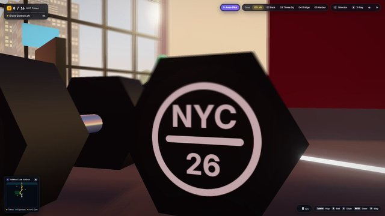</a><br>
<strong><a href="docs/cases/x-statswire-gemini-carbon-nyc-cruiser/README.md">Interactive 3D NYC cruiser tour in one HTML file (Three.js)</a></strong><br>
Credit: @StatsWire<br><a href="https://x.com/StatsWire/status/2120344850071540152">Post</a>
</td>
<td align="center" width="33%">
<a href="https://x.com/RadCyberTruck/status/2120350558431445006"></a><br>
<strong><a href="docs/cases/x-radcybertruck-grok-imagine-cybertruck-cry/README.md">Grok Imagine — pixstar Cybertruck farewell clip (partial prompt)</a></strong><br>
Credit: @RadCyberTruck<br><a href="https://x.com/RadCyberTruck/status/2120350558431445006">Post</a>
</td>
</tr>
<tr>
<td align="center" width="33%">
<a href="https://x.com/quxiaoyin/status/2120341962314150207">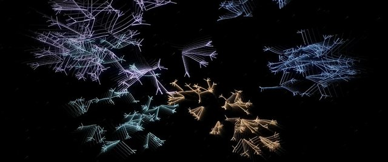</a><br>
<strong><a href="docs/cases/x-quxiaoyin-fable52-agentsky-film/README.md">Point-light 3D film about AgentSky (Blender and code)</a></strong><br>
Credit: @quxiaoyin（Xiaoyin Qu）<br><a href="https://x.com/quxiaoyin/status/2120341962314150207">Post</a>
</td>
<td align="center" width="33%">
<a href="https://x.com/paleknight/status/2120368418805174639">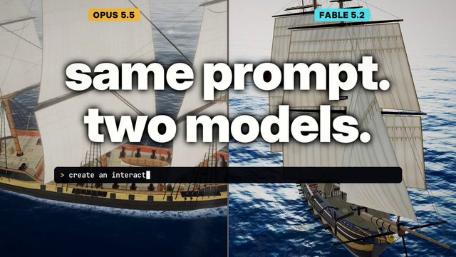</a><br>
<strong><a href="docs/cases/x-paleknight-fable52-vs-opus55-ship/README.md">Fable 5.2 vs Opus 5.5 — same prompt Three.js ship (side-by-side)</a></strong><br>
Credit: @paleknight（Vraj）<br><a href="https://x.com/paleknight/status/2120368418805174639">Post</a>
</td>
<td align="center" width="33%">
<a href="https://x.com/MrTacticalX/status/2120342453807157720">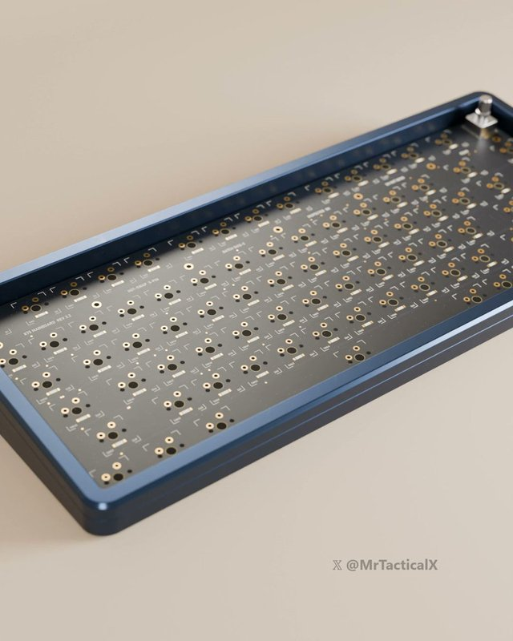</a><br>
<strong><a href="docs/cases/x-mrtactical-fable52-mechanical-keyboard/README.md">Mechanical keyboard built and typed on in Blender</a></strong><br>
Credit: @MrTacticalX（Mr Tactical）<br><a href="https://x.com/MrTacticalX/status/2120342453807157720">Post</a>
</td>
</tr>
<tr>
<td align="center" width="33%">
<a href="https://x.com/MengTo/status/2120316203738829180">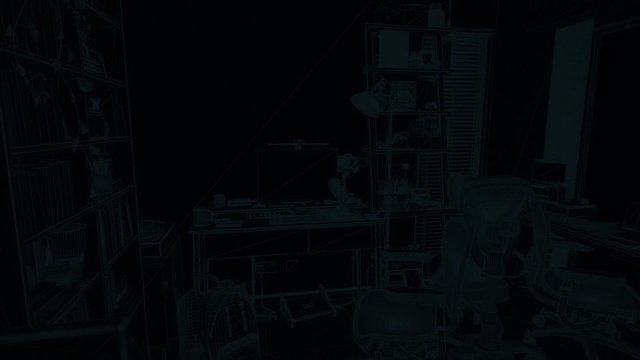</a><br>
<strong><a href="docs/cases/x-mengto-fable52-blender-apartment/README.md">Recreate a Three.js apartment in Blender with Fable 5.2</a></strong><br>
Credit: @MengTo（Meng To）<br><a href="https://x.com/MengTo/status/2120316203738829180">Post</a>
</td>
<td align="center" width="33%">
<a href="https://x.com/_MaxBlade/status/2120355412021231795">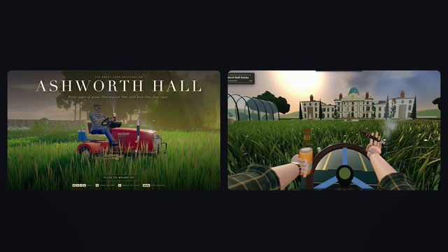</a><br>
<strong><a href="docs/cases/x-maxblade-fable-vs-carbon/README.md">Same prompt: Fable 5.2 vs Gemini 4 Carbon</a></strong><br>
Credit: @_MaxBlade（Max Blade）<br><a href="https://x.com/_MaxBlade/status/2120355412021231795">Post</a>
</td>
</tr>
</table>


<a id="showcase"></a>
## Cases by model family

Every sourced case is listed under its family and version, newest first. Cases with a thumbnail get a card (click the image for the original post; ▶ Video opens the archived local video); cases without one get a single line. Versions with no sourced case stay empty. Nothing here is invented to fill a slot.

The [AIGCreative Feishu reference](docs/reference-feishu.md) also groups one model’s works by use case (product workflow, teaching, film and visual experiments, games, research). This catalog still navigates by model family, version, and work type.

<a id="claude"></a>

## Claude


All 146 sourced cases in this family, grouped by version, newest first. 138 have a thumbnail card (click the image for the original post); the rest are listed one per line. The same rows are in the full evidence tables.

<a id="ver-claude-fable-5-2"></a>

### Claude Fable 5.2

<table>
<tr>
<td align="center" width="33%">
<a href="https://x.com/quxiaoyin/status/2120341962314150207"></a><br>
<strong><a href="docs/cases/x-quxiaoyin-fable52-agentsky-film/README.md">Point-light 3D film about AgentSky (Blender and code)</a></strong><br>
Credit: @quxiaoyin（Xiaoyin Qu）<br><a href="https://x.com/quxiaoyin/status/2120341962314150207">Post</a>
 · <a href="docs/cases/x-quxiaoyin-fable52-agentsky-film/media/video.mp4">▶ Video</a>
</td>
<td align="center" width="33%">
<a href="https://x.com/paleknight/status/2120368418805174639"></a><br>
<strong><a href="docs/cases/x-paleknight-fable52-vs-opus55-ship/README.md">Fable 5.2 vs Opus 5.5 — same prompt Three.js ship (side-by-side)</a></strong><br>
Credit: @paleknight（Vraj）<br><a href="https://x.com/paleknight/status/2120368418805174639">Post</a>
 · <a href="docs/cases/x-paleknight-fable52-vs-opus55-ship/media/video.mp4">▶ Video</a>
</td>
<td align="center" width="33%">
<a href="https://x.com/MrTacticalX/status/2120342453807157720"></a><br>
<strong><a href="docs/cases/x-mrtactical-fable52-mechanical-keyboard/README.md">Mechanical keyboard built and typed on in Blender</a></strong><br>
Credit: @MrTacticalX（Mr Tactical）<br><a href="https://x.com/MrTacticalX/status/2120342453807157720">Post</a>
 · <a href="docs/cases/x-mrtactical-fable52-mechanical-keyboard/media/video.mp4">▶ Video</a>
</td>
</tr>
<tr>
<td align="center" width="33%">
<a href="https://x.com/MengTo/status/2120316203738829180"></a><br>
<strong><a href="docs/cases/x-mengto-fable52-blender-apartment/README.md">Recreate a Three.js apartment in Blender with Fable 5.2</a></strong><br>
Credit: @MengTo（Meng To）<br><a href="https://x.com/MengTo/status/2120316203738829180">Post</a>
 · <a href="docs/cases/x-mengto-fable52-blender-apartment/media/video.mp4">▶ Video</a>
</td>
<td align="center" width="33%">
<a href="https://x.com/kloss_xyz/status/2120378126740095273"></a><br>
<strong><a href="docs/cases/x-kloss-fable52-ocean-threejs/README.md">Photo-real Three.js ocean that runs from sunset to sunrise</a></strong><br>
Credit: @kloss_xyz（klöss）<br><a href="https://x.com/kloss_xyz/status/2120378126740095273">Post</a>
 · <a href="docs/cases/x-kloss-fable52-ocean-threejs/media/video.mp4">▶ Video</a>
</td>
<td align="center" width="33%">
<a href="https://x.com/FinanceYF5/status/2120372142147842296">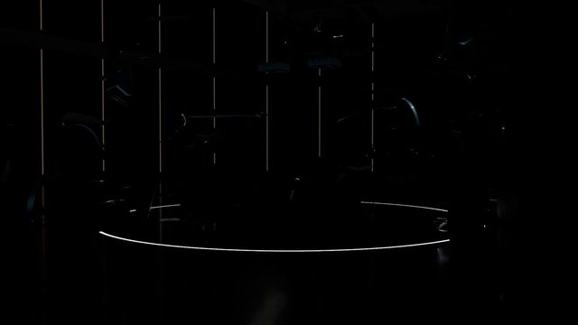</a><br>
<strong><a href="docs/cases/x-financeyf5-fable52-bugatti-tourbillon/README.md">Bugatti Tourbillon in Blender, then a short car film (Fable 5.2)</a></strong><br>
Credit: @xikhar（Shikhar）; 中文转述 @FinanceYF5（AI Will）<br><a href="https://x.com/FinanceYF5/status/2120372142147842296">Post</a>
 · <a href="docs/cases/x-financeyf5-fable52-bugatti-tourbillon/media/video.mp4">▶ Video</a>
</td>
</tr>
<tr>
<td align="center" width="33%">
<a href="https://x.com/EvanMilenko/status/2120322640048959503">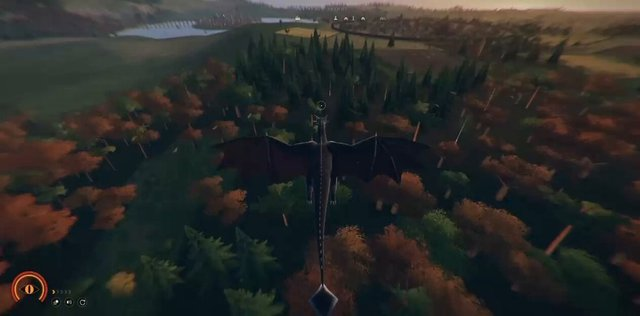</a><br>
<strong><a href="docs/cases/x-evanmilenko-fable52-dragon-game/README.md">Dragon game built from scratch in Three.js</a></strong><br>
Credit: @EvanMilenko（Evan）<br><a href="https://x.com/EvanMilenko/status/2120322640048959503">Post</a>
 · <a href="docs/cases/x-evanmilenko-fable52-dragon-game/media/video.mp4">▶ Video</a>
</td>
<td align="center" width="33%">
<a href="https://x.com/DeryaTR_/status/2120382619082727604">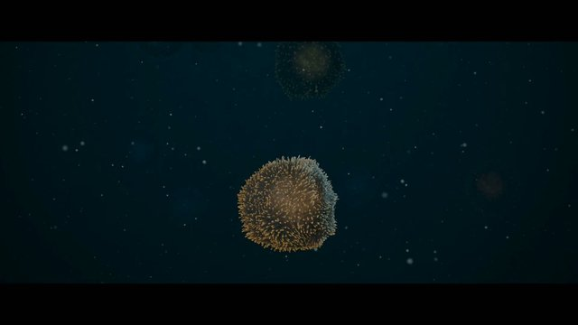</a><br>
<strong><a href="docs/cases/x-deryatr-fable52-tcell-film/README.md">T-cell life film in Blender (12,480 frames, Fable 5.2)</a></strong><br>
Credit: @DeryaTR_（Derya Unutmaz）<br><a href="https://x.com/DeryaTR_/status/2120382619082727604">Post</a>
 · <a href="docs/cases/x-deryatr-fable52-tcell-film/media/video.mp4">▶ Video</a>
</td>
<td align="center" width="33%">
<a href="https://ofox.ai/blog/claude-fable-5-2-svg-guide/">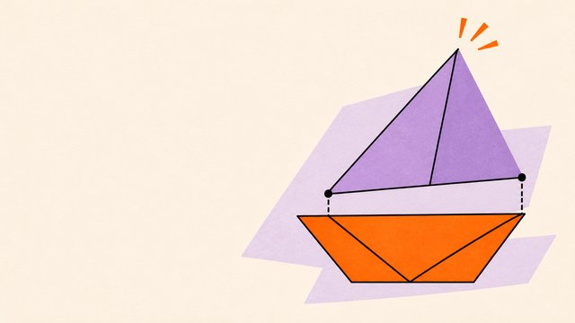</a><br>
<strong><a href="docs/cases/web-ofox-fable52-svg-sailboat/README.md">Editable SVG sailboat illustration with CSS motion (two API calls)</a></strong><br>
Credit: Ofox<br><a href="https://ofox.ai/blog/claude-fable-5-2-svg-guide/">Post</a>
</td>
</tr>
<tr>
<td align="center" width="33%">
<a href="https://x.com/YinYangYoeshi/status/2119897840965001317"></a><br>
<strong><a href="docs/cases/x-yinyangyoeshi-fable52-discovery/README.md">《Discovery》，在三维房间里展开的代码短片</a></strong><br>
Credit: @YinYangYoeshi（Yoeshi）<br><a href="https://x.com/YinYangYoeshi/status/2119897840965001317">Post</a>
 · <a href="docs/cases/x-yinyangyoeshi-fable52-discovery/media/video.mp4">▶ Video</a>
</td>
<td align="center" width="33%">
<a href="https://x.com/Webilyco/status/2119909604431626667">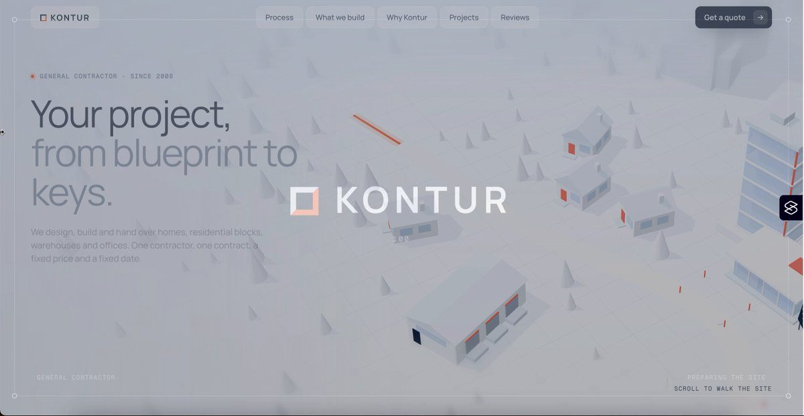</a><br>
<strong><a href="docs/cases/x-webilyco-fable52-kontur/README.md">KONTUR，把建筑服务页做成带动效的项目旅程</a></strong><br>
Credit: @Webilyco（Magda）<br><a href="https://x.com/Webilyco/status/2119909604431626667">Post</a>
 · <a href="docs/cases/x-webilyco-fable52-kontur/media/video.mp4">▶ Video</a>
</td>
<td align="center" width="33%">
<a href="https://x.com/theo/status/2119926277801144695">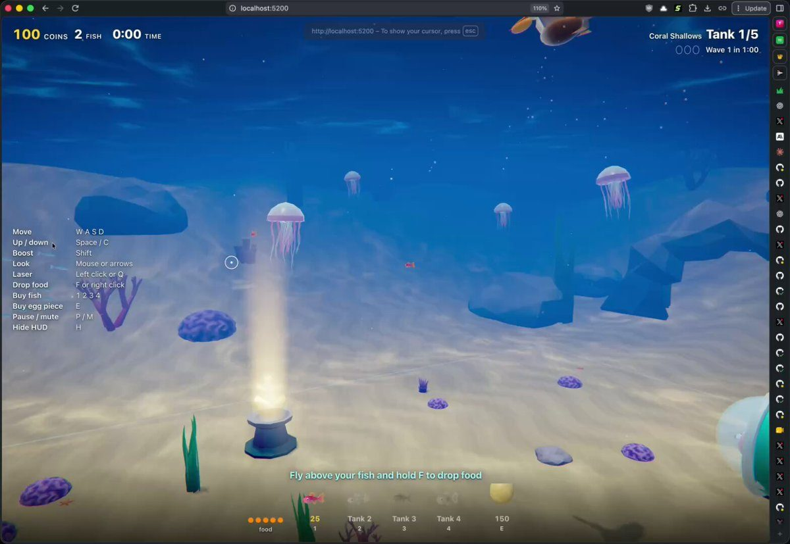</a><br>
<strong><a href="docs/cases/x-theo-fable52-fishslop-fable-opus/README.md">Fishslop，同一鱼缸游戏的 Fable 与 Opus 对照</a></strong><br>
Credit: @theo（Theo - t3.gg）<br><a href="https://x.com/theo/status/2119926277801144695">Post</a>
 · <a href="docs/cases/x-theo-fable52-fishslop-fable-opus/media/video.mp4">▶ Video</a>
</td>
</tr>
<tr>
<td align="center" width="33%">
<a href="https://x.com/The_Alex/status/2119867572875350134"></a><br>
<strong><a href="docs/cases/x-thealex-fable52-pane-youtube-twitch/README.md">Pane，开源的 YouTube 与 Twitch 播放器</a></strong><br>
Credit: @The_Alex（Alex）<br><a href="https://x.com/The_Alex/status/2119867572875350134">Post</a>
 · <a href="docs/cases/x-thealex-fable52-pane-youtube-twitch/media/video.mp4">▶ Video</a>
</td>
<td align="center" width="33%">
<a href="https://x.com/The_Alex/status/2119867574972551309">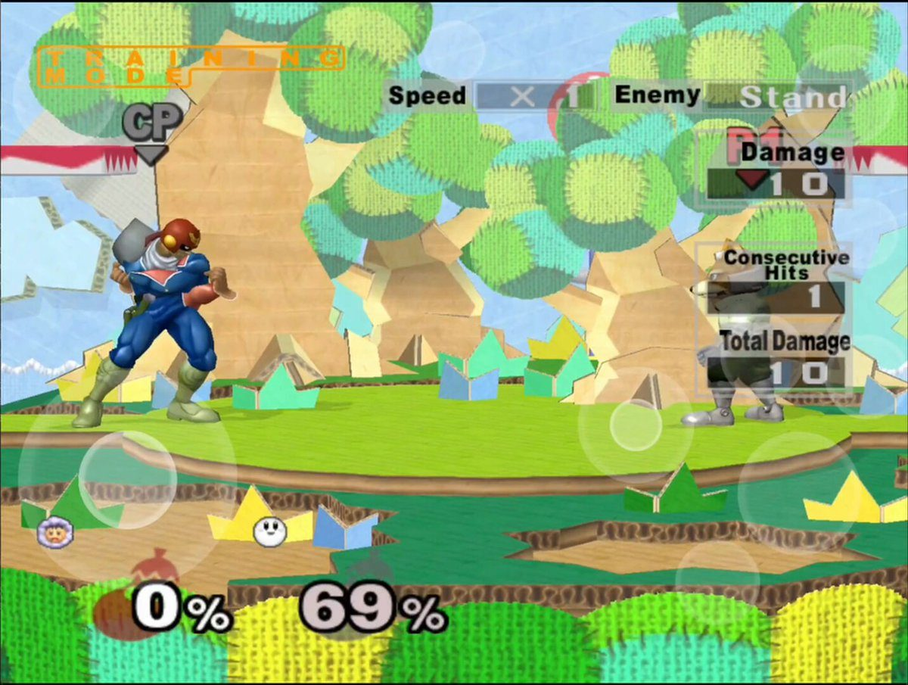</a><br>
<strong><a href="docs/cases/x-thealex-fable52-melee/README.md">在手机上试做 Melee 风格的对战</a></strong><br>
Credit: @The_Alex（Alex）<br><a href="https://x.com/The_Alex/status/2119867574972551309">Post</a>
 · <a href="docs/cases/x-thealex-fable52-melee/media/video.mp4">▶ Video</a>
</td>
<td align="center" width="33%">
<a href="https://x.com/The_Alex/status/2119917226769985785"></a><br>
<strong><a href="docs/cases/x-thealex-fable52-claude/README.md">能被 Claude 调用的编曲工作站</a></strong><br>
Credit: @The_Alex（Alex）<br><a href="https://x.com/The_Alex/status/2119917226769985785">Post</a>
 · <a href="docs/cases/x-thealex-fable52-claude/media/video.mp4">▶ Video</a>
</td>
</tr>
<tr>
<td align="center" width="33%">
<a href="https://x.com/The_Alex/status/2119867576985821398"></a><br>
<strong><a href="docs/cases/x-thealex-fable52-821398/README.md">把马里奥元素做进生存玩法的俯视角原型</a></strong><br>
Credit: @The_Alex（Alex）<br><a href="https://x.com/The_Alex/status/2119867576985821398">Post</a>
 · <a href="docs/cases/x-thealex-fable52-821398/media/video.mp4">▶ Video</a>
</td>
<td align="center" width="33%">
<a href="https://x.com/The_Alex/status/2119867570669203554"></a><br>
<strong><a href="docs/cases/x-thealex-fable52-203554/README.md">给一段口播做 9:16 剪辑，把动效也交给代理</a></strong><br>
Credit: @The_Alex（Alex）<br><a href="https://x.com/The_Alex/status/2119867570669203554">Post</a>
 · <a href="docs/cases/x-thealex-fable52-203554/media/video.mp4">▶ Video</a>
</td>
<td align="center" width="33%">
<a href="https://x.com/The_Alex/status/2119867568253177920">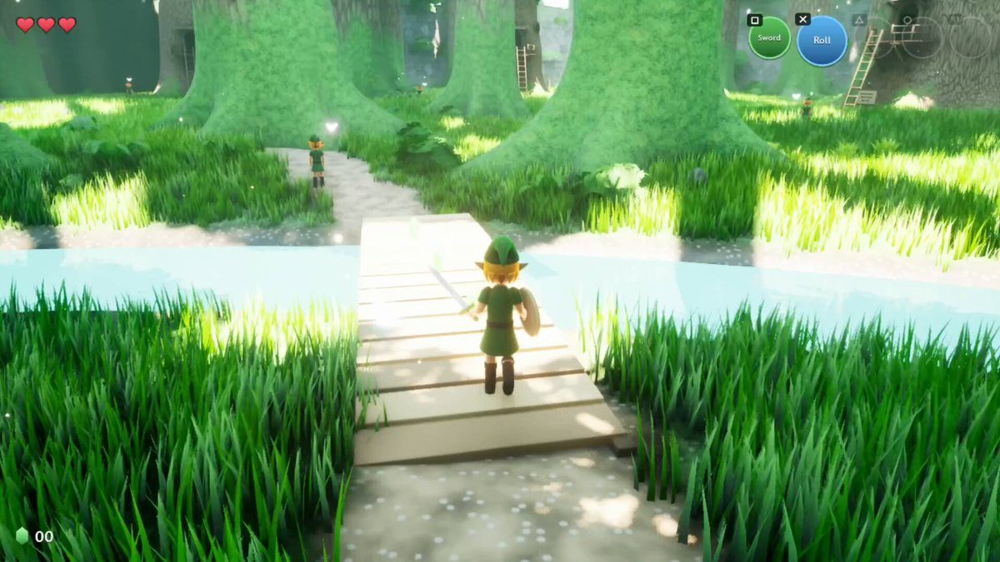</a><br>
<strong><a href="docs/cases/x-thealex-fable52-177920/README.md">做一段《时之笛》风格的三维冒险</a></strong><br>
Credit: @The_Alex（Alex）<br><a href="https://x.com/The_Alex/status/2119867568253177920">Post</a>
 · <a href="docs/cases/x-thealex-fable52-177920/media/video.mp4">▶ Video</a>
</td>
</tr>
<tr>
<td align="center" width="33%">
<a href="https://x.com/s_matysik/status/2119909371484213380"></a><br>
<strong><a href="docs/cases/x-smatysik-fable52-213380/README.md">从代理数据快照生成指挥台</a></strong><br>
Credit: @s_matysik（Sebastian Matysik）<br><a href="https://x.com/s_matysik/status/2119909371484213380">Post</a>
 · <a href="docs/cases/x-smatysik-fable52-213380/media/video.mp4">▶ Video</a>
</td>
<td align="center" width="33%">
<a href="https://x.com/SimonasLTU1/status/2119891671219622262">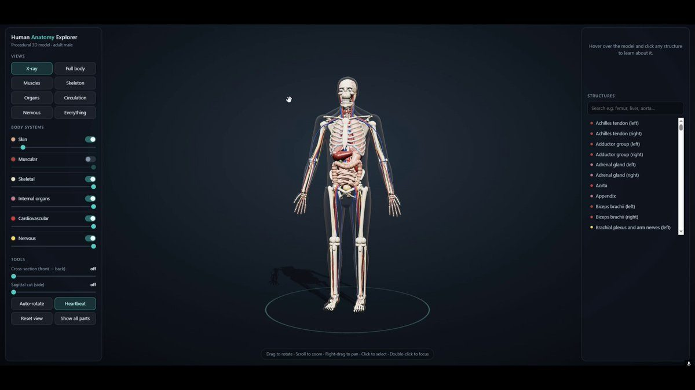</a><br>
<strong><a href="docs/cases/x-simonasltu1-fable52-three/README.md">用 Three.js 做可操作的人体解剖浏览器</a></strong><br>
Credit: @SimonasLTU1（Simonas）<br><a href="https://x.com/SimonasLTU1/status/2119891671219622262">Post</a>
 · <a href="docs/cases/x-simonasltu1-fable52-three/media/video.mp4">▶ Video</a>
</td>
<td align="center" width="33%">
<a href="https://x.com/Scratcherrrr/status/2119909780269785332">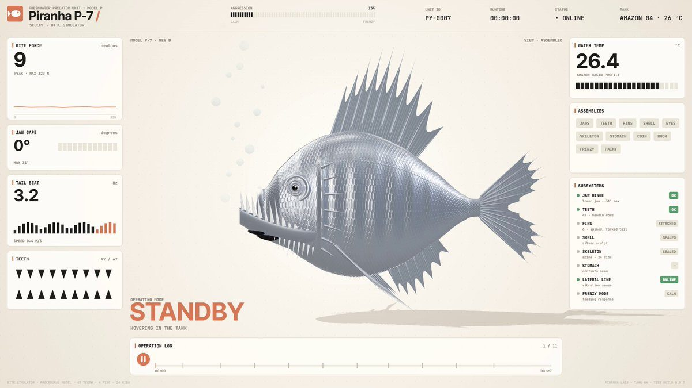</a><br>
<strong><a href="docs/cases/x-scratcherrrr-fable52-piranha/README.md">Piranha P-7，用代码做一条能拆解的食人鱼</a></strong><br>
Credit: @Scratcherrrr（Catcher of your mind）<br><a href="https://x.com/Scratcherrrr/status/2119909780269785332">Post</a>
 · <a href="docs/cases/x-scratcherrrr-fable52-piranha/media/video.mp4">▶ Video</a>
</td>
</tr>
<tr>
<td align="center" width="33%">
<a href="https://x.com/rileybrown/status/2119946022767980985"></a><br>
<strong><a href="docs/cases/x-rileybrown-fable52-the-history-writing/README.md">《The History of Writing》，把文字史做成一支 96 秒动画</a></strong><br>
Credit: @rileybrown（Riley Brown）<br><a href="https://x.com/rileybrown/status/2119946022767980985">Post</a>
 · <a href="docs/cases/x-rileybrown-fable52-the-history-writing/media/video.mp4">▶ Video</a>
</td>
<td align="center" width="33%">
<a href="https://x.com/rileybrown/status/2119902109709537708"></a><br>
<strong><a href="docs/cases/x-rileybrown-fable52-the-edge-blender/README.md">《The Edge》，用 Blender 和网页做出 13 镜头短片</a></strong><br>
Credit: @rileybrown（Riley Brown）<br><a href="https://x.com/rileybrown/status/2119902109709537708">Post</a>
 · <a href="docs/cases/x-rileybrown-fable52-the-edge-blender/media/video.mp4">▶ Video</a>
</td>
<td align="center" width="33%">
<a href="https://x.com/QRoonjha/status/2119883978962501697"></a><br>
<strong><a href="docs/cases/x-qroonjha-fable52-501697/README.md">约 5 秒的定格风格动画试验</a></strong><br>
Credit: @QRoonjha（Qaisar Roonjha）<br><a href="https://x.com/QRoonjha/status/2119883978962501697">Post</a>
 · <a href="docs/cases/x-qroonjha-fable52-501697/media/video.mp4">▶ Video</a>
</td>
</tr>
<tr>
<td align="center" width="33%">
<a href="https://x.com/pwnies/status/2119887535421980695">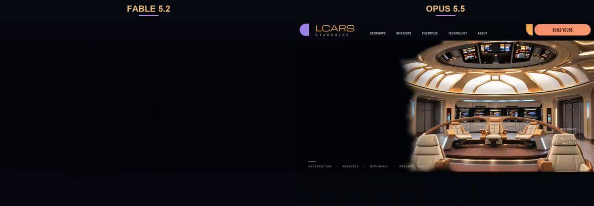</a><br>
<strong><a href="docs/cases/x-pwnies-fable52-fable-opus/README.md">给同一张参考图，比较 Fable 与 Opus 的网页还原</a></strong><br>
Credit: @pwnies（Jacob Miller）<br><a href="https://x.com/pwnies/status/2119887535421980695">Post</a>
 · <a href="docs/cases/x-pwnies-fable52-fable-opus/media/video.mp4">▶ Video</a>
</td>
<td align="center" width="33%">
<a href="https://x.com/petergyang/status/2119901658394358005"></a><br>
<strong><a href="docs/cases/x-petergyang-fable52-turbo-tails/README.md">Turbo Tails，带漂移和道具的浏览器卡丁车</a></strong><br>
Credit: @petergyang（Peter Yang）<br><a href="https://x.com/petergyang/status/2119901658394358005">Post</a>
 · <a href="docs/cases/x-petergyang-fable52-turbo-tails/media/video.mp4">▶ Video</a>
</td>
<td align="center" width="33%">
<a href="https://x.com/petergyang/status/2119886560992854431">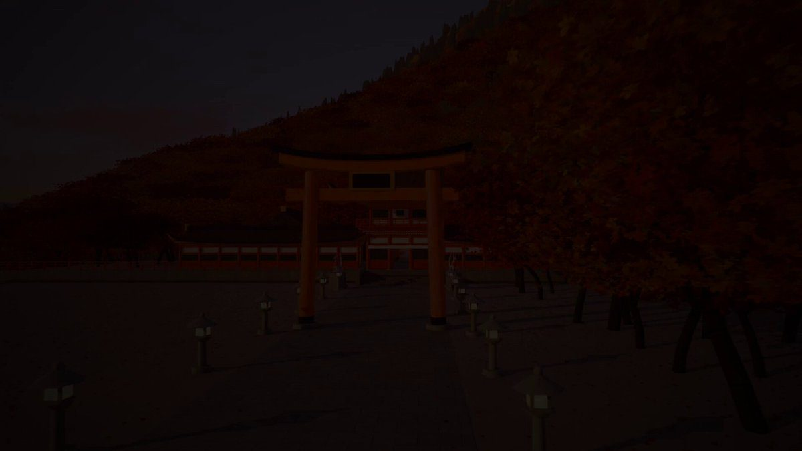</a><br>
<strong><a href="docs/cases/x-petergyang-fable52-854431/README.md">京都伏见稻荷，20 秒代码旅行宣传片</a></strong><br>
Credit: @petergyang（Peter Yang）<br><a href="https://x.com/petergyang/status/2119886560992854431">Post</a>
 · <a href="docs/cases/x-petergyang-fable52-854431/media/video.mp4">▶ Video</a>
</td>
</tr>
<tr>
<td align="center" width="33%">
<a href="https://x.com/petergostev/status/2119877733488394520">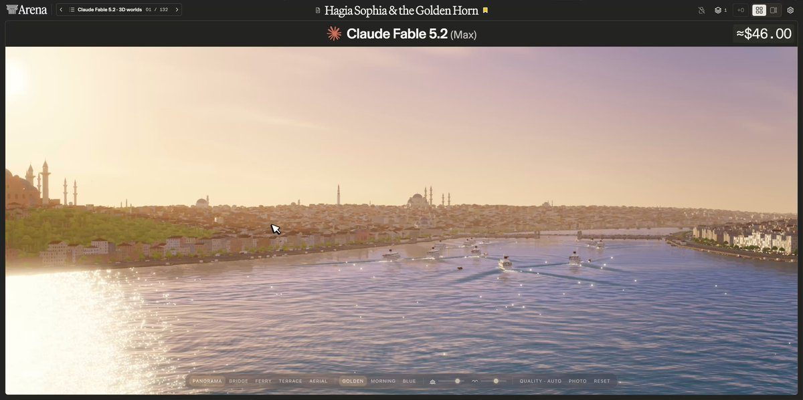</a><br>
<strong><a href="docs/cases/x-petergostev-fable52-max/README.md">用 Max 档做一段伊斯坦布尔水岸漫游</a></strong><br>
Credit: @petergostev（Peter Gostev）<br><a href="https://x.com/petergostev/status/2119877733488394520">Post</a>
 · <a href="docs/cases/x-petergostev-fable52-max/media/video.mp4">▶ Video</a>
</td>
<td align="center" width="33%">
<a href="https://x.com/nikodemszymansk/status/2119880518875435022">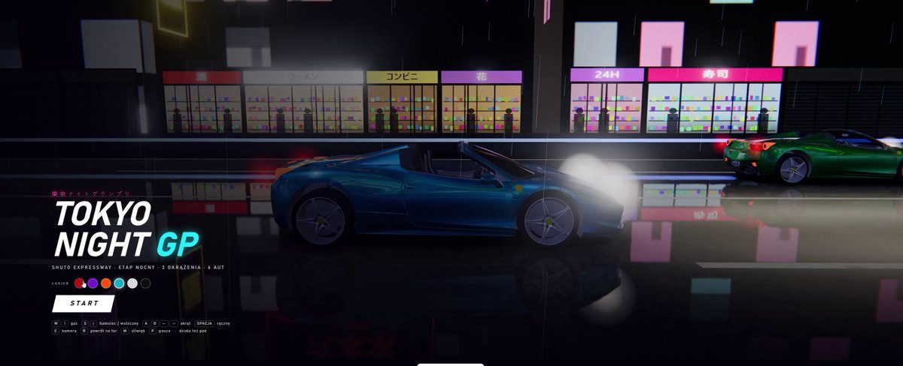</a><br>
<strong><a href="docs/cases/x-nikodemszymansk-fable52-tokyo-night/README.md">Tokyo Night GP，带湿地反光的三圈夜赛</a></strong><br>
Credit: @nikodemszymansk（Nikodem | AI Creator）<br><a href="https://x.com/nikodemszymansk/status/2119880518875435022">Post</a>
 · <a href="docs/cases/x-nikodemszymansk-fable52-tokyo-night/media/video.mp4">▶ Video</a>
</td>
<td align="center" width="33%">
<a href="https://x.com/NFT_Chen/status/2119897058597609967">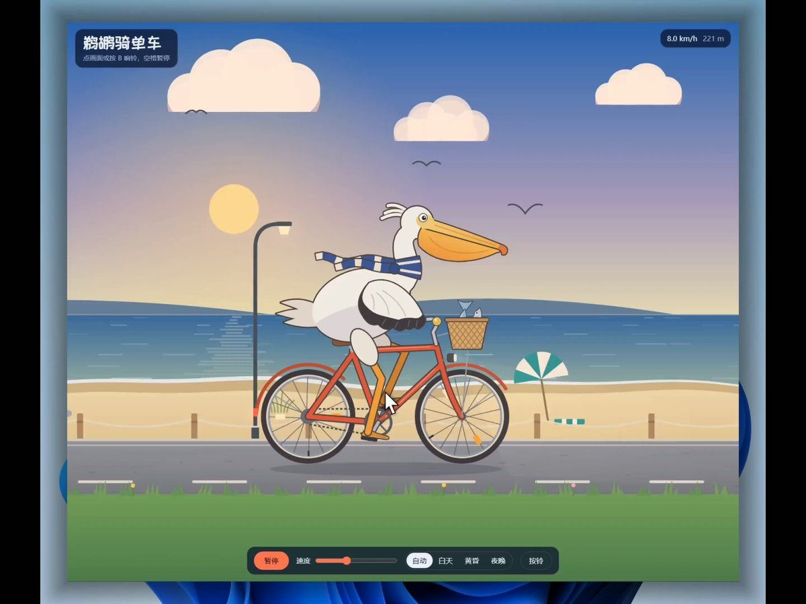</a><br>
<strong><a href="docs/cases/x-nftchen-fable52-609967/README.md">给骑单车的鹈鹕加调速、灯和车铃</a></strong><br>
Credit: @NFT_Chen（SuSu_酥酥👅）<br><a href="https://x.com/NFT_Chen/status/2119897058597609967">Post</a>
 · <a href="docs/cases/x-nftchen-fable52-609967/media/video.mp4">▶ Video</a>
</td>
</tr>
<tr>
<td align="center" width="33%">
<a href="https://x.com/mihawkxxxxx/status/2119909865296699749"></a><br>
<strong><a href="docs/cases/x-mihawkxxxxx-fable52-roblox-mcp-the-clockmaker/README.md">用 Roblox MCP 制作《The Clockmaker’s Mansion》与预告</a></strong><br>
Credit: @mihawkxxxxx（mihawkxxx）<br><a href="https://x.com/mihawkxxxxx/status/2119909865296699749">Post</a>
 · <a href="docs/cases/x-mihawkxxxxx-fable52-roblox-mcp-the-clockmaker/media/video.mp4">▶ Video</a>
</td>
<td align="center" width="33%">
<a href="https://x.com/mattshumer_/status/2119877065701036047"></a><br>
<strong><a href="docs/cases/x-mattshumer-fable52-mirror-earth/README.md">Mirror Earth，把真实地球当作可破坏的游戏地图</a></strong><br>
Credit: @mattshumer_（Matt Shumer）<br><a href="https://x.com/mattshumer_/status/2119877065701036047">Post</a>
 · <a href="docs/cases/x-mattshumer-fable52-mirror-earth/media/video.mp4">▶ Video</a>
</td>
<td align="center" width="33%">
<a href="https://x.com/mattshumer_/status/2119872098306810226">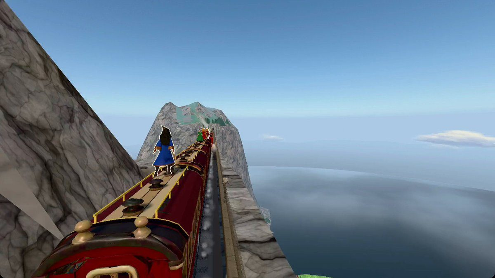</a><br>
<strong><a href="docs/cases/x-mattshumer-fable52-hogwarts-royale/README.md">Hogwarts Royale，把霍格沃茨和大逃杀放在一起</a></strong><br>
Credit: @mattshumer_（Matt Shumer）<br><a href="https://x.com/mattshumer_/status/2119872098306810226">Post</a>
 · <a href="docs/cases/x-mattshumer-fable52-hogwarts-royale/media/video.mp4">▶ Video</a>
</td>
</tr>
<tr>
<td align="center" width="33%">
<a href="https://x.com/mattshumer_/status/2119884041331892403">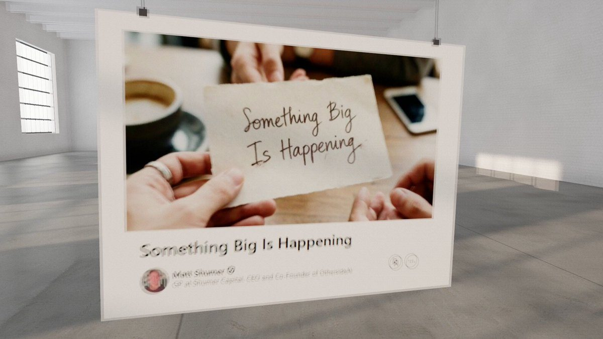</a><br>
<strong><a href="docs/cases/x-mattshumer-fable52-892403/README.md">把文章放进虚拟展厅，做成约 4 分 44 秒视频</a></strong><br>
Credit: @mattshumer_（Matt Shumer）<br><a href="https://x.com/mattshumer_/status/2119884041331892403">Post</a>
 · <a href="docs/cases/x-mattshumer-fable52-892403/media/video.mp4">▶ Video</a>
</td>
<td align="center" width="33%">
<a href="https://x.com/mattshumer_/status/2119900920347828670"></a><br>
<strong><a href="docs/cases/x-mattshumer-fable52-828670/README.md">一部约 49 分钟的代码电影</a></strong><br>
Credit: @mattshumer_（Matt Shumer）<br><a href="https://x.com/mattshumer_/status/2119900920347828670">Post</a>
 · <a href="docs/cases/x-mattshumer-fable52-828670/media/video.mp4">▶ Video</a>
</td>
<td align="center" width="33%">
<a href="https://x.com/mattshumer_/status/2119870965106483384">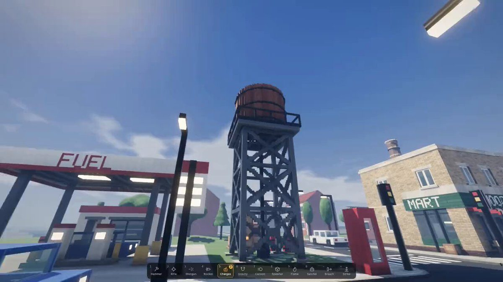</a><br>
<strong><a href="docs/cases/x-mattshumer-fable52-483384/README.md">一条提示启动的体素破坏引擎</a></strong><br>
Credit: @mattshumer_（Matt Shumer）<br><a href="https://x.com/mattshumer_/status/2119870965106483384">Post</a>
 · <a href="docs/cases/x-mattshumer-fable52-483384/media/video.mp4">▶ Video</a>
</td>
</tr>
<tr>
<td align="center" width="33%">
<a href="https://x.com/mattshumer_/status/2119889518564147409"></a><br>
<strong><a href="docs/cases/x-mattshumer-fable52-147409/README.md">为公寓里可以制作的机器人出一版外观原型</a></strong><br>
Credit: @mattshumer_（Matt Shumer）<br><a href="https://x.com/mattshumer_/status/2119889518564147409">Post</a>
 · <a href="docs/cases/x-mattshumer-fable52-147409/media/video.mp4">▶ Video</a>
</td>
<td align="center" width="33%">
<a href="https://x.com/MatthewBerman/status/2119868636810953017">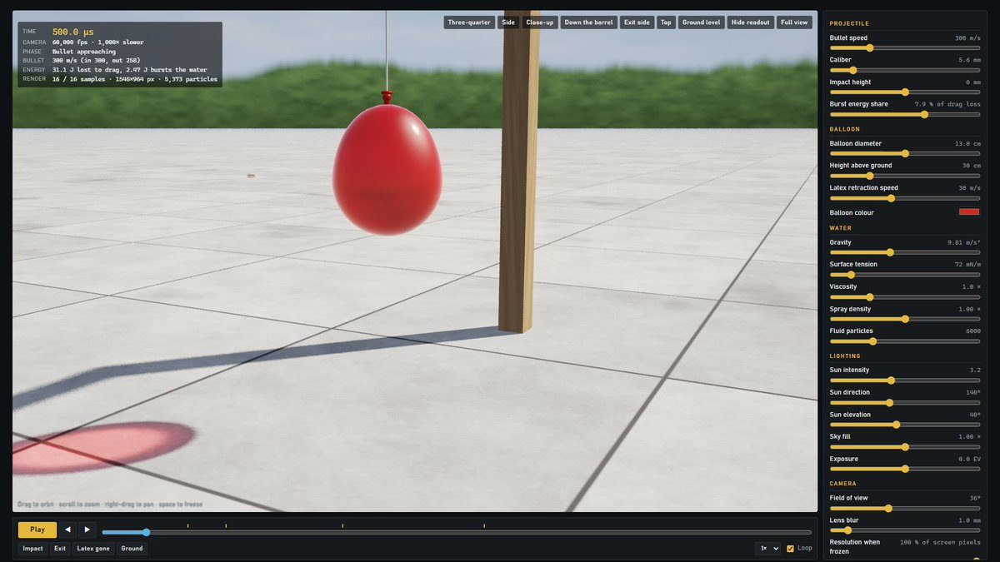</a><br>
<strong><a href="docs/cases/x-matthewberman-fable52-webgl/README.md">用 WebGL 演示子弹穿过装水气球</a></strong><br>
Credit: @MatthewBerman（Matthew Berman）<br><a href="https://x.com/MatthewBerman/status/2119868636810953017">Post</a>
 · <a href="docs/cases/x-matthewberman-fable52-webgl/media/video.mp4">▶ Video</a>
</td>
<td align="center" width="33%">
<a href="https://x.com/MatthewBerman/status/2119868629491789992">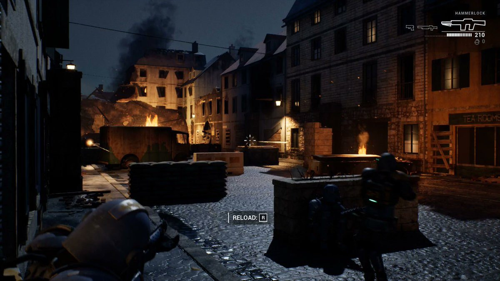</a><br>
<strong><a href="docs/cases/x-matthewberman-fable52-unreal-engine/README.md">在 Unreal Engine 里做《战争机器》风格的射击原型</a></strong><br>
Credit: @MatthewBerman（Matthew Berman）<br><a href="https://x.com/MatthewBerman/status/2119868629491789992">Post</a>
 · <a href="docs/cases/x-matthewberman-fable52-unreal-engine/media/video.mp4">▶ Video</a>
</td>
</tr>
<tr>
<td align="center" width="33%">
<a href="https://x.com/MatthewBerman/status/2119868642796154944"></a><br>
<strong><a href="docs/cases/x-matthewberman-fable52-quadrille-excel/README.md">Quadrille，浏览器里的 Excel 风格表格</a></strong><br>
Credit: @MatthewBerman（Matthew Berman）<br><a href="https://x.com/MatthewBerman/status/2119868642796154944">Post</a>
 · <a href="docs/cases/x-matthewberman-fable52-quadrille-excel/media/video.mp4">▶ Video</a>
</td>
<td align="center" width="33%">
<a href="https://x.com/MatthewBerman/status/2119872042053128412">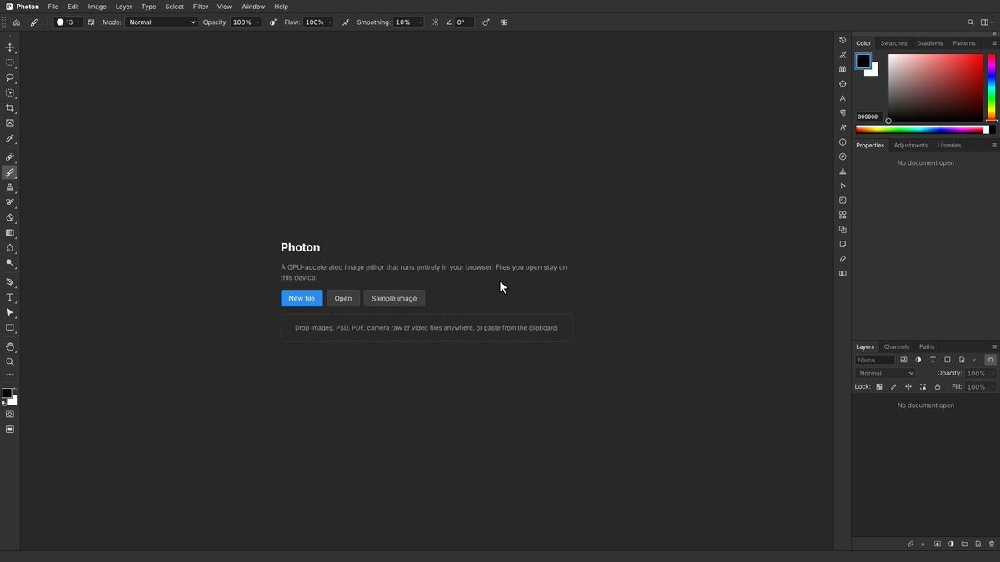</a><br>
<strong><a href="docs/cases/x-matthewberman-fable52-photon-photoshop/README.md">Photon，Photoshop 风格的在线图像编辑器</a></strong><br>
Credit: @MatthewBerman（Matthew Berman）<br><a href="https://x.com/MatthewBerman/status/2119872042053128412">Post</a>
 · <a href="docs/cases/x-matthewberman-fable52-photon-photoshop/media/video.mp4">▶ Video</a>
</td>
<td align="center" width="33%">
<a href="https://x.com/MatthewBerman/status/2119868640879349998">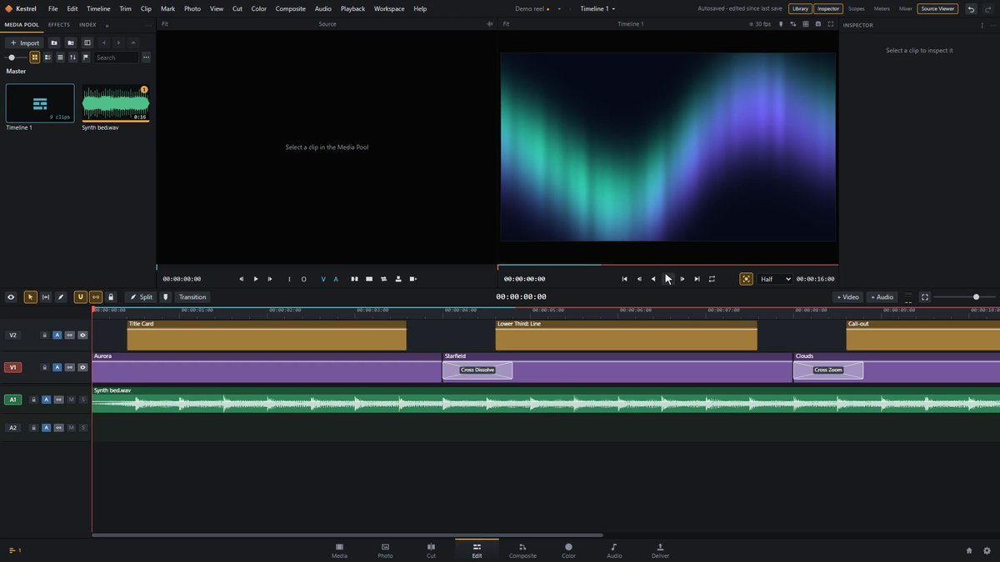</a><br>
<strong><a href="docs/cases/x-matthewberman-fable52-kestrel-windows/README.md">Kestrel，在 Windows 本地运行的时间线编辑器</a></strong><br>
Credit: @MatthewBerman（Matthew Berman）<br><a href="https://x.com/MatthewBerman/status/2119868640879349998">Post</a>
 · <a href="docs/cases/x-matthewberman-fable52-kestrel-windows/media/video.mp4">▶ Video</a>
</td>
</tr>
<tr>
<td align="center" width="33%">
<a href="https://x.com/MatthewBerman/status/2119868633086378471"></a><br>
<strong><a href="docs/cases/x-matthewberman-fable52-378471/README.md">用 约 50 秒动效讲大语言模型</a></strong><br>
Credit: @MatthewBerman（Matthew Berman）<br><a href="https://x.com/MatthewBerman/status/2119868633086378471">Post</a>
 · <a href="docs/cases/x-matthewberman-fable52-378471/media/video.mp4">▶ Video</a>
</td>
<td align="center" width="33%">
<a href="https://x.com/MatthewBerman/status/2119868630989254665">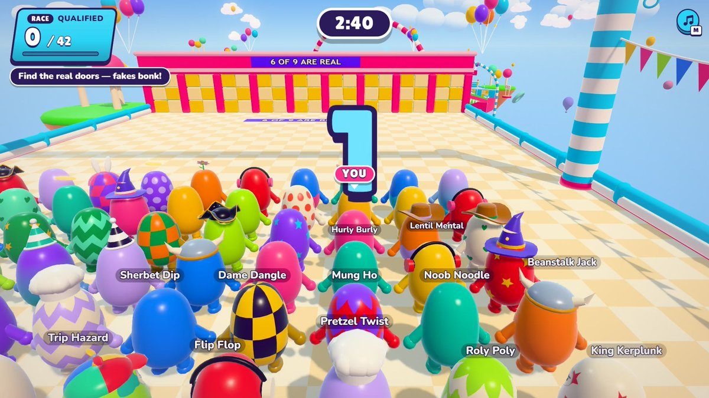</a><br>
<strong><a href="docs/cases/x-matthewberman-fable52-254665/README.md">《糖豆人》风格闯关原型</a></strong><br>
Credit: @MatthewBerman（Matthew Berman）<br><a href="https://x.com/MatthewBerman/status/2119868630989254665">Post</a>
 · <a href="docs/cases/x-matthewberman-fable52-254665/media/video.mp4">▶ Video</a>
</td>
<td align="center" width="33%">
<a href="https://x.com/MatthewBerman/status/2119868638929060195">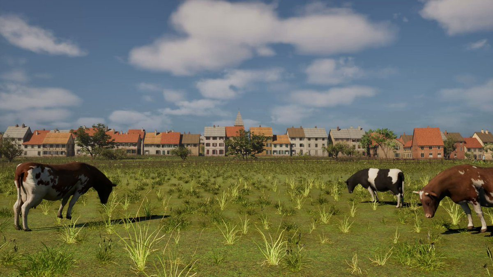</a><br>
<strong><a href="docs/cases/x-matthewberman-fable52-060195/README.md">搭一座能和居民对话的三维欧洲村庄</a></strong><br>
Credit: @MatthewBerman（Matthew Berman）<br><a href="https://x.com/MatthewBerman/status/2119868638929060195">Post</a>
 · <a href="docs/cases/x-matthewberman-fable52-060195/media/video.mp4">▶ Video</a>
</td>
</tr>
<tr>
<td align="center" width="33%">
<a href="https://x.com/marcthecreatorr/status/2119890973560054072">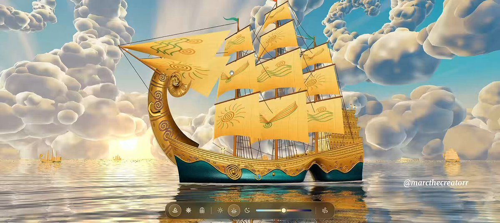</a><br>
<strong><a href="docs/cases/x-marcthecreatorr-fable52-054072/README.md">打开网页看一艘代码生成的三维帆船</a></strong><br>
Credit: @marcthecreatorr（Marcel）<br><a href="https://x.com/marcthecreatorr/status/2119890973560054072">Post</a>
 · <a href="docs/cases/x-marcthecreatorr-fable52-054072/media/video.mp4">▶ Video</a>
</td>
<td align="center" width="33%">
<a href="https://x.com/Maaaaaaadiii/status/2119885527243714946"></a><br>
<strong><a href="docs/cases/x-maaaaaaadiii-fable52-714946/README.md">从贴纸到吊链和铃声，程序化做一张会动的招牌</a></strong><br>
Credit: @Maaaaaaadiii（Hammad Hanif）<br><a href="https://x.com/Maaaaaaadiii/status/2119885527243714946">Post</a>
 · <a href="docs/cases/x-maaaaaaadiii-fable52-714946/media/video.mp4">▶ Video</a>
</td>
<td align="center" width="33%">
<a href="https://x.com/kplikethebird/status/2119900775727902732">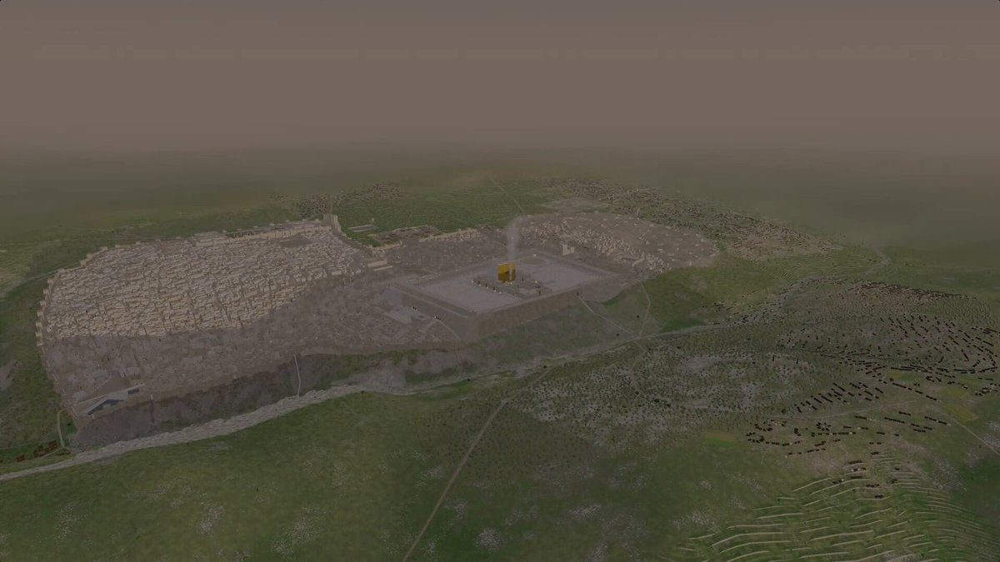</a><br>
<strong><a href="docs/cases/x-kplikethebird-fable52-blender/README.md">用 Blender 重建公元一世纪的耶路撒冷街区</a></strong><br>
Credit: @kplikethebird（Katie Parrott）<br><a href="https://x.com/kplikethebird/status/2119900775727902732">Post</a>
 · <a href="docs/cases/x-kplikethebird-fable52-blender/media/video.mp4">▶ Video</a>
</td>
</tr>
<tr>
<td align="center" width="33%">
<a href="https://x.com/kieranklaassen/status/2119871673294037280">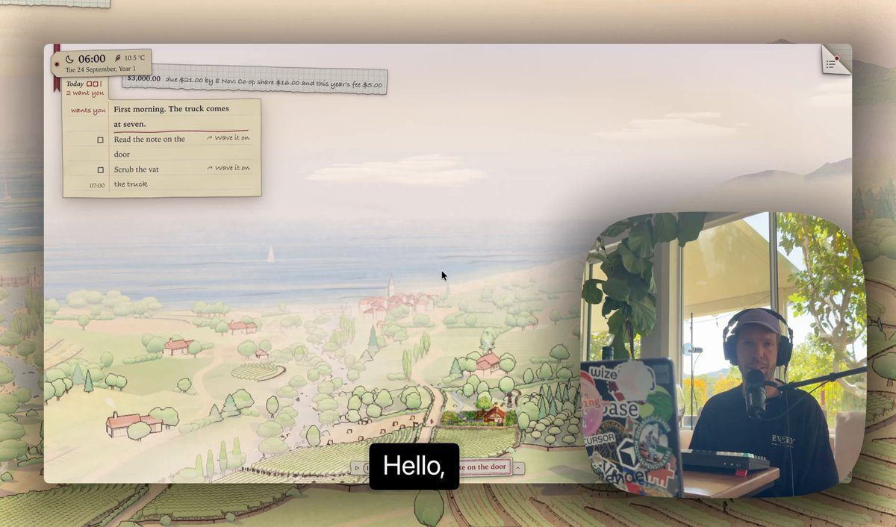</a><br>
<strong><a href="docs/cases/x-kieranklaassen-fable52-first-crush/README.md">First Crush，把葡萄酒酿造步骤变成游戏</a></strong><br>
Credit: @kieranklaassen（Kieran Klaassen）<br><a href="https://x.com/kieranklaassen/status/2119871673294037280">Post</a>
 · <a href="docs/cases/x-kieranklaassen-fable52-first-crush/media/video.mp4">▶ Video</a>
</td>
<td align="center" width="33%">
<a href="https://x.com/kieranklaassen/status/2119904489717272680"></a><br>
<strong><a href="docs/cases/x-kieranklaassen-fable52-everycut/README.md">Everycut，把录屏、文字剪辑和混音放进同一款编辑器</a></strong><br>
Credit: @kieranklaassen（Kieran Klaassen）<br><a href="https://x.com/kieranklaassen/status/2119904489717272680">Post</a>
 · <a href="docs/cases/x-kieranklaassen-fable52-everycut/media/video.mp4">▶ Video</a>
</td>
<td align="center" width="33%">
<a href="https://x.com/kieranklaassen/status/2119868196773929160">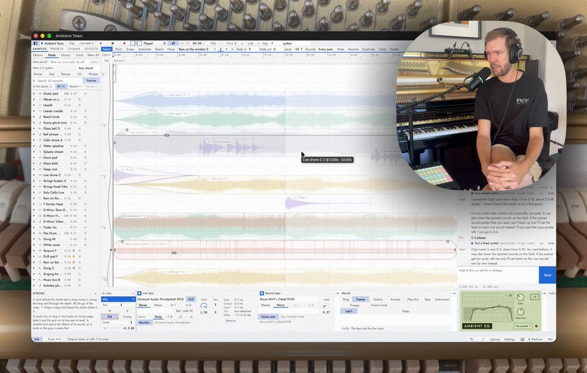</a><br>
<strong><a href="docs/cases/x-kieranklaassen-fable52-ableton-push/README.md">支持 Ableton Push 的环境音乐工作站</a></strong><br>
Credit: @kieranklaassen（Kieran Klaassen）<br><a href="https://x.com/kieranklaassen/status/2119868196773929160">Post</a>
 · <a href="docs/cases/x-kieranklaassen-fable52-ableton-push/media/video.mp4">▶ Video</a>
</td>
</tr>
<tr>
<td align="center" width="33%">
<a href="https://x.com/kevin_t_ngo/status/2119868968307695818"></a><br>
<strong><a href="docs/cases/x-kevintngo-fable52-what-the-water-keeps/README.md">What the Water Keeps，坐船穿过八个梦境场景</a></strong><br>
Credit: @kevin_t_ngo（Kevin Ngo）<br><a href="https://x.com/kevin_t_ngo/status/2119868968307695818">Post</a>
 · <a href="docs/cases/x-kevintngo-fable52-what-the-water-keeps/media/video.mp4">▶ Video</a>
</td>
<td align="center" width="33%">
<a href="https://x.com/kevin_t_ngo/status/2119972124211454139"></a><br>
<strong><a href="docs/cases/x-kevintngo-fable52-python-blender/README.md">用 Python 和 Blender 做一支 90 年代风格玩具广告</a></strong><br>
Credit: @kevin_t_ngo（Kevin Ngo）<br><a href="https://x.com/kevin_t_ngo/status/2119972124211454139">Post</a>
 · <a href="docs/cases/x-kevintngo-fable52-python-blender/media/video.mp4">▶ Video</a>
</td>
<td align="center" width="33%">
<a href="https://x.com/kevin_t_ngo/status/2119938129079808282">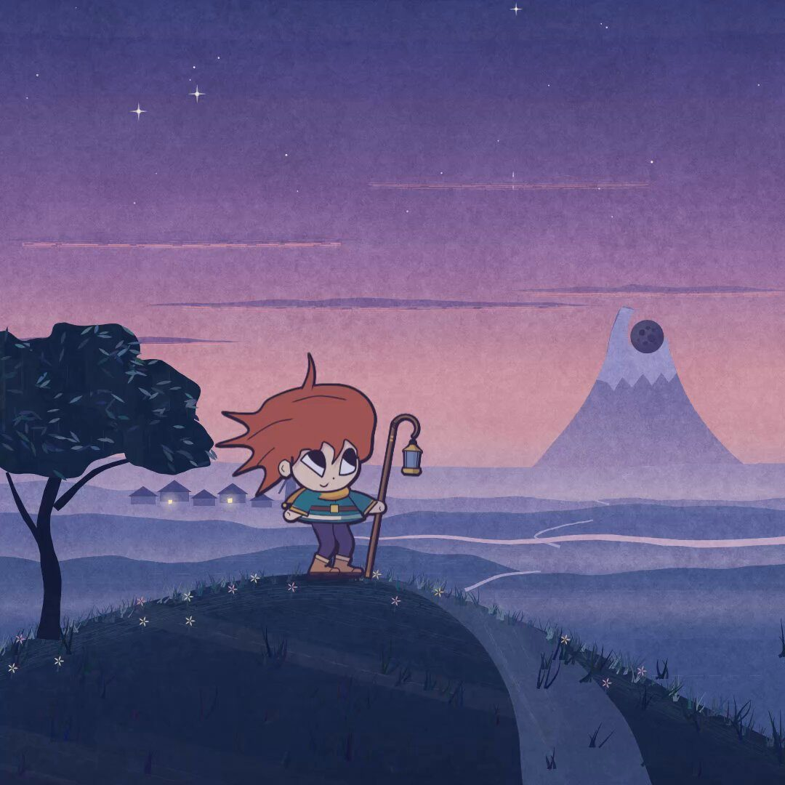</a><br>
<strong><a href="docs/cases/x-kevintngo-fable52-javascript/README.md">用 JavaScript 逐帧画一段约 100 秒的动画</a></strong><br>
Credit: @kevin_t_ngo（Kevin Ngo）<br><a href="https://x.com/kevin_t_ngo/status/2119938129079808282">Post</a>
 · <a href="docs/cases/x-kevintngo-fable52-javascript/media/video.mp4">▶ Video</a>
</td>
</tr>
<tr>
<td align="center" width="33%">
<a href="https://x.com/kevin_t_ngo/status/2119900487688622171">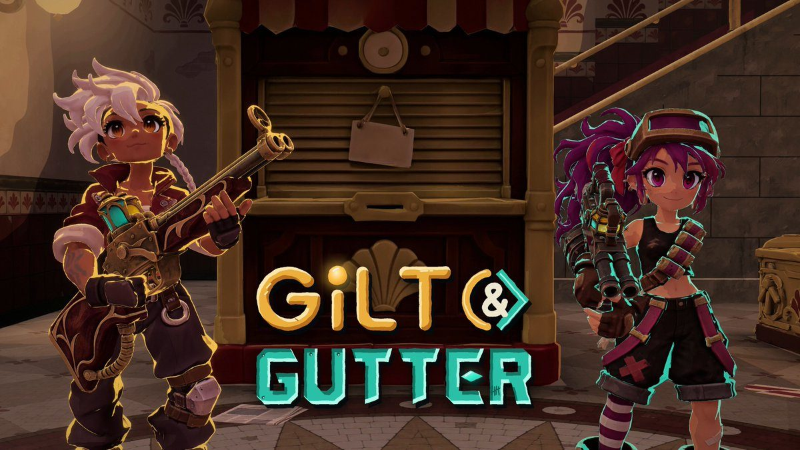</a><br>
<strong><a href="docs/cases/x-kevintngo-fable52-gilt-gutter/README.md">Gilt &amp; Gutter，用弹药颜色做 1 对 1 射击机制</a></strong><br>
Credit: @kevin_t_ngo（Kevin Ngo）<br><a href="https://x.com/kevin_t_ngo/status/2119900487688622171">Post</a>
 · <a href="docs/cases/x-kevintngo-fable52-gilt-gutter/media/video.mp4">▶ Video</a>
</td>
<td align="center" width="33%">
<a href="https://x.com/jkeatn/status/2119874007382299087">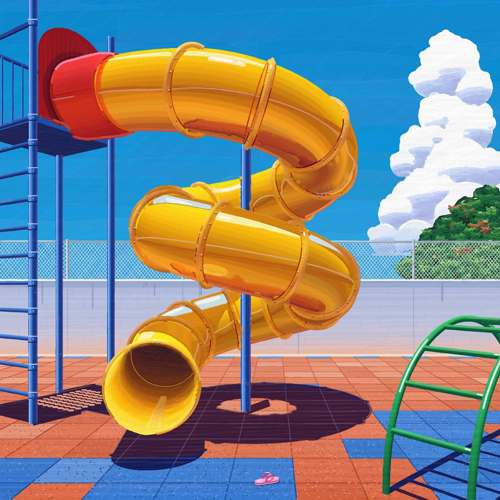</a><br>
<strong><a href="docs/cases/x-jkeatn-fable52-python/README.md">用 Python 模拟画笔，按虚构画家风格作画</a></strong><br>
Credit: @jkeatn（Jake Eaton）<br><a href="https://x.com/jkeatn/status/2119874007382299087">Post</a>
 · <a href="docs/cases/x-jkeatn-fable52-python/media/video.mp4">▶ Video</a>
</td>
<td align="center" width="33%">
<a href="https://x.com/jev_chat/status/2120015641151426838"></a><br>
<strong><a href="docs/cases/x-jev-chat-fable52-an-acrobat-stack-on-a-bipl/README.md">An acrobat stack on a biplane above the clouds, a 3D short in Chinese</a></strong><br>
Credit: @jev_chat<br><a href="https://x.com/jev_chat/status/2120015641151426838">Post</a>
 · <a href="docs/cases/x-jev-chat-fable52-an-acrobat-stack-on-a-bipl/media/video.mp4">▶ Video</a>
</td>
</tr>
<tr>
<td align="center" width="33%">
<a href="https://x.com/itssotsot/status/2119909017216491720">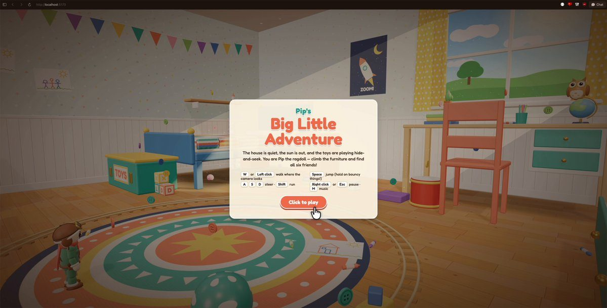</a><br>
<strong><a href="docs/cases/x-itssotsot-fable52-big-little-adventure/README.md">Big Little Adventure，把家具变成小角色的关卡</a></strong><br>
Credit: @itssotsot（Sotiris Kaniras）<br><a href="https://x.com/itssotsot/status/2119909017216491720">Post</a>
 · <a href="docs/cases/x-itssotsot-fable52-big-little-adventure/media/video.mp4">▶ Video</a>
</td>
<td align="center" width="33%">
<a href="https://x.com/ilya_sb1/status/2119878436529246669">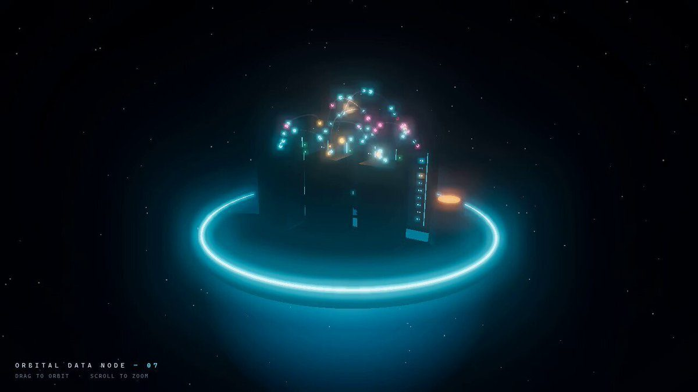</a><br>
<strong><a href="docs/cases/x-ilyasb1-fable52-orbital-data-node/README.md">Orbital Data Node 07，把数据中心搬到太空</a></strong><br>
Credit: @ilya_sb1（Ilya Rzhevskiy）<br><a href="https://x.com/ilya_sb1/status/2119878436529246669">Post</a>
 · <a href="docs/cases/x-ilyasb1-fable52-orbital-data-node/media/video.mp4">▶ Video</a>
</td>
<td align="center" width="33%">
<a href="https://x.com/hello_amani/status/2119873980786237842"></a><br>
<strong><a href="docs/cases/x-helloamani-fable52-237842/README.md">把金属质感的标志做成一段三维动效</a></strong><br>
Credit: @hello_amani（Amani • Design Partner）<br><a href="https://x.com/hello_amani/status/2119873980786237842">Post</a>
 · <a href="docs/cases/x-helloamani-fable52-237842/media/video.mp4">▶ Video</a>
</td>
</tr>
<tr>
<td align="center" width="33%">
<a href="https://x.com/hammer_mt/status/2119906374066835495">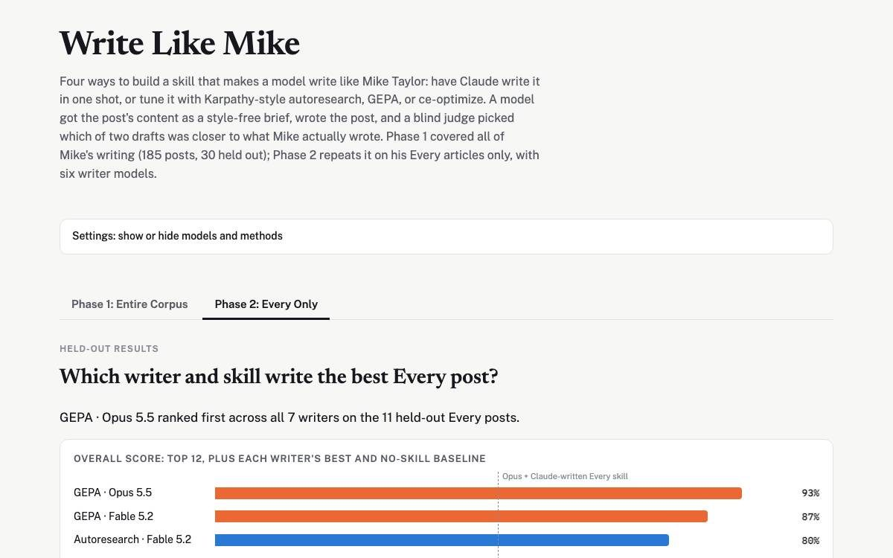</a><br>
<strong><a href="docs/cases/x-hammermt-fable52-write-like-mike/README.md">Write Like Mike，用留出的旧文章盲评写作技能</a></strong><br>
Credit: @hammer_mt（Mike Taylor）<br><a href="https://x.com/hammer_mt/status/2119906374066835495">Post</a>
</td>
<td align="center" width="33%">
<a href="https://x.com/hammer_mt/status/2119906441389826445">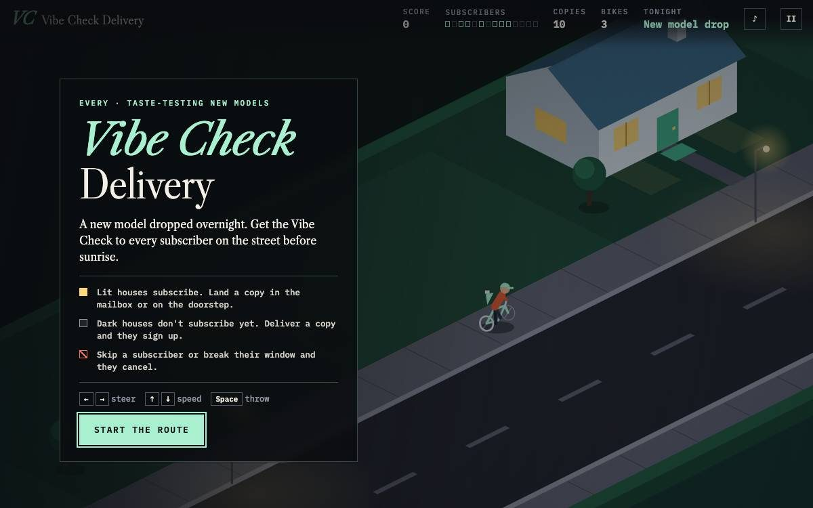</a><br>
<strong><a href="docs/cases/x-hammermt-fable52-vibe-check-delivery/README.md">Vibe Check Delivery，三个模型做同题送报游戏</a></strong><br>
Credit: @hammer_mt（Mike Taylor）<br><a href="https://x.com/hammer_mt/status/2119906441389826445">Post</a>
</td>
<td align="center" width="33%">
<a href="https://x.com/hammer_mt/status/2119906389284057363">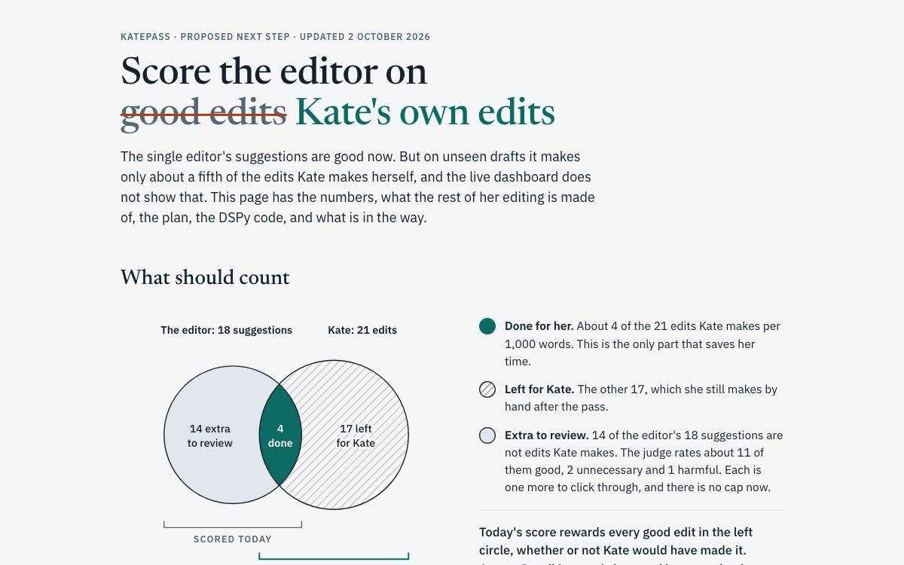</a><br>
<strong><a href="docs/cases/x-hammermt-fable52-katepass/README.md">KatePass，用 320 份旧草稿衡量编辑还剩多少工作</a></strong><br>
Credit: @hammer_mt（Mike Taylor）<br><a href="https://x.com/hammer_mt/status/2119906389284057363">Post</a>
</td>
</tr>
<tr>
<td align="center" width="33%">
<a href="https://x.com/hammer_mt/status/2119871817561346319">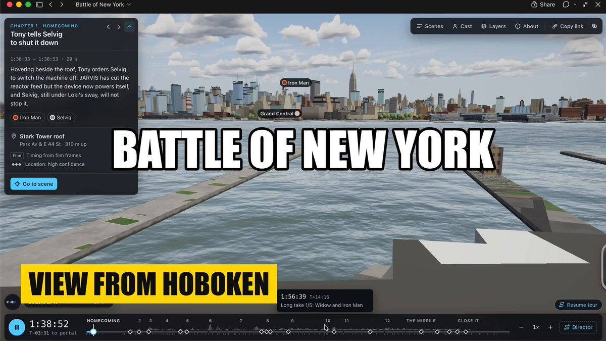</a><br>
<strong><a href="docs/cases/x-hammermt-fable52-346319/README.md">用三维地图复盘《复仇者联盟》的纽约大战</a></strong><br>
Credit: @hammer_mt（Mike Taylor）<br><a href="https://x.com/hammer_mt/status/2119871817561346319">Post</a>
 · <a href="docs/cases/x-hammermt-fable52-346319/media/video.mp4">▶ Video</a>
</td>
<td align="center" width="33%">
<a href="https://x.com/hammer_mt/status/2119906412709183568">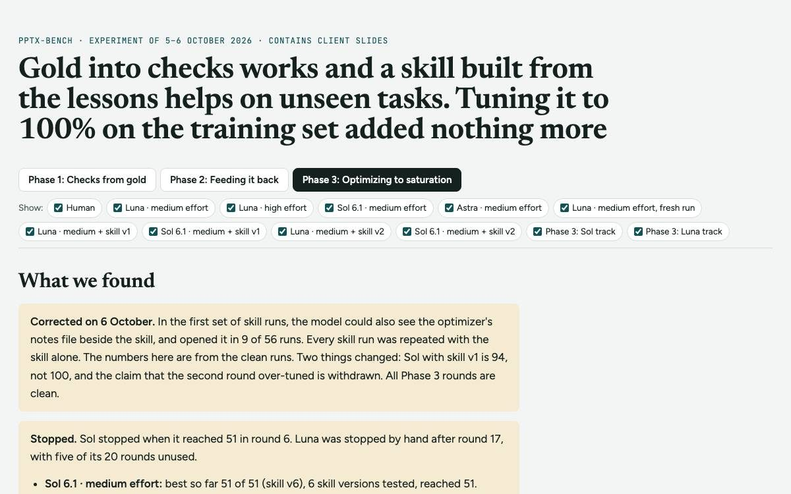</a><br>
<strong><a href="docs/cases/x-hammermt-fable52-183568/README.md">从 14 套咨询演示稿提取能自动检查的规则</a></strong><br>
Credit: @hammer_mt（Mike Taylor）<br><a href="https://x.com/hammer_mt/status/2119906412709183568">Post</a>
</td>
<td align="center" width="33%">
<a href="https://x.com/hammer_mt/status/2119907037631103010">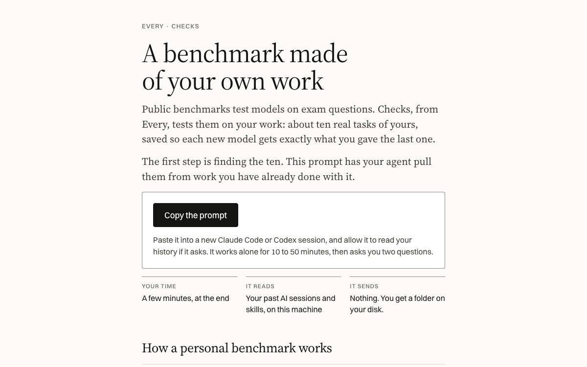</a><br>
<strong><a href="docs/cases/x-hammermt-fable52-103010/README.md">从个人 AI 使用历史整理十个可重复的评测任务</a></strong><br>
Credit: @hammer_mt（Mike Taylor）<br><a href="https://x.com/hammer_mt/status/2119907037631103010">Post</a>
</td>
</tr>
<tr>
<td align="center" width="33%">
<a href="https://x.com/geneohms/status/2119910054413685102"></a><br>
<strong><a href="docs/cases/x-geneohms-fable52-685102/README.md">从手机里发起任务，得到能与电脑对弈的棋盘</a></strong><br>
Credit: @geneohms（Gene）<br><a href="https://x.com/geneohms/status/2119910054413685102">Post</a>
 · <a href="docs/cases/x-geneohms-fable52-685102/media/video.mp4">▶ Video</a>
</td>
<td align="center" width="33%">
<a href="https://x.com/ForwardEditor/status/2119867747425194377"></a><br>
<strong><a href="docs/cases/x-forwardeditor-fable52-zero/README.md">给既有 F-Zero 风格赛车加金属爪漂移和瞬移</a></strong><br>
Credit: @ForwardEditor（Future Brian）<br><a href="https://x.com/ForwardEditor/status/2119867747425194377">Post</a>
 · <a href="docs/cases/x-forwardeditor-fable52-zero/media/video.mp4">▶ Video</a>
</td>
<td align="center" width="33%">
<a href="https://x.com/ForwardEditor/status/2119867782238212524">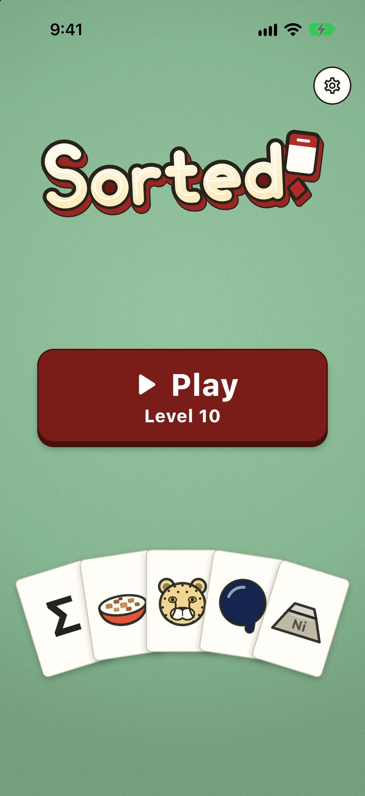</a><br>
<strong><a href="docs/cases/x-forwardeditor-fable52-sorted-ios/README.md">Sorted!，以纸牌接龙为灵感的 iOS 样机</a></strong><br>
Credit: @ForwardEditor（Future Brian）<br><a href="https://x.com/ForwardEditor/status/2119867782238212524">Post</a>
</td>
</tr>
<tr>
<td align="center" width="33%">
<a href="https://x.com/ForwardEditor/status/2119867753376940396">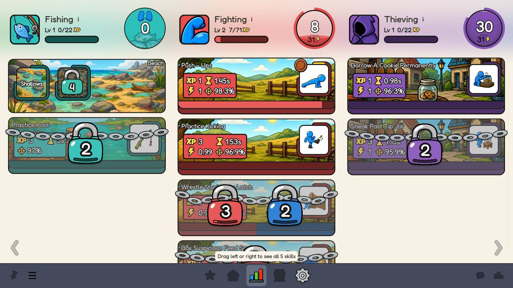</a><br>
<strong><a href="docs/cases/x-forwardeditor-fable52-idle-elite/README.md">在约 8 万行的 Idle Elite 代码库中接手开发</a></strong><br>
Credit: @ForwardEditor（Future Brian）<br><a href="https://x.com/ForwardEditor/status/2119867753376940396">Post</a>
</td>
<td align="center" width="33%">
<a href="https://x.com/ForwardEditor/status/2119867791150928106"></a><br>
<strong><a href="docs/cases/x-forwardeditor-fable52-928106/README.md">12 篇漫画试验，作者公开了没做满意的版本</a></strong><br>
Credit: @ForwardEditor（Future Brian）<br><a href="https://x.com/ForwardEditor/status/2119867791150928106">Post</a>
</td>
<td align="center" width="33%">
<a href="https://x.com/ForwardEditor/status/2119867743965163994">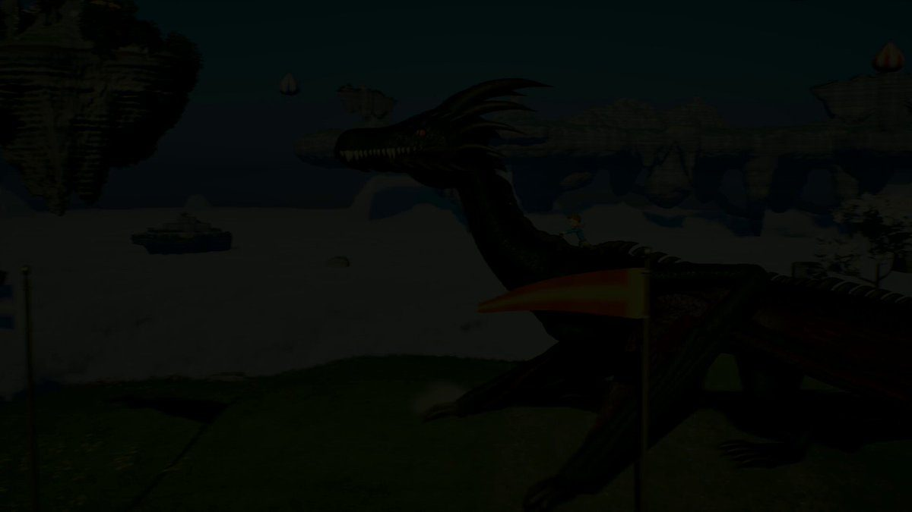</a><br>
<strong><a href="docs/cases/x-forwardeditor-fable52-163994/README.md">骑龙从空岛跃下，测试视角和飞行感</a></strong><br>
Credit: @ForwardEditor（Future Brian）<br><a href="https://x.com/ForwardEditor/status/2119867743965163994">Post</a>
 · <a href="docs/cases/x-forwardeditor-fable52-163994/media/video.mp4">▶ Video</a>
</td>
</tr>
<tr>
<td align="center" width="33%">
<a href="https://x.com/felixrieseberg/status/2119867840878825523">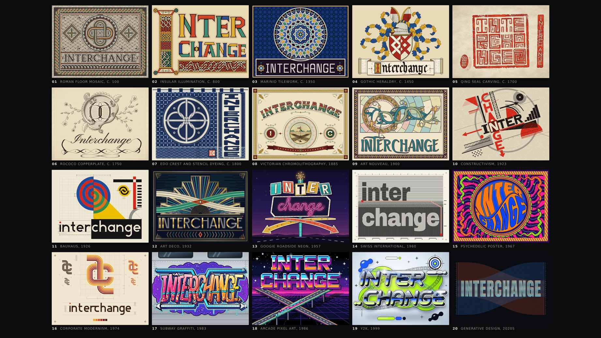</a><br>
<strong><a href="docs/cases/x-felixrieseberg-fable52-interchange/README.md">为虚构团体 Interchange 探索 20 款标志</a></strong><br>
Credit: @felixrieseberg（Felix Rieseberg）<br><a href="https://x.com/felixrieseberg/status/2119867840878825523">Post</a>
</td>
<td align="center" width="33%">
<a href="https://x.com/felixrieseberg/status/2119867839033352596"></a><br>
<strong><a href="docs/cases/x-felixrieseberg-fable52-352596/README.md">保留首版的第一人称射击等游戏样例</a></strong><br>
Credit: @felixrieseberg（Felix Rieseberg）<br><a href="https://x.com/felixrieseberg/status/2119867839033352596">Post</a>
</td>
<td align="center" width="33%">
<a href="https://x.com/FaridaNever/status/2119910055990505730"></a><br>
<strong><a href="docs/cases/x-faridanever-fable52-505730/README.md">水墨山景里的第三人称剑士</a></strong><br>
Credit: @FaridaNever（Farida）<br><a href="https://x.com/FaridaNever/status/2119910055990505730">Post</a>
 · <a href="docs/cases/x-faridanever-fable52-505730/media/video.mp4">▶ Video</a>
</td>
</tr>
<tr>
<td align="center" width="33%">
<a href="https://x.com/every/status/2119934581445145066">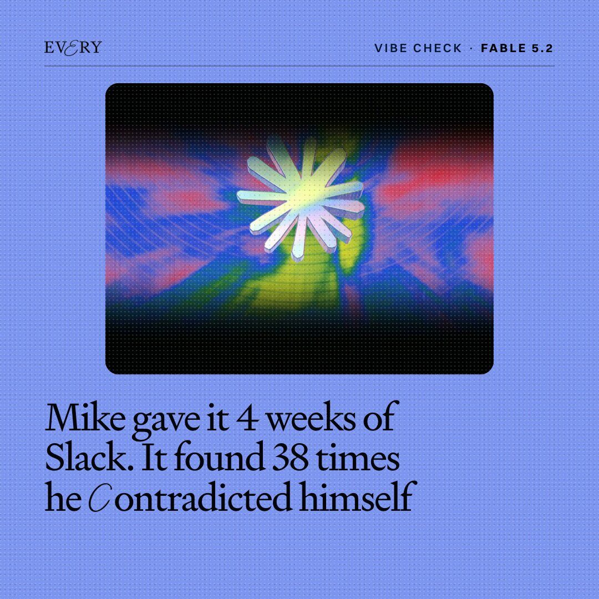</a><br>
<strong><a href="docs/cases/x-every-fable52-slack/README.md">从 Slack 与会议记录中找出 38 处说法冲突</a></strong><br>
Credit: @every（Every 📧）<br><a href="https://x.com/every/status/2119934581445145066">Post</a>
 · <a href="docs/cases/x-every-fable52-slack/media/video.mp4">▶ Video</a>
</td>
<td align="center" width="33%">
<a href="https://x.com/every/status/2119939866314289555"></a><br>
<strong><a href="docs/cases/x-every-fable52-high-max/README.md">High 和 Max 档，盲评同一组网页设计</a></strong><br>
Credit: @every（Every 📧）<br><a href="https://x.com/every/status/2119939866314289555">Post</a>
 · <a href="docs/cases/x-every-fable52-high-max/media/video.mp4">▶ Video</a>
</td>
<td align="center" width="33%">
<a href="https://x.com/every/status/2119928286465892357"></a><br>
<strong><a href="docs/cases/x-every-fable52-checks/README.md">放手一个周末，让代理给 Checks 做 75 项改动</a></strong><br>
Credit: @every（Every 📧）<br><a href="https://x.com/every/status/2119928286465892357">Post</a>
 · <a href="docs/cases/x-every-fable52-checks/media/video.mp4">▶ Video</a>
</td>
</tr>
<tr>
<td align="center" width="33%">
<a href="https://x.com/ericskavinski/status/2119895601580016005"></a><br>
<strong><a href="docs/cases/x-ericskavinski-fable52-three/README.md">用 Three.js 写出落日和海面反光</a></strong><br>
Credit: @ericskavinski（Eric Skavinski）<br><a href="https://x.com/ericskavinski/status/2119895601580016005">Post</a>
 · <a href="docs/cases/x-ericskavinski-fable52-three/media/video.mp4">▶ Video</a>
</td>
<td align="center" width="33%">
<a href="https://x.com/ericmaskfr/status/2119910195325481026"></a><br>
<strong><a href="docs/cases/x-ericmaskfr-fable52-481026/README.md">80 年代迈阿密风格的开放城市和任务系统</a></strong><br>
Credit: @ericmaskfr（eric）<br><a href="https://x.com/ericmaskfr/status/2119910195325481026">Post</a>
 · <a href="docs/cases/x-ericmaskfr-fable52-481026/media/video.mp4">▶ Video</a>
</td>
<td align="center" width="33%">
<a href="https://x.com/emollick/status/2119876449494540554"></a><br>
<strong><a href="docs/cases/x-emollick-fable52-scooby-doo/README.md">反转 Scooby-Doo，玩家要把调查的孩子吓跑</a></strong><br>
Credit: @emollick（Ethan Mollick）<br><a href="https://x.com/emollick/status/2119876449494540554">Post</a>
 · <a href="docs/cases/x-emollick-fable52-scooby-doo/media/video.mp4">▶ Video</a>
</td>
</tr>
<tr>
<td align="center" width="33%">
<a href="https://x.com/emollick/status/2119918307457577163"></a><br>
<strong><a href="docs/cases/x-emollick-fable52-portals/README.md">Portals，穿过传送门飞进 471 个代码世界</a></strong><br>
Credit: @emollick（Ethan Mollick）<br><a href="https://x.com/emollick/status/2119918307457577163">Post</a>
 · <a href="docs/cases/x-emollick-fable52-portals/media/video.mp4">▶ Video</a>
</td>
<td align="center" width="33%">
<a href="https://x.com/dom_scholz/status/2119933150025363661"></a><br>
<strong><a href="docs/cases/x-domscholz-fable52-ultramarine/README.md">Ultramarine，同一三维任务对照两代模型</a></strong><br>
Credit: @dom_scholz（Dominik Scholz）<br><a href="https://x.com/dom_scholz/status/2119933150025363661">Post</a>
 · <a href="docs/cases/x-domscholz-fable52-ultramarine/media/video.mp4">▶ Video</a>
</td>
<td align="center" width="33%">
<a href="https://x.com/DoctorYev/status/2119895951108423801"></a><br>
<strong><a href="docs/cases/x-doctoryev-fable52-uare/README.md">Uare，把一条宣传需求做成约 64 秒的发布片</a></strong><br>
Credit: @DoctorYev（Yev Marusenko）<br><a href="https://x.com/DoctorYev/status/2119895951108423801">Post</a>
 · <a href="docs/cases/x-doctoryev-fable52-uare/media/video.mp4">▶ Video</a>
</td>
</tr>
<tr>
<td align="center" width="33%">
<a href="https://x.com/DeryaTR_/status/2120083276916224014"></a><br>
<strong><a href="docs/cases/x-deryatr-fable52-ataturk-remembrance/README.md">10 November remembrance video by Fable 5.2</a></strong><br>
Credit: @DeryaTR_（Derya Unutmaz）<br><a href="https://x.com/DeryaTR_/status/2120083276916224014">Post</a>
 · <a href="docs/cases/x-deryatr-fable52-ataturk-remembrance/media/video.mp4">▶ Video</a>
</td>
<td align="center" width="33%">
<a href="https://x.com/danteeonsol/status/2119887623070077213"></a><br>
<strong><a href="docs/cases/x-danteeonsol-fable52-remotion-three-ufo/README.md">用 Remotion 和 Three.js 做 UFO 到访 51 区</a></strong><br>
Credit: @danteeonsol（Dante）<br><a href="https://x.com/danteeonsol/status/2119887623070077213">Post</a>
 · <a href="docs/cases/x-danteeonsol-fable52-remotion-three-ufo/media/video.mp4">▶ Video</a>
</td>
<td align="center" width="33%">
<a href="https://x.com/danshipper/status/2119869228207546638"></a><br>
<strong><a href="docs/cases/x-danshipper-fable52-546638/README.md">让代理采访研究者，再把录音剪成纪录片</a></strong><br>
Credit: @danshipper（Dan Shipper）<br><a href="https://x.com/danshipper/status/2119869228207546638">Post</a>
 · <a href="docs/cases/x-danshipper-fable52-546638/media/video.mp4">▶ Video</a>
</td>
</tr>
<tr>
<td align="center" width="33%">
<a href="https://x.com/DanielZambrini/status/2119893834276507954"></a><br>
<strong><a href="docs/cases/x-danielzambrini-fable52-fable-opus/README.md">15 秒火柴人对打，保留 Fable 与 Opus 的成本对照</a></strong><br>
Credit: @DanielZambrini（Daniel Zambrini）<br><a href="https://x.com/DanielZambrini/status/2119893834276507954">Post</a>
 · <a href="docs/cases/x-danielzambrini-fable52-fable-opus/media/video.mp4">▶ Video</a>
</td>
<td align="center" width="33%">
<a href="https://x.com/claudeai/status/2119899459761131615"></a><br>
<strong><a href="docs/cases/x-claudeai-fable52-pcb/README.md">从四层 PCB 到三款能工作的电子原型</a></strong><br>
Credit: @claudeai（Claude）<br><a href="https://x.com/claudeai/status/2119899459761131615">Post</a>
 · <a href="docs/cases/x-claudeai-fable52-pcb/media/video.mp4">▶ Video</a>
</td>
<td align="center" width="33%">
<a href="https://x.com/claudeai/status/2119899477855379913"></a><br>
<strong><a href="docs/cases/x-claudeai-fable52-miplib/README.md">求解 MIPLIB 开放问题，其中一个例子是 42 趟列车的排班</a></strong><br>
Credit: @claudeai（Claude）<br><a href="https://x.com/claudeai/status/2119899477855379913">Post</a>
</td>
</tr>
<tr>
<td align="center" width="33%">
<a href="https://x.com/claudeai/status/2119867129751056485"></a><br>
<strong><a href="docs/cases/x-claudeai-fable52-lean/README.md">1,000 个代理用约 29 小时复现费马大定理的 Lean 证明</a></strong><br>
Credit: @claudeai（Claude）<br><a href="https://x.com/claudeai/status/2119867129751056485">Post</a>
</td>
<td align="center" width="33%">
<a href="https://x.com/claudeai/status/2119867114450268322"></a><br>
<strong><a href="docs/cases/x-claudeai-fable52-268322/README.md">从空目录到可在笔记本启动的操作系统</a></strong><br>
Credit: @claudeai（Claude）<br><a href="https://x.com/claudeai/status/2119867114450268322">Post</a>
 · <a href="docs/cases/x-claudeai-fable52-268322/media/video.mp4">▶ Video</a>
</td>
<td align="center" width="33%">
<a href="https://x.com/claudeai/status/2119867132452221045"></a><br>
<strong><a href="docs/cases/x-claudeai-fable52-221045/README.md">用真实机械臂拧瓶盖、复原方块和画图</a></strong><br>
Credit: @claudeai（Claude）<br><a href="https://x.com/claudeai/status/2119867132452221045">Post</a>
 · <a href="docs/cases/x-claudeai-fable52-221045/media/video.mp4">▶ Video</a>
</td>
</tr>
<tr>
<td align="center" width="33%">
<a href="https://x.com/claudeai/status/2119899488995131439"></a><br>
<strong><a href="docs/cases/x-claudeai-fable52-131439/README.md">求出简化模型中模自举方法的精确界限</a></strong><br>
Credit: @claudeai（Claude）<br><a href="https://x.com/claudeai/status/2119899488995131439">Post</a>
</td>
<td align="center" width="33%">
<a href="https://x.com/clairevo/status/2119905651359142132"></a><br>
<strong><a href="docs/cases/x-clairevo-fable52-typed-page/README.md">typed.page，带纸张、色带和写作计时的网页打字机</a></strong><br>
Credit: @clairevo（claire vo 🖤）<br><a href="https://x.com/clairevo/status/2119905651359142132">Post</a>
 · <a href="docs/cases/x-clairevo-fable52-typed-page/media/video.mp4">▶ Video</a>
</td>
<td align="center" width="33%">
<a href="https://x.com/chetaslua/status/2119981510199808368"></a><br>
<strong><a href="docs/cases/x-chetaslua-fable52-808368/README.md">四张代码绘图，做成并排的动效展示</a></strong><br>
Credit: @chetaslua<br><a href="https://x.com/chetaslua/status/2119981510199808368">Post</a>
 · <a href="docs/cases/x-chetaslua-fable52-808368/media/video.mp4">▶ Video</a>
</td>
</tr>
<tr>
<td align="center" width="33%">
<a href="https://x.com/BeamManP/status/2119879390322622583"></a><br>
<strong><a href="docs/cases/x-beammanp-fable52-wasd-three/README.md">用 WASD 和空格操控 Three.js 坦克</a></strong><br>
Credit: @BeamManP（ビームマンＰ ver40）<br><a href="https://x.com/BeamManP/status/2119879390322622583">Post</a>
 · <a href="docs/cases/x-beammanp-fable52-wasd-three/media/video.mp4">▶ Video</a>
</td>
<td align="center" width="33%">
<a href="https://x.com/argofowl/status/2119913148929187960"></a><br>
<strong><a href="docs/cases/x-argofowl-fable52-spud-smash/README.md">SPUD SMASH，土豆在房间里打烂蓝椅子</a></strong><br>
Credit: @argofowl（🥔🥔🥔）<br><a href="https://x.com/argofowl/status/2119913148929187960">Post</a>
 · <a href="docs/cases/x-argofowl-fable52-spud-smash/media/video.mp4">▶ Video</a>
</td>
<td align="center" width="33%">
<a href="https://x.com/anstapnever/status/2119915123070644263"></a><br>
<strong><a href="docs/cases/x-anstapnever-fable52-blackout-three/README.md">《Blackout》，用 Three.js 做 79 秒二维动画</a></strong><br>
Credit: @anstapnever（anstap）<br><a href="https://x.com/anstapnever/status/2119915123070644263">Post</a>
 · <a href="docs/cases/x-anstapnever-fable52-blackout-three/media/video.mp4">▶ Video</a>
</td>
</tr>
<tr>
<td align="center" width="33%">
<a href="https://x.com/AmirMushich/status/2119937977426338283"></a><br>
<strong><a href="docs/cases/x-amirmushich-fable52-worm-rider/README.md">Worm Rider，用代码生成沙虫、车队与地形</a></strong><br>
Credit: @AmirMushich（AmirMušić）<br><a href="https://x.com/AmirMushich/status/2119937977426338283">Post</a>
 · <a href="docs/cases/x-amirmushich-fable52-worm-rider/media/video.mp4">▶ Video</a>
</td>
<td align="center" width="33%">
<a href="https://x.com/AmirMushich/status/2119903338078564844"></a><br>
<strong><a href="docs/cases/x-amirmushich-fable52-blender-reaper/README.md">Blender × Reaper，用手机录音做三维片段的音效</a></strong><br>
Credit: @AmirMushich（AmirMušić）<br><a href="https://x.com/AmirMushich/status/2119903338078564844">Post</a>
 · <a href="docs/cases/x-amirmushich-fable52-blender-reaper/media/video.mp4">▶ Video</a>
</td>
<td align="center" width="33%">
<a href="https://x.com/amihai/status/2119894821255205099"></a><br>
<strong><a href="docs/cases/x-amihai-fable52-205099/README.md">给一块空画布，让模型自己选题构图</a></strong><br>
Credit: @amihai（Amichai Mantinband）<br><a href="https://x.com/amihai/status/2119894821255205099">Post</a>
 · <a href="docs/cases/x-amihai-fable52-205099/media/video.mp4">▶ Video</a>
</td>
</tr>
<tr>
<td align="center" width="33%">
<a href="https://x.com/al_maxgo/status/2119891197317591040"></a><br>
<strong><a href="docs/cases/x-almaxgo-fable52-fbplot/README.md">FBPlot，把代码库里的真实图表做成产品预告</a></strong><br>
Credit: @al_maxgo（Al Maxgo）<br><a href="https://x.com/al_maxgo/status/2119891197317591040">Post</a>
 · <a href="docs/cases/x-almaxgo-fable52-fbplot/media/video.mp4">▶ Video</a>
</td>
<td align="center" width="33%">
<a href="https://x.com/alightinastorm/status/2120020469487440210"></a><br>
<strong><a href="docs/cases/x-alightinastorm-fable52-a-browser-first-person-sho/README.md">A browser first-person shooter with an armory and a desert town map</a></strong><br>
Credit: @alightinastorm<br><a href="https://x.com/alightinastorm/status/2120020469487440210">Post</a>
 · <a href="docs/cases/x-alightinastorm-fable52-a-browser-first-person-sho/media/video.mp4">▶ Video</a>
</td>
<td align="center" width="33%">
<a href="https://x.com/alexalbert__/status/2119916954337349737"></a><br>
<strong><a href="docs/cases/x-alexalbert-fable52-pdf/README.md">把达·芬奇手稿 PDF 做成可交互发明</a></strong><br>
Credit: @alexalbert__（Alex Albert）<br><a href="https://x.com/alexalbert__/status/2119916954337349737">Post</a>
 · <a href="docs/cases/x-alexalbert-fable52-pdf/media/video.mp4">▶ Video</a>
</td>
</tr>
<tr>
<td align="center" width="33%">
<a href="https://x.com/akshatbahety/status/2119882437740421456"></a><br>
<strong><a href="docs/cases/x-akshatbahety-fable52-fal/README.md">30 秒图解短片，配音和音频经 Fal 生成</a></strong><br>
Credit: @akshatbahety（Akshat Bahety）<br><a href="https://x.com/akshatbahety/status/2119882437740421456">Post</a>
 · <a href="docs/cases/x-akshatbahety-fable52-fal/media/video.mp4">▶ Video</a>
</td>
<td align="center" width="33%">
<a href="https://x.com/aakashverma/status/2119874895836524593"></a><br>
<strong><a href="docs/cases/x-aakashverma-fable52-fable-anthropic/README.md">把 Fable 5.2 的发布补进一部 Anthropic 历史片</a></strong><br>
Credit: @aakashverma（Aakash Verma）<br><a href="https://x.com/aakashverma/status/2119874895836524593">Post</a>
 · <a href="docs/cases/x-aakashverma-fable52-fable-anthropic/media/video.mp4">▶ Video</a>
</td>
<td align="center" width="33%">
<a href="https://x.com/0kncn/status/2119901782482543073"></a><br>
<strong><a href="docs/cases/x-0kncn-fable52-543073/README.md">90 秒蒸汽机车变形短片，附完整提示词</a></strong><br>
Credit: @0kncn（Okan Can）<br><a href="https://x.com/0kncn/status/2119901782482543073">Post</a>
 · <a href="docs/cases/x-0kncn-fable52-543073/media/video.mp4">▶ Video</a>
</td>
</tr>
<tr>
<td align="center" width="33%">
<a href="https://halilsekeroglu.com/en/fable/"></a><br>
<strong><a href="docs/cases/web-halil-fable52-animation-prompts/README.md">Four single-message Fable 5.2 animation prompts (logo / promo / cinematic / 3D)</a></strong><br>
Credit: Halil Sekeroglu<br><a href="https://halilsekeroglu.com/en/fable/">Post</a>
</td>
<td align="center" width="33%">
<a href="https://x.com/wshuyi/status/2120014892040417720"></a><br>
<strong><a href="docs/cases/x-wshuyi-fable52-sabertooth-hunt/README.md">纯编程动画：剑齿虎捕猎野牛（自编程音效）</a></strong><br>
Credit: @wshuyi<br><a href="https://x.com/wshuyi/status/2120014892040417720">Post</a>
 · <a href="docs/cases/x-wshuyi-fable52-sabertooth-hunt/media/video.mp4">▶ Video</a>
</td>
<td align="center" width="33%">
<a href="https://x.com/notjazii/status/2119905661505122575"></a><br>
<strong><a href="docs/cases/x-notjazii-fable52-a-pirate-ship-sailing-acro/README.md">A pirate ship sailing across the ocean</a></strong><br>
Credit: @notjazii<br><a href="https://x.com/notjazii/status/2119905661505122575">Post</a>
 · <a href="docs/cases/x-notjazii-fable52-a-pirate-ship-sailing-acro/media/video.mp4">▶ Video</a>
</td>
</tr>
<tr>
<td align="center" width="33%">
<a href="https://x.com/maxt3chno/status/2119896698281467952"></a><br>
<strong><a href="docs/cases/x-maxt3chno-fable52-gpt-6-astra-vs-fable-5-2-b/README.md">GPT-6 Astra vs Fable 5.2 building a zombie eagle creature in Blender</a></strong><br>
Credit: @maxt3chno<br><a href="https://x.com/maxt3chno/status/2119896698281467952">Post</a>
 · <a href="docs/cases/x-maxt3chno-fable52-gpt-6-astra-vs-fable-5-2-b/media/video.mp4">▶ Video</a>
</td>
<td align="center" width="33%">
<a href="https://x.com/LexnLin/status/2119880654858977333"></a><br>
<strong><a href="docs/cases/x-lexnlin-fable52-a-flight-through-a-living/README.md">A flight through a living world</a></strong><br>
Credit: @LexnLin<br><a href="https://x.com/LexnLin/status/2119880654858977333">Post</a>
 · <a href="docs/cases/x-lexnlin-fable52-a-flight-through-a-living/media/video.mp4">▶ Video</a>
</td>
<td align="center" width="33%">
<a href="https://x.com/himanshutwtxs/status/2120017106804900304"></a><br>
<strong><a href="docs/cases/x-himanshutwtxs-fable52-motion-showreel/README.md">One-prompt motion designer showreel (timing, easing, shape, type)</a></strong><br>
Credit: @himanshutwtxs<br><a href="https://x.com/himanshutwtxs/status/2120017106804900304">Post</a>
 · <a href="docs/cases/x-himanshutwtxs-fable52-motion-showreel/media/video.mp4">▶ Video</a>
</td>
</tr>
<tr>
<td align="center" width="33%">
<a href="https://x.com/anabology/status/2120010995309457643"></a><br>
<strong><a href="docs/cases/x-anabology-fable52-claudia-gallery/README.md">Claudia Gallery</a></strong><br>
Credit: @anabology<br><a href="https://x.com/anabology/status/2120010995309457643">Post</a>
 · <a href="docs/cases/x-anabology-fable52-claudia-gallery/media/video.mp4">▶ Video</a>
</td>
<td align="center" width="33%">
<a href="https://x.com/anshu4321/status/2119938067758772403"></a><br>
<strong><a href="docs/cases/x-anshu4321-fable52-indiranagar-1/README.md">印度班加罗尔 Indiranagar 1 平方公里</a></strong><br>
Credit: @anshu4321<br><a href="https://x.com/anshu4321/status/2119938067758772403">Post</a>
 · <a href="docs/cases/x-anshu4321-fable52-indiranagar-1/media/video.mp4">▶ Video</a>
</td>
<td align="center" width="33%">
<a href="https://x.com/chetaslua/status/2119870650722763052"></a><br>
<strong><a href="docs/cases/x-chetaslua-fable52-clip/README.md">官方演示：从空文件夹造操作系统（转述）</a></strong><br>
Credit: @chetaslua<br><a href="https://x.com/chetaslua/status/2119870650722763052">Post</a>
 · <a href="docs/cases/x-chetaslua-fable52-clip/media/video.mp4">▶ Video</a>
</td>
</tr>
<tr>
<td align="center" width="33%">
<a href="https://x.com/ChrisGPT/status/2119998815856218494"></a><br>
<strong><a href="docs/cases/x-chrisgpt-fable52-clip/README.md">给剪辑师的「抢饭碗」宣言视频</a></strong><br>
Credit: @ChrisGPT<br><a href="https://x.com/ChrisGPT/status/2119998815856218494">Post</a>
 · <a href="docs/cases/x-chrisgpt-fable52-clip/media/video.mp4">▶ Video</a>
</td>
<td align="center" width="33%">
<a href="https://x.com/felixrieseberg/status/2119925633564463609"></a><br>
<strong><a href="docs/cases/x-felixrieseberg-fable52-saltline/README.md">Saltline 第一人称射击</a></strong><br>
Credit: @felixrieseberg<br><a href="https://x.com/felixrieseberg/status/2119925633564463609">Post</a>
 · <a href="docs/cases/x-felixrieseberg-fable52-saltline/media/video.mp4">▶ Video</a>
</td>
<td align="center" width="33%">
<a href="https://x.com/higgsfield_ai/status/2119997122896601269"></a><br>
<strong><a href="docs/cases/x-higgsfield-ai-fable52-vowlorn-rpg/README.md">VOWLORN 纯代码暗黑 RPG</a></strong><br>
Credit: @higgsfield_ai<br><a href="https://x.com/higgsfield_ai/status/2119997122896601269">Post</a>
 · <a href="docs/cases/x-higgsfield-ai-fable52-vowlorn-rpg/media/video.mp4">▶ Video</a>
</td>
</tr>
<tr>
<td align="center" width="33%">
<a href="https://x.com/LexnLin/status/2119966127149429093"></a><br>
<strong><a href="docs/cases/x-lexnlin-fable52-feed-the-backrooms/README.md">Feed the Backrooms：你当怪物</a></strong><br>
Credit: @LexnLin<br><a href="https://x.com/LexnLin/status/2119966127149429093">Post</a>
 · <a href="docs/cases/x-lexnlin-fable52-feed-the-backrooms/media/video.mp4">▶ Video</a>
</td>
<td align="center" width="33%">
<a href="https://x.com/MrTacticalX/status/2119955647542542439"></a><br>
<strong><a href="docs/cases/x-mrtacticalx-fable52-fable-opus/README.md">玻璃泳池，Fable 对 Opus</a></strong><br>
Credit: @MrTacticalX<br><a href="https://x.com/MrTacticalX/status/2119955647542542439">Post</a>
 · <a href="docs/cases/x-mrtacticalx-fable52-fable-opus/media/video.mp4">▶ Video</a>
</td>
<td align="center" width="33%">
<a href="https://x.com/noclipepe/status/2119927838321328577"></a><br>
<strong><a href="docs/cases/x-noclipepe-fable52-chrome/README.md">Chrome 恐龙变兰博</a></strong><br>
Credit: @noclipepe<br><a href="https://x.com/noclipepe/status/2119927838321328577">Post</a>
 · <a href="docs/cases/x-noclipepe-fable52-chrome/media/video.mp4">▶ Video</a>
</td>
</tr>
<tr>
<td align="center" width="33%">
<a href="https://x.com/noclipepe/status/2119728047754547326"></a><br>
<strong><a href="docs/cases/x-noclipepe-fable52-clip/README.md">童年地毯赛车</a></strong><br>
Credit: @noclipepe<br><a href="https://x.com/noclipepe/status/2119728047754547326">Post</a>
 · <a href="docs/cases/x-noclipepe-fable52-clip/media/video.mp4">▶ Video</a>
</td>
<td align="center" width="33%">
<a href="https://x.com/_sholtodouglas/status/2119935331499925557"></a><br>
<strong><a href="docs/cases/x-sholtodouglas-fable52-fps/README.md">带传送门的竞技场 FPS，办公室里对战</a></strong><br>
Credit: @_sholtodouglas<br><a href="https://x.com/_sholtodouglas/status/2119935331499925557">Post</a>
 · <a href="docs/cases/x-sholtodouglas-fable52-fps/media/video.mp4">▶ Video</a>
</td>
<td align="center" width="33%">
<a href="https://x.com/vib3coded/status/2119951060752375827"></a><br>
<strong><a href="docs/cases/x-vib3coded-fable52-clip/README.md">果冻虎鲸材质研究</a></strong><br>
Credit: @vib3coded<br><a href="https://x.com/vib3coded/status/2119951060752375827">Post</a>
 · <a href="docs/cases/x-vib3coded-fable52-clip/media/video.mp4">▶ Video</a>
</td>
</tr>
<tr>
<td align="center" width="33%">
<a href="https://x.com/vib3coded/status/2120104517282775514"></a><br>
<strong><a href="docs/cases/x-vib3coded-fable52-clip-2/README.md">瓶中体素世界</a></strong><br>
Credit: @vib3coded<br><a href="https://x.com/vib3coded/status/2120104517282775514">Post</a>
 · <a href="docs/cases/x-vib3coded-fable52-clip-2/media/video.mp4">▶ Video</a>
</td>
<td align="center" width="33%">
<a href="https://x.com/viktoroddy/status/2119985044542705916"></a><br>
<strong><a href="docs/cases/x-viktoroddy-fable52-ribbon-hero/README.md">Ribbon Hero 首屏</a></strong><br>
Credit: @viktoroddy<br><a href="https://x.com/viktoroddy/status/2119985044542705916">Post</a>
 · <a href="docs/cases/x-viktoroddy-fable52-ribbon-hero/media/video.mp4">▶ Video</a>
</td>
<td align="center" width="33%">
<a href="https://x.com/WesRoth/status/2119953913160093817"></a><br>
<strong><a href="docs/cases/x-wesroth-fable52-clip/README.md">一次生成合集</a></strong><br>
Credit: @WesRoth<br><a href="https://x.com/WesRoth/status/2119953913160093817">Post</a>
 · <a href="docs/cases/x-wesroth-fable52-clip/media/video.mp4">▶ Video</a>
</td>
</tr>
</table>

- **用同一份网页改版任务比较 Fable 和 Opus** · Credit: @petergyang（Peter Yang） · [Case](docs/cases/x-petergyang-fable52-fable-opus/README.md) · [Post](https://x.com/petergyang/status/2119870223562191289)
- **Prebid Brief，从政府议程找尚未招标的商机** · Credit: @emollick（Ethan Mollick） · [Case](docs/cases/x-emollick-fable52-prebid-brief/README.md) · [Post](https://x.com/emollick/status/2119870150845599972)
- **算出弱耦合下的霍金–佩奇相变** · Credit: @claudeai（Claude） · [Case](docs/cases/x-claudeai-fable52-825293/README.md) · [Post](https://x.com/claudeai/status/2119899487044825293)
- **重做 ChatPRD 的产品情报管线** · Credit: @clairevo（claire vo 🖤） · [Case](docs/cases/x-clairevo-fable52-chatprd/README.md) · [Post](https://x.com/clairevo/status/2119891385784619405)
- **Three Games 合集页（Saltline / 钟表匠之心 / Tidewright）** · Credit: @felixrieseberg · [Case](docs/cases/x-felixrieseberg-fable52-three-games-saltline-tidew/README.md) · [Post](https://x.com/vineerpasam/status/2119955306096857145) · [▶ Video](docs/cases/x-felixrieseberg-fable52-three-games-saltline-tidew/media/video.mp4)
- **印度维生素该买哪些** · Credit: @itspsneha · [Case](docs/cases/x-itspsneha-fable52-clip/README.md) · [Post](https://x.com/itspsneha/status/2120048494761451974)
- **76 个单文件 HTML 视觉作品集** · Credit: @MiaAI_lab · [Case](docs/cases/x-miaai-lab-fable52-76-html/README.md) · [Post](https://x.com/MiaAI_lab/status/2119930229661503893)
- **温哥华鸟瞰** · Credit: @tokifyi · [Case](docs/cases/x-tokifyi-fable52-clip/README.md) · [Post](https://x.com/tokifyi/status/2120020272153764172)

<a id="ver-claude-mythos-5-2"></a>

### Claude Mythos 5.2

This version is named in the inventory and has no separate sourced case here. The inventory sentence is quoted as stored:

> Claude Mythos 5.2: announced, but no dedicated GIF/animation case with a verified primary URL included

<a id="ver-claude-opus-5-5"></a>

### Claude Opus 5.5

<table>
<tr>
<td align="center" width="33%">
<a href="https://jamesgreene.com/models/"></a><br>
<strong><a href="docs/cases/web-jamesgreene-code1-opus55-isometric-city/README.md">Isometric day/night city HTML loop — Claude Opus 5.5</a></strong><br>
Credit: James Greene (model comparison archive)<br><a href="https://jamesgreene.com/models/">Post</a>
</td>
<td align="center" width="33%">
<a href="https://x.com/ultimaxbt/status/2108210884799549714"></a><br>
<strong><a href="docs/cases/x-ultimaxbt-opus55-inputs-ask-me-for-my-produ/README.md">&lt;inputs&gt; Ask me for: my product, the exact request a user types into it, 6 to 8 </a></strong><br>
Credit: @ultimaxbt<br><a href="https://x.com/ultimaxbt/status/2108210884799549714">Post</a>
</td>
<td align="center" width="33%">
<a href="https://x.com/twoclipping/status/2106101258834551116"></a><br>
<strong><a href="docs/cases/x-twoclipping-opus55-inputs-ask-me-for-my-produ/README.md">&lt;inputs&gt; Ask me for: my product&#x27;s name (one lowercase word), a 4-word tagline, t</a></strong><br>
Credit: @twoclipping<br><a href="https://x.com/twoclipping/status/2106101258834551116">Post</a>
 · <a href="docs/cases/x-twoclipping-opus55-inputs-ask-me-for-my-produ/media/video.mp4">▶ Video</a>
</td>
</tr>
<tr>
<td align="center" width="33%">
<a href="https://x.com/rossaxbt/status/2107121188027707651"></a><br>
<strong><a href="docs/cases/x-rossaxbt-opus55-inputs-ask-me-for-a-short/README.md">&lt;inputs&gt; Ask me for: a short label for the opening toggle, one hero word, a perc</a></strong><br>
Credit: @rossaxbt<br><a href="https://x.com/rossaxbt/status/2107121188027707651">Post</a>
</td>
<td align="center" width="33%">
<a href="https://x.com/_koushikde_/status/2105730717455937635"></a><br>
<strong><a href="docs/cases/x-koushikde-opus55-make-a-15s-motion-video-in/README.md">Make a 15s motion video in code (1920x1080, 60fps, one HTML file drawing every f</a></strong><br>
Credit: @_koushikde_<br><a href="https://x.com/_koushikde_/status/2105730717455937635">Post</a>
 · <a href="docs/cases/x-koushikde-opus55-make-a-15s-motion-video-in/media/video.mp4">▶ Video</a>
</td>
<td align="center" width="33%">
<a href="https://x.com/heyiamnick/status/2109174851412119558"></a><br>
<strong><a href="docs/cases/x-heyiamnick-opus55-direction-build-a-30-secon/README.md">&lt;direction&gt; Build a 30-second looping motion design showreel that introduces CLA</a></strong><br>
Credit: @heyiamnick<br><a href="https://x.com/heyiamnick/status/2109174851412119558">Post</a>
 · <a href="docs/cases/x-heyiamnick-opus55-direction-build-a-30-secon/media/video.mp4">▶ Video</a>
</td>
</tr>
<tr>
<td align="center" width="33%">
<a href="https://x.com/GodsBoy7777/status/2103117450854150194"></a><br>
<strong><a href="docs/cases/x-godsboy7777-opus55-build-a-single-self-contai/README.md">Build a single self-contained HTML file: a 3D marble computer, in the spirit of </a></strong><br>
Credit: @GodsBoy7777<br><a href="https://x.com/GodsBoy7777/status/2103117450854150194">Post</a>
 · <a href="docs/cases/x-godsboy7777-opus55-build-a-single-self-contai/media/video.mp4">▶ Video</a>
</td>
<td align="center" width="33%">
<a href="https://x.com/Gdgtify/status/2105669567036989608"></a><br>
<strong><a href="docs/cases/x-gdgtify-opus55-create-a-20-00-second-kine/README.md">Create a 20.00-second kinetic typography film titled “ESCAPE THE ORBIT,” based o</a></strong><br>
Credit: @Gdgtify<br><a href="https://x.com/Gdgtify/status/2105669567036989608">Post</a>
 · <a href="docs/cases/x-gdgtify-opus55-create-a-20-00-second-kine/media/video.mp4">▶ Video</a>
</td>
<td align="center" width="33%">
<a href="https://x.com/aichrislee/status/2108709764817408244"></a><br>
<strong><a href="docs/cases/x-aichrislee-opus55-build-me-a-camera-lens-in/README.md">Build me a camera lens in interactive 3D, in one HTML file with Three.js. Make i</a></strong><br>
Credit: @aichrislee<br><a href="https://x.com/aichrislee/status/2108709764817408244">Post</a>
 · <a href="docs/cases/x-aichrislee-opus55-build-me-a-camera-lens-in/media/video.mp4">▶ Video</a>
</td>
</tr>
</table>


<a id="gemini"></a>

## Gemini


All 6 sourced cases in this family, grouped by version, newest first. 6 have a thumbnail card (click the image for the original post); the rest are listed one per line. The same rows are in the full evidence tables.

<a id="ver-gemini-4-carbon"></a>

### Gemini 4 Carbon

<table>
<tr>
<td align="center" width="33%">
<a href="https://x.com/StatsWire/status/2120344850071540152"></a><br>
<strong><a href="docs/cases/x-statswire-gemini-carbon-nyc-cruiser/README.md">Interactive 3D NYC cruiser tour in one HTML file (Three.js)</a></strong><br>
Credit: @StatsWire<br><a href="https://x.com/StatsWire/status/2120344850071540152">Post</a>
 · <a href="docs/cases/x-statswire-gemini-carbon-nyc-cruiser/media/video.mp4">▶ Video</a>
</td>
<td align="center" width="33%">
<a href="https://x.com/_MaxBlade/status/2120355412021231795"></a><br>
<strong><a href="docs/cases/x-maxblade-fable-vs-carbon/README.md">Same prompt: Fable 5.2 vs Gemini 4 Carbon</a></strong><br>
Credit: @_MaxBlade（Max Blade）<br><a href="https://x.com/_MaxBlade/status/2120355412021231795">Post</a>
 · <a href="docs/cases/x-maxblade-fable-vs-carbon/media/video.mp4">▶ Video</a>
</td>
<td align="center" width="33%">
<a href="https://x.com/DeryaTR_/status/2120393810941456710"></a><br>
<strong><a href="docs/cases/x-deryatr-gemini-carbon-theme-park/README.md">Theme Park HD pixel-art remake (playable)</a></strong><br>
Credit: @DeryaTR_（Derya Unutmaz）<br><a href="https://x.com/DeryaTR_/status/2120393810941456710">Post</a>
 · <a href="docs/cases/x-deryatr-gemini-carbon-theme-park/media/video.mp4">▶ Video</a>
</td>
</tr>
<tr>
<td align="center" width="33%">
<a href="https://x.com/coodddaaaa/status/2120363353142911078"></a><br>
<strong><a href="docs/cases/x-coodddaaaa-gemini-carbon-pelican-bike/README.md">Gemini Carbon · 鹈鹕骑自行车 HTML 动画测试</a></strong><br>
Credit: @coodddaaaa（Joe William）<br><a href="https://x.com/coodddaaaa/status/2120363353142911078">Post</a>
 · <a href="docs/cases/x-coodddaaaa-gemini-carbon-pelican-bike/media/video.mp4">▶ Video</a>
</td>
<td align="center" width="33%">
<a href="https://x.com/ai_for_success/status/2120317619588972867"></a><br>
<strong><a href="docs/cases/x-aiforsuccess-gemini-carbon-v8/README.md">V8 engine in FreeCAD and Blender</a></strong><br>
Credit: @ai_for_success（AshutoshShrivastava）<br><a href="https://x.com/ai_for_success/status/2120317619588972867">Post</a>
 · <a href="docs/cases/x-aiforsuccess-gemini-carbon-v8/media/video.mp4">▶ Video</a>
</td>
</tr>
</table>

<a id="ver-gemini-4-argon"></a>

### Gemini 4 Argon

<table>
<tr>
<td align="center" width="33%">
<a href="https://jamesgreene.com/models/"></a><br>
<strong><a href="docs/cases/web-jamesgreene-code1-gemini4-argon-isometric-city/README.md">Isometric day/night city HTML loop — Gemini 4 Argon</a></strong><br>
Credit: James Greene (model comparison archive)<br><a href="https://jamesgreene.com/models/">Post</a>
</td>
</tr>
</table>


<a id="gpt-code"></a>

## GPT-6.2 Sol


All 14 sourced cases in this family, grouped by version, newest first. 14 have a thumbnail card (click the image for the original post); the rest are listed one per line. The same rows are in the full evidence tables.

Catalog section name **GPT-6.2 Sol** follows the repo owner. As of 2026-11-11, OpenAI’s public pages still document **GPT-6.1 Sol** ([introducing GPT-6.1 Sol](https://openai.com/index/introducing-gpt-6-1-sol/), [Models](https://platform.openai.com/docs/models)); this repo does not invent an official 6.2 announcement.

<a id="ver-gpt-6-2-sol"></a>

### GPT-6.2 Sol

<table>
<tr>
<td align="center" width="33%">
<a href="https://x.com/YFeng2022/status/2120324811549225082"></a><br>
<strong><a href="docs/cases/x-yfeng-gpt61-sol-fable-take-flight/README.md">Let Fable take Flight — HTML/Three.js procedural animation (GPT-6.1 Sol Max)</a></strong><br>
Credit: @YFeng2022（LanFeng）<br><a href="https://x.com/YFeng2022/status/2120324811549225082">Post</a>
 · <a href="docs/cases/x-yfeng-gpt61-sol-fable-take-flight/media/video.mp4">▶ Video</a>
</td>
<td align="center" width="33%">
<a href="https://x.com/Raitox_tech/status/2120125234129084492"></a><br>
<strong><a href="docs/cases/x-raitoox-sol-stranger-things-credits/README.md">Stranger Things 5 end credits recreated in HTML/CSS/JS + SVG (HyperFrames)</a></strong><br>
Credit: @Raitox_tech<br><a href="https://x.com/Raitox_tech/status/2120125234129084492">Post</a>
 · <a href="docs/cases/x-raitoox-sol-stranger-things-credits/media/video.mp4">▶ Video</a>
</td>
<td align="center" width="33%">
<a href="https://x.com/cfenghub/status/2120069654437921152"></a><br>
<strong><a href="docs/cases/x-cfenghub-gpt62sol-colosseum/README.md">Rain-soaked Roman Colosseum in Three.js, GLSL, and Blender</a></strong><br>
Credit: @cfenghub（CF长风）<br><a href="https://x.com/cfenghub/status/2120069654437921152">Post</a>
 · <a href="docs/cases/x-cfenghub-gpt62sol-colosseum/media/video.mp4">▶ Video</a>
</td>
</tr>
<tr>
<td align="center" width="33%">
<a href="https://x.com/TokenGremlin/status/2119852532616790037"></a><br>
<strong><a href="docs/cases/x-tokengremlin-gpt62sol-glass-seasons/README.md">Three.js lakeside scene with boat, waterfall, trees, and butterflies</a></strong><br>
Credit: @TokenGremlin（Token Gremlin）<br><a href="https://x.com/TokenGremlin/status/2119852532616790037">Post</a>
 · <a href="docs/cases/x-tokengremlin-gpt62sol-glass-seasons/media/video.mp4">▶ Video</a>
</td>
<td align="center" width="33%">
<a href="https://x.com/TokenGremlin/status/2119371334878744648"></a><br>
<strong><a href="docs/cases/x-tokengremlin-gpt62sol-threejs-scenes-html/README.md">Three.js scenes from one prompt packed into one HTML file (castle / demos)</a></strong><br>
Credit: @TokenGremlin（Token Gremlin）<br><a href="https://x.com/TokenGremlin/status/2119371334878744648">Post</a>
 · <a href="docs/cases/x-tokengremlin-gpt62sol-threejs-scenes-html/media/video.mp4">▶ Video</a>
</td>
<td align="center" width="33%">
<a href="https://x.com/TokenGremlin/status/2119395930805879165"></a><br>
<strong><a href="docs/cases/x-tokengremlin-gpt62sol-threejs-blackhole/README.md">One-shot Three.js black hole in a single HTML file (author routed to GPT-6.2 Sol</a></strong><br>
Credit: @TokenGremlin（Token Gremlin）<br><a href="https://x.com/TokenGremlin/status/2119395930805879165">Post</a>
 · <a href="docs/cases/x-tokengremlin-gpt62sol-threejs-blackhole/media/video.mp4">▶ Video</a>
</td>
</tr>
<tr>
<td align="center" width="33%">
<a href="https://x.com/teddyaisi/status/2119503047646908664"></a><br>
<strong><a href="docs/cases/x-teddyaisi-gpt62sol-interactive-city/README.md">One-prompt interactive Three.js city in a single offline HTML file</a></strong><br>
Credit: @teddyaisi（Teddy）<br><a href="https://x.com/teddyaisi/status/2119503047646908664">Post</a>
 · <a href="docs/cases/x-teddyaisi-gpt62sol-interactive-city/media/video.mp4">▶ Video</a>
</td>
<td align="center" width="33%">
<a href="https://x.com/qingzhoucloud/status/2119441137576579448"></a><br>
<strong><a href="docs/cases/x-qingzhoucloud-gpt62sol-floating-castle/README.md">GPT-6.2 Sol 3D floating castle built with HTML + Three.js</a></strong><br>
Credit: @qingzhoucloud（产品晓东）<br><a href="https://x.com/qingzhoucloud/status/2119441137576579448">Post</a>
 · <a href="docs/cases/x-qingzhoucloud-gpt62sol-floating-castle/media/video.mp4">▶ Video</a>
</td>
<td align="center" width="33%">
<a href="https://x.com/marcthecreatorr/status/2119503438405136765"></a><br>
<strong><a href="docs/cases/x-marcthecreatorr-gpt62sol-sailing-ship/README.md">GPT-6.2 Sol vs Opus 5.5 — interactive Three.js sailing ship (same prompt)</a></strong><br>
Credit: @marcthecreatorr（Marcel）<br><a href="https://x.com/marcthecreatorr/status/2119503438405136765">Post</a>
 · <a href="docs/cases/x-marcthecreatorr-gpt62sol-sailing-ship/media/video.mp4">▶ Video</a>
</td>
</tr>
<tr>
<td align="center" width="33%">
<a href="https://x.com/HarshithLucky3/status/2119418918616150080"></a><br>
<strong><a href="docs/cases/x-harshithlucky3-gpt62sol-pelican-svg-animation/README.md">SVG animation: pelican and 2 crabs riding bicycles (Codex routing)</a></strong><br>
Credit: @HarshithLucky3（Harshith）<br><a href="https://x.com/HarshithLucky3/status/2119418918616150080">Post</a>
 · <a href="docs/cases/x-harshithlucky3-gpt62sol-pelican-svg-animation/media/video.mp4">▶ Video</a>
</td>
<td align="center" width="33%">
<a href="https://x.com/cherriessire/status/2119488351057121420"></a><br>
<strong><a href="docs/cases/x-cherriessire-gpt62sol-moon-aurora-threejs/README.md">Self-contained Three.js moon scene with red aurora in one HTML file</a></strong><br>
Credit: @cherriessire<br><a href="https://x.com/cherriessire/status/2119488351057121420">Post</a>
 · <a href="docs/cases/x-cherriessire-gpt62sol-moon-aurora-threejs/media/video.mp4">▶ Video</a>
</td>
</tr>
</table>

<a id="ver-gpt-6-1-sol"></a>

### GPT-6.1 Sol

<table>
<tr>
<td align="center" width="33%">
<a href="https://x.com/takamasa045/status/2119769277846990949"></a><br>
<strong><a href="docs/cases/x-takamasa045-gpt61sol-momoyama/README.md">Azuchi-Momoyama castle town diorama in HTML and Three.js</a></strong><br>
Credit: @takamasa045（伊藤貴將）<br><a href="https://x.com/takamasa045/status/2119769277846990949">Post</a>
 · <a href="docs/cases/x-takamasa045-gpt61sol-momoyama/media/video.mp4">▶ Video</a>
</td>
<td align="center" width="33%">
<a href="https://jamesgreene.com/models/"></a><br>
<strong><a href="docs/cases/web-jamesgreene-code1-gpt61-sol-isometric-city/README.md">Isometric day/night city HTML loop — GPT-6.1 Sol</a></strong><br>
Credit: James Greene (model comparison archive)<br><a href="https://jamesgreene.com/models/">Post</a>
</td>
<td align="center" width="33%">
<a href="https://marmikshah.github.io/atelier/"></a><br>
<strong><a href="docs/cases/web-atelier-gpt61-sol-ten-frame-loops/README.md">Atelier — ten-frame looping sprite briefs (GPT-6.1 Sol max effort column)</a></strong><br>
Credit: Marmik Shah (Atelier exhibition)<br><a href="https://marmikshah.github.io/atelier/">Post</a>
</td>
</tr>
</table>


<a id="grok"></a>

## Grok


All 11 sourced cases in this family, grouped by version, newest first. 11 have a thumbnail card (click the image for the original post); the rest are listed one per line. The same rows are in the full evidence tables.

<a id="ver-grok-4-7"></a>

### Grok 4.7

<table>
<tr>
<td align="center" width="33%">
<a href="https://jamesgreene.com/models/"></a><br>
<strong><a href="docs/cases/web-jamesgreene-code1-grok47-isometric-city/README.md">Isometric day/night city HTML loop — Grok 4.7</a></strong><br>
Credit: James Greene (model comparison archive)<br><a href="https://jamesgreene.com/models/">Post</a>
</td>
</tr>
</table>

<a id="ver-grok-imagine-video"></a>

### Grok Imagine Video

<table>
<tr>
<td align="center" width="33%">
<a href="https://x.com/RadCyberTruck/status/2120350558431445006"></a><br>
<strong><a href="docs/cases/x-radcybertruck-grok-imagine-cybertruck-cry/README.md">Grok Imagine — pixstar Cybertruck farewell clip (partial prompt)</a></strong><br>
Credit: @RadCyberTruck<br><a href="https://x.com/RadCyberTruck/status/2120350558431445006">Post</a>
 · <a href="docs/cases/x-radcybertruck-grok-imagine-cybertruck-cry/media/video.mp4">▶ Video</a>
</td>
<td align="center" width="33%">
<a href="https://x.com/Aiminithoughts/status/2120329925702070425"></a><br>
<strong><a href="docs/cases/x-aiminithoughts-grok-imagine-golden-angel/README.md">Golden Angel Warrior — Grok Imagine clip</a></strong><br>
Credit: @Aiminithoughts<br><a href="https://x.com/Aiminithoughts/status/2120329925702070425">Post</a>
 · <a href="docs/cases/x-aiminithoughts-grok-imagine-golden-angel/media/video.mp4">▶ Video</a>
</td>
<td align="center" width="33%">
<a href="https://x.com/Herbertkrspyleg/status/2119232026230305214"></a><br>
<strong><a href="docs/cases/x-herbertkrspyleg-grok-imagine-neon-martial-arts-swordswo/README.md">Neon Martial Arts Swordswoman</a></strong><br>
Credit: @Herbertkrspyleg（Herbert Krspyleg75 Joseph）<br><a href="https://x.com/Herbertkrspyleg/status/2119232026230305214">Post</a>
 · <a href="docs/cases/x-herbertkrspyleg-grok-imagine-neon-martial-arts-swordswo/media/video.mp4">▶ Video</a>
</td>
</tr>
<tr>
<td align="center" width="33%">
<a href="https://x.com/HawkinsonLindy/status/2118934426633785350"></a><br>
<strong><a href="docs/cases/x-hawkinsonlindy-grok-imagine-wind-blown-yellow-ribbon-v/README.md">Wind Blown Yellow Ribbon Video</a></strong><br>
Credit: @HawkinsonLindy（Lindy Hawkinson）<br><a href="https://x.com/HawkinsonLindy/status/2118934426633785350">Post</a>
 · <a href="docs/cases/x-hawkinsonlindy-grok-imagine-wind-blown-yellow-ribbon-v/media/video.mp4">▶ Video</a>
</td>
<td align="center" width="33%">
<a href="https://x.com/Aiminithoughts/status/2118871728680272112"></a><br>
<strong><a href="docs/cases/x-aiminithoughts-grok-imagine-spacex-beyond-earth-montag/README.md">SpaceX Beyond Earth Montage</a></strong><br>
Credit: @Aiminithoughts（Ai Mini Thoughts Creator）<br><a href="https://x.com/Aiminithoughts/status/2118871728680272112">Post</a>
 · <a href="docs/cases/x-aiminithoughts-grok-imagine-spacex-beyond-earth-montag/media/video.mp4">▶ Video</a>
</td>
<td align="center" width="33%">
<a href="https://x.com/Aiminithoughts/status/2118762128475635964"></a><br>
<strong><a href="docs/cases/x-aiminithoughts-grok-imagine-optimus-rising-from-ocean/README.md">Optimus Rising from Ocean</a></strong><br>
Credit: @Aiminithoughts（Ai Mini Thoughts Creator）<br><a href="https://x.com/Aiminithoughts/status/2118762128475635964">Post</a>
 · <a href="docs/cases/x-aiminithoughts-grok-imagine-optimus-rising-from-ocean/media/video.mp4">▶ Video</a>
</td>
</tr>
<tr>
<td align="center" width="33%">
<a href="https://x.com/whichaiwon/status/2118342571592446154"></a><br>
<strong><a href="docs/cases/x-whichaiwon-grok-imagine-grok-imagine-video-1-5-lit/README.md">Grok Imagine Video 1.5 Lite Lip-Sync Test</a></strong><br>
Credit: @whichaiwon（Which AI Won）<br><a href="https://x.com/whichaiwon/status/2118342571592446154">Post</a>
</td>
<td align="center" width="33%">
<a href="https://x.com/rxufnx/status/2118327480918438306"></a><br>
<strong><a href="docs/cases/x-rxufnx-grok-imagine-fallen-angel-cinematic-vid/README.md">Fallen Angel Cinematic Video</a></strong><br>
Credit: @rxufnx（rxufnx）<br><a href="https://x.com/rxufnx/status/2118327480918438306">Post</a>
 · <a href="docs/cases/x-rxufnx-grok-imagine-fallen-angel-cinematic-vid/media/video.mp4">▶ Video</a>
</td>
<td align="center" width="33%">
<a href="https://x.com/HaluAIArt/status/2118285947921989988"></a><br>
<strong><a href="docs/cases/x-haluaiart-grok-imagine-dark-electro-hip-hop-dance/README.md">Dark Electro Hip Hop Dance Video</a></strong><br>
Credit: @HaluAIArt（はる）<br><a href="https://x.com/HaluAIArt/status/2118285947921989988">Post</a>
 · <a href="docs/cases/x-haluaiart-grok-imagine-dark-electro-hip-hop-dance/media/video.mp4">▶ Video</a>
</td>
</tr>
<tr>
<td align="center" width="33%">
<a href="https://x.com/AwesomeGodNewL/status/2118227641027416471"></a><br>
<strong><a href="docs/cases/x-awesomegodnewl-grok-imagine-grok-imagine-prompt-prince/README.md">Grok Imagine Prompt: Prince transforms maid into princess</a></strong><br>
Credit: @AwesomeGodNewL（Awesome God New Life Ministries）<br><a href="https://x.com/AwesomeGodNewL/status/2118227641027416471">Post</a>
 · <a href="docs/cases/x-awesomegodnewl-grok-imagine-grok-imagine-prompt-prince/media/video.mp4">▶ Video</a>
</td>
</tr>
</table>


<a id="qwen"></a>

## Qwen


All 3 sourced cases in this family, grouped by version, newest first. 3 have a thumbnail card (click the image for the original post); the rest are listed one per line. The same rows are in the full evidence tables.

<a id="ver-qwen3-8-27b"></a>

### Qwen3.8 27B

<table>
<tr>
<td align="center" width="33%">
<a href="https://jamesgreene.com/models/"></a><br>
<strong><a href="docs/cases/web-jamesgreene-code1-qwen38-27b-isometric-city/README.md">Isometric day/night city HTML loop — Qwen3.8 27B</a></strong><br>
Credit: James Greene (model comparison archive)<br><a href="https://jamesgreene.com/models/">Post</a>
</td>
</tr>
</table>

<a id="ver-qwen4-max-preview"></a>

### Qwen 4 Max Preview

<table>
<tr>
<td align="center" width="33%">
<a href="https://x.com/leo114119/status/2120371909624033439"></a><br>
<strong><a href="docs/cases/x-leo114119-qwen4max-wukong-plane/README.md">Sun Wukong flying a plane — HTML 3D demo</a></strong><br>
Credit: @leo114119（Leo）<br><a href="https://x.com/leo114119/status/2120371909624033439">Post</a>
 · <a href="docs/cases/x-leo114119-qwen4max-wukong-plane/media/video.mp4">▶ Video</a>
</td>
</tr>
</table>

<a id="ver-qwen4-preview"></a>

### Qwen 4.0 Preview

<table>
<tr>
<td align="center" width="33%">
<a href="https://x.com/coffeecup2020/status/2120113388629995921"></a><br>
<strong><a href="docs/cases/x-coffeecup2020-qwen4-sagrada/README.md">Sagrada Família demo from Qwen 4.0 Preview</a></strong><br>
Credit: @coffeecup2020（David Y. Tan）<br><a href="https://x.com/coffeecup2020/status/2120113388629995921">Post</a>
 · <a href="docs/cases/x-coffeecup2020-qwen4-sagrada/media/video.mp4">▶ Video</a>
</td>
</tr>
</table>

The inventory also records a version with no separate sourced case. Quoted as stored:

> Qwen 3.8 Flash Next: no separate Flash Next HTML/GIF case verified beyond Qwen3.8 27B jamesgreene run


<a id="deepseek"></a>

## DeepSeek


All 3 sourced cases in this family, grouped by version, newest first. 3 have a thumbnail card (click the image for the original post); the rest are listed one per line. The same rows are in the full evidence tables.

<a id="ver-deepseek-v4-1-flash-1017"></a>

### DeepSeek V4.1 Flash 1017

<table>
<tr>
<td align="center" width="33%">
<a href="https://jamesgreene.com/models/"></a><br>
<strong><a href="docs/cases/web-jamesgreene-code1-deepseek-v41-flash-1017-isometric-city/README.md">Isometric day/night city HTML loop — DeepSeek V4.1 Flash 1017</a></strong><br>
Credit: James Greene (model comparison archive)<br><a href="https://jamesgreene.com/models/">Post</a>
</td>
</tr>
</table>

<a id="ver-deepseek-v4-1-flash"></a>

### DeepSeek V4.1 Flash

<table>
<tr>
<td align="center" width="33%">
<a href="https://x.com/LatentOperatorX/status/2120077800887746603"></a><br>
<strong><a href="docs/cases/x-latentoperator-deepseek-excavator/README.md">Three.js excavator loading a dump truck — DeepSeek Harness vs Command Code</a></strong><br>
Credit: @LatentOperatorX（Latent Operator）<br><a href="https://x.com/LatentOperatorX/status/2120077800887746603">Post</a>
 · <a href="docs/cases/x-latentoperator-deepseek-excavator/media/video.mp4">▶ Video</a>
</td>
<td align="center" width="33%">
<a href="https://x.com/LatentOperatorX/status/2120205377803518132"></a><br>
<strong><a href="docs/cases/x-latentoperator-a380-deepseek-fable-sol/README.md">Airbus A380 takeoff in Three.js — DeepSeek V4.1 Flash vs Fable 5.2 vs GPT-6.1 So</a></strong><br>
Credit: @LatentOperatorX<br><a href="https://x.com/LatentOperatorX/status/2120205377803518132">Post</a>
 · <a href="docs/cases/x-latentoperator-a380-deepseek-fable-sol/media/video.mp4">▶ Video</a>
</td>
</tr>
</table>


<a id="by-type"></a>
## By type

<a id="type-gif"></a>
### GIF
0 cases of this type. Four previews below when a thumbnail exists.
[Full showcase index](docs/showcase-index.md#gif)

<a id="type-animation"></a>
### Animation
114 cases of this type. Four previews below when a thumbnail exists.
<table>
<tr>
<td align="center" width="33%">
<a href="https://x.com/anabology/status/2120010995309457643"></a><br>
<strong><a href="docs/cases/x-anabology-fable52-claudia-gallery/README.md">Claudia Gallery</a></strong><br>
Credit: @anabology<br><a href="https://x.com/anabology/status/2120010995309457643">Post</a>
</td>
<td align="center" width="33%">
<a href="https://x.com/chetaslua/status/2119870650722763052"></a><br>
<strong><a href="docs/cases/x-chetaslua-fable52-clip/README.md">官方演示：从空文件夹造操作系统（转述）</a></strong><br>
Credit: @chetaslua<br><a href="https://x.com/chetaslua/status/2119870650722763052">Post</a>
</td>
<td align="center" width="33%">
<a href="https://x.com/ChrisGPT/status/2119998815856218494"></a><br>
<strong><a href="docs/cases/x-chrisgpt-fable52-clip/README.md">给剪辑师的「抢饭碗」宣言视频</a></strong><br>
Credit: @ChrisGPT<br><a href="https://x.com/ChrisGPT/status/2119998815856218494">Post</a>
</td>
</tr>
<tr>
<td align="center" width="33%">
<a href="https://x.com/MrTacticalX/status/2119955647542542439"></a><br>
<strong><a href="docs/cases/x-mrtacticalx-fable52-fable-opus/README.md">玻璃泳池，Fable 对 Opus</a></strong><br>
Credit: @MrTacticalX<br><a href="https://x.com/MrTacticalX/status/2119955647542542439">Post</a>
</td>
</tr>
</table>
[Full showcase index](docs/showcase-index.md#animation)

<a id="type-html-3d"></a>
### HTML / 3D scene
69 cases of this type. Four previews below when a thumbnail exists.
<table>
<tr>
<td align="center" width="33%">
<a href="https://x.com/anshu4321/status/2119938067758772403"></a><br>
<strong><a href="docs/cases/x-anshu4321-fable52-indiranagar-1/README.md">印度班加罗尔 Indiranagar 1 平方公里</a></strong><br>
Credit: @anshu4321<br><a href="https://x.com/anshu4321/status/2119938067758772403">Post</a>
</td>
<td align="center" width="33%">
<a href="https://x.com/felixrieseberg/status/2119925633564463609"></a><br>
<strong><a href="docs/cases/x-felixrieseberg-fable52-saltline/README.md">Saltline 第一人称射击</a></strong><br>
Credit: @felixrieseberg<br><a href="https://x.com/felixrieseberg/status/2119925633564463609">Post</a>
</td>
<td align="center" width="33%">
<a href="https://x.com/higgsfield_ai/status/2119997122896601269"></a><br>
<strong><a href="docs/cases/x-higgsfield-ai-fable52-vowlorn-rpg/README.md">VOWLORN 纯代码暗黑 RPG</a></strong><br>
Credit: @higgsfield_ai<br><a href="https://x.com/higgsfield_ai/status/2119997122896601269">Post</a>
</td>
</tr>
<tr>
<td align="center" width="33%">
<a href="https://x.com/LexnLin/status/2119966127149429093"></a><br>
<strong><a href="docs/cases/x-lexnlin-fable52-feed-the-backrooms/README.md">Feed the Backrooms：你当怪物</a></strong><br>
Credit: @LexnLin<br><a href="https://x.com/LexnLin/status/2119966127149429093">Post</a>
</td>
</tr>
</table>
[Full showcase index](docs/showcase-index.md#html-3d)

<a id="type-minigame"></a>
### Mini-game
0 cases of this type. Four previews below when a thumbnail exists.
[Full showcase index](docs/showcase-index.md#minigame)

<a id="type-image"></a>
### Image
0 cases of this type. Four previews below when a thumbnail exists.
[Full showcase index](docs/showcase-index.md#image)


<a id="collection-sites"></a>
## Showcase collection sites

Galleries and aggregators that collect or compare model GIF, animation, and HTML demos. Link back; do not scrape-rehost. Descriptions below are copied from [`playbooks/research/showcase-collection-sites.json`](playbooks/research/showcase-collection-sites.json).

**GPT-6.2 Sol**
- [OpenAI Developers Showcase](https://developers.openai.com/showcase) — Official OpenAI community demo gallery (games, 3D scenes, tools); not GPT-6.2-specific, useful Sol/Codex-era context.
- [James Greene · AI model comparison](https://jamesgreene.com/models/) — Same-brief multi-model HTML/animation archive including Sol-family isometric city runs with openable pages.
- [Atelier — the model exhibition](https://marmikshah.github.io/atelier/) — Shared brief × model grid of ten-frame looping sprite animations, including a GPT-6.1 Sol column.
- [AGI Hunt · GPT-6.2 Sol Three.js reports](https://agihunt.info/en/p/1a1bb426b5d29845aa6a62b76dd) — Aggregator card for TokenGremlin’s GPT-6.2 Sol one-shot Three.js black-hole / HTML demos from X.
- [AGI Hunt · GPT-6.2 Sol village HTML report](https://agihunt.info/en/p/1a1bb89900a97844bb6b978dbb4) — Aggregator for user-reported GPT-6.2 Sol single-file Three.js village demos.
- [OmniaKey · GPT-6.2 Sol status notes](https://omniakey.com/blog/gpt-6-2-sol) — Roundup stating OpenAI public catalog still lists GPT-6.1 Sol and summarizing unconfirmed 6.2 routing reports.
- [João Queirós · GPT-6.2 Sol preview evidence review](https://www.ai.joaoqueiros.com/blog/gpt-6-2-sol-preview-worldofai-demos-evidence) — Evidence-focused write-up of World of AI / community demos without treating them as an official 6.2 release.
- [TokenGremlin X — primary greyscale sighting thread](https://x.com/TokenGremlin/status/2119395930805879165) — Widely cited primary X post claiming routing to GPT-6.2 Sol with Three.js HTML proof clips.

**Claude**
- [liang8989/awesome-fable5-2-videos](https://github.com/liang8989/awesome-fable5-2-videos) — Curated Claude Fable 5.2 motion/3D/game videos from X with credits and published prompts when available.
- [DramaSo · Fable 5.2 prompts & videos](https://drama.so/prompts/fable-5-2) — Community gallery of Fable 5.2 code/animation works with creator credits and some verbatim prompts.
- [AIGC创意猎人 · Claude Fable 5.2 案例合集](https://aigcreative.feishu.cn/wiki/ZB58w4kilimVTPkIosFcN2N4nnd) — Feishu wiki page that groups Claude Fable 5.2 works by use case (product workflow, teaching, film, games, research). Each entry has a short brief, evidence limits, and a link to the original X post.

**Gemini**
- [James Greene · AI model comparison](https://jamesgreene.com/models/) — Includes Gemini 4 Argon (and other Gemini) HTML animation runs under shared briefs.

**Cross-family**
- [James Greene · AI model comparison](https://jamesgreene.com/models/) — Cross-family same-prompt HTML/SVG/animation leaderboard with downloadable pages and MP4 recordings.


<a id="related-projects"></a>
## Related projects

GitHub repositories that collect model showcases, prompts, or demos. Names, what each one covers, stars, last push, and language are in [docs/related-projects.md](docs/related-projects.md).

<a id="how-to-use"></a>
## What can I do with this catalog?

1. **Pick a family and a version** in the list above.
2. **Open the case.** `docs/cases/<id>/` holds the author, the original post, and `prompt.md`. That file is the published wording, a partial prompt when that is all the source gives, or an explicit unpublished marker. A prompt file does not mean a full prompt exists.
3. **Read the method.** Native animation, HTML or game demos, sprite sheets, and post-processing are different pipelines. Reproduction still depends on model access and settings.

No account, API key, or install is required to browse. If this saves you a search, **star the repository**. To help it grow, send an original source or correct an attribution.

<a id="local-setup"></a>
## How do I browse locally?

Only Python 3 is needed to serve the static gallery. Browsing does not generate images or call an API.

```bash
git clone https://github.com/jammyfu/awesome-ai-model-showcases.git
cd awesome-ai-model-showcases
python3 -m http.server 8000 --directory docs
```

Open **[http://localhost:8000/?lang=en](http://localhost:8000/?lang=en)**. Switch to `?lang=zh` for Simplified Chinese. The web gallery does not yet have Traditional Chinese or Japanese UI; those editions are the README files.

<details>
<summary><strong>For contributors: structure and validation</strong></summary>

```text
docs/cases/<id>/          Original media or source notes, prompt.md, post.md, attribution
docs/data/                Generated catalog and local-media manifest
playbooks/research/       Source inventories and evidence
playbooks/community-cases.md  Complete evidence index
tools/templates/          README templates: en, zh-CN, zh-TW, ja
tools/                    Generators, media probes, and validators
```

The site uses HTML, CSS, and JavaScript on GitHub Pages. Python + Pillow validate images; `ffprobe` checks MP4 streams when installed, with an ISO-BMFF fallback locally. CI installs ffmpeg.

```bash
python3 -m pip install -r requirements-dev.txt
python3 tools/write_community_catalog.py
# Stage intentional generated changes before the freshness check.
git add README.md README.zh-CN.md README.zh-TW.md README.ja.md playbooks/community-cases.md docs/data/community-cases.json docs/data/cases.js llms.txt docs/llms.txt docs/github-about.json
python3 tools/verify.py
```

Edit source inventories and templates, not generated README or catalog outputs. See the [contribution guide](CONTRIBUTING.md).

</details>

<a id="contribute"></a>
## How do I submit a case?

**[Open the case submission form](https://github.com/jammyfu/awesome-ai-model-showcases/issues/new?template=case-submission.yml)**. No coding required: share the original author, source URL, media links, published prompt or “unpublished,” and model or pipeline evidence.

Prefer a pull request? Follow [CONTRIBUTING.md](CONTRIBUTING.md). Corrections to attribution, broken links, prompt wording, or any of the four README languages help. Every featured creator stays credited.

<a id="catalog"></a>
## The catalog at a glance

**183 homepage cases** across the frontier families below, grouped by family and then by version. **12 pending** stay outside that total.

| Model family / bucket | Count | Outside the main catalog | Count |
|---|---:|---|---:|
| Claude (Fable 5.2 / Mythos 5.2 / Opus 5.5) | **146** | Pending | 12 |
| Gemini (4 Carbon / 4 Argon) | **6** | Prompt-only | 1 |
| GPT-6.2 Sol / Astra (code; public docs still say GPT-6.1 Sol) | **14** | Duplicate/rejected | 9 |
| Grok (4.7 / Imagine) | **11** | 2.5 / promo / multimodel / failure / Morphic / non-X candidates | 50 |
| Qwen (3.8) | **3** | Repository seeds (local examples) | 6 |
| DeepSeek (V4.1 Flash) | **3** | | |
| **Homepage total** | **183** | | |

Counts come from [one generated catalog](docs/data/community-cases.json). Last source-inventory update: **2026-11-11**. The homepage total is collected frontier-family cases, not confirmed successful generations. **151 of the 183 cases have local media** (a credited video file when the source had one). Navigation thumbnails in `assets/thumbs/` are small credited copies and link back to the original post. The row index is [docs/showcase-index.md](docs/showcase-index.md). Failed video downloads are listed in [docs/missing-videos.md](docs/missing-videos.md).

### Full source and evidence tables

Open a family below, or use the [searchable web catalog](https://jammyfu.github.io/awesome-ai-model-showcases/?lang=en). Original-language titles and evidence quotes stay as published. The same rows are in the [standalone index](playbooks/community-cases.md).

<details>
<summary><strong>Family · Claude — Fable 5.2 / Opus 5.5 / Mythos 5.2 (146)</strong></summary>

| # | Author | Play | Post | Media | prompt | Model | Pipeline | Verification | License |
|---:|---|---|---|---|---|---|---|---|---|
| 1 | @himanshutwtxs | `x-himanshutwtxs-fable52-motion-showreel` One-prompt motion designer showreel (timing, easing, shape,  | [Source](https://x.com/himanshutwtxs/status/2120017106804900304) | [Case](docs/cases/x-himanshutwtxs-fable52-motion-showreel/README.md) · [Video](docs/cases/x-himanshutwtxs-fable52-motion-showreel/media/video.mp4) | [Original](docs/cases/x-himanshutwtxs-fable52-motion-showreel/prompt.md) | Author/community catalog claim: Claude F | Code-driven motion graphics · captur | Primary X URL working · prompt publi | Source link only |
| 2 | @wshuyi | `x-wshuyi-fable52-sabertooth-hunt` 纯编程动画：剑齿虎捕猎野牛（自编程音效） | [Source](https://x.com/wshuyi/status/2120014892040417720) | [Case](docs/cases/x-wshuyi-fable52-sabertooth-hunt/README.md) · [Video](docs/cases/x-wshuyi-fable52-sabertooth-hunt/media/video.mp4) | [Original](docs/cases/x-wshuyi-fable52-sabertooth-hunt/prompt.md) | Author/community catalog claim: Claude F | Pure code animation + synthesized SF | Primary X URL working · verbatim pro | Source link only |
| 3 | @MengTo（Meng To） | `x-mengto-fable52-blender-apartment` Recreate a Three.js apartment in Blender with Fable 5.2 | [Source](https://x.com/MengTo/status/2120316203738829180) | [Case](docs/cases/x-mengto-fable52-blender-apartment/README.md) · [Video](docs/cases/x-mengto-fable52-blender-apartment/media/video.mp4) | [Unpublished](docs/cases/x-mengto-fable52-blender-apartment/prompt.md) | Author claim: Fable 5.2 (also mentions p | Claude + Blender recreation of an ex | Primary X URL + media metadata · pro | Source link only |
| 4 | @paleknight（Vraj） | `x-paleknight-fable52-vs-opus55-ship` Fable 5.2 vs Opus 5.5 — same prompt Three.js ship (side-by-s | [Source](https://x.com/paleknight/status/2120368418805174639) | [Case](docs/cases/x-paleknight-fable52-vs-opus55-ship/README.md) · [Video](docs/cases/x-paleknight-fable52-vs-opus55-ship/media/video.mp4) | [Unpublished](docs/cases/x-paleknight-fable52-vs-opus55-ship/prompt.md) | Author claim: Fable 5.2 and Opus 5.5, sa | Three.js ship animation · comparison | Primary X URL · same-prompt claim ·  | Source link only |
| 5 | Halil Sekeroglu | `web-halil-fable52-animation-prompts` Four single-message Fable 5.2 animation prompts (logo / prom | [Source](https://halilsekeroglu.com/en/fable/) | [Case](docs/cases/web-halil-fable52-animation-prompts/README.md) | [Original](docs/cases/web-halil-fable52-animation-prompts/prompt.md) | Author page: Animation with Fable 5.2 ·  | Single-message HTML/SVG/Three.js/Can | Public page with verbatim prompts ·  | Source link only |
| 6 | Ofox | `web-ofox-fable52-svg-sailboat` Editable SVG sailboat illustration with CSS motion (two API  | [Source](https://ofox.ai/blog/claude-fable-5-2-svg-guide/) | [Case](docs/cases/web-ofox-fable52-svg-sailboat/README.md) | [Short / partial](docs/cases/web-ofox-fable52-svg-sailboat/prompt.md) | Ofox test: anthropic/claude-fable-5.2 (l | SVG code generation → browser CSS ke | Guide publishes validation table + n | Source link only |
| 7 | James Greene (model comparison archive) | `web-jamesgreene-code1-opus55-isometric-city` Isometric day/night city HTML loop — Claude Opus 5.5 | [Source](https://jamesgreene.com/models/) | [Case](docs/cases/web-jamesgreene-code1-opus55-isometric-city/README.md) | [Original](docs/cases/web-jamesgreene-code1-opus55-isometric-city/prompt.md) | jamesgreene.com labeled run: Claude Opus | Self-contained HTML/CSS/JS animation | Public HTML artifact + shared brief  | Source link only |
| 8 | @xikhar（Shikhar）; 中文转述 @FinanceYF5（AI Will） | `x-financeyf5-fable52-bugatti-tourbillon` Bugatti Tourbillon in Blender, then a short car film (Fable  | [Source](https://x.com/FinanceYF5/status/2120372142147842296) | [Case](docs/cases/x-financeyf5-fable52-bugatti-tourbillon/README.md) · [Video](docs/cases/x-financeyf5-fable52-bugatti-tourbillon/media/video.mp4) | [Original](docs/cases/x-financeyf5-fable52-bugatti-tourbillon/prompt.md) | Original author @xikhar: Fable 5.2, one  | Blender modular car model, materials | FinanceYF5 post quotes @xikhar's pro | Source link only |
| 9 | @DeryaTR_（Derya Unutmaz） | `x-deryatr-fable52-tcell-film` T-cell life film in Blender (12,480 frames, Fable 5.2) | [Source](https://x.com/DeryaTR_/status/2120382619082727604) | [Case](docs/cases/x-deryatr-fable52-tcell-film/README.md) · [Video](docs/cases/x-deryatr-fable52-tcell-film/media/video.mp4) | [Unpublished](docs/cases/x-deryatr-fable52-tcell-film/prompt.md) | Author claim: Fable 5.2 wrote the script | Blender cell film plus narration and | Primary X URL + video · prompt unpub | Source link only |
| 10 | @kloss_xyz（klöss） | `x-kloss-fable52-ocean-threejs` Photo-real Three.js ocean that runs from sunset to sunrise | [Source](https://x.com/kloss_xyz/status/2120378126740095273) | [Case](docs/cases/x-kloss-fable52-ocean-threejs/README.md) · [Video](docs/cases/x-kloss-fable52-ocean-threejs/media/video.mp4) | [Original](docs/cases/x-kloss-fable52-ocean-threejs/prompt.md) | Author claim: Claude Fable 5.2, under 27 | Three.js photo-real ocean scene · re | Primary X URL · verbatim prompt in t | Source link only |
| 11 | @MrTacticalX（Mr Tactical） | `x-mrtactical-fable52-mechanical-keyboard` Mechanical keyboard built and typed on in Blender | [Source](https://x.com/MrTacticalX/status/2120342453807157720) | [Case](docs/cases/x-mrtactical-fable52-mechanical-keyboard/README.md) · [Video](docs/cases/x-mrtactical-fable52-mechanical-keyboard/media/video.mp4) | [Unpublished](docs/cases/x-mrtactical-fable52-mechanical-keyboard/prompt.md) | Author claim: Claude Fable 5.2 in Blende | Blender mechanical keyboard model an | Primary X URL + video · prompt unpub | Source link only |
| 12 | @quxiaoyin（Xiaoyin Qu） | `x-quxiaoyin-fable52-agentsky-film` Point-light 3D film about AgentSky (Blender and code) | [Source](https://x.com/quxiaoyin/status/2120341962314150207) | [Case](docs/cases/x-quxiaoyin-fable52-agentsky-film/README.md) · [Video](docs/cases/x-quxiaoyin-fable52-agentsky-film/media/video.mp4) | [Unpublished](docs/cases/x-quxiaoyin-fable52-agentsky-film/prompt.md) | Author claim: Claude Fable 5.2, fourth v | Blender and code point-light film ·  | Primary X URL + video · prompt unpub | Source link only |
| 13 | @EvanMilenko（Evan） | `x-evanmilenko-fable52-dragon-game` Dragon game built from scratch in Three.js | [Source](https://x.com/EvanMilenko/status/2120322640048959503) | [Case](docs/cases/x-evanmilenko-fable52-dragon-game/README.md) · [Video](docs/cases/x-evanmilenko-fable52-dragon-game/media/video.mp4) | [Unpublished](docs/cases/x-evanmilenko-fable52-dragon-game/prompt.md) | Author claim: Fable 5.2, Three.js dragon | Three.js dragon game · gameplay capt | Primary X URL + video · prompt unpub | Source link only |
| 14 | @DeryaTR_（Derya Unutmaz） | `x-deryatr-fable52-ataturk-remembrance` 10 November remembrance video by Fable 5.2 | [Source](https://x.com/DeryaTR_/status/2120083276916224014) | [Case](docs/cases/x-deryatr-fable52-ataturk-remembrance/README.md) · [Video](docs/cases/x-deryatr-fable52-ataturk-remembrance/media/video.mp4) | [Unpublished](docs/cases/x-deryatr-fable52-ataturk-remembrance/prompt.md) | Author claim: video by Fable 5.2, for th | Fable 5.2 video · recorded post | Primary X URL + video · prompt unpub | Source link only |
| 15 | @kieranklaassen（Kieran Klaassen） | `x-kieranklaassen-fable52-everycut` Everycut，把录屏、文字剪辑和混音放进同一款编辑器 | [Source](https://x.com/kieranklaassen/status/2119904489717272680) | [Case](docs/cases/x-kieranklaassen-fable52-everycut/README.md) · [Video](docs/cases/x-kieranklaassen-fable52-everycut/media/video.mp4) | [Unpublished](docs/cases/x-kieranklaassen-fable52-everycut/prompt.md) | Feishu AIGCreative wiki lists this under | X post captured as video or screen r | Primary X URL cited by the AIGCreati | Source link only |
| 16 | @kieranklaassen（Kieran Klaassen） | `x-kieranklaassen-fable52-ableton-push` 支持 Ableton Push 的环境音乐工作站 | [Source](https://x.com/kieranklaassen/status/2119868196773929160) | [Case](docs/cases/x-kieranklaassen-fable52-ableton-push/README.md) · [Video](docs/cases/x-kieranklaassen-fable52-ableton-push/media/video.mp4) | [Unpublished](docs/cases/x-kieranklaassen-fable52-ableton-push/prompt.md) | Feishu AIGCreative wiki lists this under | X post captured as video or screen r | Primary X URL cited by the AIGCreati | Source link only |
| 17 | @MatthewBerman（Matthew Berman） | `x-matthewberman-fable52-quadrille-excel` Quadrille，浏览器里的 Excel 风格表格 | [Source](https://x.com/MatthewBerman/status/2119868642796154944) | [Case](docs/cases/x-matthewberman-fable52-quadrille-excel/README.md) · [Video](docs/cases/x-matthewberman-fable52-quadrille-excel/media/video.mp4) | [Unpublished](docs/cases/x-matthewberman-fable52-quadrille-excel/prompt.md) | Feishu AIGCreative wiki lists this under | X post captured as video or screen r | Primary X URL cited by the AIGCreati | Source link only |
| 18 | @MatthewBerman（Matthew Berman） | `x-matthewberman-fable52-photon-photoshop` Photon，Photoshop 风格的在线图像编辑器 | [Source](https://x.com/MatthewBerman/status/2119872042053128412) | [Case](docs/cases/x-matthewberman-fable52-photon-photoshop/README.md) · [Video](docs/cases/x-matthewberman-fable52-photon-photoshop/media/video.mp4) | [Unpublished](docs/cases/x-matthewberman-fable52-photon-photoshop/prompt.md) | Feishu AIGCreative wiki lists this under | X post captured as video or screen r | Primary X URL cited by the AIGCreati | Source link only |
| 19 | @felixrieseberg（Felix Rieseberg） | `x-felixrieseberg-fable52-interchange` 为虚构团体 Interchange 探索 20 款标志 | [Source](https://x.com/felixrieseberg/status/2119867840878825523) | [Case](docs/cases/x-felixrieseberg-fable52-interchange/README.md) | [Unpublished](docs/cases/x-felixrieseberg-fable52-interchange/prompt.md) | Feishu AIGCreative wiki lists this under | X post (photos or page; no video on  | Primary X URL cited by the AIGCreati | Source link only |
| 20 | @emollick（Ethan Mollick） | `x-emollick-fable52-prebid-brief` Prebid Brief，从政府议程找尚未招标的商机 | [Source](https://x.com/emollick/status/2119870150845599972) | [Case](docs/cases/x-emollick-fable52-prebid-brief/README.md) | [Unpublished](docs/cases/x-emollick-fable52-prebid-brief/prompt.md) | Feishu AIGCreative wiki lists this under | X post captured as video or screen r | Primary X URL cited by the AIGCreati | Source link only |
| 21 | @MatthewBerman（Matthew Berman） | `x-matthewberman-fable52-kestrel-windows` Kestrel，在 Windows 本地运行的时间线编辑器 | [Source](https://x.com/MatthewBerman/status/2119868640879349998) | [Case](docs/cases/x-matthewberman-fable52-kestrel-windows/README.md) · [Video](docs/cases/x-matthewberman-fable52-kestrel-windows/media/video.mp4) | [Unpublished](docs/cases/x-matthewberman-fable52-kestrel-windows/prompt.md) | Feishu AIGCreative wiki lists this under | X post captured as video or screen r | Primary X URL cited by the AIGCreati | Source link only |
| 22 | @The_Alex（Alex） | `x-thealex-fable52-claude` 能被 Claude 调用的编曲工作站 | [Source](https://x.com/The_Alex/status/2119917226769985785) | [Case](docs/cases/x-thealex-fable52-claude/README.md) · [Video](docs/cases/x-thealex-fable52-claude/media/video.mp4) | [Unpublished](docs/cases/x-thealex-fable52-claude/prompt.md) | Feishu AIGCreative wiki lists this under | X post captured as video or screen r | Primary X URL cited by the AIGCreati | Source link only |
| 23 | @clairevo（claire vo 🖤） | `x-clairevo-fable52-typed-page` typed.page，带纸张、色带和写作计时的网页打字机 | [Source](https://x.com/clairevo/status/2119905651359142132) | [Case](docs/cases/x-clairevo-fable52-typed-page/README.md) · [Video](docs/cases/x-clairevo-fable52-typed-page/media/video.mp4) | [Unpublished](docs/cases/x-clairevo-fable52-typed-page/prompt.md) | Feishu AIGCreative wiki lists this under | X post captured as video or screen r | Primary X URL cited by the AIGCreati | Source link only |
| 24 | @s_matysik（Sebastian Matysik） | `x-smatysik-fable52-213380` 从代理数据快照生成指挥台 | [Source](https://x.com/s_matysik/status/2119909371484213380) | [Case](docs/cases/x-smatysik-fable52-213380/README.md) · [Video](docs/cases/x-smatysik-fable52-213380/media/video.mp4) | [Unpublished](docs/cases/x-smatysik-fable52-213380/prompt.md) | Feishu AIGCreative wiki lists this under | X post captured as video or screen r | Primary X URL cited by the AIGCreati | Source link only |
| 25 | @every（Every 📧） | `x-every-fable52-checks` 放手一个周末，让代理给 Checks 做 75 项改动 | [Source](https://x.com/every/status/2119928286465892357) | [Case](docs/cases/x-every-fable52-checks/README.md) · [Video](docs/cases/x-every-fable52-checks/media/video.mp4) | [Unpublished](docs/cases/x-every-fable52-checks/prompt.md) | Feishu AIGCreative wiki lists this under | X post captured as video or screen r | Primary X URL cited by the AIGCreati | Source link only |
| 26 | @clairevo（claire vo 🖤） | `x-clairevo-fable52-chatprd` 重做 ChatPRD 的产品情报管线 | [Source](https://x.com/clairevo/status/2119891385784619405) | [Case](docs/cases/x-clairevo-fable52-chatprd/README.md) | [Unpublished](docs/cases/x-clairevo-fable52-chatprd/prompt.md) | Feishu AIGCreative wiki lists this under | X post captured as video or screen r | Primary X URL cited by the AIGCreati | Source link only |
| 27 | @The_Alex（Alex） | `x-thealex-fable52-pane-youtube-twitch` Pane，开源的 YouTube 与 Twitch 播放器 | [Source](https://x.com/The_Alex/status/2119867572875350134) | [Case](docs/cases/x-thealex-fable52-pane-youtube-twitch/README.md) · [Video](docs/cases/x-thealex-fable52-pane-youtube-twitch/media/video.mp4) | [Unpublished](docs/cases/x-thealex-fable52-pane-youtube-twitch/prompt.md) | Feishu AIGCreative wiki lists this under | X post captured as video or screen r | Primary X URL cited by the AIGCreati | Source link only |
| 28 | @Webilyco（Magda） | `x-webilyco-fable52-kontur` KONTUR，把建筑服务页做成带动效的项目旅程 | [Source](https://x.com/Webilyco/status/2119909604431626667) | [Case](docs/cases/x-webilyco-fable52-kontur/README.md) · [Video](docs/cases/x-webilyco-fable52-kontur/media/video.mp4) | [Unpublished](docs/cases/x-webilyco-fable52-kontur/prompt.md) | Feishu AIGCreative wiki lists this under | X post captured as video or screen r | Primary X URL cited by the AIGCreati | Source link only |
| 29 | @pwnies（Jacob Miller） | `x-pwnies-fable52-fable-opus` 给同一张参考图，比较 Fable 与 Opus 的网页还原 | [Source](https://x.com/pwnies/status/2119887535421980695) | [Case](docs/cases/x-pwnies-fable52-fable-opus/README.md) · [Video](docs/cases/x-pwnies-fable52-fable-opus/media/video.mp4) | [Unpublished](docs/cases/x-pwnies-fable52-fable-opus/prompt.md) | Feishu AIGCreative wiki lists this under | X post captured as video or screen r | Primary X URL cited by the AIGCreati | Source link only |
| 30 | @petergyang（Peter Yang） | `x-petergyang-fable52-fable-opus` 用同一份网页改版任务比较 Fable 和 Opus | [Source](https://x.com/petergyang/status/2119870223562191289) | [Case](docs/cases/x-petergyang-fable52-fable-opus/README.md) | [Unpublished](docs/cases/x-petergyang-fable52-fable-opus/prompt.md) | Feishu AIGCreative wiki lists this under | X post captured as video or screen r | Primary X URL cited by the AIGCreati | Source link only |
| 31 | @DoctorYev（Yev Marusenko） | `x-doctoryev-fable52-uare` Uare，把一条宣传需求做成约 64 秒的发布片 | [Source](https://x.com/DoctorYev/status/2119895951108423801) | [Case](docs/cases/x-doctoryev-fable52-uare/README.md) · [Video](docs/cases/x-doctoryev-fable52-uare/media/video.mp4) | [Unpublished](docs/cases/x-doctoryev-fable52-uare/prompt.md) | Feishu AIGCreative wiki lists this under | X post captured as video or screen r | Primary X URL cited by the AIGCreati | Source link only |
| 32 | @al_maxgo（Al Maxgo） | `x-almaxgo-fable52-fbplot` FBPlot，把代码库里的真实图表做成产品预告 | [Source](https://x.com/al_maxgo/status/2119891197317591040) | [Case](docs/cases/x-almaxgo-fable52-fbplot/README.md) · [Video](docs/cases/x-almaxgo-fable52-fbplot/media/video.mp4) | [Unpublished](docs/cases/x-almaxgo-fable52-fbplot/prompt.md) | Feishu AIGCreative wiki lists this under | X post captured as video or screen r | Primary X URL cited by the AIGCreati | Source link only |
| 33 | @every（Every 📧） | `x-every-fable52-high-max` High 和 Max 档，盲评同一组网页设计 | [Source](https://x.com/every/status/2119939866314289555) | [Case](docs/cases/x-every-fable52-high-max/README.md) · [Video](docs/cases/x-every-fable52-high-max/media/video.mp4) | [Unpublished](docs/cases/x-every-fable52-high-max/prompt.md) | Feishu AIGCreative wiki lists this under | X post captured as video or screen r | Primary X URL cited by the AIGCreati | Source link only |
| 34 | @alexalbert__（Alex Albert） | `x-alexalbert-fable52-pdf` 把达·芬奇手稿 PDF 做成可交互发明 | [Source](https://x.com/alexalbert__/status/2119916954337349737) | [Case](docs/cases/x-alexalbert-fable52-pdf/README.md) · [Video](docs/cases/x-alexalbert-fable52-pdf/media/video.mp4) | [Unpublished](docs/cases/x-alexalbert-fable52-pdf/prompt.md) | Feishu AIGCreative wiki lists this under | X post captured as video or screen r | Primary X URL cited by the AIGCreati | Source link only |
| 35 | @MatthewBerman（Matthew Berman） | `x-matthewberman-fable52-378471` 用 约 50 秒动效讲大语言模型 | [Source](https://x.com/MatthewBerman/status/2119868633086378471) | [Case](docs/cases/x-matthewberman-fable52-378471/README.md) · [Video](docs/cases/x-matthewberman-fable52-378471/media/video.mp4) | [Unpublished](docs/cases/x-matthewberman-fable52-378471/prompt.md) | Feishu AIGCreative wiki lists this under | X post captured as video or screen r | Primary X URL cited by the AIGCreati | Source link only |
| 36 | @kieranklaassen（Kieran Klaassen） | `x-kieranklaassen-fable52-first-crush` First Crush，把葡萄酒酿造步骤变成游戏 | [Source](https://x.com/kieranklaassen/status/2119871673294037280) | [Case](docs/cases/x-kieranklaassen-fable52-first-crush/README.md) · [Video](docs/cases/x-kieranklaassen-fable52-first-crush/media/video.mp4) | [Unpublished](docs/cases/x-kieranklaassen-fable52-first-crush/prompt.md) | Feishu AIGCreative wiki lists this under | X post captured as video or screen r | Primary X URL cited by the AIGCreati | Source link only |
| 37 | @rileybrown（Riley Brown） | `x-rileybrown-fable52-the-history-writing` 《The History of Writing》，把文字史做成一支 96 秒动画 | [Source](https://x.com/rileybrown/status/2119946022767980985) | [Case](docs/cases/x-rileybrown-fable52-the-history-writing/README.md) · [Video](docs/cases/x-rileybrown-fable52-the-history-writing/media/video.mp4) | [Unpublished](docs/cases/x-rileybrown-fable52-the-history-writing/prompt.md) | Feishu AIGCreative wiki lists this under | X post captured as video or screen r | Primary X URL cited by the AIGCreati | Source link only |
| 38 | @SimonasLTU1（Simonas） | `x-simonasltu1-fable52-three` 用 Three.js 做可操作的人体解剖浏览器 | [Source](https://x.com/SimonasLTU1/status/2119891671219622262) | [Case](docs/cases/x-simonasltu1-fable52-three/README.md) · [Video](docs/cases/x-simonasltu1-fable52-three/media/video.mp4) | [Unpublished](docs/cases/x-simonasltu1-fable52-three/prompt.md) | Feishu AIGCreative wiki lists this under | X post captured as video or screen r | Primary X URL cited by the AIGCreati | Source link only |
| 39 | @aakashverma（Aakash Verma） | `x-aakashverma-fable52-fable-anthropic` 把 Fable 5.2 的发布补进一部 Anthropic 历史片 | [Source](https://x.com/aakashverma/status/2119874895836524593) | [Case](docs/cases/x-aakashverma-fable52-fable-anthropic/README.md) · [Video](docs/cases/x-aakashverma-fable52-fable-anthropic/media/video.mp4) | [Unpublished](docs/cases/x-aakashverma-fable52-fable-anthropic/prompt.md) | Feishu AIGCreative wiki lists this under | X post captured as video or screen r | Primary X URL cited by the AIGCreati | Source link only |
| 40 | @akshatbahety（Akshat Bahety） | `x-akshatbahety-fable52-fal` 30 秒图解短片，配音和音频经 Fal 生成 | [Source](https://x.com/akshatbahety/status/2119882437740421456) | [Case](docs/cases/x-akshatbahety-fable52-fal/README.md) · [Video](docs/cases/x-akshatbahety-fable52-fal/media/video.mp4) | [Unpublished](docs/cases/x-akshatbahety-fable52-fal/prompt.md) | Feishu AIGCreative wiki lists this under | X post captured as video or screen r | Primary X URL cited by the AIGCreati | Source link only |
| 41 | @kplikethebird（Katie Parrott） | `x-kplikethebird-fable52-blender` 用 Blender 重建公元一世纪的耶路撒冷街区 | [Source](https://x.com/kplikethebird/status/2119900775727902732) | [Case](docs/cases/x-kplikethebird-fable52-blender/README.md) · [Video](docs/cases/x-kplikethebird-fable52-blender/media/video.mp4) | [Unpublished](docs/cases/x-kplikethebird-fable52-blender/prompt.md) | Feishu AIGCreative wiki lists this under | X post captured as video or screen r | Primary X URL cited by the AIGCreati | Source link only |
| 42 | @rileybrown（Riley Brown） | `x-rileybrown-fable52-the-edge-blender` 《The Edge》，用 Blender 和网页做出 13 镜头短片 | [Source](https://x.com/rileybrown/status/2119902109709537708) | [Case](docs/cases/x-rileybrown-fable52-the-edge-blender/README.md) · [Video](docs/cases/x-rileybrown-fable52-the-edge-blender/media/video.mp4) | [Unpublished](docs/cases/x-rileybrown-fable52-the-edge-blender/prompt.md) | Feishu AIGCreative wiki lists this under | X post captured as video or screen r | Primary X URL cited by the AIGCreati | Source link only |
| 43 | @0kncn（Okan Can） | `x-0kncn-fable52-543073` 90 秒蒸汽机车变形短片，附完整提示词 | [Source](https://x.com/0kncn/status/2119901782482543073) | [Case](docs/cases/x-0kncn-fable52-543073/README.md) · [Video](docs/cases/x-0kncn-fable52-543073/media/video.mp4) | [Unpublished](docs/cases/x-0kncn-fable52-543073/prompt.md) | Feishu AIGCreative wiki lists this under | X post captured as video or screen r | Primary X URL cited by the AIGCreati | Source link only |
| 44 | @petergyang（Peter Yang） | `x-petergyang-fable52-854431` 京都伏见稻荷，20 秒代码旅行宣传片 | [Source](https://x.com/petergyang/status/2119886560992854431) | [Case](docs/cases/x-petergyang-fable52-854431/README.md) · [Video](docs/cases/x-petergyang-fable52-854431/media/video.mp4) | [Unpublished](docs/cases/x-petergyang-fable52-854431/prompt.md) | Feishu AIGCreative wiki lists this under | X post captured as video or screen r | Primary X URL cited by the AIGCreati | Source link only |
| 45 | @AmirMushich（AmirMušić） | `x-amirmushich-fable52-blender-reaper` Blender × Reaper，用手机录音做三维片段的音效 | [Source](https://x.com/AmirMushich/status/2119903338078564844) | [Case](docs/cases/x-amirmushich-fable52-blender-reaper/README.md) · [Video](docs/cases/x-amirmushich-fable52-blender-reaper/media/video.mp4) | [Unpublished](docs/cases/x-amirmushich-fable52-blender-reaper/prompt.md) | Feishu AIGCreative wiki lists this under | X post captured as video or screen r | Primary X URL cited by the AIGCreati | Source link only |
| 46 | @jkeatn（Jake Eaton） | `x-jkeatn-fable52-python` 用 Python 模拟画笔，按虚构画家风格作画 | [Source](https://x.com/jkeatn/status/2119874007382299087) | [Case](docs/cases/x-jkeatn-fable52-python/README.md) · [Video](docs/cases/x-jkeatn-fable52-python/media/video.mp4) | [Unpublished](docs/cases/x-jkeatn-fable52-python/prompt.md) | Feishu AIGCreative wiki lists this under | X post captured as video or screen r | Primary X URL cited by the AIGCreati | Source link only |
| 47 | @The_Alex（Alex） | `x-thealex-fable52-203554` 给一段口播做 9:16 剪辑，把动效也交给代理 | [Source](https://x.com/The_Alex/status/2119867570669203554) | [Case](docs/cases/x-thealex-fable52-203554/README.md) · [Video](docs/cases/x-thealex-fable52-203554/media/video.mp4) | [Unpublished](docs/cases/x-thealex-fable52-203554/prompt.md) | Feishu AIGCreative wiki lists this under | X post captured as video or screen r | Primary X URL cited by the AIGCreati | Source link only |
| 48 | @danshipper（Dan Shipper） | `x-danshipper-fable52-546638` 让代理采访研究者，再把录音剪成纪录片 | [Source](https://x.com/danshipper/status/2119869228207546638) | [Case](docs/cases/x-danshipper-fable52-546638/README.md) · [Video](docs/cases/x-danshipper-fable52-546638/media/video.mp4) | [Unpublished](docs/cases/x-danshipper-fable52-546638/prompt.md) | Feishu AIGCreative wiki lists this under | X post captured as video or screen r | Primary X URL cited by the AIGCreati | Source link only |
| 49 | @mattshumer_（Matt Shumer） | `x-mattshumer-fable52-892403` 把文章放进虚拟展厅，做成约 4 分 44 秒视频 | [Source](https://x.com/mattshumer_/status/2119884041331892403) | [Case](docs/cases/x-mattshumer-fable52-892403/README.md) · [Video](docs/cases/x-mattshumer-fable52-892403/media/video.mp4) | [Unpublished](docs/cases/x-mattshumer-fable52-892403/prompt.md) | Feishu AIGCreative wiki lists this under | X post captured as video or screen r | Primary X URL cited by the AIGCreati | Source link only |
| 50 | @mattshumer_（Matt Shumer） | `x-mattshumer-fable52-828670` 一部约 49 分钟的代码电影 | [Source](https://x.com/mattshumer_/status/2119900920347828670) | [Case](docs/cases/x-mattshumer-fable52-828670/README.md) · [Video](docs/cases/x-mattshumer-fable52-828670/media/video.mp4) | [Unpublished](docs/cases/x-mattshumer-fable52-828670/prompt.md) | Feishu AIGCreative wiki lists this under | X post captured as video or screen r | Primary X URL cited by the AIGCreati | Source link only |
| 51 | @YinYangYoeshi（Yoeshi） | `x-yinyangyoeshi-fable52-discovery` 《Discovery》，在三维房间里展开的代码短片 | [Source](https://x.com/YinYangYoeshi/status/2119897840965001317) | [Case](docs/cases/x-yinyangyoeshi-fable52-discovery/README.md) · [Video](docs/cases/x-yinyangyoeshi-fable52-discovery/media/video.mp4) | [Unpublished](docs/cases/x-yinyangyoeshi-fable52-discovery/prompt.md) | Feishu AIGCreative wiki lists this under | X post captured as video or screen r | Primary X URL cited by the AIGCreati | Source link only |
| 52 | @danteeonsol（Dante） | `x-danteeonsol-fable52-remotion-three-ufo` 用 Remotion 和 Three.js 做 UFO 到访 51 区 | [Source](https://x.com/danteeonsol/status/2119887623070077213) | [Case](docs/cases/x-danteeonsol-fable52-remotion-three-ufo/README.md) · [Video](docs/cases/x-danteeonsol-fable52-remotion-three-ufo/media/video.mp4) | [Unpublished](docs/cases/x-danteeonsol-fable52-remotion-three-ufo/prompt.md) | Feishu AIGCreative wiki lists this under | X post captured as video or screen r | Primary X URL cited by the AIGCreati | Source link only |
| 53 | @anstapnever（anstap） | `x-anstapnever-fable52-blackout-three` 《Blackout》，用 Three.js 做 79 秒二维动画 | [Source](https://x.com/anstapnever/status/2119915123070644263) | [Case](docs/cases/x-anstapnever-fable52-blackout-three/README.md) · [Video](docs/cases/x-anstapnever-fable52-blackout-three/media/video.mp4) | [Unpublished](docs/cases/x-anstapnever-fable52-blackout-three/prompt.md) | Feishu AIGCreative wiki lists this under | X post captured as video or screen r | Primary X URL cited by the AIGCreati | Source link only |
| 54 | @kevin_t_ngo（Kevin Ngo） | `x-kevintngo-fable52-python-blender` 用 Python 和 Blender 做一支 90 年代风格玩具广告 | [Source](https://x.com/kevin_t_ngo/status/2119972124211454139) | [Case](docs/cases/x-kevintngo-fable52-python-blender/README.md) · [Video](docs/cases/x-kevintngo-fable52-python-blender/media/video.mp4) | [Unpublished](docs/cases/x-kevintngo-fable52-python-blender/prompt.md) | Feishu AIGCreative wiki lists this under | X post captured as video or screen r | Primary X URL cited by the AIGCreati | Source link only |
| 55 | @kevin_t_ngo（Kevin Ngo） | `x-kevintngo-fable52-javascript` 用 JavaScript 逐帧画一段约 100 秒的动画 | [Source](https://x.com/kevin_t_ngo/status/2119938129079808282) | [Case](docs/cases/x-kevintngo-fable52-javascript/README.md) · [Video](docs/cases/x-kevintngo-fable52-javascript/media/video.mp4) | [Unpublished](docs/cases/x-kevintngo-fable52-javascript/prompt.md) | Feishu AIGCreative wiki lists this under | X post captured as video or screen r | Primary X URL cited by the AIGCreati | Source link only |
| 56 | @DanielZambrini（Daniel Zambrini） | `x-danielzambrini-fable52-fable-opus` 15 秒火柴人对打，保留 Fable 与 Opus 的成本对照 | [Source](https://x.com/DanielZambrini/status/2119893834276507954) | [Case](docs/cases/x-danielzambrini-fable52-fable-opus/README.md) · [Video](docs/cases/x-danielzambrini-fable52-fable-opus/media/video.mp4) | [Unpublished](docs/cases/x-danielzambrini-fable52-fable-opus/prompt.md) | Feishu AIGCreative wiki lists this under | X post captured as video or screen r | Primary X URL cited by the AIGCreati | Source link only |
| 57 | @Maaaaaaadiii（Hammad Hanif） | `x-maaaaaaadiii-fable52-714946` 从贴纸到吊链和铃声，程序化做一张会动的招牌 | [Source](https://x.com/Maaaaaaadiii/status/2119885527243714946) | [Case](docs/cases/x-maaaaaaadiii-fable52-714946/README.md) · [Video](docs/cases/x-maaaaaaadiii-fable52-714946/media/video.mp4) | [Unpublished](docs/cases/x-maaaaaaadiii-fable52-714946/prompt.md) | Feishu AIGCreative wiki lists this under | X post captured as video or screen r | Primary X URL cited by the AIGCreati | Source link only |
| 58 | @Scratcherrrr（Catcher of your mind） | `x-scratcherrrr-fable52-piranha` Piranha P-7，用代码做一条能拆解的食人鱼 | [Source](https://x.com/Scratcherrrr/status/2119909780269785332) | [Case](docs/cases/x-scratcherrrr-fable52-piranha/README.md) · [Video](docs/cases/x-scratcherrrr-fable52-piranha/media/video.mp4) | [Unpublished](docs/cases/x-scratcherrrr-fable52-piranha/prompt.md) | Feishu AIGCreative wiki lists this under | X post captured as video or screen r | Primary X URL cited by the AIGCreati | Source link only |
| 59 | @QRoonjha（Qaisar Roonjha） | `x-qroonjha-fable52-501697` 约 5 秒的定格风格动画试验 | [Source](https://x.com/QRoonjha/status/2119883978962501697) | [Case](docs/cases/x-qroonjha-fable52-501697/README.md) · [Video](docs/cases/x-qroonjha-fable52-501697/media/video.mp4) | [Unpublished](docs/cases/x-qroonjha-fable52-501697/prompt.md) | Feishu AIGCreative wiki lists this under | X post captured as video or screen r | Primary X URL cited by the AIGCreati | Source link only |
| 60 | @hello_amani（Amani • Design Partner） | `x-helloamani-fable52-237842` 把金属质感的标志做成一段三维动效 | [Source](https://x.com/hello_amani/status/2119873980786237842) | [Case](docs/cases/x-helloamani-fable52-237842/README.md) · [Video](docs/cases/x-helloamani-fable52-237842/media/video.mp4) | [Unpublished](docs/cases/x-helloamani-fable52-237842/prompt.md) | Feishu AIGCreative wiki lists this under | X post captured as video or screen r | Primary X URL cited by the AIGCreati | Source link only |
| 61 | @ericskavinski（Eric Skavinski） | `x-ericskavinski-fable52-three` 用 Three.js 写出落日和海面反光 | [Source](https://x.com/ericskavinski/status/2119895601580016005) | [Case](docs/cases/x-ericskavinski-fable52-three/README.md) · [Video](docs/cases/x-ericskavinski-fable52-three/media/video.mp4) | [Unpublished](docs/cases/x-ericskavinski-fable52-three/prompt.md) | Feishu AIGCreative wiki lists this under | X post captured as video or screen r | Primary X URL cited by the AIGCreati | Source link only |
| 62 | @chetaslua | `x-chetaslua-fable52-808368` 四张代码绘图，做成并排的动效展示 | [Source](https://x.com/chetaslua/status/2119981510199808368) | [Case](docs/cases/x-chetaslua-fable52-808368/README.md) · [Video](docs/cases/x-chetaslua-fable52-808368/media/video.mp4) | [Unpublished](docs/cases/x-chetaslua-fable52-808368/prompt.md) | Feishu AIGCreative wiki lists this under | X post captured as video or screen r | Primary X URL cited by the AIGCreati | Source link only |
| 63 | @amihai（Amichai Mantinband） | `x-amihai-fable52-205099` 给一块空画布，让模型自己选题构图 | [Source](https://x.com/amihai/status/2119894821255205099) | [Case](docs/cases/x-amihai-fable52-205099/README.md) · [Video](docs/cases/x-amihai-fable52-205099/media/video.mp4) | [Unpublished](docs/cases/x-amihai-fable52-205099/prompt.md) | Feishu AIGCreative wiki lists this under | X post captured as video or screen r | Primary X URL cited by the AIGCreati | Source link only |
| 64 | @ForwardEditor（Future Brian） | `x-forwardeditor-fable52-928106` 12 篇漫画试验，作者公开了没做满意的版本 | [Source](https://x.com/ForwardEditor/status/2119867791150928106) | [Case](docs/cases/x-forwardeditor-fable52-928106/README.md) | [Unpublished](docs/cases/x-forwardeditor-fable52-928106/prompt.md) | Feishu AIGCreative wiki lists this under | X post (photos or page; no video on  | Primary X URL cited by the AIGCreati | Source link only |
| 65 | @petergyang（Peter Yang） | `x-petergyang-fable52-turbo-tails` Turbo Tails，带漂移和道具的浏览器卡丁车 | [Source](https://x.com/petergyang/status/2119901658394358005) | [Case](docs/cases/x-petergyang-fable52-turbo-tails/README.md) · [Video](docs/cases/x-petergyang-fable52-turbo-tails/media/video.mp4) | [Unpublished](docs/cases/x-petergyang-fable52-turbo-tails/prompt.md) | Feishu AIGCreative wiki lists this under | X post captured as video or screen r | Primary X URL cited by the AIGCreati | Source link only |
| 66 | @emollick（Ethan Mollick） | `x-emollick-fable52-scooby-doo` 反转 Scooby-Doo，玩家要把调查的孩子吓跑 | [Source](https://x.com/emollick/status/2119876449494540554) | [Case](docs/cases/x-emollick-fable52-scooby-doo/README.md) · [Video](docs/cases/x-emollick-fable52-scooby-doo/media/video.mp4) | [Unpublished](docs/cases/x-emollick-fable52-scooby-doo/prompt.md) | Feishu AIGCreative wiki lists this under | X post captured as video or screen r | Primary X URL cited by the AIGCreati | Source link only |
| 67 | @argofowl（🥔🥔🥔） | `x-argofowl-fable52-spud-smash` SPUD SMASH，土豆在房间里打烂蓝椅子 | [Source](https://x.com/argofowl/status/2119913148929187960) | [Case](docs/cases/x-argofowl-fable52-spud-smash/README.md) · [Video](docs/cases/x-argofowl-fable52-spud-smash/media/video.mp4) | [Unpublished](docs/cases/x-argofowl-fable52-spud-smash/prompt.md) | Feishu AIGCreative wiki lists this under | X post captured as video or screen r | Primary X URL cited by the AIGCreati | Source link only |
| 68 | @mattshumer_（Matt Shumer） | `x-mattshumer-fable52-hogwarts-royale` Hogwarts Royale，把霍格沃茨和大逃杀放在一起 | [Source](https://x.com/mattshumer_/status/2119872098306810226) | [Case](docs/cases/x-mattshumer-fable52-hogwarts-royale/README.md) · [Video](docs/cases/x-mattshumer-fable52-hogwarts-royale/media/video.mp4) | [Unpublished](docs/cases/x-mattshumer-fable52-hogwarts-royale/prompt.md) | Feishu AIGCreative wiki lists this under | X post captured as video or screen r | Primary X URL cited by the AIGCreati | Source link only |
| 69 | @felixrieseberg（Felix Rieseberg） | `x-felixrieseberg-fable52-352596` 保留首版的第一人称射击等游戏样例 | [Source](https://x.com/felixrieseberg/status/2119867839033352596) | [Case](docs/cases/x-felixrieseberg-fable52-352596/README.md) | [Unpublished](docs/cases/x-felixrieseberg-fable52-352596/prompt.md) | Feishu AIGCreative wiki lists this under | X post (photos or page; no video on  | Primary X URL cited by the AIGCreati | Source link only |
| 70 | @MatthewBerman（Matthew Berman） | `x-matthewberman-fable52-unreal-engine` 在 Unreal Engine 里做《战争机器》风格的射击原型 | [Source](https://x.com/MatthewBerman/status/2119868629491789992) | [Case](docs/cases/x-matthewberman-fable52-unreal-engine/README.md) · [Video](docs/cases/x-matthewberman-fable52-unreal-engine/media/video.mp4) | [Unpublished](docs/cases/x-matthewberman-fable52-unreal-engine/prompt.md) | Feishu AIGCreative wiki lists this under | X post captured as video or screen r | Primary X URL cited by the AIGCreati | Source link only |
| 71 | @MatthewBerman（Matthew Berman） | `x-matthewberman-fable52-254665` 《糖豆人》风格闯关原型 | [Source](https://x.com/MatthewBerman/status/2119868630989254665) | [Case](docs/cases/x-matthewberman-fable52-254665/README.md) · [Video](docs/cases/x-matthewberman-fable52-254665/media/video.mp4) | [Unpublished](docs/cases/x-matthewberman-fable52-254665/prompt.md) | Feishu AIGCreative wiki lists this under | X post captured as video or screen r | Primary X URL cited by the AIGCreati | Source link only |
| 72 | @AmirMushich（AmirMušić） | `x-amirmushich-fable52-worm-rider` Worm Rider，用代码生成沙虫、车队与地形 | [Source](https://x.com/AmirMushich/status/2119937977426338283) | [Case](docs/cases/x-amirmushich-fable52-worm-rider/README.md) · [Video](docs/cases/x-amirmushich-fable52-worm-rider/media/video.mp4) | [Unpublished](docs/cases/x-amirmushich-fable52-worm-rider/prompt.md) | Feishu AIGCreative wiki lists this under | X post captured as video or screen r | Primary X URL cited by the AIGCreati | Source link only |
| 73 | @mattshumer_（Matt Shumer） | `x-mattshumer-fable52-483384` 一条提示启动的体素破坏引擎 | [Source](https://x.com/mattshumer_/status/2119870965106483384) | [Case](docs/cases/x-mattshumer-fable52-483384/README.md) · [Video](docs/cases/x-mattshumer-fable52-483384/media/video.mp4) | [Unpublished](docs/cases/x-mattshumer-fable52-483384/prompt.md) | Feishu AIGCreative wiki lists this under | X post captured as video or screen r | Primary X URL cited by the AIGCreati | Source link only |
| 74 | @theo（Theo - t3.gg） | `x-theo-fable52-fishslop-fable-opus` Fishslop，同一鱼缸游戏的 Fable 与 Opus 对照 | [Source](https://x.com/theo/status/2119926277801144695) | [Case](docs/cases/x-theo-fable52-fishslop-fable-opus/README.md) · [Video](docs/cases/x-theo-fable52-fishslop-fable-opus/media/video.mp4) | [Unpublished](docs/cases/x-theo-fable52-fishslop-fable-opus/prompt.md) | Feishu AIGCreative wiki lists this under | X post captured as video or screen r | Primary X URL cited by the AIGCreati | Source link only |
| 75 | @emollick（Ethan Mollick） | `x-emollick-fable52-portals` Portals，穿过传送门飞进 471 个代码世界 | [Source](https://x.com/emollick/status/2119918307457577163) | [Case](docs/cases/x-emollick-fable52-portals/README.md) · [Video](docs/cases/x-emollick-fable52-portals/media/video.mp4) | [Unpublished](docs/cases/x-emollick-fable52-portals/prompt.md) | Feishu AIGCreative wiki lists this under | X post captured as video or screen r | Primary X URL cited by the AIGCreati | Source link only |
| 76 | @MatthewBerman（Matthew Berman） | `x-matthewberman-fable52-webgl` 用 WebGL 演示子弹穿过装水气球 | [Source](https://x.com/MatthewBerman/status/2119868636810953017) | [Case](docs/cases/x-matthewberman-fable52-webgl/README.md) · [Video](docs/cases/x-matthewberman-fable52-webgl/media/video.mp4) | [Unpublished](docs/cases/x-matthewberman-fable52-webgl/prompt.md) | Feishu AIGCreative wiki lists this under | X post captured as video or screen r | Primary X URL cited by the AIGCreati | Source link only |
| 77 | @dom_scholz（Dominik Scholz） | `x-domscholz-fable52-ultramarine` Ultramarine，同一三维任务对照两代模型 | [Source](https://x.com/dom_scholz/status/2119933150025363661) | [Case](docs/cases/x-domscholz-fable52-ultramarine/README.md) · [Video](docs/cases/x-domscholz-fable52-ultramarine/media/video.mp4) | [Unpublished](docs/cases/x-domscholz-fable52-ultramarine/prompt.md) | Feishu AIGCreative wiki lists this under | X post captured as video or screen r | Primary X URL cited by the AIGCreati | Source link only |
| 78 | @kevin_t_ngo（Kevin Ngo） | `x-kevintngo-fable52-gilt-gutter` Gilt & Gutter，用弹药颜色做 1 对 1 射击机制 | [Source](https://x.com/kevin_t_ngo/status/2119900487688622171) | [Case](docs/cases/x-kevintngo-fable52-gilt-gutter/README.md) · [Video](docs/cases/x-kevintngo-fable52-gilt-gutter/media/video.mp4) | [Unpublished](docs/cases/x-kevintngo-fable52-gilt-gutter/prompt.md) | Feishu AIGCreative wiki lists this under | X post captured as video or screen r | Primary X URL cited by the AIGCreati | Source link only |
| 79 | @kevin_t_ngo（Kevin Ngo） | `x-kevintngo-fable52-what-the-water-keeps` What the Water Keeps，坐船穿过八个梦境场景 | [Source](https://x.com/kevin_t_ngo/status/2119868968307695818) | [Case](docs/cases/x-kevintngo-fable52-what-the-water-keeps/README.md) · [Video](docs/cases/x-kevintngo-fable52-what-the-water-keeps/media/video.mp4) | [Unpublished](docs/cases/x-kevintngo-fable52-what-the-water-keeps/prompt.md) | Feishu AIGCreative wiki lists this under | X post captured as video or screen r | Primary X URL cited by the AIGCreati | Source link only |
| 80 | @hammer_mt（Mike Taylor） | `x-hammermt-fable52-vibe-check-delivery` Vibe Check Delivery，三个模型做同题送报游戏 | [Source](https://x.com/hammer_mt/status/2119906441389826445) | [Case](docs/cases/x-hammermt-fable52-vibe-check-delivery/README.md) | [Unpublished](docs/cases/x-hammermt-fable52-vibe-check-delivery/prompt.md) | Feishu AIGCreative wiki lists this under | X post (photos or page; no video on  | Primary X URL cited by the AIGCreati | Source link only |
| 81 | @mattshumer_（Matt Shumer） | `x-mattshumer-fable52-mirror-earth` Mirror Earth，把真实地球当作可破坏的游戏地图 | [Source](https://x.com/mattshumer_/status/2119877065701036047) | [Case](docs/cases/x-mattshumer-fable52-mirror-earth/README.md) · [Video](docs/cases/x-mattshumer-fable52-mirror-earth/media/video.mp4) | [Unpublished](docs/cases/x-mattshumer-fable52-mirror-earth/prompt.md) | Feishu AIGCreative wiki lists this under | X post captured as video or screen r | Primary X URL cited by the AIGCreati | Source link only |
| 82 | @marcthecreatorr（Marcel） | `x-marcthecreatorr-fable52-054072` 打开网页看一艘代码生成的三维帆船 | [Source](https://x.com/marcthecreatorr/status/2119890973560054072) | [Case](docs/cases/x-marcthecreatorr-fable52-054072/README.md) · [Video](docs/cases/x-marcthecreatorr-fable52-054072/media/video.mp4) | [Unpublished](docs/cases/x-marcthecreatorr-fable52-054072/prompt.md) | Feishu AIGCreative wiki lists this under | X post captured as video or screen r | Primary X URL cited by the AIGCreati | Source link only |
| 83 | @ericmaskfr（eric） | `x-ericmaskfr-fable52-481026` 80 年代迈阿密风格的开放城市和任务系统 | [Source](https://x.com/ericmaskfr/status/2119910195325481026) | [Case](docs/cases/x-ericmaskfr-fable52-481026/README.md) · [Video](docs/cases/x-ericmaskfr-fable52-481026/media/video.mp4) | [Unpublished](docs/cases/x-ericmaskfr-fable52-481026/prompt.md) | Feishu AIGCreative wiki lists this under | X post captured as video or screen r | Primary X URL cited by the AIGCreati | Source link only |
| 84 | @FaridaNever（Farida） | `x-faridanever-fable52-505730` 水墨山景里的第三人称剑士 | [Source](https://x.com/FaridaNever/status/2119910055990505730) | [Case](docs/cases/x-faridanever-fable52-505730/README.md) · [Video](docs/cases/x-faridanever-fable52-505730/media/video.mp4) | [Unpublished](docs/cases/x-faridanever-fable52-505730/prompt.md) | Feishu AIGCreative wiki lists this under | X post captured as video or screen r | Primary X URL cited by the AIGCreati | Source link only |
| 85 | @mihawkxxxxx（mihawkxxx） | `x-mihawkxxxxx-fable52-roblox-mcp-the-clockmaker` 用 Roblox MCP 制作《The Clockmaker’s Mansion》与预告 | [Source](https://x.com/mihawkxxxxx/status/2119909865296699749) | [Case](docs/cases/x-mihawkxxxxx-fable52-roblox-mcp-the-clockmaker/README.md) · [Video](docs/cases/x-mihawkxxxxx-fable52-roblox-mcp-the-clockmaker/media/video.mp4) | [Unpublished](docs/cases/x-mihawkxxxxx-fable52-roblox-mcp-the-clockmaker/prompt.md) | Feishu AIGCreative wiki lists this under | X post captured as video or screen r | Primary X URL cited by the AIGCreati | Source link only |
| 86 | @geneohms（Gene） | `x-geneohms-fable52-685102` 从手机里发起任务，得到能与电脑对弈的棋盘 | [Source](https://x.com/geneohms/status/2119910054413685102) | [Case](docs/cases/x-geneohms-fable52-685102/README.md) · [Video](docs/cases/x-geneohms-fable52-685102/media/video.mp4) | [Unpublished](docs/cases/x-geneohms-fable52-685102/prompt.md) | Feishu AIGCreative wiki lists this under | X post captured as video or screen r | Primary X URL cited by the AIGCreati | Source link only |
| 87 | @itssotsot（Sotiris Kaniras） | `x-itssotsot-fable52-big-little-adventure` Big Little Adventure，把家具变成小角色的关卡 | [Source](https://x.com/itssotsot/status/2119909017216491720) | [Case](docs/cases/x-itssotsot-fable52-big-little-adventure/README.md) · [Video](docs/cases/x-itssotsot-fable52-big-little-adventure/media/video.mp4) | [Unpublished](docs/cases/x-itssotsot-fable52-big-little-adventure/prompt.md) | Feishu AIGCreative wiki lists this under | X post captured as video or screen r | Primary X URL cited by the AIGCreati | Source link only |
| 88 | @nikodemszymansk（Nikodem / AI Creator） | `x-nikodemszymansk-fable52-tokyo-night` Tokyo Night GP，带湿地反光的三圈夜赛 | [Source](https://x.com/nikodemszymansk/status/2119880518875435022) | [Case](docs/cases/x-nikodemszymansk-fable52-tokyo-night/README.md) · [Video](docs/cases/x-nikodemszymansk-fable52-tokyo-night/media/video.mp4) | [Unpublished](docs/cases/x-nikodemszymansk-fable52-tokyo-night/prompt.md) | Feishu AIGCreative wiki lists this under | X post captured as video or screen r | Primary X URL cited by the AIGCreati | Source link only |
| 89 | @ForwardEditor（Future Brian） | `x-forwardeditor-fable52-zero` 给既有 F-Zero 风格赛车加金属爪漂移和瞬移 | [Source](https://x.com/ForwardEditor/status/2119867747425194377) | [Case](docs/cases/x-forwardeditor-fable52-zero/README.md) · [Video](docs/cases/x-forwardeditor-fable52-zero/media/video.mp4) | [Unpublished](docs/cases/x-forwardeditor-fable52-zero/prompt.md) | Feishu AIGCreative wiki lists this under | X post captured as video or screen r | Primary X URL cited by the AIGCreati | Source link only |
| 90 | @ForwardEditor（Future Brian） | `x-forwardeditor-fable52-sorted-ios` Sorted!，以纸牌接龙为灵感的 iOS 样机 | [Source](https://x.com/ForwardEditor/status/2119867782238212524) | [Case](docs/cases/x-forwardeditor-fable52-sorted-ios/README.md) | [Unpublished](docs/cases/x-forwardeditor-fable52-sorted-ios/prompt.md) | Feishu AIGCreative wiki lists this under | X post (photos or page; no video on  | Primary X URL cited by the AIGCreati | Source link only |
| 91 | @The_Alex（Alex） | `x-thealex-fable52-177920` 做一段《时之笛》风格的三维冒险 | [Source](https://x.com/The_Alex/status/2119867568253177920) | [Case](docs/cases/x-thealex-fable52-177920/README.md) · [Video](docs/cases/x-thealex-fable52-177920/media/video.mp4) | [Unpublished](docs/cases/x-thealex-fable52-177920/prompt.md) | Feishu AIGCreative wiki lists this under | X post captured as video or screen r | Primary X URL cited by the AIGCreati | Source link only |
| 92 | @The_Alex（Alex） | `x-thealex-fable52-melee` 在手机上试做 Melee 风格的对战 | [Source](https://x.com/The_Alex/status/2119867574972551309) | [Case](docs/cases/x-thealex-fable52-melee/README.md) · [Video](docs/cases/x-thealex-fable52-melee/media/video.mp4) | [Unpublished](docs/cases/x-thealex-fable52-melee/prompt.md) | Feishu AIGCreative wiki lists this under | X post captured as video or screen r | Primary X URL cited by the AIGCreati | Source link only |
| 93 | @The_Alex（Alex） | `x-thealex-fable52-821398` 把马里奥元素做进生存玩法的俯视角原型 | [Source](https://x.com/The_Alex/status/2119867576985821398) | [Case](docs/cases/x-thealex-fable52-821398/README.md) · [Video](docs/cases/x-thealex-fable52-821398/media/video.mp4) | [Unpublished](docs/cases/x-thealex-fable52-821398/prompt.md) | Feishu AIGCreative wiki lists this under | X post captured as video or screen r | Primary X URL cited by the AIGCreati | Source link only |
| 94 | @MatthewBerman（Matthew Berman） | `x-matthewberman-fable52-060195` 搭一座能和居民对话的三维欧洲村庄 | [Source](https://x.com/MatthewBerman/status/2119868638929060195) | [Case](docs/cases/x-matthewberman-fable52-060195/README.md) · [Video](docs/cases/x-matthewberman-fable52-060195/media/video.mp4) | [Unpublished](docs/cases/x-matthewberman-fable52-060195/prompt.md) | Feishu AIGCreative wiki lists this under | X post captured as video or screen r | Primary X URL cited by the AIGCreati | Source link only |
| 95 | @BeamManP（ビームマンＰ ver40） | `x-beammanp-fable52-wasd-three` 用 WASD 和空格操控 Three.js 坦克 | [Source](https://x.com/BeamManP/status/2119879390322622583) | [Case](docs/cases/x-beammanp-fable52-wasd-three/README.md) · [Video](docs/cases/x-beammanp-fable52-wasd-three/media/video.mp4) | [Unpublished](docs/cases/x-beammanp-fable52-wasd-three/prompt.md) | Feishu AIGCreative wiki lists this under | X post captured as video or screen r | Primary X URL cited by the AIGCreati | Source link only |
| 96 | @ilya_sb1（Ilya Rzhevskiy） | `x-ilyasb1-fable52-orbital-data-node` Orbital Data Node 07，把数据中心搬到太空 | [Source](https://x.com/ilya_sb1/status/2119878436529246669) | [Case](docs/cases/x-ilyasb1-fable52-orbital-data-node/README.md) · [Video](docs/cases/x-ilyasb1-fable52-orbital-data-node/media/video.mp4) | [Unpublished](docs/cases/x-ilyasb1-fable52-orbital-data-node/prompt.md) | Feishu AIGCreative wiki lists this under | X post captured as video or screen r | Primary X URL cited by the AIGCreati | Source link only |
| 97 | @NFT_Chen（SuSu_酥酥👅） | `x-nftchen-fable52-609967` 给骑单车的鹈鹕加调速、灯和车铃 | [Source](https://x.com/NFT_Chen/status/2119897058597609967) | [Case](docs/cases/x-nftchen-fable52-609967/README.md) · [Video](docs/cases/x-nftchen-fable52-609967/media/video.mp4) | [Unpublished](docs/cases/x-nftchen-fable52-609967/prompt.md) | Feishu AIGCreative wiki lists this under | X post captured as video or screen r | Primary X URL cited by the AIGCreati | Source link only |
| 98 | @petergostev（Peter Gostev） | `x-petergostev-fable52-max` 用 Max 档做一段伊斯坦布尔水岸漫游 | [Source](https://x.com/petergostev/status/2119877733488394520) | [Case](docs/cases/x-petergostev-fable52-max/README.md) · [Video](docs/cases/x-petergostev-fable52-max/media/video.mp4) | [Unpublished](docs/cases/x-petergostev-fable52-max/prompt.md) | Feishu AIGCreative wiki lists this under | X post captured as video or screen r | Primary X URL cited by the AIGCreati | Source link only |
| 99 | @ForwardEditor（Future Brian） | `x-forwardeditor-fable52-163994` 骑龙从空岛跃下，测试视角和飞行感 | [Source](https://x.com/ForwardEditor/status/2119867743965163994) | [Case](docs/cases/x-forwardeditor-fable52-163994/README.md) · [Video](docs/cases/x-forwardeditor-fable52-163994/media/video.mp4) | [Unpublished](docs/cases/x-forwardeditor-fable52-163994/prompt.md) | Feishu AIGCreative wiki lists this under | X post captured as video or screen r | Primary X URL cited by the AIGCreati | Source link only |
| 100 | @hammer_mt（Mike Taylor） | `x-hammermt-fable52-346319` 用三维地图复盘《复仇者联盟》的纽约大战 | [Source](https://x.com/hammer_mt/status/2119871817561346319) | [Case](docs/cases/x-hammermt-fable52-346319/README.md) · [Video](docs/cases/x-hammermt-fable52-346319/media/video.mp4) | [Unpublished](docs/cases/x-hammermt-fable52-346319/prompt.md) | Feishu AIGCreative wiki lists this under | X post captured as video or screen r | Primary X URL cited by the AIGCreati | Source link only |
| 101 | @claudeai（Claude） | `x-claudeai-fable52-268322` 从空目录到可在笔记本启动的操作系统 | [Source](https://x.com/claudeai/status/2119867114450268322) | [Case](docs/cases/x-claudeai-fable52-268322/README.md) · [Video](docs/cases/x-claudeai-fable52-268322/media/video.mp4) | [Unpublished](docs/cases/x-claudeai-fable52-268322/prompt.md) | Feishu AIGCreative wiki lists this under | X post captured as video or screen r | Primary X URL cited by the AIGCreati | Source link only |
| 102 | @claudeai（Claude） | `x-claudeai-fable52-pcb` 从四层 PCB 到三款能工作的电子原型 | [Source](https://x.com/claudeai/status/2119899459761131615) | [Case](docs/cases/x-claudeai-fable52-pcb/README.md) · [Video](docs/cases/x-claudeai-fable52-pcb/media/video.mp4) | [Unpublished](docs/cases/x-claudeai-fable52-pcb/prompt.md) | Feishu AIGCreative wiki lists this under | X post captured as video or screen r | Primary X URL cited by the AIGCreati | Source link only |
| 103 | @claudeai（Claude） | `x-claudeai-fable52-lean` 1,000 个代理用约 29 小时复现费马大定理的 Lean 证明 | [Source](https://x.com/claudeai/status/2119867129751056485) | [Case](docs/cases/x-claudeai-fable52-lean/README.md) | [Unpublished](docs/cases/x-claudeai-fable52-lean/prompt.md) | Feishu AIGCreative wiki lists this under | X post (photos or page; no video on  | Primary X URL cited by the AIGCreati | Source link only |
| 104 | @claudeai（Claude） | `x-claudeai-fable52-825293` 算出弱耦合下的霍金–佩奇相变 | [Source](https://x.com/claudeai/status/2119899487044825293) | [Case](docs/cases/x-claudeai-fable52-825293/README.md) | [Unpublished](docs/cases/x-claudeai-fable52-825293/prompt.md) | Feishu AIGCreative wiki lists this under | X post captured as video or screen r | Primary X URL cited by the AIGCreati | Source link only |
| 105 | @claudeai（Claude） | `x-claudeai-fable52-131439` 求出简化模型中模自举方法的精确界限 | [Source](https://x.com/claudeai/status/2119899488995131439) | [Case](docs/cases/x-claudeai-fable52-131439/README.md) | [Unpublished](docs/cases/x-claudeai-fable52-131439/prompt.md) | Feishu AIGCreative wiki lists this under | X post (photos or page; no video on  | Primary X URL cited by the AIGCreati | Source link only |
| 106 | @ForwardEditor（Future Brian） | `x-forwardeditor-fable52-idle-elite` 在约 8 万行的 Idle Elite 代码库中接手开发 | [Source](https://x.com/ForwardEditor/status/2119867753376940396) | [Case](docs/cases/x-forwardeditor-fable52-idle-elite/README.md) | [Unpublished](docs/cases/x-forwardeditor-fable52-idle-elite/prompt.md) | Feishu AIGCreative wiki lists this under | X post (photos or page; no video on  | Primary X URL cited by the AIGCreati | Source link only |
| 107 | @claudeai（Claude） | `x-claudeai-fable52-221045` 用真实机械臂拧瓶盖、复原方块和画图 | [Source](https://x.com/claudeai/status/2119867132452221045) | [Case](docs/cases/x-claudeai-fable52-221045/README.md) · [Video](docs/cases/x-claudeai-fable52-221045/media/video.mp4) | [Unpublished](docs/cases/x-claudeai-fable52-221045/prompt.md) | Feishu AIGCreative wiki lists this under | X post captured as video or screen r | Primary X URL cited by the AIGCreati | Source link only |
| 108 | @claudeai（Claude） | `x-claudeai-fable52-miplib` 求解 MIPLIB 开放问题，其中一个例子是 42 趟列车的排班 | [Source](https://x.com/claudeai/status/2119899477855379913) | [Case](docs/cases/x-claudeai-fable52-miplib/README.md) | [Unpublished](docs/cases/x-claudeai-fable52-miplib/prompt.md) | Feishu AIGCreative wiki lists this under | X post (photos or page; no video on  | Primary X URL cited by the AIGCreati | Source link only |
| 109 | @mattshumer_（Matt Shumer） | `x-mattshumer-fable52-147409` 为公寓里可以制作的机器人出一版外观原型 | [Source](https://x.com/mattshumer_/status/2119889518564147409) | [Case](docs/cases/x-mattshumer-fable52-147409/README.md) · [Video](docs/cases/x-mattshumer-fable52-147409/media/video.mp4) | [Unpublished](docs/cases/x-mattshumer-fable52-147409/prompt.md) | Feishu AIGCreative wiki lists this under | X post captured as video or screen r | Primary X URL cited by the AIGCreati | Source link only |
| 110 | @every（Every 📧） | `x-every-fable52-slack` 从 Slack 与会议记录中找出 38 处说法冲突 | [Source](https://x.com/every/status/2119934581445145066) | [Case](docs/cases/x-every-fable52-slack/README.md) · [Video](docs/cases/x-every-fable52-slack/media/video.mp4) | [Unpublished](docs/cases/x-every-fable52-slack/prompt.md) | Feishu AIGCreative wiki lists this under | X post captured as video or screen r | Primary X URL cited by the AIGCreati | Source link only |
| 111 | @hammer_mt（Mike Taylor） | `x-hammermt-fable52-write-like-mike` Write Like Mike，用留出的旧文章盲评写作技能 | [Source](https://x.com/hammer_mt/status/2119906374066835495) | [Case](docs/cases/x-hammermt-fable52-write-like-mike/README.md) | [Unpublished](docs/cases/x-hammermt-fable52-write-like-mike/prompt.md) | Feishu AIGCreative wiki lists this under | X post (photos or page; no video on  | Primary X URL cited by the AIGCreati | Source link only |
| 112 | @hammer_mt（Mike Taylor） | `x-hammermt-fable52-183568` 从 14 套咨询演示稿提取能自动检查的规则 | [Source](https://x.com/hammer_mt/status/2119906412709183568) | [Case](docs/cases/x-hammermt-fable52-183568/README.md) | [Unpublished](docs/cases/x-hammermt-fable52-183568/prompt.md) | Feishu AIGCreative wiki lists this under | X post (photos or page; no video on  | Primary X URL cited by the AIGCreati | Source link only |
| 113 | @hammer_mt（Mike Taylor） | `x-hammermt-fable52-katepass` KatePass，用 320 份旧草稿衡量编辑还剩多少工作 | [Source](https://x.com/hammer_mt/status/2119906389284057363) | [Case](docs/cases/x-hammermt-fable52-katepass/README.md) | [Unpublished](docs/cases/x-hammermt-fable52-katepass/prompt.md) | Feishu AIGCreative wiki lists this under | X post (photos or page; no video on  | Primary X URL cited by the AIGCreati | Source link only |
| 114 | @hammer_mt（Mike Taylor） | `x-hammermt-fable52-103010` 从个人 AI 使用历史整理十个可重复的评测任务 | [Source](https://x.com/hammer_mt/status/2119907037631103010) | [Case](docs/cases/x-hammermt-fable52-103010/README.md) | [Unpublished](docs/cases/x-hammermt-fable52-103010/prompt.md) | Feishu AIGCreative wiki lists this under | X post (photos or page; no video on  | Primary X URL cited by the AIGCreati | Source link only |
| 115 | @aichrislee | `x-aichrislee-opus55-build-me-a-camera-lens-in` Build me a camera lens in interactive 3D, in one HTML file w | [Source](https://x.com/aichrislee/status/2108709764817408244) | [Case](docs/cases/x-aichrislee-opus55-build-me-a-camera-lens-in/README.md) · [Video](docs/cases/x-aichrislee-opus55-build-me-a-camera-lens-in/media/video.mp4) | [Original](docs/cases/x-aichrislee-opus55-build-me-a-camera-lens-in/prompt.md) | Citing repo lists this under Claude Opus | Code-made animation captured as vide | Primary X URL listed by yihui-dev/aw | Source link only |
| 116 | @alightinastorm | `x-alightinastorm-fable52-a-browser-first-person-sho` A browser first-person shooter with an armory and a desert t | [Source](https://x.com/alightinastorm/status/2120020469487440210) | [Case](docs/cases/x-alightinastorm-fable52-a-browser-first-person-sho/README.md) · [Video](docs/cases/x-alightinastorm-fable52-a-browser-first-person-sho/media/video.mp4) | [Unpublished](docs/cases/x-alightinastorm-fable52-a-browser-first-person-sho/prompt.md) | Citing repo lists this under Claude Fabl | Three.js / HTML or Blender scene cap | Primary X URL listed by fengyiqicode | Source link only |
| 117 | @anabology | `x-anabology-fable52-claudia-gallery` Claudia Gallery | [Source](https://x.com/anabology/status/2120010995309457643) | [Case](docs/cases/x-anabology-fable52-claudia-gallery/README.md) · [Video](docs/cases/x-anabology-fable52-claudia-gallery/media/video.mp4) | [Unpublished](docs/cases/x-anabology-fable52-claudia-gallery/prompt.md) | Citing repo lists this under Claude Fabl | Code-made animation captured as vide | Primary X URL listed by fengyiqicode | Source link only |
| 118 | @anshu4321 | `x-anshu4321-fable52-indiranagar-1` 印度班加罗尔 Indiranagar 1 平方公里 | [Source](https://x.com/anshu4321/status/2119938067758772403) | [Case](docs/cases/x-anshu4321-fable52-indiranagar-1/README.md) · [Video](docs/cases/x-anshu4321-fable52-indiranagar-1/media/video.mp4) | [Unpublished](docs/cases/x-anshu4321-fable52-indiranagar-1/prompt.md) | Citing repo lists this under Claude Fabl | Three.js / HTML or Blender scene cap | Primary X URL listed by fengyiqicode | Source link only |
| 119 | @chetaslua | `x-chetaslua-fable52-clip` 官方演示：从空文件夹造操作系统（转述） | [Source](https://x.com/chetaslua/status/2119870650722763052) | [Case](docs/cases/x-chetaslua-fable52-clip/README.md) · [Video](docs/cases/x-chetaslua-fable52-clip/media/video.mp4) | [Unpublished](docs/cases/x-chetaslua-fable52-clip/prompt.md) | Citing repo lists this under Claude Fabl | Code-made animation captured as vide | Primary X URL listed by fengyiqicode | Source link only |
| 120 | @ChrisGPT | `x-chrisgpt-fable52-clip` 给剪辑师的「抢饭碗」宣言视频 | [Source](https://x.com/ChrisGPT/status/2119998815856218494) | [Case](docs/cases/x-chrisgpt-fable52-clip/README.md) · [Video](docs/cases/x-chrisgpt-fable52-clip/media/video.mp4) | [Unpublished](docs/cases/x-chrisgpt-fable52-clip/prompt.md) | Citing repo lists this under Claude Fabl | Code-made animation captured as vide | Primary X URL listed by fengyiqicode | Source link only |
| 121 | @felixrieseberg | `x-felixrieseberg-fable52-saltline` Saltline 第一人称射击 | [Source](https://x.com/felixrieseberg/status/2119925633564463609) | [Case](docs/cases/x-felixrieseberg-fable52-saltline/README.md) · [Video](docs/cases/x-felixrieseberg-fable52-saltline/media/video.mp4) | [Unpublished](docs/cases/x-felixrieseberg-fable52-saltline/prompt.md) | Citing repo lists this under Claude Fabl | Three.js / HTML or Blender scene cap | Primary X URL listed by fengyiqicode | Source link only |
| 122 | @felixrieseberg | `x-felixrieseberg-fable52-three-games-saltline-tidew` Three Games 合集页（Saltline / 钟表匠之心 / Tidewright） | [Source](https://x.com/vineerpasam/status/2119955306096857145) | [Case](docs/cases/x-felixrieseberg-fable52-three-games-saltline-tidew/README.md) · [Video](docs/cases/x-felixrieseberg-fable52-three-games-saltline-tidew/media/video.mp4) | [Unpublished](docs/cases/x-felixrieseberg-fable52-three-games-saltline-tidew/prompt.md) | Citing repo lists this under Claude Fabl | Three.js / HTML or Blender scene cap | Primary X URL listed by fengyiqicode | Source link only |
| 123 | @Gdgtify | `x-gdgtify-opus55-create-a-20-00-second-kine` Create a 20.00-second kinetic typography film titled “ESCAPE | [Source](https://x.com/Gdgtify/status/2105669567036989608) | [Case](docs/cases/x-gdgtify-opus55-create-a-20-00-second-kine/README.md) · [Video](docs/cases/x-gdgtify-opus55-create-a-20-00-second-kine/media/video.mp4) | [Original](docs/cases/x-gdgtify-opus55-create-a-20-00-second-kine/prompt.md) | Citing repo lists this under Claude Opus | Three.js / HTML scene captured as vi | Primary X URL listed by yihui-dev/aw | Source link only |
| 124 | @GodsBoy7777 | `x-godsboy7777-opus55-build-a-single-self-contai` Build a single self-contained HTML file: a 3D marble compute | [Source](https://x.com/GodsBoy7777/status/2103117450854150194) | [Case](docs/cases/x-godsboy7777-opus55-build-a-single-self-contai/README.md) · [Video](docs/cases/x-godsboy7777-opus55-build-a-single-self-contai/media/video.mp4) | [Original](docs/cases/x-godsboy7777-opus55-build-a-single-self-contai/prompt.md) | Citing repo lists this under Claude Opus | Three.js / HTML scene captured as vi | Primary X URL listed by yihui-dev/aw | Source link only |
| 125 | @heyiamnick | `x-heyiamnick-opus55-direction-build-a-30-secon` <direction> Build a 30-second looping motion design showreel | [Source](https://x.com/heyiamnick/status/2109174851412119558) | [Case](docs/cases/x-heyiamnick-opus55-direction-build-a-30-secon/README.md) · [Video](docs/cases/x-heyiamnick-opus55-direction-build-a-30-secon/media/video.mp4) | [Original](docs/cases/x-heyiamnick-opus55-direction-build-a-30-secon/prompt.md) | Citing repo lists this under Claude Opus | Code-made animation captured as vide | Primary X URL listed by yihui-dev/aw | Source link only |
| 126 | @higgsfield_ai | `x-higgsfield-ai-fable52-vowlorn-rpg` VOWLORN 纯代码暗黑 RPG | [Source](https://x.com/higgsfield_ai/status/2119997122896601269) | [Case](docs/cases/x-higgsfield-ai-fable52-vowlorn-rpg/README.md) · [Video](docs/cases/x-higgsfield-ai-fable52-vowlorn-rpg/media/video.mp4) | [Unpublished](docs/cases/x-higgsfield-ai-fable52-vowlorn-rpg/prompt.md) | Citing repo lists this under Claude Fabl | Three.js / HTML or Blender scene cap | Primary X URL listed by fengyiqicode | Source link only |
| 127 | @itspsneha | `x-itspsneha-fable52-clip` 印度维生素该买哪些 | [Source](https://x.com/itspsneha/status/2120048494761451974) | [Case](docs/cases/x-itspsneha-fable52-clip/README.md) | [Unpublished](docs/cases/x-itspsneha-fable52-clip/prompt.md) | Citing repo lists this under Claude Fabl | Code-made animation captured as vide | Primary X URL listed by fengyiqicode | Source link only |
| 128 | @jev_chat | `x-jev-chat-fable52-an-acrobat-stack-on-a-bipl` An acrobat stack on a biplane above the clouds, a 3D short i | [Source](https://x.com/jev_chat/status/2120015641151426838) | [Case](docs/cases/x-jev-chat-fable52-an-acrobat-stack-on-a-bipl/README.md) · [Video](docs/cases/x-jev-chat-fable52-an-acrobat-stack-on-a-bipl/media/video.mp4) | [Unpublished](docs/cases/x-jev-chat-fable52-an-acrobat-stack-on-a-bipl/prompt.md) | Citing repo lists this under Claude Fabl | Three.js / HTML or Blender scene cap | Primary X URL listed by fengyiqicode | Source link only |
| 129 | @_koushikde_ | `x-koushikde-opus55-make-a-15s-motion-video-in` Make a 15s motion video in code (1920x1080, 60fps, one HTML  | [Source](https://x.com/_koushikde_/status/2105730717455937635) | [Case](docs/cases/x-koushikde-opus55-make-a-15s-motion-video-in/README.md) · [Video](docs/cases/x-koushikde-opus55-make-a-15s-motion-video-in/media/video.mp4) | [Original](docs/cases/x-koushikde-opus55-make-a-15s-motion-video-in/prompt.md) | Citing repo lists this under Claude Opus | Code-made animation captured as vide | Primary X URL listed by yihui-dev/aw | Source link only |
| 130 | @LexnLin | `x-lexnlin-fable52-a-flight-through-a-living` A flight through a living world | [Source](https://x.com/LexnLin/status/2119880654858977333) | [Case](docs/cases/x-lexnlin-fable52-a-flight-through-a-living/README.md) · [Video](docs/cases/x-lexnlin-fable52-a-flight-through-a-living/media/video.mp4) | [Unpublished](docs/cases/x-lexnlin-fable52-a-flight-through-a-living/prompt.md) | Citing repo lists this under Claude Fabl | Code-made animation captured as vide | Primary X URL listed by fengyiqicode | Source link only |
| 131 | @LexnLin | `x-lexnlin-fable52-feed-the-backrooms` Feed the Backrooms：你当怪物 | [Source](https://x.com/LexnLin/status/2119966127149429093) | [Case](docs/cases/x-lexnlin-fable52-feed-the-backrooms/README.md) · [Video](docs/cases/x-lexnlin-fable52-feed-the-backrooms/media/video.mp4) | [Unpublished](docs/cases/x-lexnlin-fable52-feed-the-backrooms/prompt.md) | Citing repo lists this under Claude Fabl | Three.js / HTML or Blender scene cap | Primary X URL listed by fengyiqicode | Source link only |
| 132 | @maxt3chno | `x-maxt3chno-fable52-gpt-6-astra-vs-fable-5-2-b` GPT-6 Astra vs Fable 5.2 building a zombie eagle creature in | [Source](https://x.com/maxt3chno/status/2119896698281467952) | [Case](docs/cases/x-maxt3chno-fable52-gpt-6-astra-vs-fable-5-2-b/README.md) · [Video](docs/cases/x-maxt3chno-fable52-gpt-6-astra-vs-fable-5-2-b/media/video.mp4) | [Original](docs/cases/x-maxt3chno-fable52-gpt-6-astra-vs-fable-5-2-b/prompt.md) | Citing repo lists this under Claude Fabl | Three.js / HTML or Blender scene cap | Primary X URL listed by yihui-dev/aw | Source link only |
| 133 | @MiaAI_lab | `x-miaai-lab-fable52-76-html` 76 个单文件 HTML 视觉作品集 | [Source](https://x.com/MiaAI_lab/status/2119930229661503893) | [Case](docs/cases/x-miaai-lab-fable52-76-html/README.md) | [Unpublished](docs/cases/x-miaai-lab-fable52-76-html/prompt.md) | Citing repo lists this under Claude Fabl | Code-made animation captured as vide | Primary X URL listed by fengyiqicode | Source link only |
| 134 | @MrTacticalX | `x-mrtacticalx-fable52-fable-opus` 玻璃泳池，Fable 对 Opus | [Source](https://x.com/MrTacticalX/status/2119955647542542439) | [Case](docs/cases/x-mrtacticalx-fable52-fable-opus/README.md) · [Video](docs/cases/x-mrtacticalx-fable52-fable-opus/media/video.mp4) | [Unpublished](docs/cases/x-mrtacticalx-fable52-fable-opus/prompt.md) | Citing repo lists this under Claude Fabl | Code-made animation captured as vide | Primary X URL listed by fengyiqicode | Source link only |
| 135 | @noclipepe | `x-noclipepe-fable52-chrome` Chrome 恐龙变兰博 | [Source](https://x.com/noclipepe/status/2119927838321328577) | [Case](docs/cases/x-noclipepe-fable52-chrome/README.md) · [Video](docs/cases/x-noclipepe-fable52-chrome/media/video.mp4) | [Unpublished](docs/cases/x-noclipepe-fable52-chrome/prompt.md) | Citing repo lists this under Claude Fabl | Three.js / HTML or Blender scene cap | Primary X URL listed by fengyiqicode | Source link only |
| 136 | @noclipepe | `x-noclipepe-fable52-clip` 童年地毯赛车 | [Source](https://x.com/noclipepe/status/2119728047754547326) | [Case](docs/cases/x-noclipepe-fable52-clip/README.md) · [Video](docs/cases/x-noclipepe-fable52-clip/media/video.mp4) | [Unpublished](docs/cases/x-noclipepe-fable52-clip/prompt.md) | Citing repo lists this under Claude Fabl | Three.js / HTML or Blender scene cap | Primary X URL listed by fengyiqicode | Source link only |
| 137 | @notjazii | `x-notjazii-fable52-a-pirate-ship-sailing-acro` A pirate ship sailing across the ocean | [Source](https://x.com/notjazii/status/2119905661505122575) | [Case](docs/cases/x-notjazii-fable52-a-pirate-ship-sailing-acro/README.md) · [Video](docs/cases/x-notjazii-fable52-a-pirate-ship-sailing-acro/media/video.mp4) | [Unpublished](docs/cases/x-notjazii-fable52-a-pirate-ship-sailing-acro/prompt.md) | Citing repo lists this under Claude Fabl | Three.js / HTML or Blender scene cap | Primary X URL listed by fengyiqicode | Source link only |
| 138 | @rossaxbt | `x-rossaxbt-opus55-inputs-ask-me-for-a-short` <inputs> Ask me for: a short label for the opening toggle, o | [Source](https://x.com/rossaxbt/status/2107121188027707651) | [Case](docs/cases/x-rossaxbt-opus55-inputs-ask-me-for-a-short/README.md) | [Original](docs/cases/x-rossaxbt-opus55-inputs-ask-me-for-a-short/prompt.md) | Citing repo lists this under Claude Opus | Three.js / HTML scene captured as vi | Primary X URL listed by yihui-dev/aw | Source link only |
| 139 | @_sholtodouglas | `x-sholtodouglas-fable52-fps` 带传送门的竞技场 FPS，办公室里对战 | [Source](https://x.com/_sholtodouglas/status/2119935331499925557) | [Case](docs/cases/x-sholtodouglas-fable52-fps/README.md) · [Video](docs/cases/x-sholtodouglas-fable52-fps/media/video.mp4) | [Unpublished](docs/cases/x-sholtodouglas-fable52-fps/prompt.md) | Citing repo lists this under Claude Fabl | Code-made animation captured as vide | Primary X URL listed by fengyiqicode | Source link only |
| 140 | @tokifyi | `x-tokifyi-fable52-clip` 温哥华鸟瞰 | [Source](https://x.com/tokifyi/status/2120020272153764172) | [Case](docs/cases/x-tokifyi-fable52-clip/README.md) | [Unpublished](docs/cases/x-tokifyi-fable52-clip/prompt.md) | Citing repo lists this under Claude Fabl | Three.js / HTML or Blender scene cap | Primary X URL listed by fengyiqicode | Source link only |
| 141 | @twoclipping | `x-twoclipping-opus55-inputs-ask-me-for-my-produ` <inputs> Ask me for: my product's name (one lowercase word), | [Source](https://x.com/twoclipping/status/2106101258834551116) | [Case](docs/cases/x-twoclipping-opus55-inputs-ask-me-for-my-produ/README.md) · [Video](docs/cases/x-twoclipping-opus55-inputs-ask-me-for-my-produ/media/video.mp4) | [Original](docs/cases/x-twoclipping-opus55-inputs-ask-me-for-my-produ/prompt.md) | Citing repo lists this under Claude Opus | Code-made animation captured as vide | Primary X URL listed by yihui-dev/aw | Source link only |
| 142 | @ultimaxbt | `x-ultimaxbt-opus55-inputs-ask-me-for-my-produ` <inputs> Ask me for: my product, the exact request a user ty | [Source](https://x.com/ultimaxbt/status/2108210884799549714) | [Case](docs/cases/x-ultimaxbt-opus55-inputs-ask-me-for-my-produ/README.md) | [Original](docs/cases/x-ultimaxbt-opus55-inputs-ask-me-for-my-produ/prompt.md) | Citing repo lists this under Claude Opus | Three.js / HTML scene captured as vi | Primary X URL listed by yihui-dev/aw | Source link only |
| 143 | @vib3coded | `x-vib3coded-fable52-clip` 果冻虎鲸材质研究 | [Source](https://x.com/vib3coded/status/2119951060752375827) | [Case](docs/cases/x-vib3coded-fable52-clip/README.md) · [Video](docs/cases/x-vib3coded-fable52-clip/media/video.mp4) | [Unpublished](docs/cases/x-vib3coded-fable52-clip/prompt.md) | Citing repo lists this under Claude Fabl | Three.js / HTML or Blender scene cap | Primary X URL listed by fengyiqicode | Source link only |
| 144 | @vib3coded | `x-vib3coded-fable52-clip-2` 瓶中体素世界 | [Source](https://x.com/vib3coded/status/2120104517282775514) | [Case](docs/cases/x-vib3coded-fable52-clip-2/README.md) · [Video](docs/cases/x-vib3coded-fable52-clip-2/media/video.mp4) | [Unpublished](docs/cases/x-vib3coded-fable52-clip-2/prompt.md) | Citing repo lists this under Claude Fabl | Three.js / HTML or Blender scene cap | Primary X URL listed by fengyiqicode | Source link only |
| 145 | @viktoroddy | `x-viktoroddy-fable52-ribbon-hero` Ribbon Hero 首屏 | [Source](https://x.com/viktoroddy/status/2119985044542705916) | [Case](docs/cases/x-viktoroddy-fable52-ribbon-hero/README.md) · [Video](docs/cases/x-viktoroddy-fable52-ribbon-hero/media/video.mp4) | [Unpublished](docs/cases/x-viktoroddy-fable52-ribbon-hero/prompt.md) | Citing repo lists this under Claude Fabl | Code-made animation captured as vide | Primary X URL listed by fengyiqicode | Source link only |
| 146 | @WesRoth | `x-wesroth-fable52-clip` 一次生成合集 | [Source](https://x.com/WesRoth/status/2119953913160093817) | [Case](docs/cases/x-wesroth-fable52-clip/README.md) · [Video](docs/cases/x-wesroth-fable52-clip/media/video.mp4) | [Unpublished](docs/cases/x-wesroth-fable52-clip/prompt.md) | Citing repo lists this under Claude Fabl | Code-made animation captured as vide | Primary X URL listed by fengyiqicode | Source link only |

</details>

<details>
<summary><strong>Family · Gemini — 4 Carbon / 4 Argon (6)</strong></summary>

| # | Author | Play | Post | Media | prompt | Model | Pipeline | Verification | License |
|---:|---|---|---|---|---|---|---|---|---|
| 1 | James Greene (model comparison archive) | `web-jamesgreene-code1-gemini4-argon-isometric-city` Isometric day/night city HTML loop — Gemini 4 Argon | [Source](https://jamesgreene.com/models/) | [Case](docs/cases/web-jamesgreene-code1-gemini4-argon-isometric-city/README.md) | [Original](docs/cases/web-jamesgreene-code1-gemini4-argon-isometric-city/prompt.md) | jamesgreene.com labeled run: Gemini 4 Ar | Self-contained HTML/CSS/JS animation | Public HTML artifact + shared brief  | Source link only |
| 2 | @coodddaaaa（Joe William） | `x-coodddaaaa-gemini-carbon-pelican-bike` Gemini Carbon · 鹈鹕骑自行车 HTML 动画测试 | [Source](https://x.com/coodddaaaa/status/2120363353142911078) | [Case](docs/cases/x-coodddaaaa-gemini-carbon-pelican-bike/README.md) · [Video](docs/cases/x-coodddaaaa-gemini-carbon-pelican-bike/media/video.mp4) | [Unpublished](docs/cases/x-coodddaaaa-gemini-carbon-pelican-bike/prompt.md) | Author claim: Gemini Carbon, High · Gemi | HTML animation + model-made demo vid | Primary X URL · prompt unpublished · | Source link only |
| 3 | @StatsWire | `x-statswire-gemini-carbon-nyc-cruiser` Interactive 3D NYC cruiser tour in one HTML file (Three.js) | [Source](https://x.com/StatsWire/status/2120344850071540152) | [Case](docs/cases/x-statswire-gemini-carbon-nyc-cruiser/README.md) · [Video](docs/cases/x-statswire-gemini-carbon-nyc-cruiser/media/video.mp4) | [Unpublished](docs/cases/x-statswire-gemini-carbon-nyc-cruiser/prompt.md) | Author claim: Gemini 4 Carbon · single . | Three.js single-file scene · screen- | Primary X URL · prompt unpublished · | Source link only |
| 4 | @DeryaTR_（Derya Unutmaz） | `x-deryatr-gemini-carbon-theme-park` Theme Park HD pixel-art remake (playable) | [Source](https://x.com/DeryaTR_/status/2120393810941456710) | [Case](docs/cases/x-deryatr-gemini-carbon-theme-park/README.md) · [Video](docs/cases/x-deryatr-gemini-carbon-theme-park/media/video.mp4) | [Unpublished](docs/cases/x-deryatr-gemini-carbon-theme-park/prompt.md) | Author claim: Gemini 4 Carbon, one shot  | HTML pixel-art remake · playable at  | Primary X URL + play link + video ·  | Source link only |
| 5 | @ai_for_success（AshutoshShrivastava） | `x-aiforsuccess-gemini-carbon-v8` V8 engine in FreeCAD and Blender | [Source](https://x.com/ai_for_success/status/2120317619588972867) | [Case](docs/cases/x-aiforsuccess-gemini-carbon-v8/README.md) · [Video](docs/cases/x-aiforsuccess-gemini-carbon-v8/media/video.mp4) | [Unpublished](docs/cases/x-aiforsuccess-gemini-carbon-v8/prompt.md) | Author claim: Gemini 4 Carbon inside Ant | FreeCAD + Blender V8 engine · record | Primary X URL + video · prompt unpub | Source link only |
| 6 | @_MaxBlade（Max Blade） | `x-maxblade-fable-vs-carbon` Same prompt: Fable 5.2 vs Gemini 4 Carbon | [Source](https://x.com/_MaxBlade/status/2120355412021231795) | [Case](docs/cases/x-maxblade-fable-vs-carbon/README.md) · [Video](docs/cases/x-maxblade-fable-vs-carbon/media/video.mp4) | [Unpublished](docs/cases/x-maxblade-fable-vs-carbon/prompt.md) | Author claim: same unpublished prompt on | Side-by-side model comparison · reco | Primary X URL · prompt not published | Source link only |

</details>

<details>
<summary><strong>Family · GPT-6.2 Sol / Astra (code models) — GPT-6.2 Sol (owner) · OpenAI pages still list GPT-6.1 Sol (14)</strong></summary>

> Catalog section name **GPT-6.2 Sol** follows the repo owner. As of 2026-11-11, OpenAI’s public pages still document **GPT-6.1 Sol** ([introducing GPT-6.1 Sol](https://openai.com/index/introducing-gpt-6-1-sol/), [Models](https://platform.openai.com/docs/models)); this repo does not invent an official 6.2 announcement.

| # | Author | Play | Post | Media | prompt | Model | Pipeline | Verification | License |
|---:|---|---|---|---|---|---|---|---|---|
| 1 | James Greene (model comparison archive) | `web-jamesgreene-code1-gpt61-sol-isometric-city` Isometric day/night city HTML loop — GPT-6.1 Sol | [Source](https://jamesgreene.com/models/) | [Case](docs/cases/web-jamesgreene-code1-gpt61-sol-isometric-city/README.md) | [Original](docs/cases/web-jamesgreene-code1-gpt61-sol-isometric-city/prompt.md) | jamesgreene.com labeled run: GPT-6.1 Sol | Self-contained HTML/CSS/JS animation | Public HTML artifact + shared brief  | Source link only |
| 2 | Marmik Shah (Atelier exhibition) | `web-atelier-gpt61-sol-ten-frame-loops` Atelier — ten-frame looping sprite briefs (GPT-6.1 Sol max e | [Source](https://marmikshah.github.io/atelier/) | [Case](docs/cases/web-atelier-gpt61-sol-ten-frame-loops/README.md) | [Short / partial](docs/cases/web-atelier-gpt61-sol-ten-frame-loops/prompt.md) | Exhibition column: OpenAI GPT-6.1 Sol ma | Ten-frame looping animations (1 fps) | Public exhibition page · briefs on s | Source link only |
| 3 | @YFeng2022（LanFeng） | `x-yfeng-gpt61-sol-fable-take-flight` Let Fable take Flight — HTML/Three.js procedural animation ( | [Source](https://x.com/YFeng2022/status/2120324811549225082) | [Case](docs/cases/x-yfeng-gpt61-sol-fable-take-flight/README.md) · [Video](docs/cases/x-yfeng-gpt61-sol-fable-take-flight/media/video.mp4) | [Unpublished](docs/cases/x-yfeng-gpt61-sol-fable-take-flight/prompt.md) | Author claim: GPT-6.1 Sol Max via Codex  | HTML + Three.js procedural · Python- | Primary X URL · author says prompt i | Source link only |
| 4 | @Raitox_tech | `x-raitoox-sol-stranger-things-credits` Stranger Things 5 end credits recreated in HTML/CSS/JS + SVG | [Source](https://x.com/Raitox_tech/status/2120125234129084492) | [Case](docs/cases/x-raitoox-sol-stranger-things-credits/README.md) · [Video](docs/cases/x-raitoox-sol-stranger-things-credits/media/video.mp4) | [Unpublished](docs/cases/x-raitoox-sol-stranger-things-credits/prompt.md) | Author text says '6.2 sol ULTRA' but cit | Codex · SVG trace of studio art · Hy | Primary X URL · unofficial 6.2 Sol w | Source link only |
| 5 | @TokenGremlin（Token Gremlin） | `x-tokengremlin-gpt62sol-threejs-blackhole` One-shot Three.js black hole in a single HTML file (author r | [Source](https://x.com/TokenGremlin/status/2119395930805879165) | [Case](docs/cases/x-tokengremlin-gpt62sol-threejs-blackhole/README.md) · [Video](docs/cases/x-tokengremlin-gpt62sol-threejs-blackhole/media/video.mp4) | [Unpublished](docs/cases/x-tokengremlin-gpt62sol-threejs-blackhole/prompt.md) | Author: "I'm being routed to GPT-6.2 Sol | Three.js single HTML file · screen/v | Primary X URL working · author routi | Source link only |
| 6 | @TokenGremlin（Token Gremlin） | `x-tokengremlin-gpt62sol-threejs-scenes-html` Three.js scenes from one prompt packed into one HTML file (c | [Source](https://x.com/TokenGremlin/status/2119371334878744648) | [Case](docs/cases/x-tokengremlin-gpt62sol-threejs-scenes-html/README.md) · [Video](docs/cases/x-tokengremlin-gpt62sol-threejs-scenes-html/media/video.mp4) | [Unpublished](docs/cases/x-tokengremlin-gpt62sol-threejs-scenes-html/prompt.md) | Author attributes demos to GPT-6.2 Sol s | Single-prompt Three.js → one HTML fi | Primary X URL · widely quoted sighti | Source link only |
| 7 | @marcthecreatorr（Marcel） | `x-marcthecreatorr-gpt62sol-sailing-ship` GPT-6.2 Sol vs Opus 5.5 — interactive Three.js sailing ship  | [Source](https://x.com/marcthecreatorr/status/2119503438405136765) | [Case](docs/cases/x-marcthecreatorr-gpt62sol-sailing-ship/README.md) · [Video](docs/cases/x-marcthecreatorr-gpt62sol-sailing-ship/media/video.mp4) | [Short / partial](docs/cases/x-marcthecreatorr-gpt62sol-sailing-ship/prompt.md) | Author timed GPT 6.2 Sol (~27m, $3) vs O | Three.js interactive ship · comparis | Primary X URL · shared short prompt  | Source link only |
| 8 | @teddyaisi（Teddy） | `x-teddyaisi-gpt62sol-interactive-city` One-prompt interactive Three.js city in a single offline HTM | [Source](https://x.com/teddyaisi/status/2119503047646908664) | [Case](docs/cases/x-teddyaisi-gpt62sol-interactive-city/README.md) · [Video](docs/cases/x-teddyaisi-gpt62sol-interactive-city/media/video.mp4) | [Unpublished](docs/cases/x-teddyaisi-gpt62sol-interactive-city/prompt.md) | Author: first GPT-6.2 Sol one-prompt tes | Fully interactive Three.js · single  | Primary X URL · prompt unpublished · | Source link only |
| 9 | @qingzhoucloud（产品晓东） | `x-qingzhoucloud-gpt62sol-floating-castle` GPT-6.2 Sol 3D floating castle built with HTML + Three.js | [Source](https://x.com/qingzhoucloud/status/2119441137576579448) | [Case](docs/cases/x-qingzhoucloud-gpt62sol-floating-castle/README.md) · [Video](docs/cases/x-qingzhoucloud-gpt62sol-floating-castle/media/video.mp4) | [Unpublished](docs/cases/x-qingzhoucloud-gpt62sol-floating-castle/prompt.md) | Author claim: GPT-6.2 Sol · html + three | HTML + Three.js scene capture | Primary X URL · prompt unpublished | Source link only |
| 10 | @HarshithLucky3（Harshith） | `x-harshithlucky3-gpt62sol-pelican-svg-animation` SVG animation: pelican and 2 crabs riding bicycles (Codex ro | [Source](https://x.com/HarshithLucky3/status/2119418918616150080) | [Case](docs/cases/x-harshithlucky3-gpt62sol-pelican-svg-animation/README.md) · [Video](docs/cases/x-harshithlucky3-gpt62sol-pelican-svg-animation/media/video.mp4) | [Short / partial](docs/cases/x-harshithlucky3-gpt62sol-pelican-svg-animation/prompt.md) | Author: "GPT 6.2 Sol max (or another mod | SVG animation via Codex · recorded v | Primary X URL · short prompt publish | Source link only |
| 11 | @cherriessire | `x-cherriessire-gpt62sol-moon-aurora-threejs` Self-contained Three.js moon scene with red aurora in one HT | [Source](https://x.com/cherriessire/status/2119488351057121420) | [Case](docs/cases/x-cherriessire-gpt62sol-moon-aurora-threejs/README.md) · [Video](docs/cases/x-cherriessire-gpt62sol-moon-aurora-threejs/media/video.mp4) | [Unpublished](docs/cases/x-cherriessire-gpt62sol-moon-aurora-threejs/prompt.md) | Author: GPT 6.2 Sol after seeing routing | Self-contained Three.js HTML render  | Primary X URL · prompt unpublished | Source link only |
| 12 | @cfenghub（CF长风） | `x-cfenghub-gpt62sol-colosseum` Rain-soaked Roman Colosseum in Three.js, GLSL, and Blender | [Source](https://x.com/cfenghub/status/2120069654437921152) | [Case](docs/cases/x-cfenghub-gpt62sol-colosseum/README.md) · [Video](docs/cases/x-cfenghub-gpt62sol-colosseum/media/video.mp4) | [Original](docs/cases/x-cfenghub-gpt62sol-colosseum/prompt.md) | Author claim: GPT 6.2 Sol, one-sentence  | Three.js + GLSL + Blender · single H | Primary X URL · one-sentence prompt  | Source link only |
| 13 | @TokenGremlin（Token Gremlin） | `x-tokengremlin-gpt62sol-glass-seasons` Three.js lakeside scene with boat, waterfall, trees, and but | [Source](https://x.com/TokenGremlin/status/2119852532616790037) | [Case](docs/cases/x-tokengremlin-gpt62sol-glass-seasons/README.md) · [Video](docs/cases/x-tokengremlin-gpt62sol-glass-seasons/media/video.mp4) | [Unpublished](docs/cases/x-tokengremlin-gpt62sol-glass-seasons/prompt.md) | Author claim: GPT-6.2 Sol, Three.js file | Three.js scene with textures and lig | Primary X URL + video and still · pr | Source link only |
| 14 | @takamasa045（伊藤貴將） | `x-takamasa045-gpt61sol-momoyama` Azuchi-Momoyama castle town diorama in HTML and Three.js | [Source](https://x.com/takamasa045/status/2119769277846990949) | [Case](docs/cases/x-takamasa045-gpt61sol-momoyama/README.md) · [Video](docs/cases/x-takamasa045-gpt61sol-momoyama/media/video.mp4) | [Original](docs/cases/x-takamasa045-gpt61sol-momoyama/prompt.md) | Author selected GPT-6.1 Sol Max and only | HTML + Three.js interactive castle-t | Primary X URL · full prompt in the a | Source link only |

</details>

<details>
<summary><strong>Family · Grok — Grok 4.7 / Imagine Video (11)</strong></summary>

| # | Author | Play | Post | Media | prompt | Model | Pipeline | Verification | License |
|---:|---|---|---|---|---|---|---|---|---|
| 1 | James Greene (model comparison archive) | `web-jamesgreene-code1-grok47-isometric-city` Isometric day/night city HTML loop — Grok 4.7 | [Source](https://jamesgreene.com/models/) | [Case](docs/cases/web-jamesgreene-code1-grok47-isometric-city/README.md) | [Original](docs/cases/web-jamesgreene-code1-grok47-isometric-city/prompt.md) | jamesgreene.com labeled run: Grok 4.7 | Self-contained HTML/CSS/JS animation | Public HTML artifact + shared brief | Source link only |
| 2 | @RadCyberTruck | `x-radcybertruck-grok-imagine-cybertruck-cry` Grok Imagine — pixstar Cybertruck farewell clip (partial pro | [Source](https://x.com/RadCyberTruck/status/2120350558431445006) | [Case](docs/cases/x-radcybertruck-grok-imagine-cybertruck-cry/README.md) · [Video](docs/cases/x-radcybertruck-grok-imagine-cybertruck-cry/media/video.mp4) | [Short / partial](docs/cases/x-radcybertruck-grok-imagine-cybertruck-cry/prompt.md) | Author labels post 'Grok Imagine prompt' | Grok Imagine native video generation | Primary X URL · prompt truncated in  | Source link only |
| 3 | @Aiminithoughts | `x-aiminithoughts-grok-imagine-golden-angel` Golden Angel Warrior — Grok Imagine clip | [Source](https://x.com/Aiminithoughts/status/2120329925702070425) | [Case](docs/cases/x-aiminithoughts-grok-imagine-golden-angel/README.md) · [Video](docs/cases/x-aiminithoughts-grok-imagine-golden-angel/media/video.mp4) | [Original](docs/cases/x-aiminithoughts-grok-imagine-golden-angel/prompt.md) | Author labels the post 'Grok Imagine Pro | Grok Imagine native video | Primary X URL · prompt published in  | Source link only |
| 4 | @Aiminithoughts（Ai Mini Thoughts Creator） | `x-aiminithoughts-grok-imagine-optimus-rising-from-ocean` Optimus Rising from Ocean | [Source](https://x.com/Aiminithoughts/status/2118762128475635964) | [Case](docs/cases/x-aiminithoughts-grok-imagine-optimus-rising-from-ocean/README.md) · [Video](docs/cases/x-aiminithoughts-grok-imagine-optimus-rising-from-ocean/media/video.mp4) | [Short / partial](docs/cases/x-aiminithoughts-grok-imagine-optimus-rising-from-ocean/prompt.md) | Citing repo attributes this clip to Grok | Grok Imagine native video, as credit | Primary X URL listed by YouMind-Open | Source link only |
| 5 | @Aiminithoughts（Ai Mini Thoughts Creator） | `x-aiminithoughts-grok-imagine-spacex-beyond-earth-montag` SpaceX Beyond Earth Montage | [Source](https://x.com/Aiminithoughts/status/2118871728680272112) | [Case](docs/cases/x-aiminithoughts-grok-imagine-spacex-beyond-earth-montag/README.md) · [Video](docs/cases/x-aiminithoughts-grok-imagine-spacex-beyond-earth-montag/media/video.mp4) | [Short / partial](docs/cases/x-aiminithoughts-grok-imagine-spacex-beyond-earth-montag/prompt.md) | Citing repo attributes this clip to Grok | Grok Imagine native video, as credit | Primary X URL listed by YouMind-Open | Source link only |
| 6 | @AwesomeGodNewL（Awesome God New Life Ministries） | `x-awesomegodnewl-grok-imagine-grok-imagine-prompt-prince` Grok Imagine Prompt: Prince transforms maid into princess | [Source](https://x.com/AwesomeGodNewL/status/2118227641027416471) | [Case](docs/cases/x-awesomegodnewl-grok-imagine-grok-imagine-prompt-prince/README.md) · [Video](docs/cases/x-awesomegodnewl-grok-imagine-grok-imagine-prompt-prince/media/video.mp4) | [Short / partial](docs/cases/x-awesomegodnewl-grok-imagine-grok-imagine-prompt-prince/prompt.md) | Citing repo attributes this clip to Grok | Grok Imagine native video, as credit | Primary X URL listed by YouMind-Open | Source link only |
| 7 | @HaluAIArt（はる） | `x-haluaiart-grok-imagine-dark-electro-hip-hop-dance` Dark Electro Hip Hop Dance Video | [Source](https://x.com/HaluAIArt/status/2118285947921989988) | [Case](docs/cases/x-haluaiart-grok-imagine-dark-electro-hip-hop-dance/README.md) · [Video](docs/cases/x-haluaiart-grok-imagine-dark-electro-hip-hop-dance/media/video.mp4) | [Short / partial](docs/cases/x-haluaiart-grok-imagine-dark-electro-hip-hop-dance/prompt.md) | Citing repo attributes this clip to Grok | Grok Imagine native video, as credit | Primary X URL listed by YouMind-Open | Source link only |
| 8 | @HawkinsonLindy（Lindy Hawkinson） | `x-hawkinsonlindy-grok-imagine-wind-blown-yellow-ribbon-v` Wind Blown Yellow Ribbon Video | [Source](https://x.com/HawkinsonLindy/status/2118934426633785350) | [Case](docs/cases/x-hawkinsonlindy-grok-imagine-wind-blown-yellow-ribbon-v/README.md) · [Video](docs/cases/x-hawkinsonlindy-grok-imagine-wind-blown-yellow-ribbon-v/media/video.mp4) | [Short / partial](docs/cases/x-hawkinsonlindy-grok-imagine-wind-blown-yellow-ribbon-v/prompt.md) | Citing repo attributes this clip to Grok | Grok Imagine native video, as credit | Primary X URL listed by YouMind-Open | Source link only |
| 9 | @Herbertkrspyleg（Herbert Krspyleg75 Joseph） | `x-herbertkrspyleg-grok-imagine-neon-martial-arts-swordswo` Neon Martial Arts Swordswoman | [Source](https://x.com/Herbertkrspyleg/status/2119232026230305214) | [Case](docs/cases/x-herbertkrspyleg-grok-imagine-neon-martial-arts-swordswo/README.md) · [Video](docs/cases/x-herbertkrspyleg-grok-imagine-neon-martial-arts-swordswo/media/video.mp4) | [Short / partial](docs/cases/x-herbertkrspyleg-grok-imagine-neon-martial-arts-swordswo/prompt.md) | Citing repo attributes this clip to Grok | Grok Imagine native video, as credit | Primary X URL listed by YouMind-Open | Source link only |
| 10 | @rxufnx（rxufnx） | `x-rxufnx-grok-imagine-fallen-angel-cinematic-vid` Fallen Angel Cinematic Video | [Source](https://x.com/rxufnx/status/2118327480918438306) | [Case](docs/cases/x-rxufnx-grok-imagine-fallen-angel-cinematic-vid/README.md) · [Video](docs/cases/x-rxufnx-grok-imagine-fallen-angel-cinematic-vid/media/video.mp4) | [Short / partial](docs/cases/x-rxufnx-grok-imagine-fallen-angel-cinematic-vid/prompt.md) | Citing repo attributes this clip to Grok | Grok Imagine native video, as credit | Primary X URL listed by YouMind-Open | Source link only |
| 11 | @whichaiwon（Which AI Won） | `x-whichaiwon-grok-imagine-grok-imagine-video-1-5-lit` Grok Imagine Video 1.5 Lite Lip-Sync Test | [Source](https://x.com/whichaiwon/status/2118342571592446154) | [Case](docs/cases/x-whichaiwon-grok-imagine-grok-imagine-video-1-5-lit/README.md) | [Short / partial](docs/cases/x-whichaiwon-grok-imagine-grok-imagine-video-1-5-lit/prompt.md) | Citing repo attributes this clip to Grok | Grok Imagine native video, as credit | Primary X URL listed by YouMind-Open | Source link only |

</details>

<details>
<summary><strong>Family · Qwen — Qwen3.8 / Qwen 4 Preview (3)</strong></summary>

| # | Author | Play | Post | Media | prompt | Model | Pipeline | Verification | License |
|---:|---|---|---|---|---|---|---|---|---|
| 1 | James Greene (model comparison archive) | `web-jamesgreene-code1-qwen38-27b-isometric-city` Isometric day/night city HTML loop — Qwen3.8 27B | [Source](https://jamesgreene.com/models/) | [Case](docs/cases/web-jamesgreene-code1-qwen38-27b-isometric-city/README.md) | [Original](docs/cases/web-jamesgreene-code1-qwen38-27b-isometric-city/prompt.md) | jamesgreene.com labeled run: Qwen3.8 27B | Self-contained HTML/CSS/JS animation | Public HTML artifact + shared brief | Source link only |
| 2 | @coffeecup2020（David Y. Tan） | `x-coffeecup2020-qwen4-sagrada` Sagrada Família demo from Qwen 4.0 Preview | [Source](https://x.com/coffeecup2020/status/2120113388629995921) | [Case](docs/cases/x-coffeecup2020-qwen4-sagrada/README.md) · [Video](docs/cases/x-coffeecup2020-qwen4-sagrada/media/video.mp4) | [Unpublished](docs/cases/x-coffeecup2020-qwen4-sagrada/prompt.md) | Author claim: Qwen 4.0 (Preview), iterat | Iterative self-critique demo · recor | Primary X URL + video · prompt unpub | Source link only |
| 3 | @leo114119（Leo） | `x-leo114119-qwen4max-wukong-plane` Sun Wukong flying a plane — HTML 3D demo | [Source](https://x.com/leo114119/status/2120371909624033439) | [Case](docs/cases/x-leo114119-qwen4max-wukong-plane/README.md) · [Video](docs/cases/x-leo114119-qwen4max-wukong-plane/media/video.mp4) | [Unpublished](docs/cases/x-leo114119-qwen4max-wukong-plane/prompt.md) | Author claim: Qwen 4 Max Preview + qoder | HTML + 3D animation demo · recorded  | Primary X URL + video · prompt unpub | Source link only |

</details>

<details>
<summary><strong>Family · DeepSeek — V4.1 Flash (3)</strong></summary>

| # | Author | Play | Post | Media | prompt | Model | Pipeline | Verification | License |
|---:|---|---|---|---|---|---|---|---|---|
| 1 | James Greene (model comparison archive) | `web-jamesgreene-code1-deepseek-v41-flash-1017-isometric-city` Isometric day/night city HTML loop — DeepSeek V4.1 Flash 101 | [Source](https://jamesgreene.com/models/) | [Case](docs/cases/web-jamesgreene-code1-deepseek-v41-flash-1017-isometric-city/README.md) | [Original](docs/cases/web-jamesgreene-code1-deepseek-v41-flash-1017-isometric-city/prompt.md) | jamesgreene.com labeled run: DeepSeek V4 | Self-contained HTML/CSS/JS animation | Public HTML artifact + shared brief | Source link only |
| 2 | @LatentOperatorX | `x-latentoperator-a380-deepseek-fable-sol` Airbus A380 takeoff in Three.js — DeepSeek V4.1 Flash vs Fab | [Source](https://x.com/LatentOperatorX/status/2120205377803518132) | [Case](docs/cases/x-latentoperator-a380-deepseek-fable-sol/README.md) · [Video](docs/cases/x-latentoperator-a380-deepseek-fable-sol/media/video.mp4) | [Short / partial](docs/cases/x-latentoperator-a380-deepseek-fable-sol/prompt.md) | Author timed DeepSeek V4.1 Flash (+ Harn | Three.js single-scene challenge · co | Primary X URL · short shared prompt  | Source link only |
| 3 | @LatentOperatorX（Latent Operator） | `x-latentoperator-deepseek-excavator` Three.js excavator loading a dump truck — DeepSeek Harness v | [Source](https://x.com/LatentOperatorX/status/2120077800887746603) | [Case](docs/cases/x-latentoperator-deepseek-excavator/README.md) · [Video](docs/cases/x-latentoperator-deepseek-excavator/media/video.mp4) | [Short / partial](docs/cases/x-latentoperator-deepseek-excavator/prompt.md) | Author claim: same DeepSeek V4.1 Flash m | Three.js excavator challenge · compa | Primary X URL · published challenge  | Source link only |

</details>

<details>
<summary><strong>Appendix A — pending (12)</strong></summary>

| # | Author | Play | Post | Media | prompt | Model | Pipeline | Verification | License |
|---:|---|---|---|---|---|---|---|---|---|
| 1 | @chaoranya（超然） | `x-chaoranya-orange-cat` 一句话橘猫打招呼循环 GIF；含参考宠物照与九宫格再挑格做 GIF 的教程流程 | [Source](https://x.com/chaoranya/status/2118391093633159437) | [mp4](https://video.twimg.com/amplify_video/2118391079322185728/vid/avc1/412x412/absMXH64ALixA_yX.mp4) | Original | 作者声明 2.6：GPT Image 2.6｜一句话，把橘猫做成动态表情包 | 作者称直出 GIF · X 附件实际 MP4 | 作者声明 + 媒体元数据已核 · 未观看 · 未复测 | Unknown |
| 2 | @batzdu（batzdu） | `x-batzdu-demo-gif` 引用官方帖附 animated_gif，正文无字 | [Source](https://x.com/batzdu/status/2118142933924827638) | [mp4](https://video.twimg.com/tweet_video/HWUnxHsWsAA_2Ar.mp4) | Unpublished | 作者声明 2.6：（无正文，仅引用 OpenAI 发布帖） | 作者称直出 GIF · X 附件实际 MP4 | 作者声明 + 媒体元数据已核 · 未观看 · 未复测 | Unknown |
| 3 | @_aidan_clark_（Aidan Clark） | `x-aidan-clark-gif` 引用官方帖附 animated_gif，正文无字 | [Source](https://x.com/_aidan_clark_/status/2118180063804105025) | [mp4](https://video.twimg.com/tweet_video/HWVJieRbsAEcDMY.mp4) | Unpublished | 作者声明 2.6：（无正文，仅引用 OpenAI 发布帖） | 作者称直出 GIF · X 附件实际 MP4 | 作者声明 + 媒体元数据已核 · 未观看 · 未复测 | Unknown |
| 4 | @AndrewMayne（Andrew Mayne） | `x-andrew-mayne-checks-out` 「Checks out…」+GIF 引用官方 | [Source](https://x.com/AndrewMayne/status/2118137348307485048) | [mp4](https://video.twimg.com/tweet_video/HWUir6dXcAAKU3m.mp4) | Unpublished | 作者声明 2.6：Checks out… | 作者称直出 GIF · X 附件实际 MP4 | 作者声明 + 媒体元数据已核 · 未观看 · 未复测 | Unknown |
| 5 | @bt21_ok（애니는 과학이다 · 서보카인드 KR） | `x-bt21-ok-flask-light` 韩文 OC 烧瓶发光 GIF；称约16帧/1.5秒 | [Source](https://x.com/bt21_ok/status/2118391303872639364) | [mp4](https://video.twimg.com/tweet_video/HWYJp9pa8AAan9l.mp4) | Unpublished | 作者声明 2.6：引用 OpenAI 发布帖；同线程另帖写 Images 2.6 | 作者称直出 GIF · X 附件实际 MP4 | 作者声明 + 媒体元数据已核 · 未观看 · 未复测 | Unknown |
| 6 | @hackdeacon（黑衣执事） | `x-hackdeacon-test` 「GPT Image 2.6 GIF 测试」+animated_gif | [Source](https://x.com/hackdeacon/status/2118396692500537383) | [mp4](https://video.twimg.com/tweet_video/HWYOhU8aoAEuxwK.mp4) | Unpublished | 作者声明 2.6：GPT Image 2.6 GIF 测试 | 作者称直出 GIF · X 附件实际 MP4 | 作者声明 + 媒体元数据已核 · 未观看 · 未复测 | Unknown |
| 7 | @jiaojiaojio（JIO JIO） | `x-jiaojiaojio-fora` 给 memecoin 角色 Fora 做 GIF | [Source](https://x.com/jiaojiaojio/status/2118391023911289212) | [mp4](https://video.twimg.com/tweet_video/HWYJZVgbEAAsTjm.mp4) | Unpublished | 作者声明 2.6：image 2.6更新啦 给fora做个gif | 作者称直出 GIF · X 附件实际 MP4 | 作者声明 + 媒体元数据已核 · 未观看 · 未复测 | Unknown |
| 8 | @web30708（HP） | `x-web30708-wechat-listing` 称用 2.6 做微信表情「猫会飞但不太会」；帖内仅商店截图静图 | [Source](https://x.com/web30708/status/2118338310649385317) | [unknown](https://pbs.twimg.com/media/HWXZAq0aoAE1A_A.png) | Unpublished | 作者声明 2.6：我用GPT Image 2.6 搓的 GIF 表情包图已经上架 | 未知 | 作者声明 + 媒体元数据已核 · 未观看 · 未复测 | Unknown |
| 9 | @halozhangyu（AI军火库） | `x-halozhangyu-fatfish-9` 大肥鱼九表情包；中转站推广；疑似复用归藏玩法 | [Source](https://x.com/halozhangyu/status/2118327841410408546) | [mp4](https://video.twimg.com/tweet_video/HWXP5g1XoAAJeya.mp4) | Unpublished | 作者声明 2.6：GPT Image 2.6…丢张大肥鱼参考图，一句话，GIF  | 作者称直出 GIF · X 附件实际 MP4 | 作者声明 + 媒体元数据已核 · 未观看 · 未复测 | Unknown |
| 10 | @YouArtStudio（YouArt） | `x-youart-platform-video` 第三方平台上线 2.6 GIF 产品宣传视频 | [Source](https://x.com/YouArtStudio/status/2118391856799056265) | [mp4](https://video.twimg.com/ext_tw_video/2118391816193978368/pu/vid/avc1/1280x720/u_4dyoMtfYhB6fUD.mp4?tag=12) | Unpublished | 作者声明 2.6：GPT Image 2.6 is now on YouArt | 作者称直出 GIF · X 附件实际 MP4 | 作者声明 + 媒体元数据已核 · 未观看 · 未复测 | Unknown |
| 11 | @AntSeed（Antseed） | `x-antseed-demo-video` 短视频演示（约4.7s）引用官方帖 | [Source](https://x.com/AntSeed/status/2118396169336275186) | [mp4](https://video.twimg.com/amplify_video/2118396129251311617/vid/avc1/600x336/hz3nPINwKQ8usrwo.mp4) | Unpublished | 作者声明 2.6：GPT Images 2.6 is here! | 作者称直出 GIF · X 附件实际 MP4 | 作者声明 + 媒体元数据已核 · 未观看 · 未复测 | Unknown |
| 12 | @iskunzhenbai（Isk真白） | `x-iskunzhenbai-fatfish-reply` 归藏大肥鱼帖回复：简单中文描述驱动呆毛/耳朵/眨眼，附 2 条 animated_gif | [Source](https://x.com/iskunzhenbai/status/2118239397766484445) | [mp4](https://video.twimg.com/tweet_video/HWV_fleaYAAlsDP.mp4) | Short / partial | 作者声明 2.6：@op7418 我用了一个简单的描述尝试了做一下：根据图中角色 | 作者称直出 GIF · X 附件实际 MP4 | 作者声明 + 媒体元数据已核 · 未观看 · 未复测 | Unknown |

</details>

<details>
<summary><strong>Appendix B — prompt-only / rejected</strong></summary>

| # | Author | Play | Post | Media | prompt | Model | Pipeline | Verification | License |
|---:|---|---|---|---|---|---|---|---|---|
| 1 | @NeuroFoxxx（NeuroFoxxx） | `x-neurofoxxx-prompt-reply` 照片/草图 → 循环 GIF 的可复制英文提示词（回复贴） | [Source](https://x.com/NeuroFoxxx/status/2118395253329657904) | [Source](https://x.com/NeuroFoxxx/status/2118395253329657904) | Original | 作者声明 2.6：Try this in ChatGPT Images 2.6: | 先上传图 → 粘贴无缝循环提示词 | 作者声明 + 媒体元数据已核 · 未观看 · 未复测 | Unknown |
| 2 | x-luffy-already | `x-luffy-already` 交办已收；仓库 sources 与 ideas 已收录文章玩法；不列为新增 | [Source](https://x.com/0xluffy_eth/status/2118274913337552992) | [Source](https://x.com/0xluffy_eth/status/2118274913337552992) | — | 不入库 | 重复/不合格 | 探子剔除 | Unknown |
| 3 | x-krouxzz-already | `x-krouxzz-already` 仓库 sources.md / krouxzz-wave-ref 已收录；prompt「Make a looping G | [Source](https://x.com/Krouxzz/status/2118283796181053637) | [Source](https://x.com/Krouxzz/status/2118283796181053637) | — | 不入库 | 重复/不合格 | 探子剔除 | Unknown |
| 4 | x-promptlyai-midjourney-mix | `x-promptlyai-midjourney-mix` 作者写「Midjourney + GPT Images 2.6」，无法确认动图是否纯 2.6 产物 | [Source](https://x.com/PromptlyAI_YT/status/2118389133446173155) | [Source](https://x.com/PromptlyAI_YT/status/2118389133446173155) | — | 不入库 | 重复/不合格 | 探子剔除 | Unknown |
| 5 | x-omniallai-reseller | `x-omniallai-reseller` 第三方 API 分销文案，列出非官方命名（exact 等）与自有 endpoint，不宜当一手官方 2.6 案例 | [Source](https://x.com/omniallai/status/2118208307563528350) | [Source](https://x.com/omniallai/status/2118208307563528350) | — | 不入库 | 重复/不合格 | 探子剔除 | Unknown |
| 6 | x-tuzi-ai-reseller | `x-tuzi-ai-reseller` 中转 API 推广 | [Source](https://x.com/tuzi_ai/status/2118201124515959106) | [Source](https://x.com/tuzi_ai/status/2118201124515959106) | — | 不入库 | 重复/不合格 | 探子剔除 | Unknown |
| 7 | x-fal-platform | `x-fal-platform` fal 平台上线宣传视频；可作旁证但非社区一手玩法 GIF 案例（互动高，可选后续单列平台源） | [Source](https://x.com/fal/status/2118127874926407952) | [Source](https://x.com/fal/status/2118127874926407952) | — | 不入库 | 重复/不合格 | 探子剔除 | Unknown |
| 8 | x-news-reposts-cluster | `x-news-reposts-cluster` 大量多语新闻转述帖（含官方 35s 宣传视频二次传播），无原创玩法/无自生成 GIF：如 RoundtableSpace | — | — | — | 不入库 | 重复/不合格 | 探子剔除 | Unknown |
| 9 | x-luffy-simplified-prompt-repost | `x-luffy-simplified-prompt-repost` 路飞发布简化大肥鱼模板（与归藏模板同族）；无新 GIF 附件，属提示词扩散；不作为新增媒体案例 | [Source](https://x.com/0xluffy_eth/status/2118235547454083357) | [Source](https://x.com/0xluffy_eth/status/2118235547454083357) | — | 不入库 | 重复/不合格 | 探子剔除 | Unknown |
| 10 | x-masyu-niji-mix | `x-masyu-niji-mix` 作者写明 企画・プロンプト→ChatGPT / イラスト→niji•journey / GIF化→GPT Image 2 | [Source](https://x.com/__masyu0225/status/2118241265213165676) | [Source](https://x.com/__masyu0225/status/2118241265213165676) | — | 不入库 | 重复/不合格 | 探子剔除 | Unknown |

</details>

<details>
<summary><strong>Appendix C — not mixed into main success: 2.5 / promo / multimodel / failure / non-X candidates / Morphic</strong></summary>

| # | Author | Play | Post | Media | prompt | Model | Pipeline | Verification | License |
|---:|---|---|---|---|---|---|---|---|---|
| 1 | maker_evan @maker_evan · 多模型后处理 walk cycle · 纯代码对照不算 2.6 · 未观看 MP4 | `game-maker-evan-walk-cycle` 像素 walk cycle 对照（含其他模型修帧） | [Source](https://x.com/maker_evan/status/2118235403430027495) | [mp4](https://video.twimg.com/amplify_video/2118232769663025152/vid/avc1/1920x724/ayooWwkfOTLQNASb.mp4) | Unpublished | 作者声明两条 GPT Image 2.6 + Claude Opus 5.5 后 | sheet_then_agent_postprocess | 多模型后处理 · 不是纯 2.6 | Unknown |
| 2 | SSSS.CRYPTOMAN @SSSS_CRYPTOMAN · 原帖写明 GPT Image 2.5 · 不是 2.6 · 默认隐藏 · 未观看 MP4 | `game-ssss-4x4-spec` 【2.5 历史规格】游戏 4×4 分镜表 | [Source](https://x.com/SSSS_CRYPTOMAN/status/2097797456117539136) | [mp4](https://video.twimg.com/tweet_video/HRzfplxaYAAEzX5.mp4) | Original | GPT Image 2.5（原帖写明；不是 Image 2.6） | sheet_then_slice | GPT Image 2.5 · 不是 2.6 | Unknown |
| 3 | Higgsfield @higgsfield_ai · 9 帖=1 组宣传演示 · 未观看 MP4 · 无原文 prompt | `game-higgsfield-boxing` 宣传方 9 帖游戏演示（1 组，非 9 案） | [Source](https://x.com/higgsfield_ai/status/2118154923070439759) | [mp4](https://video.twimg.com/amplify_video/2118154871027445760/vid/avc1/960x720/Bq_LlhwmfHmeaEya.mp4) | Unpublished | 宣传方宣称 ChatGPT Images 2.6（未观看；非官方验证） | native_gif_claimed | 宣传方宣称 · 未观看 | Unknown |
| 4 | AM09:21 @AM09_21 · 作者声明 2.6 GIF 失败验证 · 未观看 MP4 | `game-am09-sprite-failure` 失败样本：动态+静态同帧会崩 | [Source](https://x.com/AM09_21/status/2118143217434800219) | [mp4](https://video.twimg.com/tweet_video/HWUoBnhaUAALYln.mp4) | Unpublished | 作者声明 GPT Image 2.6 GIF（失败/注意事项；非成功落地） | native_gif_claimed | 失败样本 · 不计成功 | Unknown |
| 5 | WrongNebula · Sunburst/Flare 像素动画失败 · 未观看 MP4 | `game-wrongnebula-pixel-failure` 失败样本：像素动画 not there yet | [Source](https://x.com/WrongNebula/status/2118164394400182755) | [mp4](https://video.twimg.com/tweet_video/HWU7Qt2a4AARF_K.mp4) | Unpublished | 作者声明 GPT Image 2.6 Sunburst/Flare（失败结论：不 | native_gif_or_sheet_tests | 失败样本 · 不计成功 | Unknown |
| 6 | itvincent | `v2ex-pelican-bike` 一句话鹈鹕骑自行车GIF | [Source](https://www.v2ex.com/t/1254763) | [gif](https://i.imgur.com/ZthxiAB.gif) | Short / partial | GPT Image 2.6（楼主自称） | 不混入已收集主表 | 候选/排除 | Unknown |
| 7 | K,z Lick（原文案例；Atlas转载） | `atlas-robot-wave-pre26` 粘土机器人八帧挥手（本地拼GIF） | [Source](https://www.atlascloud.ai/blog/tips/gpt-image-2.6-image-to-gif) | [unknown](https://static.atlascloud.ai/uploads/01_robot_wave_d7b491e387.gif) | Unpublished | 非Images 2.6（Atlas明文） | 不混入已收集主表 | 候选/排除 | Unknown |
| 8 | Isana（Atlas转载） | `atlas-teacup-pre26` 角色举茶杯循环 | [Source](https://www.atlascloud.ai/blog/tips/gpt-image-2.6-image-to-gif) | [unknown](https://static.atlascloud.ai/uploads/02_tea_cup_loop_6581c7b529.gif) | Unpublished | 非Images 2.6 | 不混入已收集主表 | 候选/排除 | Unknown |
| 9 | Morphic | `morphic-sprite-prompts-run-on-25` 2.6向提示词库（面包师分镜/剪纸锦鲤等） | [Source](https://morphic.com/resources/prompts/chatgpt-images-2-6-prompts) | [Source](https://morphic.com/resources/prompts/chatgpt-images-2-6-prompts) | Unpublished | 提示词面向2.6；示例跑在GPT Image 2.5 / Ideogram Ve | 不混入已收集主表 | 候选/排除 | Unknown |
| 10 | Cocoloop Editorial | `cocoloop-boat-sheet-unconfirmed` Codex要GIF却得PNG→六宫格纸船本地拼GIF | [Source](https://news.cocoloop.cn/en/2026/11/chatgpt-gif-six-frame-sheet/) | [Source](https://news.cocoloop.cn/en/2026/11/chatgpt-gif-six-frame-sheet/) | Unpublished | 无法确认是否真跑到2.6 | 不混入已收集主表 | 候选/排除 | Unknown |
| 11 | Makari｜AIイラスト | `makari-note-jp-cases` LINE贴纸/致谢字GIF/商品前后对比GIF（日文实测） | [Source](https://note.com/makari_5108010/n/nbfdb5c15e70b) | [Source](https://note.com/makari_5108010/n/nbfdb5c15e70b) | Unpublished | ChatGPT Images 2.6（自称） | 不混入已收集主表 | 候选/排除 | Unknown |
| 12 | WEEL（田村 洋樹监修） | `weel-jp-emotion-gifs` 静图→喜怒哀乐四套GIF；参照图@调用 | [Source](https://weel.co.jp/media/tech/chatgpt-images-2-6/) | [Source](https://weel.co.jp/media/tech/chatgpt-images-2-6/) | Unpublished | ChatGPT Images 2.6 | 不混入已收集主表 | 候选/排除 | Unknown |
| 13 | OpenArt（公告署名 Created by OpenArt） | `openart-launch-sprite-videos` 股价表情六宫格精灵表提示词（涨/跌） | [Source](https://openai.com/index/introducing-images-2-6/) | [Source](https://openai.com/index/introducing-images-2-6/) | Short / partial | Images 2.6 能力展示 | 不混入已收集主表 | 候选/排除 | Unknown |
| 14 | xianyu110 | `xianyu110-mirror-gallery` 官方文档案例镜像仓（含提灯GIF镜像） | [Source](https://github.com/xianyu110/awesome-gpt-images-2.6) | [unknown](https://raw.githubusercontent.com/xianyu110/awesome-gpt-images-2.6/main/images/monkey-lantern-gpt-image-2-6-sunburst.gif) | Unpublished | 镜像自官方2.6文档 | 不混入已收集主表 | 候选/排除 | Unknown |
| 15 | sparkpix.ai | `sparkpix-wave-gif` 肖像轻挥手 | [Source](https://sparkpix.ai/gpt-image-2-6) | [webp](https://cdn.sparkpix.ai/showcases/gpt-image-2-6/wave-gif-c349481d.webp) | [Published at source](https://sparkpix.ai/gpt-image-2-6) | Publisher states all examples were produ | Publisher claims native GIF; only We | 2026-11-07 source record; not newly  | Unknown |
| 16 | sparkpix.ai | `sparkpix-coffee-gif` 咖啡蒸汽与纱帘局部运动 | [Source](https://sparkpix.ai/gpt-image-2-6) | [webp](https://cdn.sparkpix.ai/showcases/gpt-image-2-6/coffee-gif-783cd7b1.webp) | [Published at source](https://sparkpix.ai/gpt-image-2-6) | Publisher states all examples were produ | Publisher claims native GIF; only We | 2026-11-07 source record; not newly  | Unknown |
| 17 | sparkpix.ai | `sparkpix-dog-gif` 金毛摇尾与歪头 | [Source](https://sparkpix.ai/gpt-image-2-6) | [webp](https://cdn.sparkpix.ai/showcases/gpt-image-2-6/dog-gif-41fb01f5.webp) | [Published at source](https://sparkpix.ai/gpt-image-2-6) | Publisher states all examples were produ | Publisher claims native GIF; only We | 2026-11-07 source record; not newly  | Unknown |
| 18 | sparkpix.ai | `sparkpix-sneaker-gif` 白色运动鞋旋转展台 | [Source](https://sparkpix.ai/gpt-image-2-6) | [webp](https://cdn.sparkpix.ai/showcases/gpt-image-2-6/sneaker-gif-849b3159.webp) | [Published at source](https://sparkpix.ai/gpt-image-2-6) | Publisher states all examples were produ | Publisher claims native GIF; only We | 2026-11-07 source record; not newly  | Unknown |
| 19 | sparkpix.ai | `sparkpix-sticker-gif` 猫咪挥爪与 HI! 跳字贴纸 | [Source](https://sparkpix.ai/gpt-image-2-6) | [webp](https://cdn.sparkpix.ai/showcases/gpt-image-2-6/sticker-gif-b6e0fa56.webp) | [Published at source](https://sparkpix.ai/gpt-image-2-6) | Publisher states all examples were produ | Publisher claims native GIF; only We | 2026-11-07 source record; not newly  | Unknown |
| 20 | sparkpix.ai | `sparkpix-boat-gif` 红纸船海浪循环 | [Source](https://sparkpix.ai/gpt-image-2-6) | [webp](https://cdn.sparkpix.ai/showcases/gpt-image-2-6/boat-gif-942576f6.webp) | [Published at source](https://sparkpix.ai/gpt-image-2-6) | Publisher states all examples were produ | Publisher claims native GIF; only We | 2026-11-07 source record; not newly  | Unknown |
| 21 | Ofox | `ofox-orange-bird-native-gif` 橙鸟抬翅回位原生 GIF | [Source](https://ofox.ai/blog/gpt-image-2-6-gif-guide/) | [gif](https://ofox.ai/blog/_assets/downloads/image26-gif-complete/ofox-native-bird.gif) | [Published at source](https://ofox.ai/blog/_assets/downloads/image26-gif-complete/ofox-request.json) | Public request JSON explicitly sets open | Supplier API test: output_format=gif | 2026-11-07 source record; not newly  | Unknown |
| 22 | Gregory Wieber / @dreamwieber | `gpt-image-2-6-claymation-kitten-ball-pit-gif` 黏土定格风小猫在球池中玩耍 | [Source](https://x.com/dreamwieber/status/2118191599872344467) | [gif](https://raw.githubusercontent.com/ai-boost/awesome-image-video-prompts/main/previews/gpt-image-2-6-claymation-kitten-ball-pit-gif.gif) | [Aggregator only](https://github.com/ai-boost/awesome-image-video-prompts/blob/main/prompts/image/gpt-image-2-6-claymation-kitten-ball-pit-gif.yaml) | Secondary AgentCraft catalog labels GPT  | AgentCraft says previews were recons | Secondary label; primary post unveri | Unknown |
| 23 | Lucy / @princess414141 | `gpt-image-2-6-dancing-frog-top-hat` 戴礼帽跳舞的卡通青蛙 | [Source](https://x.com/princess414141/status/2118144125354877152) | [gif](https://raw.githubusercontent.com/ai-boost/awesome-image-video-prompts/main/previews/gpt-image-2-6-dancing-frog-top-hat.gif) | [Aggregator only](https://github.com/ai-boost/awesome-image-video-prompts/blob/main/prompts/image/gpt-image-2-6-dancing-frog-top-hat.yaml) | Secondary AgentCraft catalog labels GPT  | AgentCraft says previews were recons | Secondary label; primary post unveri | Unknown |
| 24 | 鱼哥 / @MrGafish | `gpt-image-2-6-diligent-bee-daily-checkin-gif` 卡通小蜜蜂在手机上发帖打卡 | [Source](https://x.com/MrGafish/status/2118217749680025722) | [gif](https://raw.githubusercontent.com/ai-boost/awesome-image-video-prompts/main/previews/gpt-image-2-6-diligent-bee-daily-checkin-gif.gif) | [Aggregator only](https://github.com/ai-boost/awesome-image-video-prompts/blob/main/prompts/image/gpt-image-2-6-diligent-bee-daily-checkin-gif.yaml) | Secondary AgentCraft catalog labels GPT  | AgentCraft says previews were recons | Secondary label; primary post unveri | Unknown |
| 25 | Koei / こうえい / @koe_ai414 | `gpt-image-2-6-elderly-man-splitting-firewood-gif` 雪中庭院里老人劈柴 | [Source](https://x.com/koe_ai414/status/2118153765094351279) | [gif](https://raw.githubusercontent.com/ai-boost/awesome-image-video-prompts/main/previews/gpt-image-2-6-elderly-man-splitting-firewood-gif.gif) | [Aggregator only](https://github.com/ai-boost/awesome-image-video-prompts/blob/main/prompts/image/gpt-image-2-6-elderly-man-splitting-firewood-gif.yaml) | Secondary AgentCraft catalog labels GPT  | AgentCraft says previews were recons | Secondary label; primary post unveri | Unknown |
| 26 | リマレレ / @rem_rev | `gpt-image-2-6-heisei-flip-phone-decomail-gif` 东京街头折叠手机屏幕播放平成风格动画 | [Source](https://x.com/rem_rev/status/2118252486360498485) | [gif](https://raw.githubusercontent.com/ai-boost/awesome-image-video-prompts/main/previews/gpt-image-2-6-heisei-flip-phone-decomail-gif.gif) | [Aggregator only](https://github.com/ai-boost/awesome-image-video-prompts/blob/main/prompts/image/gpt-image-2-6-heisei-flip-phone-decomail-gif.yaml) | Secondary AgentCraft catalog labels GPT  | AgentCraft says previews were recons | Secondary label; primary post unveri | Unknown |
| 27 | 知识猫 / @GeekCatX | `gpt-image-2-6-idiom-riddle-ceramic-shelf-gif` 四件陶瓷摆件依次跳动的成语猜谜 | [Source](https://x.com/GeekCatX/status/2118160560290480519) | [gif](https://raw.githubusercontent.com/ai-boost/awesome-image-video-prompts/main/previews/gpt-image-2-6-idiom-riddle-ceramic-shelf-gif.gif) | [Aggregator only](https://github.com/ai-boost/awesome-image-video-prompts/blob/main/prompts/image/gpt-image-2-6-idiom-riddle-ceramic-shelf-gif.yaml) | Secondary AgentCraft catalog labels GPT  | AgentCraft says previews were recons | Secondary label; primary post unveri | Unknown |
| 28 | 鄭鈞霆 / @ZHENGJUNTING92 | `gpt-image-2-6-luminol-beaker-vortex-gif` 烧杯漩涡随滴入液体变成蓝绿紫荧光 | [Source](https://x.com/ZHENGJUNTING92/status/2118252052556255364) | [gif](https://raw.githubusercontent.com/ai-boost/awesome-image-video-prompts/main/previews/gpt-image-2-6-luminol-beaker-vortex-gif.gif) | [Aggregator only](https://github.com/ai-boost/awesome-image-video-prompts/blob/main/prompts/image/gpt-image-2-6-luminol-beaker-vortex-gif.yaml) | Secondary AgentCraft catalog labels GPT  | AgentCraft says previews were recons | Secondary label; primary post unveri | Unknown |
| 29 | Gregory Wieber / @dreamwieber | `gpt-image-2-6-nyc-snow-globe-gif` 纽约雪景水晶球，雪花飘落 | [Source](https://x.com/dreamwieber/status/2118190877567037732) | [gif](https://raw.githubusercontent.com/ai-boost/awesome-image-video-prompts/main/previews/gpt-image-2-6-nyc-snow-globe-gif.gif) | [Aggregator only](https://github.com/ai-boost/awesome-image-video-prompts/blob/main/prompts/image/gpt-image-2-6-nyc-snow-globe-gif.yaml) | Secondary AgentCraft catalog labels GPT  | AgentCraft says previews were recons | Secondary label; primary post unveri | Unknown |
| 30 | じゃむまる / @jammaru_lab | `gpt-image-2-6-osaka-castle-construction-gif` 大阪城从石垣逐层建成天守阁 | [Source](https://x.com/jammaru_lab/status/2118153279821787623) | [gif](https://raw.githubusercontent.com/ai-boost/awesome-image-video-prompts/main/previews/gpt-image-2-6-osaka-castle-construction-gif.gif) | [Aggregator only](https://github.com/ai-boost/awesome-image-video-prompts/blob/main/prompts/image/gpt-image-2-6-osaka-castle-construction-gif.yaml) | Secondary AgentCraft catalog labels GPT  | AgentCraft says previews were recons | Secondary label; primary post unveri | Unknown |
| 31 | ヤレヤル / @YaReYaRu30Life | `gpt-image-2-6-pixel-hero-sword-swing-gif` 像素风勇者挥舞发光剑 | [Source](https://x.com/YaReYaRu30Life/status/2118166505603153922) | [gif](https://raw.githubusercontent.com/ai-boost/awesome-image-video-prompts/main/previews/gpt-image-2-6-pixel-hero-sword-swing-gif.gif) | [Aggregator only](https://github.com/ai-boost/awesome-image-video-prompts/blob/main/prompts/image/gpt-image-2-6-pixel-hero-sword-swing-gif.yaml) | Secondary AgentCraft catalog labels GPT  | AgentCraft says previews were recons | Secondary label; primary post unveri | Unknown |
| 32 | DEXTUNE / @dextune | `gpt-image-2-6-pixel-jungle-radar-outpost-gif` 像素风丛林哨站与卫星天线扫描 | [Source](https://x.com/dextune/status/2118523179702624694) | [gif](https://raw.githubusercontent.com/ai-boost/awesome-image-video-prompts/main/previews/gpt-image-2-6-pixel-jungle-radar-outpost-gif.gif) | [Aggregator only](https://github.com/ai-boost/awesome-image-video-prompts/blob/main/prompts/image/gpt-image-2-6-pixel-jungle-radar-outpost-gif.yaml) | Secondary AgentCraft catalog labels GPT  | Published prompt explicitly requests | Secondary label; primary post unveri | Unknown |
| 33 | XinYuAI / @Superboy4949 | `gpt-image-2-6-steaming-ramen-bowl-chopsticks` 深色木台上冒热气的拉面碗 | [Source](https://x.com/Superboy4949/status/2118627045379105006) | [gif](https://raw.githubusercontent.com/ai-boost/awesome-image-video-prompts/main/previews/gpt-image-2-6-steaming-ramen-bowl-chopsticks.gif) | [Aggregator only](https://github.com/ai-boost/awesome-image-video-prompts/blob/main/prompts/image/gpt-image-2-6-steaming-ramen-bowl-chopsticks.yaml) | Secondary catalog labels 2.6; transcribe | Only Step 1 still-image prompt is tr | Secondary label; primary post unveri | Unknown |
| 34 | PTTL team | `pttl-pelican-loop` 鹈鹕在 Kerkini 湖船篷上展翅 | [Source](https://www.pttl.gr/en/chatgpt-images-2-6-gif-animation/) | [webp](https://www.pttl.gr/wp-content/uploads/2026/11/kerkini-dalmatian-pelican-boat-loop.webp) | [Published at source](https://www.pttl.gr/en/chatgpt-images-2-6-gif-animation/) | First-party article presents two self-ge | Author claims text-to-GIF in ChatGPT | 2026-11-07 source record; not newly  | Unknown |
| 35 | PTTL team | `pttl-owl-loop` 月夜树枝上兴奋跳跃的猫头鹰 | [Source](https://www.pttl.gr/en/chatgpt-images-2-6-gif-animation/) | [webp](https://www.pttl.gr/wp-content/uploads/2026/11/excited-owl-moonlight-loop.webp) | [Published at source](https://www.pttl.gr/en/chatgpt-images-2-6-gif-animation/) | First-party article presents two self-ge | Author claims text-to-GIF in ChatGPT | 2026-11-07 source record; not newly  | Unknown |
| 36 | Graham Barlow / TechRadar | `techradar-chester-gif-iteration` Chester 宠物照动画：万圣节眨眼、施法与月球蝴蝶 | [Source](https://www.techradar.com/ai-platforms-assistants/chatgpt/chatgpt-images-2-6-is-here-and-it-can-turn-your-photos-into-animated-gifs-so-i-tried-it-on-my-cat) | [gif](https://cdn.mos.cms.futurecdn.net/i2zJ45jTyLsVLybbTM62BL.gif) | [Published at source](https://www.techradar.com/ai-platforms-assistants/chatgpt/chatgpt-images-2-6-is-here-and-it-can-turn-your-photos-into-animated-gifs-so-i-tried-it-on-my-cat) | 2026-11-05 journalist's first-party Imag | Photo to GIF, motion revision, named | 2026-11-07 source record; not newly  | Unknown |
| 37 | 布留川英一 / Hidekazu Furukawa / @npaka123 | `npaka-dance-edit-workflow` 猫跳舞与参考角色动画，再改为笑脸 | [Source](https://note.com/npaka/n/n7e86091b23c3) | [Source](https://note.com/npaka/n/n7e86091b23c3) | [Published at source](https://note.com/npaka/n/n7e86091b23c3) | Author's own note embeds his own X posts | Text-to-cat dance, reference-charact | 2026-11-07 source record; not newly  | Unknown |
| 38 | Opusly | `opusly-tgif-cat-demo` 免费账户 TGIF 礼帽橘猫舞蹈实测 | [Source](https://www.opusly.ai/blog/how-to-make-a-gif-in-chatgpt) | [webp_screenshot](https://www.opusly.ai/blog/chatgpt-gif/chatgpt-gif-result.webp) | [Published at source](https://www.opusly.ai/blog/how-to-make-a-gif-in-chatgpt) | Publisher states 2026-11-05 free ChatGPT | Text-to-cat dance; public asset is p | 2026-11-07 source record; not newly  | Unknown |
| 39 | vargHQ / vargai Inc. | `varg-pip-wave-hop` Pip mascot waves twice and hops / Pip 吉祥物挥手两次后小跳 | [Source](https://github.com/vargHQ/skills/blob/main/gpt-image-gif/SKILL.md) | [gif](https://s3.varg.ai/files/194b94d0-58ff-4e8b-91de-4f1959d04013/file_4fbc831c7e61.gif) | [Published at source](https://github.com/vargHQ/skills/blob/main/gpt-image-gif/SKILL.md) | Source reports gpt_image_2_6; not authen | Documentation request example, media | 2026-11-07 source record; media not  | Unknown |
| 40 | vargHQ / vargai Inc. | `varg-thanks-sticker` Pip THANKS! transparent bowing sticker / Pip 合掌鞠躬 THANKS! 透明 | [Source](https://github.com/vargHQ/skills/blob/main/gpt-image-sticker-pack/SKILL.md) | [gif](https://s3.varg.ai/files/194b94d0-58ff-4e8b-91de-4f1959d04013/file_2cfe66f52749.gif) | [Published at source](https://github.com/vargHQ/skills/blob/main/gpt-image-sticker-pack/SKILL.md) | Source reports gpt_image_2_6; not authen | Documentation request example, media | 2026-11-07 source record; media not  | Unknown |
| 41 | web | `openai-social-png` openai-social-png | [Source](https://images.ctfassets.net/kftzwdyauwt9/.../images-2-6-social.png) | [Source](https://images.ctfassets.net/kftzwdyauwt9/.../images-2-6-social.png) | Unpublished | 候选/排除 | 不混入已收集主表 | 候选/排除 | Unknown |
| 42 | web | `nowrap-429` nowrap-429 | [Source](https://nowrap.ai/tools/chatgpt-images-2-6) | [Source](https://nowrap.ai/tools/chatgpt-images-2-6) | Unpublished | 候选/排除 | 不混入已收集主表 | 候选/排除 | Unknown |
| 43 | web | `github-sdk-only` vercel/ai PR、openai-python类型定义等为工程支持非案例GIF | — | — | Unpublished | 候选/排除 | 不混入已收集主表 | 候选/排除 | Unknown |
| 44 | Morphic | `baker-mascot-sprite` 面包师吉祥物分镜表 | [Source](https://morphic.com/resources/prompts/chatgpt-images-2-6-prompts) | [Source](https://morphic.com/resources/prompts/chatgpt-images-2-6-prompts) | 有面向 2.6 的提示词 | 示例跑在 2.5 / Ideogram · 不是 2.6 成品 | 提示词卡 · SVG 概念封面 | 示例非 2.6 | Unknown |
| 45 | Morphic | `papercraft-koi` 剪纸锦鲤环游 | [Source](https://morphic.com/resources/prompts/chatgpt-images-2-6-prompts) | [Source](https://morphic.com/resources/prompts/chatgpt-images-2-6-prompts) | 有面向 2.6 的提示词 | 示例跑在 2.5 / Ideogram · 不是 2.6 成品 | 提示词卡 · SVG 概念封面 | 示例非 2.6 | Unknown |
| 46 | Morphic | `character-ref-sheet` 吉祥物三视图设定表 | [Source](https://morphic.com/resources/how-to/chatgpt-images-2-6-guide) | [Source](https://morphic.com/resources/how-to/chatgpt-images-2-6-guide) | 有面向 2.6 的提示词 | 示例跑在 2.5 / Ideogram · 不是 2.6 成品 | 提示词卡 · SVG 概念封面 | 示例非 2.6 | Unknown |
| 47 | Morphic | `packaging-dieline` 茶叶盒展开刀模 | [Source](https://morphic.com/resources/prompts/chatgpt-images-2-6-prompts) | [Source](https://morphic.com/resources/prompts/chatgpt-images-2-6-prompts) | 有面向 2.6 的提示词 | 示例跑在 2.5 / Ideogram · 不是 2.6 成品 | 提示词卡 · SVG 概念封面 | 示例非 2.6 | Unknown |
| 48 | Morphic | `labelled-bakery-cutaway` 六区标注烘焙剖面 | [Source](https://morphic.com/resources/how-to/chatgpt-images-2-6-guide) | [Source](https://morphic.com/resources/how-to/chatgpt-images-2-6-guide) | 有面向 2.6 的提示词 | 示例跑在 2.5 / Ideogram · 不是 2.6 成品 | 提示词卡 · SVG 概念封面 | 示例非 2.6 | Unknown |
| 49 | Morphic | `winter-edition-edit` 只改一处的冬季版 | [Source](https://morphic.com/resources/prompts/chatgpt-images-2-6-prompts) | [Source](https://morphic.com/resources/prompts/chatgpt-images-2-6-prompts) | 有面向 2.6 的提示词 | 示例跑在 2.5 / Ideogram · 不是 2.6 成品 | 提示词卡 · SVG 概念封面 | 示例非 2.6 | Unknown |
| 50 | Morphic | `autumn-bake-poster` 橱窗里的精确字海报 | [Source](https://morphic.com/resources/prompts/chatgpt-images-2-6-prompts) | [Source](https://morphic.com/resources/prompts/chatgpt-images-2-6-prompts) | 有面向 2.6 的提示词 | 示例跑在 2.5 / Ideogram · 不是 2.6 成品 | 提示词卡 · SVG 概念封面 | 示例非 2.6 | Unknown |

</details>

<details>
<summary><strong>Appendix D — repository-seed GIFs (local examples, not the community collection)</strong></summary>

| # | Author | Play | Post | Media | prompt | Model | Pipeline | Verification | License |
|---:|---|---|---|---|---|---|---|---|---|
| 1 | 仓库种子（本仓示例，不是社区征集主清单） | `pixel-head-pat` 像素人物摸头 / Pixel Head Pat | [Source](https://github.com/jammyfu/awesome-ai-model-showcases/blob/main/docs/gifs/pixel-head-pat.gif) | [Case](docs/gifs/pixel-head-pat.gif) | reconstructed | ChatGPT Images 2.6 (exact checkpoint not | 本仓种子 GIF | 本地 Pillow 多帧 · 非社区原作者案例 | Unknown |
| 2 | 仓库种子（本仓示例，不是社区征集主清单） | `cat-screen-crack` 怒猫撞裂屏幕 / Cat Cracks the Screen | [Source](https://github.com/jammyfu/awesome-ai-model-showcases/blob/main/docs/gifs/cat-screen-crack.gif) | [Case](docs/gifs/cat-screen-crack.gif) | reconstructed | ChatGPT Images 2.6 (exact checkpoint not | 本仓种子 GIF | 本地 Pillow 多帧 · 非社区原作者案例 | Unknown |
| 3 | 仓库种子（本仓示例，不是社区征集主清单） | `cat-headbutt` 猫咪撞镜头 / Cat Headbutt | [Source](https://github.com/jammyfu/awesome-ai-model-showcases/blob/main/docs/gifs/cat-headbutt.gif) | [Case](docs/gifs/cat-headbutt.gif) | reconstructed | ChatGPT Images 2.6 (exact checkpoint not | 本仓种子 GIF | 本地 Pillow 多帧 · 非社区原作者案例 | Unknown |
| 4 | 仓库种子（本仓示例，不是社区征集主清单） | `kangaroo-pat` 袋鼠摸头 / Kangaroo Head Pat | [Source](https://github.com/jammyfu/awesome-ai-model-showcases/blob/main/docs/gifs/kangaroo-pat.gif) | [Case](docs/gifs/kangaroo-pat.gif) | reconstructed | ChatGPT Images 2.6 (exact checkpoint not | 本仓种子 GIF | 本地 Pillow 多帧 · 非社区原作者案例 | Unknown |
| 5 | 仓库种子（本仓示例，不是社区征集主清单） | `martial-arts-combo` 太极五连鞭 / Martial Arts Combo | [Source](https://github.com/jammyfu/awesome-ai-model-showcases/blob/main/docs/gifs/martial-arts-combo.gif) | [Case](docs/gifs/martial-arts-combo.gif) | reconstructed | ChatGPT Images 2.6 (exact checkpoint not | 本仓种子 GIF | 本地 Pillow 多帧 · 非社区原作者案例 | Unknown |
| 6 | 仓库种子（本仓示例，不是社区征集主清单） | `head-pat-caption` 摸头表情包 / Captioned Head Pat | [Source](https://github.com/jammyfu/awesome-ai-model-showcases/blob/main/docs/gifs/head-pat-caption.gif) | [Case](docs/gifs/head-pat-caption.gif) | reconstructed | ChatGPT Images 2.6 (exact checkpoint not | 本仓种子 GIF | 本地 Pillow 多帧 · 非社区原作者案例 | Unknown |

</details>

<a id="faq"></a>
## What is this repository?

A source-first library of real production cases from the latest large models. It is organized by model family, then version. It is not this repository's original playbook showcase. Claude, Gemini, GPT-6.2 Sol, Grok, Qwen, and DeepSeek are the homepage families. The GPT-6.2 Sol section name follows the repo owner; OpenAI’s public pages still document GPT-6.1 Sol as of the last check. Each record keeps authorship, source links, local media where retrieved, prompt availability, model evidence, pipeline, and verification status. Model names from sources are claims, not independent verification.

## What can this repository not do?

- Generate images or provide an API application.
- Certify model origin or claim exhaustive web coverage. Author claim ≠ official verification; officially verified 2.6 game outputs: **0**.
- Treat an X “GIF” label as proof of GIF format. Many archived attachments are MP4, with no completed visual review or reproduction claim.
- Treat remakes, SVG concept art, or rewritten prompts as community originals. [Idea and popular-remake appendices](https://jammyfu.github.io/awesome-ai-model-showcases/ideas.html) and six local seed GIFs stay separate from the main count.
- Fill an empty version, including Claude Mythos 5.2, with a case that is not already in the inventory.

<a id="rights"></a>
## What are the license boundaries?

Media rights, in short: [MIT](LICENSE) covers source code and original project documentation. It does **not** license third-party media, prompts, trademarks, or likenesses. Archived third-party files remain **license unknown** unless a grant is documented. Public availability is not author permission or CC0.

Read [MEDIA_RIGHTS.md](MEDIA_RIGHTS.md) before reuse. Rights holders can [open an issue](https://github.com/jammyfu/awesome-ai-model-showcases/issues/new) with the case URL to request an attribution change or removal.

## Which languages are maintained?

**English, 简体中文, 繁體中文, and 日本語** share one inventory and the same case counts. Original quotes and prompts stay in their source language. The web catalog supports `?lang=en` / `?lang=zh` only. Idea and popular-remake appendices are Chinese-first, not a second synchronized catalog.

[Back to top ↑](#awesome-ai-model-showcases)
