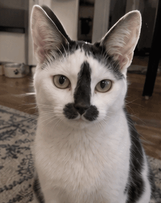
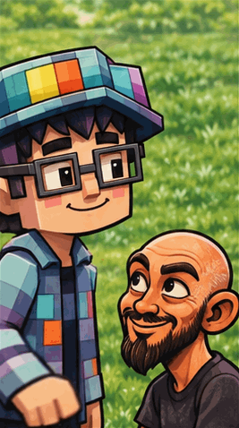
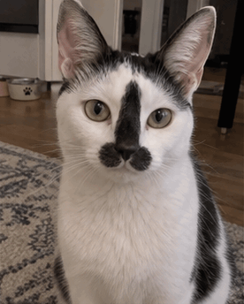
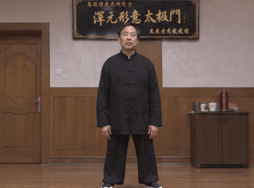
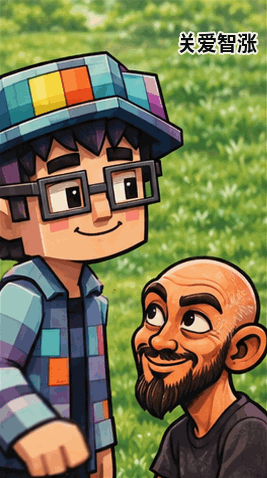
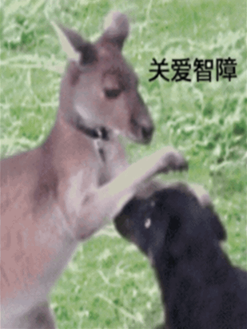

<div align="center">

# ✳ Awesome GPT Image GIFs

### 🎞️ Free AI Animated GIF Gallery, Prompts & Examples

**A curated collection of looping AI GIFs, reproducible prompt ideas, and GPT Image 2.6 experiments.**

[**🎬 View the gallery**](https://jammyfu.github.io/awesome-gpt-image-gifs/) · [**🧠 Browse prompts**](prompts/) · [**➕ Contribute**](CONTRIBUTING.md) · [**🇨🇳 中文说明**](#中文说明)

  

</div>

> **Publishing note:** The gallery URL above is the conventional GitHub Pages address, not a claim that Pages has already been activated. Enable Pages after creating the repository.

## ✨ GIF gallery

Click any thumbnail to open the original GIF. All files below are real animated GIFs (not PNG contact sheets with a `.gif` extension).

| Reactions | Memes | Animals |
|:---:|:---:|:---:|
| [](docs/gifs/cat-screen-crack.gif) | [](docs/gifs/pixel-head-pat.gif) | [](docs/gifs/cat-headbutt.gif) |
| **[Cat Screen Crack](prompts/cat-screen-crack.md)** | **[Pixel Head Pat](prompts/pixel-head-pat.md)** | **[Cat Headbutt](prompts/cat-headbutt.md)** |
| [](docs/gifs/martial-arts-combo.gif) | [](docs/gifs/head-pat-caption.gif) | [](docs/gifs/kangaroo-pat.gif) |
| **[Martial Arts Combo](prompts/martial-arts-combo.md)** | **[Captioned Head Pat](prompts/head-pat-caption.md)** | **[Kangaroo Head Pat](prompts/kangaroo-pat.md)** |

### What makes this different?

- **Real animations, not just screenshots.** The repository ships playable GIFs and validates frame counts/duration.
- **Prompt + result paired.** Each image has a linked, copyable animation brief and its metadata.
- **No framework required.** The responsive, searchable [GitHub Pages gallery](docs/) runs as static HTML/CSS/JS.
- **Reproducibility first.** Prompts are marked `reconstructed` when the exact original prompt was not retained; we don't fake verbatim prompts or model checkpoint verification.
- **Community-first.** Add examples via pull requests, with attribution and permission checks.

## 🚀 Generate your own GIF using GPT Image 2.6

OpenAI announced **Images 2.6 on November 4, 2026**, including animated GIF generation. API checkpoint names are `gpt-image-2.6-sunburst` and `gpt-image-2.6-flare`.

```python
# pip install openai
# export OPENAI_API_KEY='your API key'
import base64
from pathlib import Path
from openai import OpenAI

client = OpenAI()
result = client.images.generate(
    model="gpt-image-2.6-sunburst",  # or gpt-image-2.6-flare
    prompt=(
        "A tiny blue robot waves hello, blinks, then returns to its "
        "original pose. Fixed camera, no camera movement, seamless loop."
    ),
    output_format="gif",
    frame_count=12,
    frame_duration_ms=160,
)
Path("hello-robot.gif").write_bytes(base64.b64decode(result.data[0].b64_json))
```

The example is illustrative and **makes a paid API call** if executed with a valid key; it has not been run as part of this repository. Image generation is not required to browse these existing GIFs. Official docs: [Image generation](https://developers.openai.com/api/docs/guides/image-generation) · [Image API reference](https://developers.openai.com/api/reference/resources/images/methods/generate).

## 🧭 Browse locally

```bash
git clone https://github.com/jammyfu/awesome-gpt-image-gifs.git
cd awesome-gpt-image-gifs
python3 -m http.server 8000
# Open http://localhost:8000/docs/
```

The gallery also works as a simple offline file (`docs/index.html`) because its metadata is compiled into `docs/data/gallery.js`. No build step or API key is required.

## 🧪 Validate the library

```bash
python3 -m pip install -r requirements-dev.txt
python3 tools/validate_gallery.py
```

If you edit `docs/data/gallery.json`, run `python3 tools/sync_gallery_js.py` and commit the regenerated JS together with your changes.

## 📁 Repository structure

```text
docs/                   GitHub Pages gallery (static)
  gifs/                 Real animated GIF files
  data/gallery.json     Canonical metadata
  data/gallery.js       Browser copy of metadata
prompts/                One prompt document per GIF
.github/workflows/      Validation + Pages deployment
.github/ISSUE_TEMPLATE/ Submission template
tools/                  Data synchronization and GIF validation
CONTRIBUTING.md         How to add a GIF
MEDIA_RIGHTS.md         Rights and attribution policy
LICENSE                 MIT license for source code
```

## 🧩 Submit a GIF

1. Ensure you have rights to share the generated output and all reference images, likenesses, captions, logos and marks.
2. Place an actual animated `.gif` file in `docs/gifs/`, add a `prompts/<slug>.md` document, and append its metadata to `docs/data/gallery.json`.
3. Run the sync/validation commands, then open a PR. Include source attribution and whether the prompt is verbatim or reconstructed.

Read [CONTRIBUTING.md](CONTRIBUTING.md) for the full submission format. Samples are illustrative; image asset reuse is **not** automatically licensed under MIT. Read [MEDIA_RIGHTS.md](MEDIA_RIGHTS.md).

## 🔎 Search-friendly topics

`gpt-image-2-6` · `gpt-image` · `animated-gif` · `ai-gif` · `ai-animation` · `gif-generator` · `prompt-engineering` · `gif-gallery` · `openai` · `awesome-list`

## 中文说明

这个仓库收集 GPT Image / ChatGPT Images 2.6 相关的 **AI GIF 动图、提示词、可循环动画案例**，包括摸头表情包、猫咪撞屏、动物梗图、人物动作等。

- 直接打开 GitHub README 就能预览 GIF，画廊可按标签、分类和关键字过滤。
- 每个作品配备可复制的生成提示词；历史提示词未完整记录时，明确标记为**复原版**，不冒充逐字原版。
- 源码采用 MIT 许可证；涉及用户照片和第三方形象的图片另受著作权、肖像权等限制，**不能因为仓库开源就随意商用**。
- 欢迎贡献自己的原创 GIF，并说明模型版本、是否采用参考图以及授权情况。

> This is an independent community project, not an official OpenAI repository or endorsement.

## 📦 One-command public publish (repository owner only)

After verifying image rights, install/authenticate [GitHub CLI](https://cli.github.com/) (`gh auth login`) and run `bash publish.sh` from the project directory. It will create the public GitHub repository if absent, commit the prepared source if needed, and push `main`. It does **not** activate GitHub Pages automatically; follow `RELEASE_CHECKLIST.md`.