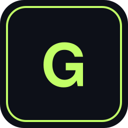

<div align="center">



# Awesome GPT Image GIFs

**A static gallery of real looping AI GIFs and a sourced catalog of GPT Image 2.6 (ChatGPT Images 2.6 / `gpt-image-2.6-sunburst` / `gpt-image-2.6-flare`) use cases.** Browse animated examples, copy public or reconstructed prompts, and skip entries whose original prompt was never published.

[**View the gallery**](https://jammyfu.github.io/awesome-gpt-image-gifs/) · [**Browse ideas & prompts**](https://jammyfu.github.io/awesome-gpt-image-gifs/ideas.html) · [**Contribute**](CONTRIBUTING.md) · [**中文说明**](#这个仓库是做什么的)

      

</div>

> **Publishing note:** The gallery URL is the conventional GitHub Pages address, not a claim that Pages is already live. Enable Pages after creating the repository. This is an independent community project, not an official OpenAI repository.

<!-- readme-tech-visualizer:start -->
## Technical Snapshot

### Tech Stack

    

### Engineering Capabilities

- Static GitHub Pages gallery (`docs/index.html`, `docs/ideas.html`) with client-side search
- GIF frame-count and duration checks via Pillow (`tools/validate_gallery.py`) for local files
- Media manifest for local vs external GIFs, MP4, and Vimeo (`docs/data/media-manifest.json`)
- Idea catalog sync from `docs/data/ideas.json` to `docs/data/ideas.js` and `playbooks/ideas-and-prompts.md`
- No Node toolchain, no backend, no database, no runtime API key to browse

### Version & Runtime

- Runtime: browsers for the gallery; Python 3.12 in GitHub Actions for validators
- Image generation is **not** part of browsing or CI

### Core Dependencies

| Package | Version | Source |
| --- | --- | --- |
| Pillow | `>=10,<13` | `requirements-dev.txt` (validators only) |

### Delivery Signals

- Evidence: `.github/workflows/validate.yml`, `.github/workflows/pages.yml`, `docs/` static files
- Scan record: [`docs/readme-assets/tech-stack.json`](docs/readme-assets/tech-stack.json)
<!-- readme-tech-visualizer:end -->

## What is in the idea catalog?

Updated **2026-11-06 (Beijing time)**. The catalog is a **quality-first** set of distinctive playbooks. Real 2.6 GIFs recovered from public pages are **link-only** (no third-party bytes in git). X posts that label attachments as GIF usually deliver **MP4**; those cards are unwatched, not claimed as `.gif`, and stay out of the GIF gallery. Several samples can share one playbook — extra mascot-wave, steam loops, or four fatfish clips live as related media, not duplicate idea cards. Morphic prompt cards stay, with a hard label that **examples ran on 2.5 / Ideogram Vector, not 2.6**. A separate **[game sequence page](https://jammyfu.github.io/awesome-gpt-image-gifs/game.html)** covers idle/run/attack. Deep pass: 4 old cards enriched, **0** new success workflows, 2 failure samples. Fox prompt is a game-agent one-shot (image prompt unpublished). Daft jump needed background flattening. Official verification is 0. A separate **[popular GIF remake page](https://jammyfu.github.io/awesome-gpt-image-gifs/popular.html)** uses a 23-item reference library (annual / event / trending snapshot / fame-only) and is **not** Image 2.6 work. 2024/2025 annual YIR was not found and is not invented. Prompts are `verbatim` / `reconstructed` / `empty`; this repo's rewrites sit in `prompt_adaptation`. SVG covers are original concept art, never generated results.

**[Open the visual idea gallery](https://jammyfu.github.io/awesome-gpt-image-gifs/ideas.html)** · **[Game sequences](https://jammyfu.github.io/awesome-gpt-image-gifs/game.html)** · **[Full prompts](playbooks/ideas-and-prompts.md)** · **[参考出处 / Sources](playbooks/sources.md)** · **[Popular GIF remakes](playbooks/popular-gifs.md)** · [Research notes](playbooks/trends-2026-11.md) · [Prompt formula](playbooks/prompt-formula.md)

This is a qualitative editorial selection, not a measured search-trend leaderboard. No claim that every idea was generated or tested in this repository.

## 参考出处 / Sources

Where did these playbooks come from? Full list: **[playbooks/sources.md](playbooks/sources.md)**.

A primary community source for GIF / sticker / edit-consistency prompts is 路飞 [@0xluffy_eth](https://x.com/0xluffy_eth), *[榨干 Image 2.6 的 10 个神级玩法！【附完整提示词】](https://x.com/i/article/2118269816821919744)* (X Article, 2026-11-05; [intro post](https://x.com/0xluffy_eth/status/2118274913337552992)). Chinese prompts are copied verbatim from that article. This repository does **not** redistribute the author's GIFs.

A primary non-X GIF addition is Ravivit’s [paper-boat API loop](https://note.com/ravivit_ai/n/nb8f40b5a21b9) (16 frames; Atlas hosts a copy and states the robot/teacup on that page are **not** 2.6). Independently re-checked X templates include mirai_ai2050’s spec’d blink loop, MiraMusic stretch, Gorden Sun 真香, op7418’s fatfish fill-in, nonieengel’s 10-reaction set, and supertask’s architecture timelapse — all link-only MP4, unwatched. Morphic prompt cards remain, labeled as **not** 2.6 example media. Official OpenAI docs, Lightlyn, Veevid, Nereo, and other links are listed on the same Sources page.

## GIF gallery

Local seeds (Pillow-checked in CI). Recovered source GIFs play from the original host and are listed in the [Pages gallery](https://jammyfu.github.io/awesome-gpt-image-gifs/) and `docs/data/media-manifest.json` — they are **not mirrored** here.

| Reactions | Memes | Animals |
|:---:|:---:|:---:|
| [](docs/gifs/cat-screen-crack.gif) | [](docs/gifs/pixel-head-pat.gif) | [](docs/gifs/cat-headbutt.gif) |
| **[Cat Screen Crack](prompts/cat-screen-crack.md)** | **[Pixel Head Pat](prompts/pixel-head-pat.md)** | **[Cat Headbutt](prompts/cat-headbutt.md)** |
| [](docs/gifs/martial-arts-combo.gif) | [](docs/gifs/head-pat-caption.gif) | [](docs/gifs/kangaroo-pat.gif) |
| **[Martial Arts Combo](prompts/martial-arts-combo.md)** | **[Captioned Head Pat](prompts/head-pat-caption.md)** | **[Kangaroo Head Pat](prompts/kangaroo-pat.md)** |

## What makes this different?

- **Real animations, not just screenshots.** Local GIFs are Pillow-checked. Source GIFs are probed once (format, frames, hash) and played from the original URL. X `animated_gif` entities are usually MP4; still posters are not a substitute GIF. SVG covers are never treated as generated results.
- **Prompt + result paired.** Gallery items have a linked brief. Idea cards say whether a prompt is verbatim, reconstructed, or unavailable.
- **No framework required.** The [GitHub Pages gallery](docs/) is static HTML/CSS/JS.
- **Reproducibility first.** Unknown third-party prompts stay empty. We do not fake GIFs or checkpoint verification.
- **Community-first.** Add examples via pull requests, with attribution and permission checks.

## How do I generate a GIF with GPT Image 2.6?

OpenAI announced **Images 2.6 on November 4, 2026**, including animated GIF generation. API checkpoint names are `gpt-image-2.6-sunburst` and `gpt-image-2.6-flare`. Set `output_format="gif"` on image **generation** (the image **edit** endpoint does not output GIFs). Describe one subject, one repeating motion, a locked camera, and a last frame that returns to the first.

```python
# pip install openai
# export OPENAI_API_KEY='your API key'
import base64
from pathlib import Path
from openai import OpenAI

client = OpenAI()
result = client.images.generate(
    model="gpt-image-2.6-sunburst",  # or gpt-image-2.6-flare
    prompt=(
        "A tiny blue robot waves hello, blinks, then returns to its "
        "original pose. Fixed camera, no camera movement, seamless loop."
    ),
    output_format="gif",
    frame_count=12,
    frame_duration_ms=160,
)
Path("hello-robot.gif").write_bytes(base64.b64decode(result.data[0].b64_json))
```

The example is illustrative and **makes a paid API call** if executed with a valid key; it has not been run as part of this repository. Official docs: [Image generation](https://developers.openai.com/api/docs/guides/image-generation) · [Image prompting](https://developers.openai.com/api/docs/guides/image-prompting) · [Image API reference](https://developers.openai.com/api/reference/resources/images/methods/generate).

## What is the difference between Flare and Sunburst?

**Flare** (`gpt-image-2.6-flare`) is the faster model for drafts, simple loops, posters, and layout tests. **Sunburst** (`gpt-image-2.6-sunburst`) is the higher-detail model for product geometry, character identity across frames or edits, SVG paths, and markup-local changes. Official docs: start with Flare when speed matters, Sunburst when the image must stay exact, then compare the same prompt on both.

## How do I browse the gallery locally?

```bash
git clone https://github.com/jammyfu/awesome-gpt-image-gifs.git
cd awesome-gpt-image-gifs
python3 -m http.server 8000
# Open http://localhost:8000/docs/
```

The gallery also works as a simple offline file (`docs/index.html`) because metadata is compiled into `docs/data/gallery.js`. No build step or API key is required.

## How do I validate the library?

```bash
python3 -m pip install -r requirements-dev.txt
python3 tools/sync_gallery_js.py
python3 tools/sync_ideas.py
python3 tools/sync_media_js.py
python3 tools/validate_gallery.py
python3 tools/validate_ideas.py
python3 tools/validate_media.py
```

If you edit `docs/data/gallery.json` or `docs/data/ideas.json`, run the matching `sync_*.py` script and commit the generated files with your changes.

## Can I reuse the sample GIFs commercially?

**No, not automatically.** The MIT license covers source code. Gallery media, reference photos, characters, and captions can carry separate copyright and publicity rights. Read [MEDIA_RIGHTS.md](MEDIA_RIGHTS.md) before reuse.

## Repository structure

```text
docs/                   GitHub Pages (static HTML/CSS/JS)
  ideas.html            Idea cards + copy prompts
  game.html             Game idle/run/attack sequences (not sticker GIFs)
  popular.html          Chart/trending GIF remakes (not Image 2.6)
  data/ideas.json       Canonical idea and source metadata
  data/media-manifest.json  Local vs external media, hashes, rights
  previews/             Original SVG concept illustrations
  gifs/                 Repository-seed animated GIF files
  data/gallery.json     Canonical gallery metadata (local + link-only)
  llms.txt              Machine-readable Pages summary
playbooks/              Prompt catalog + evidence notes
prompts/                One prompt document per shipped GIF
tools/                  JSON/JS sync and GIF/idea validators
.github/workflows/      Validation + Pages deployment
CONTRIBUTING.md         How to add a GIF or idea
MEDIA_RIGHTS.md         Rights and attribution policy
LICENSE                 MIT license for source code
```

## How do I submit a GIF or idea?

1. Ensure you have rights to share the generated output and all reference images, likenesses, captions, logos and marks.
2. For a GIF: place an actual animated `.gif` in `docs/gifs/`, add `prompts/<slug>.md`, and append metadata to `docs/data/gallery.json`.
3. For an idea-only card: add a record to `docs/data/ideas.json`. Leave `prompt` empty when the original text is unknown. Do not invent verbatim third-party prompts or claim an untested GIF exists.
4. Run the sync/validation commands, then open a PR with source attribution.

Read [CONTRIBUTING.md](CONTRIBUTING.md) for the full format.

## Search-friendly topics

`gpt-image-2-6` · `gpt-image` · `animated-gif` · `ai-gif` · `ai-animation` · `gif-generator` · `prompt-engineering` · `gif-gallery` · `openai` · `awesome-list`

Proposed GitHub About / topics (for the owner to apply with `gh repo edit`; not applied by this change): see the pull request body.

## 这个仓库是做什么的？

这个仓库收集 GPT Image / ChatGPT Images 2.6 相关的 **AI GIF 动图、提示词、可循环动画与相关静图工作流**，包括摸头表情包、猫咪撞屏、Sprite 分镜、markup 局部改图、SVG logo，以及路飞、归藏大肥鱼模板等社区公开玩法（注明出处；X 附件多为 MP4，未观看、不转载）。另有独立页面 **[游戏动作序列](https://jammyfu.github.io/awesome-gpt-image-gifs/game.html)**（待机/跑/攻击，与普通 GIF 分开）和 **[全球热门 GIF 参考 → 原创角色重演](https://jammyfu.github.io/awesome-gpt-image-gifs/popular.html)**：年度榜 / 活动榜 / 近期趋势 / 经典知名度四种依据分开标，**明确不是 2.6 作品**，方案未实测。

- 打开 GitHub README 或 Pages 画廊即可预览真实 GIF；玩法页可按类型和来源过滤。
- 提示词标明 **逐字公开 / 本站改写 / 未公开留空**，不冒充第三方原文，也不把概念 SVG 说成模型成品。
- 源码采用 MIT 许可证；涉及用户照片和第三方形象的图片另受著作权、肖像权等限制，**不能因为仓库开源就随意商用**。
- 欢迎贡献原创 GIF 或带出处的玩法卡片，并说明模型版本、是否采用参考图以及授权情况。

## One-command public publish (repository owner only)

After verifying image rights, install/authenticate [GitHub CLI](https://cli.github.com/) (`gh auth login`) and run `bash publish.sh` from the project directory. It will create the public GitHub repository if absent, commit the prepared source if needed, and push `main`. It does **not** activate GitHub Pages automatically; follow `RELEASE_CHECKLIST.md`.
