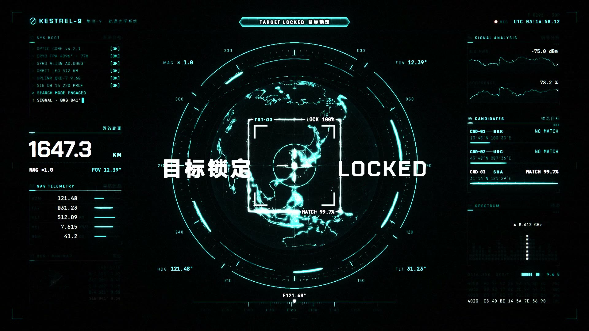

<!-- Generated by tools/write_community_catalog.py. Edit tools/templates/README.zh-TW.md instead. -->
<!-- readme-tech-visualizer:start -->
<p align="center"><a href="https://jammyfu.github.io/awesome-ai-model-showcases/?lang=zh"></a></p>
<!-- readme-tech-visualizer:end -->

[English](README.md) · [简体中文](README.zh-CN.md) · [繁體中文](README.zh-TW.md) · [日本語](README.ja.md)

# Awesome AI Model Showcases

**AI 製作的動畫、互動展示與遊戲。先看作品，再找作者、提示詞與原始碼。**

**[開啟作品畫廊 →](https://jammyfu.github.io/awesome-ai-model-showcases/?lang=zh)** · [依模型瀏覽](#showcase) · [完整目錄](docs/catalog.zh-TW.md)

<p>
<a href="#catalog"></a>
<a href="LICENSE"></a>
</p>

<a id="examples"></a>
## 先看 Claude 的真實作品

**Claude Opus 5.5** · Vincentwei1021 · 來源專案 **3,434 GitHub stars**（2026-11-11 快照）。

**ISOPOLIS · 讓城市生長**

<a href="https://vincentwei1021.github.io/mg-styles-15/#03-isometric"></a>

柔和色彩的等距城市圍繞發光高塔生長，風力渦輪機、屋頂太陽能板與高架交通組成微縮城市。

**[觀看成片 →](https://vincentwei1021.github.io/mg-styles-15/#03-isometric)** · [公開提示詞](https://github.com/Vincentwei1021/mg-styles-15/blob/269f6ed788cf60aaf9c276b110c548d6e7d353e1/prompts/03-isometric.md) · [原始碼](https://github.com/Vincentwei1021/mg-styles-15/tree/269f6ed788cf60aaf9c276b110c548d6e7d353e1/demos/03-isometric) · [作者原圖](https://github.com/Vincentwei1021/mg-styles-15/blob/269f6ed788cf60aaf9c276b110c548d6e7d353e1/videos/03-isometric.jpg)

**KESTREL-9 · 賽博龐克 HUD**

<a href="https://vincentwei1021.github.io/mg-styles-15/#22-hud"></a>

青黑配色的虛構動態介面，呈現地球、定位環、訊號曲線與遙測資訊。

**[觀看成片 →](https://vincentwei1021.github.io/mg-styles-15/#22-hud)** · [公開提示詞](https://github.com/Vincentwei1021/mg-styles-15/blob/269f6ed788cf60aaf9c276b110c548d6e7d353e1/prompts/22-hud.md) · [原始碼](https://github.com/Vincentwei1021/mg-styles-15/tree/269f6ed788cf60aaf9c276b110c548d6e7d353e1/demos/22-hud) · [作者原圖](https://github.com/Vincentwei1021/mg-styles-15/blob/269f6ed788cf60aaf9c276b110c548d6e7d353e1/videos/22-hud.jpg)

同一開源專案的兩部短片；倉庫 stars 不是單片播放量或跨模型排名。作者發布的成片畫面，未修改。[媒體 MIT 授權](https://github.com/Vincentwei1021/mg-styles-15/blob/269f6ed788cf60aaf9c276b110c548d6e7d353e1/README.md#license) · [版權與完整許可](docs/licenses/Vincentwei1021-mg-styles-15-MIT.txt)。這組獨立精選不計入 183 則目錄；模型歸屬為作者聲明，未重新生成驗證。

[Claude](#claude) · [Gemini](#gemini) · [GPT Sol](#gpt-code) · [Grok](#grok) · [Qwen](#qwen) · [DeepSeek](#deepseek)

<a id="showcase"></a>
<a id="catalog"></a>
## 依模型查找

六個家族共 **183 則有來源案例**。每個家族優先展示其首個有案例的重點版本中的一則入門範例，全部版本和紀錄都保留在[完整目錄](docs/catalog.zh-TW.md)。這是導覽，不是模型能力排名。

版本依編輯優先級排列：先展示來源標示的當前重點版本，同版本再看來源日期。尚無可比熱度資料。[排序規則](docs/discovery-order.md)。

<a id="claude"></a>
### Claude · 146 則

[查看全部](docs/catalog.zh-TW.md#claude)

<a id="ver-claude-fable-5-2"></a>
- [Claude Fable 5.2](docs/catalog.zh-TW.md#ver-claude-fable-5-2) · 137
<a id="ver-claude-mythos-5-2"></a>
- [Claude Mythos 5.2](docs/catalog.zh-TW.md#ver-claude-mythos-5-2) · 0 · 暫無獨立來源案例
<a id="ver-claude-opus-5-5"></a>
- [Claude Opus 5.5](docs/catalog.zh-TW.md#ver-claude-opus-5-5) · 9

入門範例: **關於 AgentSky 的點光源三維影片（Blender 與代碼）** · 署名: @quxiaoyin（Xiaoyin Qu） · [案例](docs/translations/x-quxiaoyin-fable52-agentsky-film.md#zh-tw) · [原帖](https://x.com/quxiaoyin/status/2120341962314150207)

<a id="gemini"></a>
### Gemini · 6 則

[查看全部](docs/catalog.zh-TW.md#gemini)

<a id="ver-gemini-4-carbon"></a>
- [Gemini 4 Carbon](docs/catalog.zh-TW.md#ver-gemini-4-carbon) · 5
<a id="ver-gemini-4-argon"></a>
- [Gemini 4 Argon](docs/catalog.zh-TW.md#ver-gemini-4-argon) · 1

入門範例: **單個 HTML 文件中的交互式三維紐約巡遊（Three.js）** · 署名: @StatsWire · [案例](docs/translations/x-statswire-gemini-carbon-nyc-cruiser.md#zh-tw) · [原帖](https://x.com/StatsWire/status/2120344850071540152)

<a id="gpt-code"></a>
### GPT-6.2 Sol · 14 則

[查看全部](docs/catalog.zh-TW.md#gpt-code)

<a id="ver-gpt-6-2-sol"></a>
- [GPT-6.2 Sol](docs/catalog.zh-TW.md#ver-gpt-6-2-sol) · 11
<a id="ver-gpt-6-1-sol"></a>
- [GPT-6.1 Sol](docs/catalog.zh-TW.md#ver-gpt-6-1-sol) · 3

入門範例: **用 Three.js、GLSL 與 Blender 製作雨中的羅馬鬥獸場** · 署名: @cfenghub（CF长风） · [案例](docs/translations/x-cfenghub-gpt62sol-colosseum.md#zh-tw) · [原帖](https://x.com/cfenghub/status/2120069654437921152)

<a id="grok"></a>
### Grok · 11 則

[查看全部](docs/catalog.zh-TW.md#grok)

<a id="ver-grok-4-7"></a>
- [Grok 4.7](docs/catalog.zh-TW.md#ver-grok-4-7) · 1
<a id="ver-grok-imagine-video"></a>
- [Grok Imagine Video](docs/catalog.zh-TW.md#ver-grok-imagine-video) · 10

入門範例: **等距視角城市晝夜 HTML 循環動畫：Grok 4.7** · 署名: James Greene (model comparison archive) · [案例](docs/translations/web-jamesgreene-code1-grok47-isometric-city.md#zh-tw) · [原帖](https://jamesgreene.com/models/)

<a id="qwen"></a>
### Qwen · 3 則

[查看全部](docs/catalog.zh-TW.md#qwen)

<a id="ver-qwen4-max-preview"></a>
- [Qwen 4 Max Preview](docs/catalog.zh-TW.md#ver-qwen4-max-preview) · 1
<a id="ver-qwen4-preview"></a>
- [Qwen 4.0 Preview](docs/catalog.zh-TW.md#ver-qwen4-preview) · 1
<a id="ver-qwen3-8-27b"></a>
- [Qwen3.8 27B](docs/catalog.zh-TW.md#ver-qwen3-8-27b) · 1

入門範例: **孫悟空開飛機：HTML 三維演示** · 署名: @leo114119（Leo） · [案例](docs/translations/x-leo114119-qwen4max-wukong-plane.md#zh-tw) · [原帖](https://x.com/leo114119/status/2120371909624033439)

<a id="deepseek"></a>
### DeepSeek · 3 則

[查看全部](docs/catalog.zh-TW.md#deepseek)

<a id="ver-deepseek-v4-1-flash-1017"></a>
- [DeepSeek V4.1 Flash 1017](docs/catalog.zh-TW.md#ver-deepseek-v4-1-flash-1017) · 1
<a id="ver-deepseek-v4-1-flash"></a>
- [DeepSeek V4.1 Flash](docs/catalog.zh-TW.md#ver-deepseek-v4-1-flash) · 2

入門範例: **等距視角城市晝夜 HTML 循環動畫：DeepSeek V4.1 Flash 1017** · 署名: James Greene (model comparison archive) · [案例](docs/translations/web-jamesgreene-code1-deepseek-v41-flash-1017-isometric-city.md#zh-tw) · [原帖](https://jamesgreene.com/models/)


<a id="latest"></a>
## 近期原帖

依來源日期倒序列出五則，不代表收錄時間或品質排名。同日依案例 ID 排序；無日期案例仍保留在完整目錄。

截至 2026-11-11 尚無可比熱度快照；此處依來源日期排列，不是熱度榜。

- **2026-11-11 · GPT Sol** · **Let Fable take Flight：HTML／Three.js 程序化動畫（GPT-6.1 Sol Max）** · 署名: @YFeng2022（LanFeng） · [案例](docs/translations/x-yfeng-gpt61-sol-fable-take-flight.md#zh-tw) · [原帖](https://x.com/YFeng2022/status/2120324811549225082)
- **2026-11-11 · Gemini** · **單個 HTML 文件中的交互式三維紐約巡遊（Three.js）** · 署名: @StatsWire · [案例](docs/translations/x-statswire-gemini-carbon-nyc-cruiser.md#zh-tw) · [原帖](https://x.com/StatsWire/status/2120344850071540152)
- **2026-11-11 · Grok** · **Grok Imagine：pixstar 的 Cybertruck 告別短片（部分提示詞）** · 署名: @RadCyberTruck · [案例](docs/translations/x-radcybertruck-grok-imagine-cybertruck-cry.md#zh-tw) · [原帖](https://x.com/RadCyberTruck/status/2120350558431445006)
- **2026-11-11 · Claude** · **關於 AgentSky 的點光源三維影片（Blender 與代碼）** · 署名: @quxiaoyin（Xiaoyin Qu） · [案例](docs/translations/x-quxiaoyin-fable52-agentsky-film.md#zh-tw) · [原帖](https://x.com/quxiaoyin/status/2120341962314150207)
- **2026-11-11 · Claude** · **Fable 5.2 與 Opus 5.5：同一提示詞製作 Three.js 船隻（並排對照）** · 署名: @paleknight（Vraj） · [案例](docs/translations/x-paleknight-fable52-vs-opus55-ship.md#zh-tw) · [原帖](https://x.com/paleknight/status/2120368418805174639)


<a id="how-to-use"></a>
## 從這裡開始

1. **找靈感。** 從下方模型家族進入，或在案例站依標題、作者和模型搜尋。
2. **核對證據。** 開啟案例，查看原帖、作者、做法，以及提示詞是已公開、部分公開還是未公開。
3. **準備自己的嘗試。** 參考已記錄的製作方法；模型權限、設定和結果可能不同。本倉未重現或認證模型輸出。

瀏覽無需帳號、API Key 或安裝。模型名稱是來源聲明。**程式碼授權不授予第三方媒體或提示詞的使用權。**

[模型](#showcase) · [近期原帖](#latest) · [作品類型](#by-type) · [參與貢獻](#contribute) · [版權與語言](#rights)

<details>
<summary>模型名稱與證據界線</summary>

目錄分欄名 **GPT-6.2 Sol** 按倉庫主人確認。截至 2026-11-11，OpenAI 公開文件仍寫 **GPT-6.1 Sol**（[介紹頁](https://openai.com/index/introducing-gpt-6-1-sol/)、[Models](https://platform.openai.com/docs/models)）；本倉不編造官方 6.2 發布聲明。

清單提及 Claude Mythos 5.2 和 Qwen 3.8 Flash Next，但沒有獨立且有出處的案例，因此不增加計數。提示詞和模型名稱可能不完整或僅為來源聲明；收錄及下載成功均不證明生成成功。

</details>


<a id="by-type"></a>
## 按類型

<a id="type-gif"></a>
- [動圖 / GIF](docs/showcase-index.md#gif) · **0**
<a id="type-animation"></a>
- [動畫 / 動效](docs/showcase-index.md#animation) · **114**
<a id="type-html-3d"></a>
- [HTML / 3D 場景](docs/showcase-index.md#html-3d) · **69**
<a id="type-minigame"></a>
- [小遊戲](docs/showcase-index.md#minigame) · **0**
<a id="type-image"></a>
- [圖像](docs/showcase-index.md#image) · **0**


類型計數沿用現有清單標籤，不代表模型能力範圍。零表示目前沒有案例使用該標籤；遊戲也可能歸在 HTML / 3D 下。[分類方法](tools/readme_presentation.py)。

<a id="collection-sites"></a>
<a id="related-projects"></a>
## 繼續探索

- [完整目錄與案例收集站](docs/catalog.zh-TW.md)：全部案例、來源證據，以及獨立標示的附錄。
- [相關開源專案](docs/related-projects.md)：其他案例與提示詞合集。
- [機器可讀目錄](docs/data/community-cases.json) · [供 LLM 閱讀的專案說明](llms.txt)。

- [靈感與熱門重製附錄（不計入主目錄）](https://jammyfu.github.io/awesome-ai-model-showcases/popular.html).

- [GPT Image 動圖檔案 · 51](collections/gpt-image-gifs/README.md) · 獨立子集合.

<a id="contribute"></a>
## 提交案例或更正

[提交案例](https://github.com/jammyfu/awesome-ai-model-showcases/issues/new?template=case-submission.yml)，提供原作者、原帖連結、已公開提示詞或「未公開」，以及模型或製作方法的證據。無需寫程式，也歡迎修正署名、失效連結和翻譯。

提交 PR 請閱讀 [CONTRIBUTING.md](CONTRIBUTING.md)。修改來源清單或四語模板，重新產生、審查差異，並執行[統一驗證入口](tools/verify.py)。

<a id="local-setup"></a>
<details>
<summary>在本機瀏覽案例站</summary>

瀏覽現有靜態案例站只需要 Python 3：

```bash
git clone https://github.com/jammyfu/awesome-ai-model-showcases.git
cd awesome-ai-model-showcases
python3 -m http.server 8000 --directory docs
```

開啟 [localhost:8000](http://localhost:8000/?lang=zh)。公開託管須使用[獲准媒體建置流程](MEDIA_RIGHTS.md#publication-and-playback-checks)，不能直接發布原始歸檔目錄。開發驗證還需要 [CONTRIBUTING.md](CONTRIBUTING.md) 所列相依套件。

</details>

<a id="rights"></a>
<a id="faq"></a>
## 版權、範圍與語言

- **範圍：**清單更新於 **2026-11-11**；**12 則待核案例**不計入首頁的 **183** 則。GIF 子專案、重製、失敗和倉庫種子另列。
- **媒體：**現有目錄 **0 則案例有獲准發布的本機媒體**。上方兩張 Claude 精選畫面另有明確授權；其餘目錄項目連結原帖。公開可見、署名或下載成功不等於獲准再利用。
- **授權：**[MIT](LICENSE) 僅涵蓋原始碼和專案原創文件，不涵蓋第三方媒體、提示詞、商標或肖像。參閱 [MEDIA_RIGHTS.md](MEDIA_RIGHTS.md)。權利人可[申請更正或移除](https://github.com/jammyfu/awesome-ai-model-showcases/issues/new)。
- **語言：**README 與案例證據提供 English、简体中文、繁體中文和日本語。AI 翻譯**尚未經人工審校**，原文保留。案例站介面目前只支援 **English / 简体中文**。[翻譯政策與涵蓋情況](docs/translation-policy.md)。

想重用這套文件結構？參閱 [README 範本與檢查清單](docs/readme-pattern.md)，以自己倉庫的證據替換所有專案專屬陳述。

[返回頂部 ↑](#awesome-ai-model-showcases)
