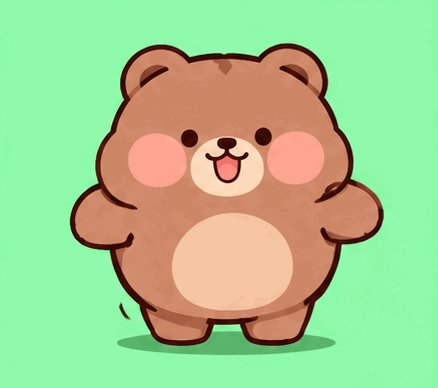
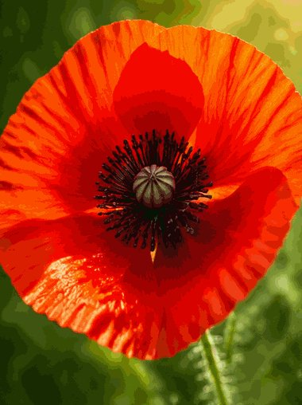
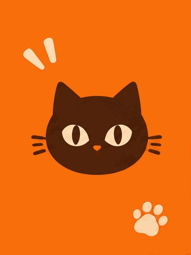

# GPT Image 2.6 GIF archive
Subproject of [Awesome AI Model Showcases](../../README.md). These cases are not in the homepage totals.
**51** cases: X author-claimed 25 · non-X GIFs 20 · in-repo 2 · game author-claimed 4.
Case files stay in `docs/cases/<id>/`. This page is the listing.

Still-mainstream previous generation. The three cards below are local media already archived for these cases, not new generations.
<table>
<tr>
<td align="center" width="33%">
 
<strong><a href="../../docs/cases/ailingqu-jelly-bear-wobble/README.md">Jelly bear wobble</a></strong> 
Credit: ailingqu / awesome-ai-gif-prompts CC BY 4.0 · ailingqu 
<a href="../../docs/cases/ailingqu-jelly-bear-wobble/prompt.md">Published prompt</a> · <a href="https://github.com/ailingqu/awesome-ai-gif-prompts/blob/a20f88b18a9abe8cd1531fb8a8e738a5a4701ce2/gifs/jelly-bear-wobble.gif">Post</a> · <a href="../../docs/cases/ailingqu-jelly-bear-wobble/media/01-gif.gif">GIF</a>
 <a href="https://creativecommons.org/licenses/by/4.0/">CC BY 4.0</a>
</td>
<td align="center" width="33%">
 
<strong><a href="../../docs/cases/ailingqu-flower-macro-flash/README.md">Flower macro flash</a></strong> 
Credit: ailingqu / awesome-ai-gif-prompts CC BY 4.0 · ailingqu 
<a href="../../docs/cases/ailingqu-flower-macro-flash/prompt.md">Published prompt</a> · <a href="https://github.com/ailingqu/awesome-ai-gif-prompts/blob/a20f88b18a9abe8cd1531fb8a8e738a5a4701ce2/gifs/flower-macro-flash.gif">Post</a> · <a href="../../docs/cases/ailingqu-flower-macro-flash/media/01-gif.gif">GIF</a>
 <a href="https://creativecommons.org/licenses/by/4.0/">CC BY 4.0</a>
</td>
<td align="center" width="33%">
 
<strong><a href="../../docs/cases/ailingqu-cat-brand-reel/README.md">Cat logo reel</a></strong> 
Credit: ailingqu / awesome-ai-gif-prompts CC BY 4.0 · ailingqu 
<a href="../../docs/cases/ailingqu-cat-brand-reel/prompt.md">Published prompt</a> · <a href="https://github.com/ailingqu/awesome-ai-gif-prompts/blob/a20f88b18a9abe8cd1531fb8a8e738a5a4701ce2/gifs/cat-brand-reel.gif">Post</a> · <a href="../../docs/cases/ailingqu-cat-brand-reel/media/01-gif.gif">GIF</a>
 <a href="https://creativecommons.org/licenses/by/4.0/">CC BY 4.0</a>
</td>
</tr>
</table>
CC BY 4.0 examples by ailingqu. Published prompts are source rewrites, not verified historical requests. Model attribution is a source claim; generation has not been reproduced. These featured thumbnails are resized derivatives.

## X author-claimed (25 groups, not split by attachment)

| # | Author | Play | Post | Media | prompt | Model | Pipeline | Verification | License |
|---:|---|---|---|---|---|---|---|---|---|
| 1 | @Gorden_Sun（Gorden Sun） | `x-gorden-sun-rice-gif` Reference character image + one sentence: a looping GIF meme | [Source](https://x.com/Gorden_Sun/status/2118166046175908016) | [Case](../../docs/cases/x-gorden-sun-rice-gif/README.md) | [Short / partial](../../docs/cases/x-gorden-sun-rice-gif/prompt.md) · [Read translation + original](../../docs/translations/x-gorden-sun-rice-gif.md#en) | Author claims 2.6: GPT’s newly released  | Author claims direct GIF output · X  | Author claim + media metadata checke | Unknown |
| 2 | @op7418（歸藏(guizang.ai)） | `x-op7418-fatfish-pack` Dafeiyu character reference + structured template for batche | [Source](https://x.com/op7418/status/2118181775688241456) | [Case](../../docs/cases/x-op7418-fatfish-pack/README.md) | [Original](../../docs/cases/x-op7418-fatfish-pack/prompt.md) · [Read translation + original](../../docs/translations/x-op7418-fatfish-pack.md#en) | Author claims 2.6: GPT-image-2.6 was rel | Author claims direct GIF output · X  | Author claim + media metadata checke | Unknown |
| 3 | @abc123953468547（A1terE&o） | `x-abc123-static-to-gif` Upload a static meme and turn it into an endless GIF loop wi | [Source](https://x.com/abc123953468547/status/2118188053793837265) | [Case](../../docs/cases/x-abc123-static-to-gif/README.md) | [Original](../../docs/cases/x-abc123-static-to-gif/prompt.md) · [Read translation + original](../../docs/translations/x-abc123-static-to-gif.md#en) | Author claims 2.6: The newly released GP | Author claims direct GIF output · X  | Author claim + media metadata checke | Unknown |
| 4 | @thinkszyg（爆裂队长NEXT） | `x-thinkszyg-paperboat-verify` Paper-boat GIF loop to check whether Images 2.6 has reached  | [Source](https://x.com/thinkszyg/status/2118166234495947044) | [Case](../../docs/cases/x-thinkszyg-paperboat-verify/README.md) | [Original](../../docs/cases/x-thinkszyg-paperboat-verify/prompt.md) · [Read translation + original](../../docs/translations/x-thinkszyg-paperboat-verify.md#en) | Author claims 2.6: ChatGPT has Images 2. | Author claims direct GIF output · X  | Author claim + media metadata checke | Unknown |
| 5 | @gdb（Greg Brockman） | `x-gdb-images26-gif` OpenAI cofounder shows an Images 2.6 GIF demo | [Source](https://x.com/gdb/status/2118174986544488876) | [Case](../../docs/cases/x-gdb-images26-gif/README.md) | [Unpublished](../../docs/cases/x-gdb-images26-gif/prompt.md) · [Read translation + original](../../docs/translations/x-gdb-images26-gif.md#en) | Author claims 2.6: chatgpt images 2.6 is | Author claims direct GIF output · X  | Author claim + media metadata checke | Unknown |
| 6 | @moltikuji（もる@ポケカ・フロム） | `x-moltikuji-oc-eyebrow` Japanese post: turning an original character into a GIF with | [Source](https://x.com/moltikuji/status/2118187059102027921) | [Case](../../docs/cases/x-moltikuji-oc-eyebrow/README.md) | [Unpublished](../../docs/cases/x-moltikuji-oc-eyebrow/prompt.md) · [Read translation + original](../../docs/translations/x-moltikuji-oc-eyebrow.md#en) | Author claims 2.6: I tried animating my  | Author claims direct GIF output · X  | Author claim + media metadata checke | Unknown |
| 7 | @heycesr（cesar.wtf） | `x-heycesr-photo-animate` Real photo (left) → GPT Image 2.6 animation (right), via @tr | [Source](https://x.com/heycesr/status/2118391412639371290) | [Case](../../docs/cases/x-heycesr-photo-animate/README.md) | [Unpublished](../../docs/cases/x-heycesr-photo-animate/prompt.md) · [Read translation + original](../../docs/translations/x-heycesr-photo-animate.md#en) | Author claims 2.6: i've been testing the | Author claims direct GIF output · X  | Author claim + media metadata checke | Unknown |
| 8 | @kqyno7（Kai） | `x-kqyno7-frieren` Native GIF test with Frieren; author describes expressions a | [Source](https://x.com/kqyno7/status/2118160063835815981) | [Case](../../docs/cases/x-kqyno7-frieren/README.md) | [Unpublished](../../docs/cases/x-kqyno7-frieren/prompt.md) · [Read translation + original](../../docs/translations/x-kqyno7-frieren.md#en) | Author claims 2.6: GPT Image 2.6 is live | Author claims direct GIF output · X  | Author claim + media metadata checke | Unknown |
| 9 | @Adam38363368936（Adam也叫吉米） | `x-adam-7plays-thread` Seven-use thread: animated human reactions, physics explaine | [Source](https://x.com/Adam38363368936/status/2118269020369817856) | [Case](../../docs/cases/x-adam-7plays-thread/README.md) | [Unpublished](../../docs/cases/x-adam-7plays-thread/prompt.md) · [Read translation + original](../../docs/translations/x-adam-7plays-thread.md#en) | Author claims 2.6: The most comprehensiv | Author claims direct GIF output · X  | Author claim + media metadata checke | Unknown |
| 10 | @zone__online（SleepyZone） | `x-zone-nonsticker-plays` Beyond memes: dance breakdowns, history explainers, pixel ac | [Source](https://x.com/zone__online/status/2118264293678608774) | [Case](../../docs/cases/x-zone-nonsticker-plays/README.md) | [Unpublished](../../docs/cases/x-zone-nonsticker-plays/prompt.md) · [Read translation + original](../../docs/translations/x-zone-nonsticker-plays.md#en) | Author claims 2.6: GPT Image 2.6 now sup | Author claims direct GIF output · X  | Author claim + media metadata checke | Unknown |
| 11 | @meow2149（meow） | `x-meow2149-ai-girl-stickers` Four looping reaction GIFs of an AI girl character | [Source](https://x.com/meow2149/status/2118254460187373747) | [Case](../../docs/cases/x-meow2149-ai-girl-stickers/README.md) | [Unpublished](../../docs/cases/x-meow2149-ai-girl-stickers/prompt.md) · [Read translation + original](../../docs/translations/x-meow2149-ai-girl-stickers.md#en) | Author claims 2.6: GPT Image 2.6 really  | Author claims direct GIF output · X  | Author claim + media metadata checke | Unknown |
| 12 | @vm3jp6u04（許文彥） | `x-vm3jp6u04-schnauzer` Schnauzer GIF + four-step Images 2.6 guide | [Source](https://x.com/vm3jp6u04/status/2118390692347363396) | [Case](../../docs/cases/x-vm3jp6u04-schnauzer/README.md) | [Unpublished](../../docs/cases/x-vm3jp6u04-schnauzer/prompt.md) · [Read translation + original](../../docs/translations/x-vm3jp6u04-schnauzer.md#en) | Author claims 2.6: ChatGPT can now make  | Author claims direct GIF output · X  | Author claim + media metadata checke | Unknown |
| 13 | @SeaArt_Ai（SeaArt.Ai🐋） | `x-seaart-doodle-gif` Doodle sketch → looping GIF; claims prompt-based duration co | [Source](https://x.com/SeaArt_Ai/status/2118267088284659733) | [Case](../../docs/cases/x-seaart-doodle-gif/README.md) | [Unpublished](../../docs/cases/x-seaart-doodle-gif/prompt.md) · [Read translation + original](../../docs/translations/x-seaart-doodle-gif.md#en) | Author claims 2.6: GPT Image 2.6 turned  | Author claims direct GIF output · X  | Author claim + media metadata checke | Unknown |
| 14 | @xulijian1994（Kxians） | `x-xulijian-avatar-stickers` X profile picture → two chibi animated memes | [Source](https://x.com/xulijian1994/status/2118193018167828815) | [Case](../../docs/cases/x-xulijian-avatar-stickers/README.md) | [Unpublished](../../docs/cases/x-xulijian-avatar-stickers/prompt.md) · [Read translation + original](../../docs/translations/x-xulijian-avatar-stickers.md#en) | Author claims 2.6: GPT-Image-2.6 can now | Author claims direct GIF output · X  | Author claim + media metadata checke | Unknown |
| 15 | @plasm0（ρŁ𝐀𝔰Ｍʘ） | `x-plasm0-animated-gif` Brief “GPT Image 2.6 animated GIF” label + quote of the offi | [Source](https://x.com/plasm0/status/2118177268870562241) | [Case](../../docs/cases/x-plasm0-animated-gif/README.md) | [Unpublished](../../docs/cases/x-plasm0-animated-gif/prompt.md) · [Read translation + original](../../docs/translations/x-plasm0-animated-gif.md#en) | Author claims 2.6: GPT Image 2.6 animate | Author claims direct GIF output · X  | Author claim + media metadata checke | Unknown |
| 16 | @NewsAsArt（News As Cartoon） | `x-newsasart-claim-gif` News-card-style post; author claims the attached GIF was mad | [Source](https://x.com/NewsAsArt/status/2118236954383028693) | [Case](../../docs/cases/x-newsasart-claim-gif/README.md) | [Unpublished](../../docs/cases/x-newsasart-claim-gif/prompt.md) · [Read translation + original](../../docs/translations/x-newsasart-claim-gif.md#en) | Author claims 2.6: And the gif attached  | Author claims direct GIF output · X  | Author claim + media metadata checke | Unknown |
| 17 | @MiraMusic_AI（MiraMusic） | `x-miramusic-stretch` Japanese post: a “stretching” GIF loop generated from scratc | [Source](https://x.com/MiraMusic_AI/status/2118168013618987298) | [Case](../../docs/cases/x-miramusic-stretch/README.md) | [Original](../../docs/cases/x-miramusic-stretch/prompt.md) · [Read translation + original](../../docs/translations/x-miramusic-stretch.md#en) | Author claims 2.6: GPTimage2.6 It’s evol | Author claims direct GIF output · X  | Author claim + media metadata checke | Unknown |
| 18 | @okan_aitool（あゆ｜キャラパレ運営） | `x-okan-aitool-wave-laugh` Japanese post: one image + the tiny prompt “このキャラをGIFで動かして。手 | [Source](https://x.com/okan_aitool/status/2118201578406772887) | [Case](../../docs/cases/x-okan-aitool-wave-laugh/README.md) | [Short / partial](../../docs/cases/x-okan-aitool-wave-laugh/prompt.md) · [Read translation + original](../../docs/translations/x-okan-aitool-wave-laugh.md#en) | Author claims 2.6: ChatGPT’s Image 2.6 u | Author claims direct GIF output · X  | Author claim + media metadata checke | Unknown |
| 19 | @mirai_ai2050（藍澤 ミライ） | `x-mirai-ai2050-frame-test` Japanese post: testing 16/32 frames and dimensions with the  | [Source](https://x.com/mirai_ai2050/status/2118213713761292432) | [Case](../../docs/cases/x-mirai-ai2050-frame-test/README.md) | [Original](../../docs/cases/x-mirai-ai2050-frame-test/prompt.md) · [Read translation + original](../../docs/translations/x-mirai-ai2050-frame-test.md#en) | Author claims 2.6: I tried making a GIF  | Author claims direct GIF output · X  | Author claim + media metadata checke | Unknown |
| 20 | @nonieengel（Leonie Engel） | `x-nonieengel-reaction-set` English post: character photo + style reference → ten reacti | [Source](https://x.com/nonieengel/status/2118382251226562570) | [Case](../../docs/cases/x-nonieengel-reaction-set/README.md) | [Original](../../docs/cases/x-nonieengel-reaction-set/prompt.md) · [Read translation + original](../../docs/translations/x-nonieengel-reaction-set.md#en) | Author claims 2.6: You can just upload o | Author claims direct GIF output · X  | Author claim + media metadata checke | Unknown |
| 21 | @IHayato（イケハヤ） | `x-ihayato-markup-gif` High-engagement Japanese post: markup editing demo + charact | [Source](https://x.com/IHayato/status/2118151619212890291) | [Case](../../docs/cases/x-ihayato-markup-gif/README.md) | [Short / partial](../../docs/cases/x-ihayato-markup-gif/prompt.md) · [Read translation + original](../../docs/translations/x-ihayato-markup-gif.md#en) | Author claims 2.6: GPT Image 2.6 came ou | Author claims direct GIF output · X  | Author claim + media metadata checke | Unknown |
| 22 | @dokken92047824（HeartlessCat） | `x-dokken-guitar` Japanese post: attached image + tiny “アコギを弾く男性” prompt produ | [Source](https://x.com/dokken92047824/status/2118293666456559762) | [Case](../../docs/cases/x-dokken-guitar/README.md) | [Short / partial](../../docs/cases/x-dokken-guitar/prompt.md) · [Read translation + original](../../docs/translations/x-dokken-guitar.md#en) | Author claims 2.6: Open AI…announced GPT | Author claims direct GIF output · X  | Author claim + media metadata checke | Unknown |
| 23 | @supertask_jp（Tasuku Takahashi） | `x-supertask-arch-timelapse` Japanese post: architectural rendering → sunset time-lapse G | [Source](https://x.com/supertask_jp/status/2118241124133532077) | [Case](../../docs/cases/x-supertask-arch-timelapse/README.md) | [Short / partial](../../docs/cases/x-supertask-arch-timelapse/prompt.md) · [Read translation + original](../../docs/translations/x-supertask-arch-timelapse.md#en) | Author claims 2.6: I made a sunset time- | Author claims direct GIF output · X  | Author claim + media metadata checke | Unknown |
| 24 | @xepher113（ふぁーねりあん） | `x-xepher113-oc12` Japanese original-character post: claims about 12 frames, us | [Source](https://x.com/xepher113/status/2118177063727411603) | [Case](../../docs/cases/x-xepher113-oc12/README.md) | [Unpublished](../../docs/cases/x-xepher113-oc12/prompt.md) · [Read translation + original](../../docs/translations/x-xepher113-oc12.md#en) | Author claims 2.6: I tried Chappy’s GIF  | Author claims direct GIF output · X  | Author claim + media metadata checke | Unknown |
| 25 | @yulikay（Yuli Kay） | `x-yulikay-toast` “GPT Images 2.6 is here + GIFs” with animated_gif attached | [Source](https://x.com/yulikay/status/2118322092709994503) | [Case](../../docs/cases/x-yulikay-toast/README.md) | [Unpublished](../../docs/cases/x-yulikay-toast/prompt.md) · [Read translation + original](../../docs/translations/x-yulikay-toast.md#en) | Author claims 2.6: GPT Images 2.6 is her | Author claims direct GIF output · X  | Author claim + media metadata checke | Unknown |

## Non-X real GIFs (20)

| # | Author | Play | Post | Media | prompt | Model | Pipeline | Verification | License |
|---:|---|---|---|---|---|---|---|---|---|
| 1 | OpenAI | `official-lantern-monkey-gif` Native GIF loop: little monkey raises a lantern, blinks, and | [Source](https://developers.openai.com/api/docs/guides/image-prompting) | [Case](../../docs/cases/official-lantern-monkey-gif/README.md) | [Original](../../docs/cases/official-lantern-monkey-gif/prompt.md) · [Read translation + original](../../docs/translations/official-lantern-monkey-gif.md#en) | GPT Image 2.6 Sunburst (gpt-image-2.6-su | Direct native GIF link (multiple fra | Model evidence on page + GIF multi-f | Unknown |
| 2 | Linger（Lightlyn Images） | `lightlyn-orange-cat-mascot-gif` Brand mascot waving and blinking in a seamless GIF loop | [Source](https://image.lightlyn.com/gpt-image-2-6?lang=en) | [Case](../../docs/cases/lightlyn-orange-cat-mascot-gif/README.md) | [Original](../../docs/cases/lightlyn-orange-cat-mascot-gif/prompt.md) · [Read translation + original](../../docs/translations/lightlyn-orange-cat-mascot-gif.md#en) | GPT Image 2.6 Flare (page says 2.6 Flare | Direct native GIF link (multiple fra | Model evidence on page + GIF multi-f | Unknown |
| 3 | Linger（Lightlyn Images） | `lightlyn-earbuds-case-gif` Product case opens and closes: earbud case opens → earbuds f | [Source](https://image.lightlyn.com/gpt-image-2-6?lang=en) | [Case](../../docs/cases/lightlyn-earbuds-case-gif/README.md) | [Original](../../docs/cases/lightlyn-earbuds-case-gif/prompt.md) · [Read translation + original](../../docs/translations/lightlyn-earbuds-case-gif.md#en) | GPT Image 2.6 Sunburst (2.6 Sunburst · 3 | Direct native GIF link (multiple fra | Model evidence on page + GIF multi-f | Unknown |
| 4 | Linger（Lightlyn Images） | `lightlyn-photo-steam-gif` Only steam and light move in a real photo; cup, table, and w | [Source](https://image.lightlyn.com/gpt-image-2-6?lang=en) | [Case](../../docs/cases/lightlyn-photo-steam-gif/README.md) | [Original](../../docs/cases/lightlyn-photo-steam-gif/prompt.md) · [Read translation + original](../../docs/translations/lightlyn-photo-steam-gif.md#en) | GPT Image 2.6 Flare (with photo uploaded | Direct native GIF link (multiple fra | Model evidence on page + GIF multi-f | Unknown |
| 5 | Veevid Team | `veevid-perfume-light-sweep-gif` Product light sweep: stationary perfume bottle, passing ligh | [Source](https://veevid.ai/blog/gpt-image-2-6-gif) | [Case](../../docs/cases/veevid-perfume-light-sweep-gif/README.md) | [Original](../../docs/cases/veevid-perfume-light-sweep-gif/prompt.md) · [Read translation + original](../../docs/translations/veevid-perfume-light-sweep-gif.md#en) | GPT Image 2.6 Flare (text claims a self- | Direct native GIF link (multiple fra | Model evidence on page + GIF multi-f | Unknown |
| 6 | Veevid Team | `veevid-cactus-mascot-gif` Structured sprite-sheet prompt → waving cactus mascot loop ( | [Source](https://veevid.ai/blog/gpt-image-2-6-gif) | [Case](../../docs/cases/veevid-cactus-mascot-gif/README.md) | [Original](../../docs/cases/veevid-cactus-mascot-gif/prompt.md) · [Read translation + original](../../docs/translations/veevid-cactus-mascot-gif.md#en) | GPT Image 2.6 Flare | Direct native GIF link (multiple fra | Model evidence on page + GIF multi-f | Unknown |
| 7 | Veevid Team | `veevid-fox-mascot-gif` Sticker-style fox mascot waves and blinks | [Source](https://veevid.ai/blog/gpt-image-2-6-gif) | [Case](../../docs/cases/veevid-fox-mascot-gif/README.md) | [Original](../../docs/cases/veevid-fox-mascot-gif/prompt.md) · [Read translation + original](../../docs/translations/veevid-fox-mascot-gif.md#en) | GPT Image 2.6 (page example; 2.6 GIF out | Direct native GIF link (multiple fra | Model evidence on page + GIF multi-f | Unknown |
| 8 | Veevid Team | `veevid-coffee-steam-gif` Steam rising from a coffee cup in a loop (text-to-GIF) | [Source](https://veevid.ai/blog/gpt-image-2-6-gif) | [Case](../../docs/cases/veevid-coffee-steam-gif/README.md) | [Original](../../docs/cases/veevid-coffee-steam-gif/prompt.md) · [Read translation + original](../../docs/translations/veevid-coffee-steam-gif.md#en) | GPT Image 2.6 (Veevid example) | Direct native GIF link (multiple fra | Model evidence on page + GIF multi-f | Unknown |
| 9 | Veevid Team | `veevid-dog-photo-wag-gif` Upload a real dog photo → gentle tail-wagging and blinking l | [Source](https://veevid.ai/blog/gpt-image-2-6-gif) | [Case](../../docs/cases/veevid-dog-photo-wag-gif/README.md) | [Original](../../docs/cases/veevid-dog-photo-wag-gif/prompt.md) · [Read translation + original](../../docs/translations/veevid-dog-photo-wag-gif.md#en) | GPT Image 2.6 image-to-GIF | Direct native GIF link (multiple fra | Model evidence on page + GIF multi-f | Unknown |
| 10 | Veevid Team | `veevid-robot-sketch-gif` Line drawing becomes a waving robot, retaining ink lines and | [Source](https://veevid.ai/blog/gpt-image-2-6-gif) | [Case](../../docs/cases/veevid-robot-sketch-gif/README.md) | [Original](../../docs/cases/veevid-robot-sketch-gif/prompt.md) · [Read translation + original](../../docs/translations/veevid-robot-sketch-gif.md#en) | GPT Image 2.6 (text acknowledges the lin | Direct native GIF link (multiple fra | Model evidence on page + GIF multi-f | Unknown |
| 11 | ラビビット / AI活用メディア（Ravivit） | `ravivit-paper-boat-gif` Native API GIF: white paper boat gently rocks on water, fixe | [Source](https://note.com/ravivit_ai/n/nb8f40b5a21b9) | [Case](../../docs/cases/ravivit-paper-boat-gif/README.md) | [Original](../../docs/cases/ravivit-paper-boat-gif/prompt.md) · [Read translation + original](../../docs/translations/ravivit-paper-boat-gif.md#en) | Images 2.6 / GPT Image 2.6 (API-generate | Direct native GIF link (multiple fra | Model evidence on page + GIF multi-f | Unknown |
| 12 | 未知（r/OpenAI 帖作者；本轮JSON接口被拦未能取handle） | `reddit-anime-nod-gif` Reference character image → anime nodding and eye-closing lo | [Source](https://www.reddit.com/r/OpenAI/comments/1xoh2u0/i_tried_the_new_image_26_gif_feature/) | [Case](../../docs/cases/reddit-anime-nod-gif/README.md) | [Original](../../docs/cases/reddit-anime-nod-gif/prompt.md) · [Read translation + original](../../docs/translations/reddit-anime-nod-gif.md#en) | Image 2.6 GIF feature (claimed in the po | Direct native GIF link (multiple fra | Model evidence on page + GIF multi-f | Unknown |
| 13 | ailingqu / awesome-ai-gif-prompts | `ailingqu-jelly-bear-wobble` Jelly bear wobble | [Source](https://github.com/ailingqu/awesome-ai-gif-prompts/blob/a20f88b18a9abe8cd1531fb8a8e738a5a4701ce2/gifs/jelly-bear-wobble.gif) | [Case](../../docs/cases/ailingqu-jelly-bear-wobble/README.md) · [File](../../docs/cases/ailingqu-jelly-bear-wobble/media/01-gif.gif) | [Original](../../docs/cases/ailingqu-jelly-bear-wobble/prompt.md) · [Read translation + original](../../docs/translations/ailingqu-jelly-bear-wobble.md#en) | Author reports GPT Image 2.6; not indepe | Published GIF; generation provider n | GIF hashes/frames checked; frame she | CC BY 4.0 |
| 14 | ailingqu / awesome-ai-gif-prompts | `ailingqu-flower-macro-flash` Flower macro flash cut | [Source](https://github.com/ailingqu/awesome-ai-gif-prompts/blob/a20f88b18a9abe8cd1531fb8a8e738a5a4701ce2/gifs/flower-macro-flash.gif) | [Case](../../docs/cases/ailingqu-flower-macro-flash/README.md) · [File](../../docs/cases/ailingqu-flower-macro-flash/media/01-gif.gif) | [Original](../../docs/cases/ailingqu-flower-macro-flash/prompt.md) · [Read translation + original](../../docs/translations/ailingqu-flower-macro-flash.md#en) | Author reports GPT Image 2.6; not indepe | Published GIF; generation provider n | GIF hashes/frames checked; frame she | CC BY 4.0 |
| 15 | ailingqu / awesome-ai-gif-prompts | `ailingqu-cat-brand-reel` Cat-head logo brand reel | [Source](https://github.com/ailingqu/awesome-ai-gif-prompts/blob/a20f88b18a9abe8cd1531fb8a8e738a5a4701ce2/gifs/cat-brand-reel.gif) | [Case](../../docs/cases/ailingqu-cat-brand-reel/README.md) · [File](../../docs/cases/ailingqu-cat-brand-reel/media/01-gif.gif) | [Original](../../docs/cases/ailingqu-cat-brand-reel/prompt.md) · [Read translation + original](../../docs/translations/ailingqu-cat-brand-reel.md#en) | Author reports GPT Image 2.6; not indepe | Published GIF; generation provider n | GIF hashes/frames checked; frame she | CC BY 4.0 |
| 16 | ailingqu / awesome-ai-gif-prompts | `ailingqu-window-day-to-night` Reading by the window, day to night | [Source](https://github.com/ailingqu/awesome-ai-gif-prompts/blob/a20f88b18a9abe8cd1531fb8a8e738a5a4701ce2/gifs/window-day-to-night.gif) | [Case](../../docs/cases/ailingqu-window-day-to-night/README.md) · [File](../../docs/cases/ailingqu-window-day-to-night/media/01-gif.gif) | [Original](../../docs/cases/ailingqu-window-day-to-night/prompt.md) · [Read translation + original](../../docs/translations/ailingqu-window-day-to-night.md#en) | Author reports GPT Image 2.6; not indepe | Published GIF; generation provider n | GIF hashes/frames checked; frame she | CC BY 4.0 |
| 17 | ailingqu / awesome-ai-gif-prompts | `ailingqu-glass-butterfly` Glass butterfly with shifting shadows | [Source](https://github.com/ailingqu/awesome-ai-gif-prompts/blob/a20f88b18a9abe8cd1531fb8a8e738a5a4701ce2/gifs/glass-butterfly.gif) | [Case](../../docs/cases/ailingqu-glass-butterfly/README.md) · [File](../../docs/cases/ailingqu-glass-butterfly/media/01-gif.gif) | [Original](../../docs/cases/ailingqu-glass-butterfly/prompt.md) · [Read translation + original](../../docs/translations/ailingqu-glass-butterfly.md#en) | Author reports GPT Image 2.6; not indepe | Source records via=chatgpt-image-2.c | GIF hashes/frames checked; frame she | CC BY 4.0 |
| 18 | ailingqu / awesome-ai-gif-prompts | `ailingqu-ink-wash-horse` Ink-wash galloping horse | [Source](https://github.com/ailingqu/awesome-ai-gif-prompts/blob/a20f88b18a9abe8cd1531fb8a8e738a5a4701ce2/gifs/ink-wash-horse.gif) | [Case](../../docs/cases/ailingqu-ink-wash-horse/README.md) · [File](../../docs/cases/ailingqu-ink-wash-horse/media/01-gif.gif) | [Original](../../docs/cases/ailingqu-ink-wash-horse/prompt.md) · [Read translation + original](../../docs/translations/ailingqu-ink-wash-horse.md#en) | Author reports GPT Image 2.6; not indepe | Source records via=chatgpt-image-2.c | GIF hashes/frames checked; frame she | CC BY 4.0 |
| 19 | ailingqu / awesome-ai-gif-prompts | `ailingqu-pixel-slime-boss` 8-bit slime boss battle | [Source](https://github.com/ailingqu/awesome-ai-gif-prompts/blob/a20f88b18a9abe8cd1531fb8a8e738a5a4701ce2/gifs/pixel-slime-boss.gif) | [Case](../../docs/cases/ailingqu-pixel-slime-boss/README.md) · [File](../../docs/cases/ailingqu-pixel-slime-boss/media/01-gif.gif) | [Original](../../docs/cases/ailingqu-pixel-slime-boss/prompt.md) · [Read translation + original](../../docs/translations/ailingqu-pixel-slime-boss.md#en) | Author reports GPT Image 2.6; not indepe | Source records via=chatgpt-image-2.c | GIF hashes/frames checked; frame she | CC BY 4.0 |
| 20 | ailingqu / awesome-ai-gif-prompts | `ailingqu-ai-typing-indicator` AI assistant typing indicator | [Source](https://github.com/ailingqu/awesome-ai-gif-prompts/blob/a20f88b18a9abe8cd1531fb8a8e738a5a4701ce2/gifs/ai-typing-indicator.gif) | [Case](../../docs/cases/ailingqu-ai-typing-indicator/README.md) · [File](../../docs/cases/ailingqu-ai-typing-indicator/media/01-gif.gif) | [Original](../../docs/cases/ailingqu-ai-typing-indicator/prompt.md) · [Read translation + original](../../docs/translations/ailingqu-ai-typing-indicator.md#en) | Author reports GPT Image 2.6; not indepe | Source records via=chatgpt-image-2.c | GIF hashes/frames checked; frame she | CC BY 4.0 |

## Already-in-repo community longform / posts (2)

| # | Author | Play | Post | Media | prompt | Model | Pipeline | Verification | License |
|---:|---|---|---|---|---|---|---|---|---|
| 1 | @Krouxzz | `krouxzz-wave-ref` Character waving loop | [Source](https://x.com/Krouxzz/status/2118283796181053637) | [Case](../../docs/cases/krouxzz-wave-ref/README.md) | [Original](../../docs/cases/krouxzz-wave-ref/prompt.md) · [Read translation + original](../../docs/translations/krouxzz-wave-ref.md#en) | Author claims 2.6 | Author claims looping GIF · X attach | Already in the archive · author clai | Unknown |
| 2 | @0xluffy_eth | `luffy-x-article` Lufei X Article: ten powerful ways to get the most from Imag | [Source](https://x.com/i/article/2118269816821919744) | [Case](../../docs/cases/luffy-x-article/README.md) | [Original](../../docs/cases/luffy-x-article/prompt.md) · [Read translation + original](../../docs/translations/luffy-x-article.md#en) | Author claims 2.6 | Community article; full original pro | Already in archive · verbatim prompt | Unknown |

## Game action sequences — author-claimed (4, not officially verified)

| # | Author | Play | Post | Media | prompt | Model | Pipeline | Verification | License |
|---:|---|---|---|---|---|---|---|---|---|
| 1 | Daft_Trade @Daft_Trade · 作者声明 2.6；跳跃承认 flatten 去闪烁 · 4 条 MP4=1 案例 · 未观看 | `game-daft-pixel-combo` Pixel three-hit combo / roll / spell (background composited  | [Source](https://x.com/Daft_Trade/status/2118283025498906800) | [Case](../../docs/cases/game-daft-pixel-combo/README.md) | [Unpublished](../../docs/cases/game-daft-pixel-combo/prompt.md) · [Read translation + original](../../docs/translations/game-daft-pixel-combo.md#en) | Author claims GPT Image 2.6 (not officia | Native GIF output claimed | Author claims 2.6 · not officially v | Unknown |
| 2 | maker_evan @maker_evan · 游戏 agent one-shot 已公开；图像 prompt 未公开 · 未观看 MP4 | `game-maker-evan-fox-ronin` Fox ronin browser game: 2.6 generates the sheet, another age | [Source](https://x.com/maker_evan/status/2118222694345040253) | [Case](../../docs/cases/game-maker-evan-fox-ronin/README.md) | [Original](../../docs/cases/game-maker-evan-fox-ronin/prompt.md) · [Read translation + original](../../docs/translations/game-maker-evan-fox-ronin.md#en) | Author claims GPT Image 2.6 generated th | Sprite sheet, then agent-assisted sl | Author claims 2.6 · not officially v | Unknown |
| 3 | 小墨同学 @xiaomovps · 作者声明 Images 2.6 · X animated_gif→MP4 · 未见引擎内运行 | `game-xiaomovps-fighter` Retro fighting-game punch / charge loop | [Source](https://x.com/xiaomovps/status/2118274032227471705) | [Case](../../docs/cases/game-xiaomovps-fighter/README.md) | [Unpublished](../../docs/cases/game-xiaomovps-fighter/prompt.md) · [Read translation + original](../../docs/translations/game-xiaomovps-fighter.md#en) | Author claims GPT Images 2.6 (not offici | Native GIF and/or sprite output clai | Author claims 2.6 · not officially v | Unknown |
| 4 | vargHQ gpt-image-sprite-sheet · 作者声明 gpt_image_2_6 · 非 OpenAI 官方验证 · 未复测 | `game-varg-knight-run` Knight running loop: author says 2.6 generated the sheet, th | [Source](https://github.com/vargHQ/skills/blob/main/gpt-image-sprite-sheet/SKILL.md) | [Case](../../docs/cases/game-varg-knight-run/README.md) | [Original](../../docs/cases/game-varg-knight-run/prompt.md) · [Read translation + original](../../docs/translations/game-varg-knight-run.md#en) | Author claims gpt_image_2_6 (not officia | Sprite sheet, then slicing | Author claims 2.6 · not officially v | Unknown |
