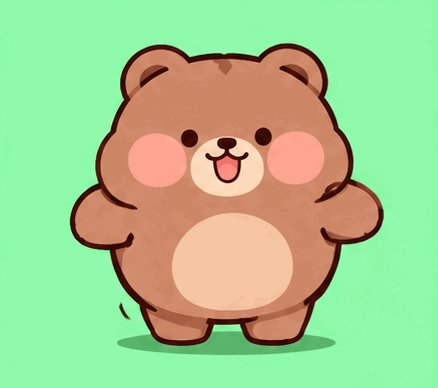
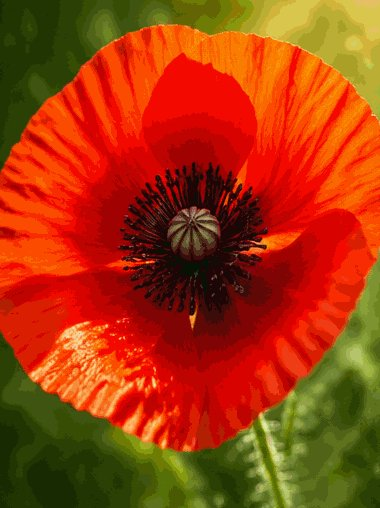
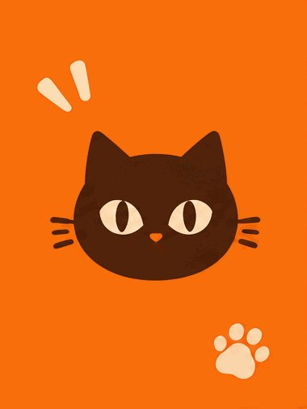

# GPT Image 2.6 GIF 归档
这是 [AI 模型制作案例集](../../README.zh-CN.md) 的子项目。这些案例不计入首页合计。
共 **51** 条：X 作者声明 25 · 非 X GIF 20 · 已在库 2 · 游戏作者声明 4。
案例文件仍在 `docs/cases/<id>/`。本页是目录。

上一代里还在主流使用的图像模型。下面三张是这些案例已经归档的本地素材，不是新生成的图。
<table>
<tr>
<td align="center" width="33%">
 
<strong><a href="../../docs/cases/ailingqu-jelly-bear-wobble/README.md">果冻熊摇晃</a></strong> 
署名: ailingqu / awesome-ai-gif-prompts CC BY 4.0 · ailingqu 
<a href="../../docs/cases/ailingqu-jelly-bear-wobble/prompt.md">公开提示词</a> · <a href="https://github.com/ailingqu/awesome-ai-gif-prompts/blob/a20f88b18a9abe8cd1531fb8a8e738a5a4701ce2/gifs/jelly-bear-wobble.gif">原帖</a> · <a href="../../docs/cases/ailingqu-jelly-bear-wobble/media/01-gif.gif">GIF</a>
 <a href="https://creativecommons.org/licenses/by/4.0/">CC BY 4.0</a>
</td>
<td align="center" width="33%">
 
<strong><a href="../../docs/cases/ailingqu-flower-macro-flash/README.md">花卉微距快闪</a></strong> 
署名: ailingqu / awesome-ai-gif-prompts CC BY 4.0 · ailingqu 
<a href="../../docs/cases/ailingqu-flower-macro-flash/prompt.md">公开提示词</a> · <a href="https://github.com/ailingqu/awesome-ai-gif-prompts/blob/a20f88b18a9abe8cd1531fb8a8e738a5a4701ce2/gifs/flower-macro-flash.gif">原帖</a> · <a href="../../docs/cases/ailingqu-flower-macro-flash/media/01-gif.gif">GIF</a>
 <a href="https://creativecommons.org/licenses/by/4.0/">CC BY 4.0</a>
</td>
<td align="center" width="33%">
 
<strong><a href="../../docs/cases/ailingqu-cat-brand-reel/README.md">猫头品牌快闪</a></strong> 
署名: ailingqu / awesome-ai-gif-prompts CC BY 4.0 · ailingqu 
<a href="../../docs/cases/ailingqu-cat-brand-reel/prompt.md">公开提示词</a> · <a href="https://github.com/ailingqu/awesome-ai-gif-prompts/blob/a20f88b18a9abe8cd1531fb8a8e738a5a4701ce2/gifs/cat-brand-reel.gif">原帖</a> · <a href="../../docs/cases/ailingqu-cat-brand-reel/media/01-gif.gif">GIF</a>
 <a href="https://creativecommons.org/licenses/by/4.0/">CC BY 4.0</a>
</td>
</tr>
</table>
ailingqu 的 CC BY 4.0 示例。公开提示词是来源改写，不是已核实的历史提交请求。模型归属为来源声明，未复测生成。缩略图为缩放衍生版本。

## X 作者声明（25 组，不按附件拆卡）

| # | 作者 | 玩法 | 原帖 | 媒体 | prompt | 模型依据 | 管线 | 验证 | 许可 |
|---:|---|---|---|---|---|---|---|---|---|
| 1 | @Gorden_Sun（Gorden Sun） | `x-gorden-sun-rice-gif` 参考角色图一句话生成「吃白米饭+真香」中文配字循环 GIF 表情包 | [出处](https://x.com/Gorden_Sun/status/2118166046175908016) | [案例](../../docs/cases/x-gorden-sun-rice-gif/README.md) | [短 / 部分](../../docs/cases/x-gorden-sun-rice-gif/prompt.md) · [译文与原文](../../docs/translations/x-gorden-sun-rice-gif.md#zh-cn) | 作者声明 2.6：GPT新出的GPT Image 2.6，可以一句话生成表情包动 | 作者称直出 GIF · X 附件实际 MP4 | 作者声明 + 媒体元数据已核 · 未观看 · 未复测 | 许可未知 |
| 2 | @op7418（歸藏(guizang.ai)） | `x-op7418-fatfish-pack` 大肥鱼角色参考图 + 结构化模板批量出循环 GIF 表情包（主题可填空） | [出处](https://x.com/op7418/status/2118181775688241456) | [案例](../../docs/cases/x-op7418-fatfish-pack/README.md) | [原文](../../docs/cases/x-op7418-fatfish-pack/prompt.md) · [译文与原文](../../docs/translations/x-op7418-fatfish-pack.md#zh-cn) | 作者声明 2.6：GPT-image-2.6 今天发布了，主要的新特性就是能够直 | 作者称直出 GIF · X 附件实际 MP4 | 作者声明 + 媒体元数据已核 · 未观看 · 未复测 | 许可未知 |
| 3 | @abc123953468547（A1terE&o） | `x-abc123-static-to-gif` 上传静态表情包原图，一句话做成无限循环 GIF，强调角色一致性（与大肥鱼同模板族，仍单列原帖） | [出处](https://x.com/abc123953468547/status/2118188053793837265) | [案例](../../docs/cases/x-abc123-static-to-gif/README.md) | [原文](../../docs/cases/x-abc123-static-to-gif/prompt.md) · [译文与原文](../../docs/translations/x-abc123-static-to-gif.md#zh-cn) | 作者声明 2.6：刚发布的 GPT-image-2.6 真牛逼！！我只用了一句话 | 作者称直出 GIF · X 附件实际 MP4 | 作者声明 + 媒体元数据已核 · 未观看 · 未复测 | 许可未知 |
| 4 | @thinkszyg（爆裂队长NEXT） | `x-thinkszyg-paperboat-verify` 用纸船循环 GIF 验证账号是否已推送 Images 2.6；并附六宫格 sprite sheet 提示词模板（与 Ra | [出处](https://x.com/thinkszyg/status/2118166234495947044) | [案例](../../docs/cases/x-thinkszyg-paperboat-verify/README.md) | [原文](../../docs/cases/x-thinkszyg-paperboat-verify/prompt.md) · [译文与原文](../../docs/translations/x-thinkszyg-paperboat-verify.md#zh-cn) | 作者声明 2.6：ChatGPT 上了 Images 2.6…GIF 是 2.6 | 作者称直出 GIF · X 附件实际 MP4 | 作者声明 + 媒体元数据已核 · 未观看 · 未复测 | 许可未知 |
| 5 | @gdb（Greg Brockman） | `x-gdb-images26-gif` OpenAI 联合创始人展示 Images 2.6 GIF 演示 | [出处](https://x.com/gdb/status/2118174986544488876) | [案例](../../docs/cases/x-gdb-images26-gif/README.md) | [未公开](../../docs/cases/x-gdb-images26-gif/prompt.md) · [译文与原文](../../docs/translations/x-gdb-images26-gif.md#zh-cn) | 作者声明 2.6：ChatGPT Images 2.6 来了！ | 作者称直出 GIF · X 附件实际 MP4 | 作者声明 + 媒体元数据已核 · 未观看 · 未复测 | 许可未知 |
| 6 | @moltikuji（もる@ポケカ・フロム） | `x-moltikuji-oc-eyebrow` 日文：用 Images 2.6 把自家角色做成 GIF，反馈眉毛一致性问题 | [出处](https://x.com/moltikuji/status/2118187059102027921) | [案例](../../docs/cases/x-moltikuji-oc-eyebrow/README.md) | [未公开](../../docs/cases/x-moltikuji-oc-eyebrow/prompt.md) · [译文与原文](../../docs/translations/x-moltikuji-oc-eyebrow.md#zh-cn) | 作者声明 2.6：用昨天发布的 ChatGPT Images 2.6（GPT I | 作者称直出 GIF · X 附件实际 MP4 | 作者声明 + 媒体元数据已核 · 未观看 · 未复测 | 许可未知 |
| 7 | @heycesr（cesar.wtf） | `x-heycesr-photo-animate` 真实照片（左）→ GPT Image 2.6 动画化（右），经 @tryidem 调用 | [出处](https://x.com/heycesr/status/2118391412639371290) | [案例](../../docs/cases/x-heycesr-photo-animate/README.md) | [未公开](../../docs/cases/x-heycesr-photo-animate/prompt.md) · [译文与原文](../../docs/translations/x-heycesr-photo-animate.md#zh-cn) | 作者声明 2.6：我一直在测试新的 GPT Image 2.6 来生成 GIF… | 作者称直出 GIF · X 附件实际 MP4 | 作者声明 + 媒体元数据已核 · 未观看 · 未复测 | 许可未知 |
| 8 | @kqyno7（Kai） | `x-kqyno7-frieren` 用芙莉莲角色试原生 GIF，作者称表情动作自然 | [出处](https://x.com/kqyno7/status/2118160063835815981) | [案例](../../docs/cases/x-kqyno7-frieren/README.md) | [未公开](../../docs/cases/x-kqyno7-frieren/prompt.md) · [译文与原文](../../docs/translations/x-kqyno7-frieren.md#zh-cn) | 作者声明 2.6：GPT Image 2.6 上线，支持 GIF 生成…刚拿芙莉 | 作者称直出 GIF · X 附件实际 MP4 | 作者声明 + 媒体元数据已核 · 未观看 · 未复测 | 许可未知 |
| 9 | @Adam38363368936（Adam也叫吉米） | `x-adam-7plays-thread` 七玩法串：真人动态表情、物理科普、产品展示、操作教程、天文动画、商业图表、打工人情绪包；每条附结果 GIF | [出处](https://x.com/Adam38363368936/status/2118269020369817856) | [案例](../../docs/cases/x-adam-7plays-thread/README.md) | [未公开](../../docs/cases/x-adam-7plays-thread/prompt.md) · [译文与原文](../../docs/translations/x-adam-7plays-thread.md#zh-cn) | 作者声明 2.6：全网最全！GPT Image 2.6 的 GIF 功能实用玩法 | 作者称直出 GIF · X 附件实际 MP4 | 作者声明 + 媒体元数据已核 · 未观看 · 未复测 | 许可未知 |
| 10 | @zone__online（SleepyZone） | `x-zone-nonsticker-plays` 非表情包向：舞蹈拆解、历史科普、像素动作、角色变身 | [出处](https://x.com/zone__online/status/2118264293678608774) | [案例](../../docs/cases/x-zone-nonsticker-plays/README.md) | [未公开](../../docs/cases/x-zone-nonsticker-plays/prompt.md) · [译文与原文](../../docs/translations/x-zone-nonsticker-plays.md#zh-cn) | 作者声明 2.6：GPT Image 2.6已经支持生成动图啦…挖到了不一样的玩 | 作者称直出 GIF · X 附件实际 MP4 | 作者声明 + 媒体元数据已核 · 未观看 · 未复测 | 许可未知 |
| 11 | @meow2149（meow） | `x-meow2149-ai-girl-stickers` AI 娘四连循环表情包 GIF | [出处](https://x.com/meow2149/status/2118254460187373747) | [案例](../../docs/cases/x-meow2149-ai-girl-stickers/README.md) | [未公开](../../docs/cases/x-meow2149-ai-girl-stickers/prompt.md) · [译文与原文](../../docs/translations/x-meow2149-ai-girl-stickers.md#zh-cn) | 作者声明 2.6：GPT Image 2.6 这次真的有点东西！以后做 AI 娘 | 作者称直出 GIF · X 附件实际 MP4 | 作者声明 + 媒体元数据已核 · 未观看 · 未复测 | 许可未知 |
| 12 | @vm3jp6u04（許文彥） | `x-vm3jp6u04-schnauzer` 雪纳瑞狗 GIF + Images 2.6 四步用法说明 | [出处](https://x.com/vm3jp6u04/status/2118390692347363396) | [案例](../../docs/cases/x-vm3jp6u04-schnauzer/README.md) | [未公开](../../docs/cases/x-vm3jp6u04-schnauzer/prompt.md) · [译文与原文](../../docs/translations/x-vm3jp6u04-schnauzer.md#zh-cn) | 作者声明 2.6：ChatGPT 现在可以制作 GIF 动画了。这是 Image | 作者称直出 GIF · X 附件实际 MP4 | 作者声明 + 媒体元数据已核 · 未观看 · 未复测 | 许可未知 |
| 13 | @SeaArt_Ai（SeaArt.Ai🐋） | `x-seaart-doodle-gif` 涂鸦草图 → 循环 GIF；宣称可用提示词控制时长 | [出处](https://x.com/SeaArt_Ai/status/2118267088284659733) | [案例](../../docs/cases/x-seaart-doodle-gif/README.md) | [未公开](../../docs/cases/x-seaart-doodle-gif/prompt.md) · [译文与原文](../../docs/translations/x-seaart-doodle-gif.md#zh-cn) | 作者声明 2.6：GPT Image 2.6 把这张涂鸦变成了循环 GIF…你甚 | 作者称直出 GIF · X 附件实际 MP4 | 作者声明 + 媒体元数据已核 · 未观看 · 未复测 | 许可未知 |
| 14 | @xulijian1994（Kxians） | `x-xulijian-avatar-stickers` X 头像 → Q 版动态表情包两则 | [出处](https://x.com/xulijian1994/status/2118193018167828815) | [案例](../../docs/cases/x-xulijian-avatar-stickers/README.md) | [未公开](../../docs/cases/x-xulijian-avatar-stickers/prompt.md) · [译文与原文](../../docs/translations/x-xulijian-avatar-stickers.md#zh-cn) | 作者声明 2.6：GPT-Image-2.6 现在可以直接生成 GIF 动图了… | 作者称直出 GIF · X 附件实际 MP4 | 作者声明 + 媒体元数据已核 · 未观看 · 未复测 | 许可未知 |
| 15 | @plasm0（ρŁ𝐀𝔰Ｍʘ） | `x-plasm0-animated-gif` 简短标注「GPT Image 2.6 animated GIF」+ 引用官方帖 | [出处](https://x.com/plasm0/status/2118177268870562241) | [案例](../../docs/cases/x-plasm0-animated-gif/README.md) | [未公开](../../docs/cases/x-plasm0-animated-gif/prompt.md) · [译文与原文](../../docs/translations/x-plasm0-animated-gif.md#zh-cn) | 作者声明 2.6：GPT Image 2.6 GIF 动画 | 作者称直出 GIF · X 附件实际 MP4 | 作者声明 + 媒体元数据已核 · 未观看 · 未复测 | 许可未知 |
| 16 | @NewsAsArt（News As Cartoon） | `x-newsasart-claim-gif` 新闻卡风格帖，作者声称附件 GIF 由 Image 2.6 制作 | [出处](https://x.com/NewsAsArt/status/2118236954383028693) | [案例](../../docs/cases/x-newsasart-claim-gif/README.md) | [未公开](../../docs/cases/x-newsasart-claim-gif/prompt.md) · [译文与原文](../../docs/translations/x-newsasart-claim-gif.md#zh-cn) | 作者声明 2.6：而附上的 GIF 当然也是用 Image 2.6 制作的 | 作者称直出 GIF · X 附件实际 MP4 | 作者声明 + 媒体元数据已核 · 未观看 · 未复测 | 许可未知 |
| 17 | @MiraMusic_AI（MiraMusic） | `x-miramusic-stretch` 日文：从零提示词生成「拉伸」循环 GIF，附风格约束 | [出处](https://x.com/MiraMusic_AI/status/2118168013618987298) | [案例](../../docs/cases/x-miramusic-stretch/README.md) | [原文](../../docs/cases/x-miramusic-stretch/prompt.md) · [译文与原文](../../docs/translations/x-miramusic-stretch.md#zh-cn) | 作者声明 2.6：GPTimage2.6 进步了！而且生成速度很快！ | 作者称直出 GIF · X 附件实际 MP4 | 作者声明 + 媒体元数据已核 · 未观看 · 未复测 | 许可未知 |
| 18 | @okan_aitool（あゆ｜キャラパレ運営） | `x-okan-aitool-wave-laugh` 日文：一图+超短提示词「このキャラをGIFで動かして。手を振って笑う」（与 Krouxzz 挥手同类动作，不合并删帖） | [出处](https://x.com/okan_aitool/status/2118201578406772887) | [案例](../../docs/cases/x-okan-aitool-wave-laugh/README.md) | [短 / 部分](../../docs/cases/x-okan-aitool-wave-laugh/prompt.md) · [译文与原文](../../docs/translations/x-okan-aitool-wave-laugh.md#zh-cn) | 作者声明 2.6：ChatGPT 的 Image 2.6 更新！！…提示词只有这 | 作者称直出 GIF · X 附件实际 MP4 | 作者声明 + 媒体元数据已核 · 未观看 · 未复测 | 许可未知 |
| 19 | @mirai_ai2050（藍澤 ミライ） | `x-mirai-ai2050-frame-test` 日文：同角色测 16/32 帧与尺寸；完整规格化 prompt 在评论 | [出处](https://x.com/mirai_ai2050/status/2118213713761292432) | [案例](../../docs/cases/x-mirai-ai2050-frame-test/README.md) | [原文](../../docs/cases/x-mirai-ai2050-frame-test/prompt.md) · [译文与原文](../../docs/translations/x-mirai-ai2050-frame-test.md#zh-cn) | 作者声明 2.6：用今天起可以使用的 GPT Image 2.6 试做了 GIF | 作者称直出 GIF · X 附件实际 MP4 | 作者声明 + 媒体元数据已核 · 未观看 · 未复测 | 许可未知 |
| 20 | @nonieengel（Leonie Engel） | `x-nonieengel-reaction-set` 英文：角色照+风格参考 → 一套 10 个 reaction GIF；prompt 在回复（正文截断） | [出处](https://x.com/nonieengel/status/2118382251226562570) | [案例](../../docs/cases/x-nonieengel-reaction-set/README.md) | [原文](../../docs/cases/x-nonieengel-reaction-set/prompt.md) · [译文与原文](../../docs/translations/x-nonieengel-reaction-set.md#zh-cn) | 作者声明 2.6：只需上传一张角色照片和一张风格参考图，就能得到一套 10 个… | 作者称直出 GIF · X 附件实际 MP4 | 作者声明 + 媒体元数据已核 · 未观看 · 未复测 | 许可未知 |
| 21 | @IHayato（イケハヤ） | `x-ihayato-markup-gif` 日文高互动：标记编辑演示 + 角色「まばたきして、ふわっと揺れて」GIF（markup + GIF；与 mirai 规格 | [出处](https://x.com/IHayato/status/2118151619212890291) | [案例](../../docs/cases/x-ihayato-markup-gif/README.md) | [短 / 部分](../../docs/cases/x-ihayato-markup-gif/prompt.md) · [译文与原文](../../docs/translations/x-ihayato-markup-gif.md#zh-cn) | 作者声明 2.6：GPT Image 2.6 发布了，所以马上试了一下。 | 作者称直出 GIF · X 附件实际 MP4 | 作者声明 + 媒体元数据已核 · 未观看 · 未复测 | 许可未知 |
| 22 | @dokken92047824（HeartlessCat） | `x-dokken-guitar` 日文：附图+超短「アコギを弾く男性」出吉他手 GIF | [出处](https://x.com/dokken92047824/status/2118293666456559762) | [案例](../../docs/cases/x-dokken-guitar/README.md) | [短 / 部分](../../docs/cases/x-dokken-guitar/prompt.md) · [译文与原文](../../docs/translations/x-dokken-guitar.md#zh-cn) | 作者声明 2.6：Open AI…发布了 GPT Images 2.6，已经可以 | 作者称直出 GIF · X 附件实际 MP4 | 作者声明 + 媒体元数据已核 · 未观看 · 未复测 | 许可未知 |
| 23 | @supertask_jp（Tasuku Takahashi） | `x-supertask-arch-timelapse` 日文：建筑效果图 → 日没时光流逝 GIF | [出处](https://x.com/supertask_jp/status/2118241124133532077) | [案例](../../docs/cases/x-supertask-arch-timelapse/README.md) | [短 / 部分](../../docs/cases/x-supertask-arch-timelapse/prompt.md) · [译文与原文](../../docs/translations/x-supertask-arch-timelapse.md#zh-cn) | 作者声明 2.6：用 GPT Image 2.6 制作了建筑效果图的日落延时动画 | 作者称直出 GIF · X 附件实际 MP4 | 作者声明 + 媒体元数据已核 · 未观看 · 未复测 | 许可未知 |
| 24 | @xepher113（ふぁーねりあん） | `x-xepher113-oc12` 日文 OC：称约 12 帧，借用他人角色图 | [出处](https://x.com/xepher113/status/2118177063727411603) | [案例](../../docs/cases/x-xepher113-oc12/README.md) | [未公开](../../docs/cases/x-xepher113-oc12/prompt.md) · [译文与原文](../../docs/translations/x-xepher113-oc12.md#zh-cn) | 作者声明 2.6：试了试 Chappy 的 GIF 生成功能。 这大约是 12  | 作者称直出 GIF · X 附件实际 MP4 | 作者声明 + 媒体元数据已核 · 未观看 · 未复测 | 许可未知 |
| 25 | @yulikay（Yuli Kay） | `x-yulikay-toast` 「GPT Images 2.6 is here + GIFs」附 animated_gif | [出处](https://x.com/yulikay/status/2118322092709994503) | [案例](../../docs/cases/x-yulikay-toast/README.md) | [未公开](../../docs/cases/x-yulikay-toast/prompt.md) · [译文与原文](../../docs/translations/x-yulikay-toast.md#zh-cn) | 作者声明 2.6：GPT Images 2.6 来了 🥂 + GIF | 作者称直出 GIF · X 附件实际 MP4 | 作者声明 + 媒体元数据已核 · 未观看 · 未复测 | 许可未知 |

## 非 X 真 GIF（20）

| # | 作者 | 玩法 | 原帖 | 媒体 | prompt | 模型依据 | 管线 | 验证 | 许可 |
|---:|---|---|---|---|---|---|---|---|---|
| 1 | OpenAI | `official-lantern-monkey-gif` 原生循环GIF：提灯小猴抬灯/眨眼/回位，固定机位 | [出处](https://developers.openai.com/api/docs/guides/image-prompting) | [案例](../../docs/cases/official-lantern-monkey-gif/README.md) | [原文](../../docs/cases/official-lantern-monkey-gif/prompt.md) · [译文与原文](../../docs/translations/official-lantern-monkey-gif.md#zh-cn) | GPT Image 2.6 Sunburst（gpt-image-2.6-sun | 原生 GIF 直链（Pillow 多帧已核） | 页面模型依据 + GIF 多帧探测 · 未复测生成 | 许可未知 |
| 2 | Linger（Lightlyn Images） | `lightlyn-orange-cat-mascot-gif` 品牌吉祥物挥手+眨眼无缝循环GIF | [出处](https://image.lightlyn.com/gpt-image-2-6?lang=en) | [案例](../../docs/cases/lightlyn-orange-cat-mascot-gif/README.md) | [原文](../../docs/cases/lightlyn-orange-cat-mascot-gif/prompt.md) · [译文与原文](../../docs/translations/lightlyn-orange-cat-mascot-gif.md#zh-cn) | GPT Image 2.6 Flare（页面写 2.6 Flare · 20.9 | 原生 GIF 直链（Pillow 多帧已核） | 页面模型依据 + GIF 多帧探测 · 未复测生成 | 许可未知 |
| 3 | Linger（Lightlyn Images） | `lightlyn-earbuds-case-gif` 商品盒开合：耳机盒开盖→耳机浮起→回位无缝循环 | [出处](https://image.lightlyn.com/gpt-image-2-6?lang=en) | [案例](../../docs/cases/lightlyn-earbuds-case-gif/README.md) | [原文](../../docs/cases/lightlyn-earbuds-case-gif/prompt.md) · [译文与原文](../../docs/translations/lightlyn-earbuds-case-gif.md#zh-cn) | GPT Image 2.6 Sunburst（2.6 Sunburst · 38 | 原生 GIF 直链（Pillow 多帧已核） | 页面模型依据 + GIF 多帧探测 · 未复测生成 | 许可未知 |
| 4 | Linger（Lightlyn Images） | `lightlyn-photo-steam-gif` 实拍图只动蒸汽与光，杯/桌/窗锁死 | [出处](https://image.lightlyn.com/gpt-image-2-6?lang=en) | [案例](../../docs/cases/lightlyn-photo-steam-gif/README.md) | [原文](../../docs/cases/lightlyn-photo-steam-gif/prompt.md) · [译文与原文](../../docs/translations/lightlyn-photo-steam-gif.md#zh-cn) | GPT Image 2.6 Flare（上传照片后） | 原生 GIF 直链（Pillow 多帧已核） | 页面模型依据 + GIF 多帧探测 · 未复测生成 | 许可未知 |
| 5 | Veevid Team | `veevid-perfume-light-sweep-gif` 产品流光：香水瓶固定，光带扫过+尘粒上浮 | [出处](https://veevid.ai/blog/gpt-image-2-6-gif) | [案例](../../docs/cases/veevid-perfume-light-sweep-gif/README.md) | [原文](../../docs/cases/veevid-perfume-light-sweep-gif/prompt.md) · [译文与原文](../../docs/translations/veevid-perfume-light-sweep-gif.md#zh-cn) | GPT Image 2.6 Flare（文称自跑 Flare） | 原生 GIF 直链（Pillow 多帧已核） | 页面模型依据 + GIF 多帧探测 · 未复测生成 | 许可未知 |
| 6 | Veevid Team | `veevid-cactus-mascot-gif` 精灵表结构提示词→仙人掌吉祥物挥手循环（9帧） | [出处](https://veevid.ai/blog/gpt-image-2-6-gif) | [案例](../../docs/cases/veevid-cactus-mascot-gif/README.md) | [原文](../../docs/cases/veevid-cactus-mascot-gif/prompt.md) · [译文与原文](../../docs/translations/veevid-cactus-mascot-gif.md#zh-cn) | GPT Image 2.6 Flare | 原生 GIF 直链（Pillow 多帧已核） | 页面模型依据 + GIF 多帧探测 · 未复测生成 | 许可未知 |
| 7 | Veevid Team | `veevid-fox-mascot-gif` 贴纸风狐狸吉祥物挥手眨眼 | [出处](https://veevid.ai/blog/gpt-image-2-6-gif) | [案例](../../docs/cases/veevid-fox-mascot-gif/README.md) | [原文](../../docs/cases/veevid-fox-mascot-gif/prompt.md) · [译文与原文](../../docs/translations/veevid-fox-mascot-gif.md#zh-cn) | GPT Image 2.6（页面示例，Veevid上跑2.6 GIF输出） | 原生 GIF 直链（Pillow 多帧已核） | 页面模型依据 + GIF 多帧探测 · 未复测生成 | 许可未知 |
| 8 | Veevid Team | `veevid-coffee-steam-gif` 咖啡杯蒸汽上升循环（文生GIF） | [出处](https://veevid.ai/blog/gpt-image-2-6-gif) | [案例](../../docs/cases/veevid-coffee-steam-gif/README.md) | [原文](../../docs/cases/veevid-coffee-steam-gif/prompt.md) · [译文与原文](../../docs/translations/veevid-coffee-steam-gif.md#zh-cn) | GPT Image 2.6（Veevid示例） | 原生 GIF 直链（Pillow 多帧已核） | 页面模型依据 + GIF 多帧探测 · 未复测生成 | 许可未知 |
| 9 | Veevid Team | `veevid-dog-photo-wag-gif` 上传实拍狗→摇尾眨眼温和循环 | [出处](https://veevid.ai/blog/gpt-image-2-6-gif) | [案例](../../docs/cases/veevid-dog-photo-wag-gif/README.md) | [原文](../../docs/cases/veevid-dog-photo-wag-gif/prompt.md) · [译文与原文](../../docs/translations/veevid-dog-photo-wag-gif.md#zh-cn) | GPT Image 2.6 图像转 GIF | 原生 GIF 直链（Pillow 多帧已核） | 页面模型依据 + GIF 多帧探测 · 未复测生成 | 许可未知 |
| 10 | Veevid Team | `veevid-robot-sketch-gif` 线稿变挥手机器人，保留墨线纸感 | [出处](https://veevid.ai/blog/gpt-image-2-6-gif) | [案例](../../docs/cases/veevid-robot-sketch-gif/README.md) | [原文](../../docs/cases/veevid-robot-sketch-gif/prompt.md) · [译文与原文](../../docs/translations/veevid-robot-sketch-gif.md#zh-cn) | GPT Image 2.6（文承认线稿本身也用2.6生成作替身） | 原生 GIF 直链（Pillow 多帧已核） | 页面模型依据 + GIF 多帧探测 · 未复测生成 | 许可未知 |
| 11 | ラビビット / AI活用メディア（Ravivit） | `ravivit-paper-boat-gif` API原生GIF：白纸船水面轻摇，固定机位；16帧×120ms | [出处](https://note.com/ravivit_ai/n/nb8f40b5a21b9) | [案例](../../docs/cases/ravivit-paper-boat-gif/README.md) | [原文](../../docs/cases/ravivit-paper-boat-gif/prompt.md) · [译文与原文](../../docs/translations/ravivit-paper-boat-gif.md#zh-cn) | Images 2.6 / GPT Image 2.6（API生成，文内写明） | 原生 GIF 直链（Pillow 多帧已核） | 页面模型依据 + GIF 多帧探测 · 未复测生成 | 许可未知 |
| 12 | 未知（r/OpenAI 帖作者；本轮JSON接口被拦未能取handle） | `reddit-anime-nod-gif` 参考角色图→动漫点头闭眼循环 | [出处](https://www.reddit.com/r/OpenAI/comments/1xoh2u0/i_tried_the_new_image_26_gif_feature/) | [案例](../../docs/cases/reddit-anime-nod-gif/README.md) | [原文](../../docs/cases/reddit-anime-nod-gif/prompt.md) · [译文与原文](../../docs/translations/reddit-anime-nod-gif.md#zh-cn) | Image 2.6 GIF 功能（帖标题与正文自称） | 原生 GIF 直链（Pillow 多帧已核） | 页面模型依据 + GIF 多帧探测 · 未复测生成 | 许可未知 |
| 13 | ailingqu / awesome-ai-gif-prompts | `ailingqu-jelly-bear-wobble` Q 弹果冻熊摇晃 | [出处](https://github.com/ailingqu/awesome-ai-gif-prompts/blob/a20f88b18a9abe8cd1531fb8a8e738a5a4701ce2/gifs/jelly-bear-wobble.gif) | [案例](../../docs/cases/ailingqu-jelly-bear-wobble/README.md) · [文件](../../docs/cases/ailingqu-jelly-bear-wobble/media/01-gif.gif) | [原文](../../docs/cases/ailingqu-jelly-bear-wobble/prompt.md) · [译文与原文](../../docs/translations/ailingqu-jelly-bear-wobble.md#zh-cn) | 作者声明 GPT Image 2.6，未独立认证 | 已公开 GIF；此例未记录生成供应商 | GIF 哈希值／帧已检查；已查看帧表；未复现生成 | CC BY 4.0 |
| 14 | ailingqu / awesome-ai-gif-prompts | `ailingqu-flower-macro-flash` 花卉微距快闪 | [出处](https://github.com/ailingqu/awesome-ai-gif-prompts/blob/a20f88b18a9abe8cd1531fb8a8e738a5a4701ce2/gifs/flower-macro-flash.gif) | [案例](../../docs/cases/ailingqu-flower-macro-flash/README.md) · [文件](../../docs/cases/ailingqu-flower-macro-flash/media/01-gif.gif) | [原文](../../docs/cases/ailingqu-flower-macro-flash/prompt.md) · [译文与原文](../../docs/translations/ailingqu-flower-macro-flash.md#zh-cn) | 作者声明 GPT Image 2.6，未独立认证 | 已公开 GIF；此例未记录生成供应商 | GIF 哈希值／帧已检查；已查看帧表；未复现生成 | CC BY 4.0 |
| 15 | ailingqu / awesome-ai-gif-prompts | `ailingqu-cat-brand-reel` 猫头 Logo 品牌快闪 | [出处](https://github.com/ailingqu/awesome-ai-gif-prompts/blob/a20f88b18a9abe8cd1531fb8a8e738a5a4701ce2/gifs/cat-brand-reel.gif) | [案例](../../docs/cases/ailingqu-cat-brand-reel/README.md) · [文件](../../docs/cases/ailingqu-cat-brand-reel/media/01-gif.gif) | [原文](../../docs/cases/ailingqu-cat-brand-reel/prompt.md) · [译文与原文](../../docs/translations/ailingqu-cat-brand-reel.md#zh-cn) | 作者声明 GPT Image 2.6，未独立认证 | 已公开 GIF；此例未记录生成供应商 | GIF 哈希值／帧已检查；已查看帧表；未复现生成 | CC BY 4.0 |
| 16 | ailingqu / awesome-ai-gif-prompts | `ailingqu-window-day-to-night` 窗边读书·白天到夜晚 | [出处](https://github.com/ailingqu/awesome-ai-gif-prompts/blob/a20f88b18a9abe8cd1531fb8a8e738a5a4701ce2/gifs/window-day-to-night.gif) | [案例](../../docs/cases/ailingqu-window-day-to-night/README.md) · [文件](../../docs/cases/ailingqu-window-day-to-night/media/01-gif.gif) | [原文](../../docs/cases/ailingqu-window-day-to-night/prompt.md) · [译文与原文](../../docs/translations/ailingqu-window-day-to-night.md#zh-cn) | 作者声明 GPT Image 2.6，未独立认证 | 已公开 GIF；此例未记录生成供应商 | GIF 哈希值／帧已检查；已查看帧表；未复现生成 | CC BY 4.0 |
| 17 | ailingqu / awesome-ai-gif-prompts | `ailingqu-glass-butterfly` 玻璃蝴蝶与变化的投影 | [出处](https://github.com/ailingqu/awesome-ai-gif-prompts/blob/a20f88b18a9abe8cd1531fb8a8e738a5a4701ce2/gifs/glass-butterfly.gif) | [案例](../../docs/cases/ailingqu-glass-butterfly/README.md) · [文件](../../docs/cases/ailingqu-glass-butterfly/media/01-gif.gif) | [原文](../../docs/cases/ailingqu-glass-butterfly/prompt.md) · [译文与原文](../../docs/translations/ailingqu-glass-butterfly.md#zh-cn) | 作者声明 GPT Image 2.6，未独立认证 | 来源记录 via=chatgpt-image-2.com；实际请求未知 | GIF 哈希值／帧已检查；已查看帧表；未复现生成 | CC BY 4.0 |
| 18 | ailingqu / awesome-ai-gif-prompts | `ailingqu-ink-wash-horse` 水墨奔马 | [出处](https://github.com/ailingqu/awesome-ai-gif-prompts/blob/a20f88b18a9abe8cd1531fb8a8e738a5a4701ce2/gifs/ink-wash-horse.gif) | [案例](../../docs/cases/ailingqu-ink-wash-horse/README.md) · [文件](../../docs/cases/ailingqu-ink-wash-horse/media/01-gif.gif) | [原文](../../docs/cases/ailingqu-ink-wash-horse/prompt.md) · [译文与原文](../../docs/translations/ailingqu-ink-wash-horse.md#zh-cn) | 作者声明 GPT Image 2.6，未独立认证 | 来源记录 via=chatgpt-image-2.com；实际请求未知 | GIF 哈希值／帧已检查；已查看帧表；未复现生成 | CC BY 4.0 |
| 19 | ailingqu / awesome-ai-gif-prompts | `ailingqu-pixel-slime-boss` 8-bit 史莱姆 Boss 战 | [出处](https://github.com/ailingqu/awesome-ai-gif-prompts/blob/a20f88b18a9abe8cd1531fb8a8e738a5a4701ce2/gifs/pixel-slime-boss.gif) | [案例](../../docs/cases/ailingqu-pixel-slime-boss/README.md) · [文件](../../docs/cases/ailingqu-pixel-slime-boss/media/01-gif.gif) | [原文](../../docs/cases/ailingqu-pixel-slime-boss/prompt.md) · [译文与原文](../../docs/translations/ailingqu-pixel-slime-boss.md#zh-cn) | 作者声明 GPT Image 2.6，未独立认证 | 来源记录 via=chatgpt-image-2.com；实际请求未知 | GIF 哈希值／帧已检查；已查看帧表；未复现生成 | CC BY 4.0 |
| 20 | ailingqu / awesome-ai-gif-prompts | `ailingqu-ai-typing-indicator` AI 助手正在输入 | [出处](https://github.com/ailingqu/awesome-ai-gif-prompts/blob/a20f88b18a9abe8cd1531fb8a8e738a5a4701ce2/gifs/ai-typing-indicator.gif) | [案例](../../docs/cases/ailingqu-ai-typing-indicator/README.md) · [文件](../../docs/cases/ailingqu-ai-typing-indicator/media/01-gif.gif) | [原文](../../docs/cases/ailingqu-ai-typing-indicator/prompt.md) · [译文与原文](../../docs/translations/ailingqu-ai-typing-indicator.md#zh-cn) | 作者声明 GPT Image 2.6，未独立认证 | 来源记录 via=chatgpt-image-2.com；实际请求未知 | GIF 哈希值／帧已检查；已查看帧表；未复现生成 | CC BY 4.0 |

## 本仓已收录社区长文 / 单帖（2）

| # | 作者 | 玩法 | 原帖 | 媒体 | prompt | 模型依据 | 管线 | 验证 | 许可 |
|---:|---|---|---|---|---|---|---|---|---|
| 1 | @Krouxzz | `krouxzz-wave-ref` 角色挥手循环 | [出处](https://x.com/Krouxzz/status/2118283796181053637) | [案例](../../docs/cases/krouxzz-wave-ref/README.md) | [原文](../../docs/cases/krouxzz-wave-ref/prompt.md) · [译文与原文](../../docs/translations/krouxzz-wave-ref.md#zh-cn) | 作者声明 2.6 | 作者称循环 GIF · X 附件实际为 MP4（已本地归档） | 已在库 · 作者声明 · 未观看附件 | 许可未知 |
| 2 | @0xluffy_eth | `luffy-x-article` 路飞 X Article：榨干 Image 2.6 的 10 个神级玩法（多玩法一组） | [出处](https://x.com/i/article/2118269816821919744) | [案例](../../docs/cases/luffy-x-article/README.md) | [原文](../../docs/cases/luffy-x-article/prompt.md) · [译文与原文](../../docs/translations/luffy-x-article.md#zh-cn) | 作者声明 2.6 | 社区长文；原文提示词已本地全文归档；库存无附件 URL，文章接口尝试未取 | 已在库 · 提示词逐字 · 库存无附件 URL · 接口未取得 · 不能 | 许可未知 |

## 游戏动作序列 · 作者声明（4，非官方验证）

| # | 作者 | 玩法 | 原帖 | 媒体 | prompt | 模型依据 | 管线 | 验证 | 许可 |
|---:|---|---|---|---|---|---|---|---|---|
| 1 | Daft_Trade @Daft_Trade · 作者声明 2.6；跳跃承认 flatten 去闪烁 · 4 条 MP4=1 案例 · 未观看 | `game-daft-pixel-combo` 像素三连击 / 翻滚 / 法术（跳跃事后压背景） | [出处](https://x.com/Daft_Trade/status/2118283025498906800) | [案例](../../docs/cases/game-daft-pixel-combo/README.md) | [未公开](../../docs/cases/game-daft-pixel-combo/prompt.md) · [译文与原文](../../docs/translations/game-daft-pixel-combo.md#zh-cn) | 作者声明 GPT Image 2.6（非官方验证；跳跃有事后修帧；本仓未观看） | 声称原生 GIF 直出 | 作者声明 2.6 · 非官方验证 · 未观看 | 许可未知 |
| 2 | maker_evan @maker_evan · 游戏 agent one-shot 已公开；图像 prompt 未公开 · 未观看 MP4 | `game-maker-evan-fox-ronin` 狐浪人网页游戏：2.6 出表、另一 agent 切帧 | [出处](https://x.com/maker_evan/status/2118222694345040253) | [案例](../../docs/cases/game-maker-evan-fox-ronin/README.md) | [原文](../../docs/cases/game-maker-evan-fox-ronin/prompt.md) · [译文与原文](../../docs/translations/game-maker-evan-fox-ronin.md#zh-cn) | 作者声明 GPT Image 2.6 出表（切帧/游戏是 GPT-6.1 Sol | 精灵图后由智能体切分 | 作者声明 2.6 · 非官方验证 · 未观看 | 许可未知 |
| 3 | 小墨同学 @xiaomovps · 作者声明 Images 2.6 · X animated_gif→MP4 · 未见引擎内运行 | `game-xiaomovps-fighter` 复古格斗出拳 / 蓄力循环 | [出处](https://x.com/xiaomovps/status/2118274032227471705) | [案例](../../docs/cases/game-xiaomovps-fighter/README.md) | [未公开](../../docs/cases/game-xiaomovps-fighter/prompt.md) · [译文与原文](../../docs/translations/game-xiaomovps-fighter.md#zh-cn) | 作者声明 GPT Images 2.6（非官方验证；本仓未观看、未复测） | 声称输出原生 GIF 和／或精灵图 | 作者声明 2.6 · 非官方验证 · 未观看 | 许可未知 |
| 4 | vargHQ gpt-image-sprite-sheet · 作者声明 gpt_image_2_6 · 非 OpenAI 官方验证 · 未复测 | `game-varg-knight-run` 骑士跑循环：作者声明 2.6 出表再切帧 | [出处](https://github.com/vargHQ/skills/blob/main/gpt-image-sprite-sheet/SKILL.md) | [案例](../../docs/cases/game-varg-knight-run/README.md) | [原文](../../docs/cases/game-varg-knight-run/prompt.md) · [译文与原文](../../docs/translations/game-varg-knight-run.md#zh-cn) | 作者声明 gpt_image_2_6（非官方验证；本仓未复测） | 精灵图后切分 | 作者声明 2.6 · 非官方验证 · 未观看 | 许可未知 |
