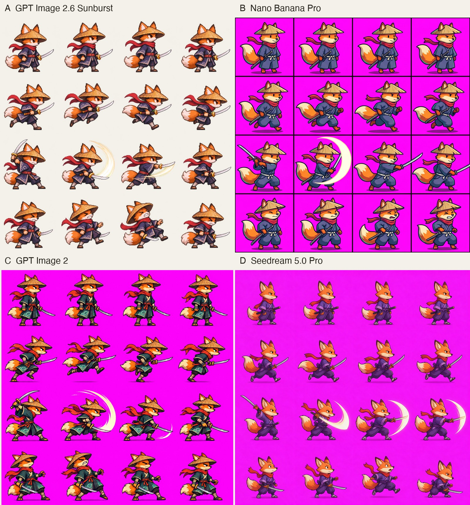

# 狐浪人网页游戏：2.6 出表、另一 agent 切帧

Author: **@maker_evan** · Source: https://x.com/maker_evan/status/2118222694345040253

Model evidence: 作者声明 GPT Image 2.6 出表（切帧/游戏是 GPT-6.1 Sol；非官方验证）

Pipeline: sheet_then_agent_cut · Verification: 作者声明 2.6 · 非官方验证 · 未观看

License: **unknown**. Archived locally at the user's request. MIT covers repo source code only. This is not an author grant or CC0.

## Media

<video src="media/02-dynamic.mp4" controls muted loop playsinline preload="metadata" style="max-width:100%"></video>

[local 02-dynamic.mp4](media/02-dynamic.mp4)
<video src="media/01-dynamic.mp4" controls muted loop playsinline preload="metadata" style="max-width:100%"></video>

[local 01-dynamic.mp4](media/01-dynamic.mp4)

## Prompt

See [prompt.md](prompt.md) for the full original text (empty if unpublished).

## Post / process

See [post.md](post.md).
