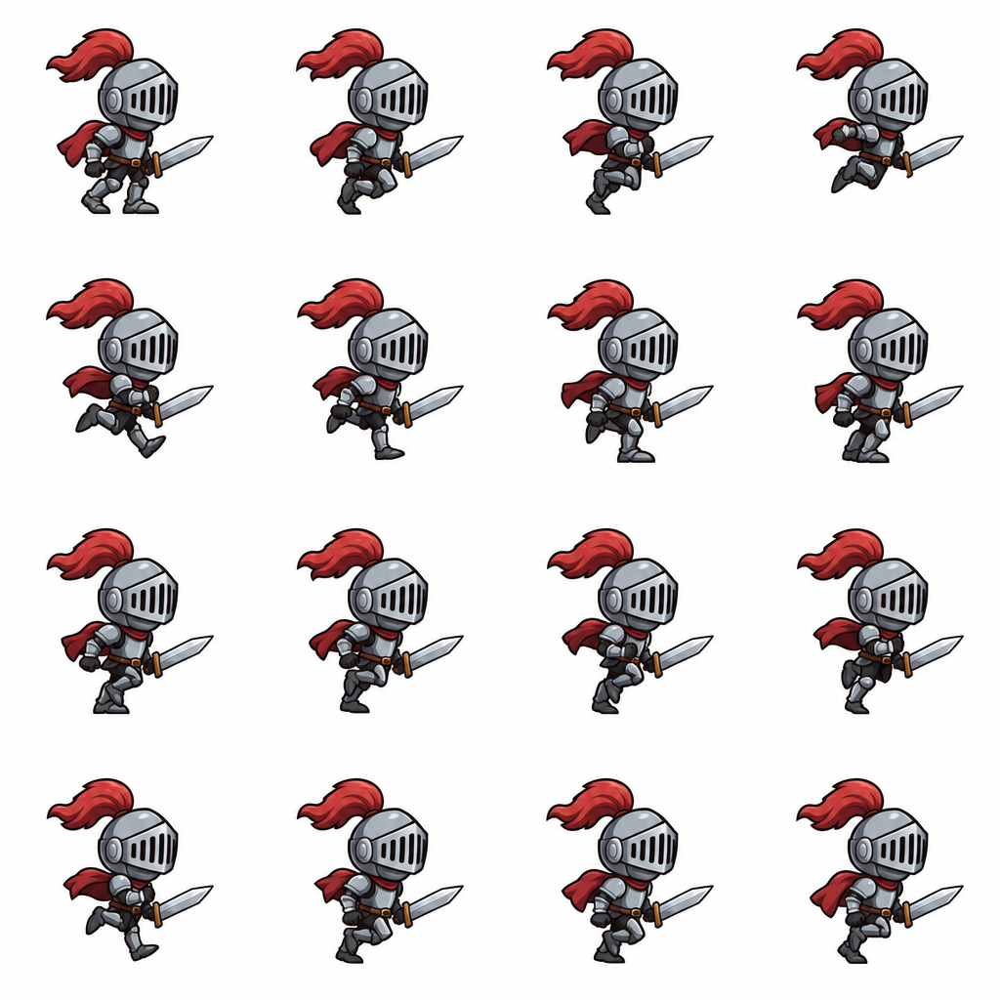

# 骑士跑循环：作者声明 2.6 出表再切帧

Author: **vargHQ gpt-image-sprite-sheet · 作者声明 gpt_image_2_6 · 非 OpenAI 官方验证 · 未复测** · Source: https://github.com/vargHQ/skills/blob/main/gpt-image-sprite-sheet/SKILL.md

Model evidence: 作者声明 gpt_image_2_6（非官方验证；本仓未复测）

Pipeline: sheet_then_slice · Verification: 作者声明 2.6 · 非官方验证 · 未观看

License: **unknown**. Archived locally at the user's request. MIT covers repo source code only. This is not an author grant or CC0.

## Media

<video src="media/02-loop.mp4" controls muted loop playsinline preload="metadata" style="max-width:100%"></video>

[local 02-loop.mp4](media/02-loop.mp4)

## Prompt

See [prompt.md](prompt.md) for the full original text (empty if unpublished).

## Post / process

See [post.md](post.md).
