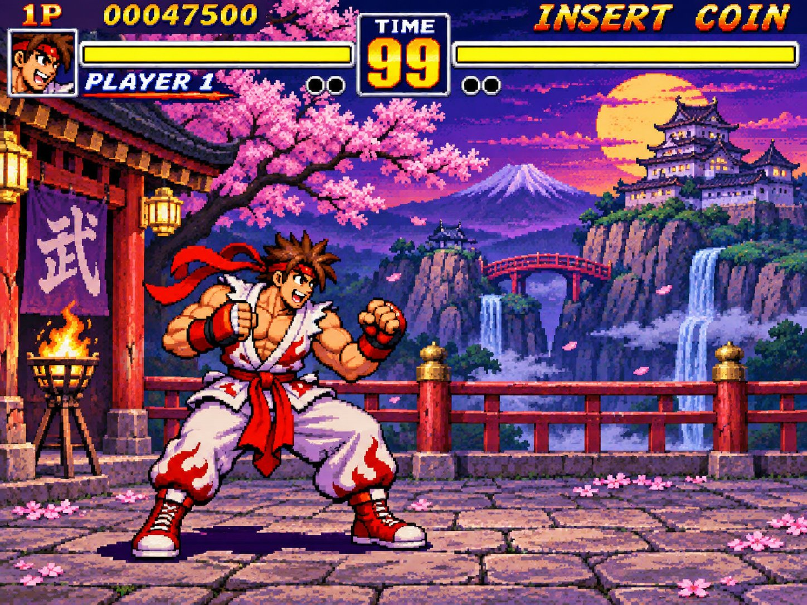

# 复古格斗出拳 / 蓄力循环

Author: **@xiaomovps** · Source: https://x.com/xiaomovps/status/2118274032227471705

Model evidence: 作者声明 GPT Images 2.6（非官方验证；本仓未观看、未复测）

Pipeline: native_gif_and_or_sprite_claimed · Verification: 作者声明 2.6 · 非官方验证 · 未观看

License: **unknown**. Archived locally at the user's request. MIT covers repo source code only. This is not an author grant or CC0.

## Media

<video src="media/01-dynamic.mp4" controls muted loop playsinline preload="metadata" style="max-width:100%"></video>

[local 01-dynamic.mp4](media/01-dynamic.mp4)
<video src="media/02-dynamic.mp4" controls muted loop playsinline preload="metadata" style="max-width:100%"></video>

[local 02-dynamic.mp4](media/02-dynamic.mp4)

## Prompt

See [prompt.md](prompt.md) for the full original text (empty if unpublished).

## Post / process

See [post.md](post.md).

- Video: [video.mp4](media/video.mp4)
- Local `video.mp4` is a credited copy of the original author's post and links back to that post. It is not a reuse license. Open a GitHub Issue to request removal.
