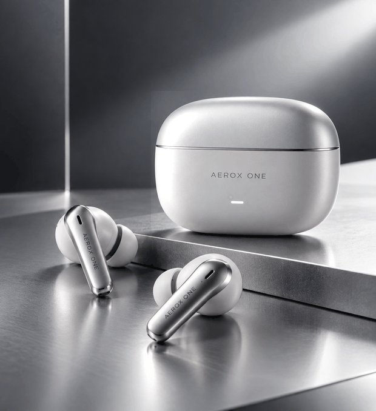
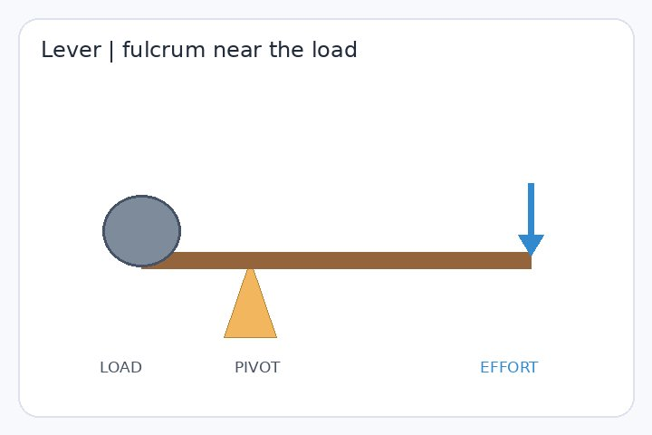
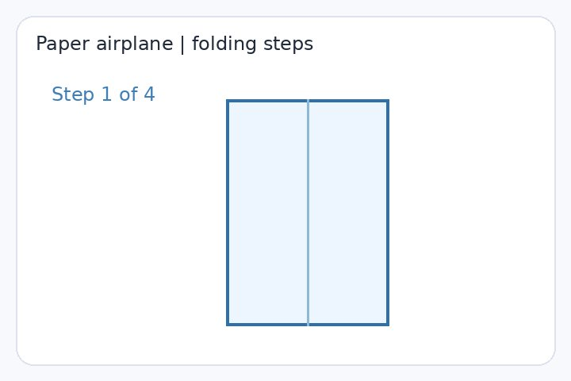
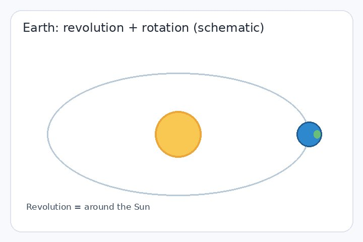
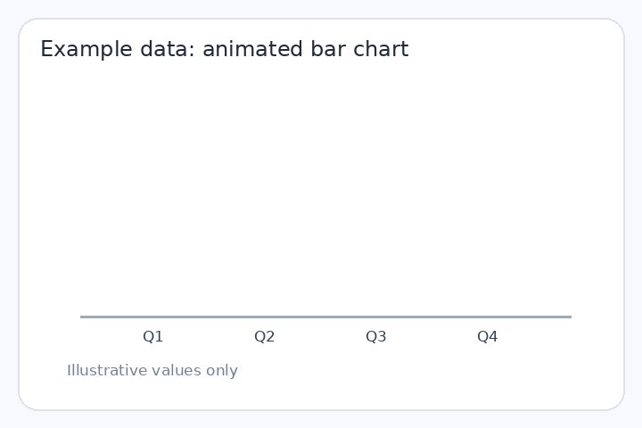

# 七玩法串：真人动态表情、物理科普、产品展示、操作教程、天文动画、商业图表、打工人情绪包；每条附结果 GIF

Author: **@Adam38363368936** · Source: https://x.com/Adam38363368936/status/2118269020369817856

Model evidence: 作者声明 2.6：全网最全！GPT Image 2.6 的 GIF 功能实用玩法…附完整提示词

Pipeline: 作者称直出 GIF · X 附件实际 MP4 · Verification: 作者声明 + 媒体元数据已核 · 未观看 · 未复测

License: **unknown**. Archived locally at the user's request. MIT covers repo source code only. This is not an author grant or CC0.

## Media

<video src="media/01-dynamic.mp4" controls muted loop playsinline preload="metadata" style="max-width:100%"></video>

[local 01-dynamic.mp4](media/01-dynamic.mp4)
<video src="media/02-dynamic.mp4" controls muted loop playsinline preload="metadata" style="max-width:100%"></video>

[local 02-dynamic.mp4](media/02-dynamic.mp4)

<video src="media/03-dynamic.mp4" controls muted loop playsinline preload="metadata" style="max-width:100%"></video>

[local 03-dynamic.mp4](media/03-dynamic.mp4)
<video src="media/04-dynamic.mp4" controls muted loop playsinline preload="metadata" style="max-width:100%"></video>

[local 04-dynamic.mp4](media/04-dynamic.mp4)

<video src="media/05-dynamic.mp4" controls muted loop playsinline preload="metadata" style="max-width:100%"></video>

[local 05-dynamic.mp4](media/05-dynamic.mp4)

<video src="media/07-dynamic.mp4" controls muted loop playsinline preload="metadata" style="max-width:100%"></video>

[local 07-dynamic.mp4](media/07-dynamic.mp4)

<video src="media/06-dynamic.mp4" controls muted loop playsinline preload="metadata" style="max-width:100%"></video>

[local 06-dynamic.mp4](media/06-dynamic.mp4)

## Prompt

See [prompt.md](prompt.md) for the full original text (empty if unpublished).

## Post / process

See [post.md](post.md).

- Video: [video.mp4](media/video.mp4)
- Local `video.mp4` is a credited copy of the original author's post and links back to that post. It is not a reuse license. Open a GitHub Issue to request removal.
