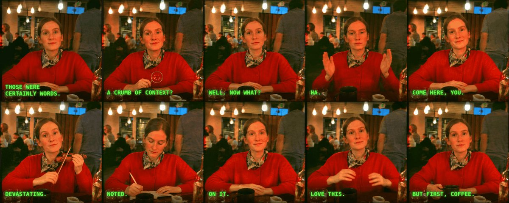

# 英文：角色照+风格参考 → 一套 10 个 reaction GIF；prompt 在回复（正文截断）

Author: **@nonieengel** · Source: https://x.com/nonieengel/status/2118382251226562570

Model evidence: 作者声明 2.6：You can just upload one character photo + a style reference and get a set of 10 custom reaction GIFs… Sharing the prompt below.

Pipeline: 作者称直出 GIF · X 附件实际 MP4 · Verification: 作者声明 + 媒体元数据已核 · 未观看 · 未复测

License: **unknown**. Archived locally at the user's request. MIT covers repo source code only. This is not an author grant or CC0.

## Media

<video src="media/01-dynamic.mp4" controls muted loop playsinline preload="metadata" style="max-width:100%"></video>

[local 01-dynamic.mp4](media/01-dynamic.mp4)

## Prompt

See [prompt.md](prompt.md) for the full original text (empty if unpublished).

## Post / process

See [post.md](post.md).
