# Showcase index / 案例总表

一行一条主表案例。缩略图链回原帖，作者列是署名。代码许可证不覆盖这些图，见 [MEDIA_RIGHTS.md](../MEDIA_RIGHTS.md)。

共 **77** 条。排序是模型家族，家族里最新一代在前。

## 按作品类型检索

- **动图 / GIF** (47): `official-lantern-monkey-gif`, `reddit-anime-nod-gif`, `krouxzz-wave-ref`, `lightlyn-earbuds-case-gif`, `lightlyn-orange-cat-mascot-gif`, `lightlyn-photo-steam-gif`, `luffy-x-article`, `ravivit-paper-boat-gif`, `veevid-cactus-mascot-gif`, `veevid-coffee-steam-gif`, `veevid-dog-photo-wag-gif`, `veevid-fox-mascot-gif`, `veevid-perfume-light-sweep-gif`, `veevid-robot-sketch-gif`, `x-abc123-static-to-gif`, `x-adam-7plays-thread`, `x-dokken-guitar`, `x-gdb-images26-gif`, `x-gorden-sun-rice-gif`, `x-ihayato-markup-gif`, `x-kqyno7-frieren`, `x-meow2149-ai-girl-stickers`, `x-mirai-ai2050-frame-test`, `x-miramusic-stretch`, `x-moltikuji-oc-eyebrow`, `x-newsasart-claim-gif`, `x-okan-aitool-wave-laugh`, `x-op7418-fatfish-pack`, `x-plasm0-animated-gif`, `x-seaart-doodle-gif`, `x-supertask-arch-timelapse`, `x-thinkszyg-paperboat-verify`, `x-xepher113-oc12`, `x-xulijian-avatar-stickers`, `x-yulikay-toast`, `x-zone-nonsticker-plays`, `x-heycesr-photo-animate`, `x-nonieengel-reaction-set`, `x-vm3jp6u04-schnauzer`, `ailingqu-ai-typing-indicator`, `ailingqu-cat-brand-reel`, `ailingqu-flower-macro-flash`, `ailingqu-glass-butterfly`, `ailingqu-ink-wash-horse`, `ailingqu-jelly-bear-wobble`, `ailingqu-pixel-slime-boss`, `ailingqu-window-day-to-night`
- **动画 / Animation** (7): `x-himanshutwtxs-fable52-motion-showreel`, `x-wshuyi-fable52-sabertooth-hunt`, `web-halil-fable52-animation-prompts`, `web-ofox-fable52-svg-sailboat`, `x-harshithlucky3-gpt62sol-pelican-svg-animation`, `web-atelier-gpt61-sol-ten-frame-loops`, `x-radcybertruck-grok-imagine-cybertruck-cry`
- **HTML / 3D** (19): `x-mengto-fable52-blender-apartment`, `x-paleknight-fable52-vs-opus55-ship`, `web-jamesgreene-code1-opus55-isometric-city`, `x-coodddaaaa-gemini-carbon-pelican-bike`, `x-statswire-gemini-carbon-nyc-cruiser`, `web-jamesgreene-code1-gemini4-argon-isometric-city`, `x-cherriessire-gpt62sol-moon-aurora-threejs`, `x-marcthecreatorr-gpt62sol-sailing-ship`, `x-qingzhoucloud-gpt62sol-floating-castle`, `x-teddyaisi-gpt62sol-interactive-city`, `x-tokengremlin-gpt62sol-threejs-blackhole`, `x-tokengremlin-gpt62sol-threejs-scenes-html`, `x-raitoox-sol-stranger-things-credits`, `x-yfeng-gpt61-sol-fable-take-flight`, `web-jamesgreene-code1-gpt61-sol-isometric-city`, `web-jamesgreene-code1-grok47-isometric-city`, `web-jamesgreene-code1-qwen38-27b-isometric-city`, `web-jamesgreene-code1-deepseek-v41-flash-1017-isometric-city`, `x-latentoperator-a380-deepseek-fable-sol`
- **小游戏 / Game** (4): `game-daft-pixel-combo`, `game-maker-evan-fox-ronin`, `game-varg-knight-run`, `game-xiaomovps-fighter`
- **图像 / Image** (0): 

## 全部案例

| 缩略图 | 标题 | 模型家族 | 版本 | 作品类型 | 日期 | 作者 | 来源 |
|---|---|---|---|---|---|---|---|
|  | `x-himanshutwtxs-fable52-motion-showreel` One-prompt motion designer showreel (timing, easing, shape, type) | Claude | Claude Fable 5.2 | 动画 / Animation | 2026-11-09 | @himanshutwtxs | [来源](https://x.com/himanshutwtxs/status/2120017106804900304) |
| 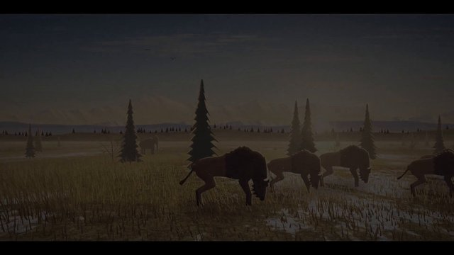 | `x-wshuyi-fable52-sabertooth-hunt` 纯编程动画：剑齿虎捕猎野牛（自编程音效） | Claude | Claude Fable 5.2 | 动画 / Animation | 2026-11-09 | @wshuyi | [来源](https://x.com/wshuyi/status/2120014892040417720) |
| 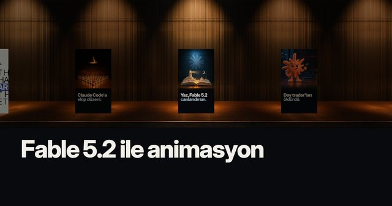 | `web-halil-fable52-animation-prompts` Four single-message Fable 5.2 animation prompts (logo / promo / cinemati | Claude | Claude Fable 5.2 | 动画 / Animation | 2026-11-10 | Halil Sekeroglu | [来源](https://halilsekeroglu.com/en/fable/) |
| 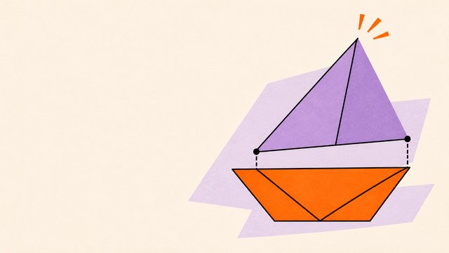 | `web-ofox-fable52-svg-sailboat` Editable SVG sailboat illustration with CSS motion (two API calls) | Claude | Claude Fable 5.2 | 动画 / Animation | 2026-11-11 | Ofox | [来源](https://ofox.ai/blog/claude-fable-5-2-svg-guide/) |
| 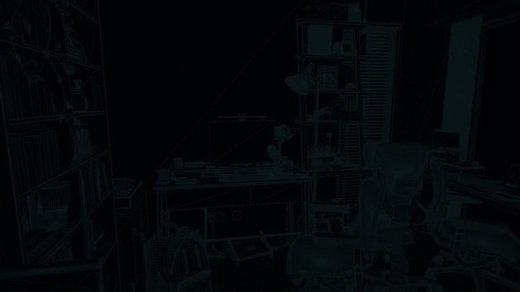 | `x-mengto-fable52-blender-apartment` Recreate a Three.js apartment in Blender with Fable 5.2 | Claude | Claude Fable 5.2 | HTML / 3D | 2026-11-11 | @MengTo（Meng To） | [来源](https://x.com/MengTo/status/2120316203738829180) |
| 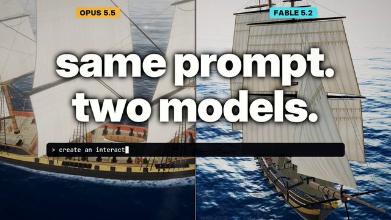 | `x-paleknight-fable52-vs-opus55-ship` Fable 5.2 vs Opus 5.5 — same prompt Three.js ship (side-by-side) | Claude | Claude Fable 5.2 | HTML / 3D | 2026-11-11 | @paleknight（Vraj） | [来源](https://x.com/paleknight/status/2120368418805174639) |
| 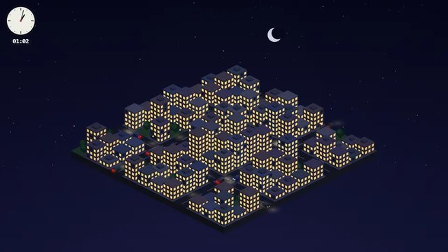 | `web-jamesgreene-code1-opus55-isometric-city` Isometric day/night city HTML loop — Claude Opus 5.5 | Claude | Claude Opus 5.5 | HTML / 3D | 2026-11-05 | James Greene (model comparison archive) | [来源](https://jamesgreene.com/models/) |
|  | `x-coodddaaaa-gemini-carbon-pelican-bike` Gemini Carbon · 鹈鹕骑自行车 HTML 动画测试 | Gemini | Gemini 4 Carbon | HTML / 3D | 2026-11-11 | @coodddaaaa（Joe William） | [来源](https://x.com/coodddaaaa/status/2120363353142911078) |
| 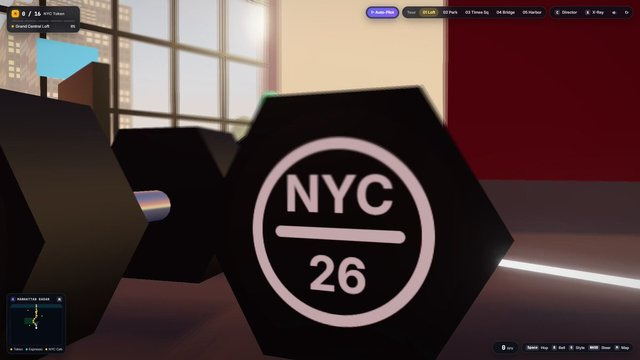 | `x-statswire-gemini-carbon-nyc-cruiser` Interactive 3D NYC cruiser tour in one HTML file (Three.js) | Gemini | Gemini 4 Carbon | HTML / 3D | 2026-11-11 | @StatsWire | [来源](https://x.com/StatsWire/status/2120344850071540152) |
| 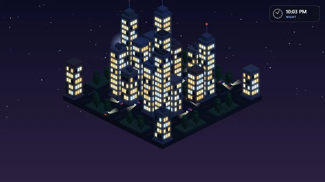 | `web-jamesgreene-code1-gemini4-argon-isometric-city` Isometric day/night city HTML loop — Gemini 4 Argon | Gemini | Gemini 4 Argon | HTML / 3D | 2026-11-05 | James Greene (model comparison archive) | [来源](https://jamesgreene.com/models/) |
| 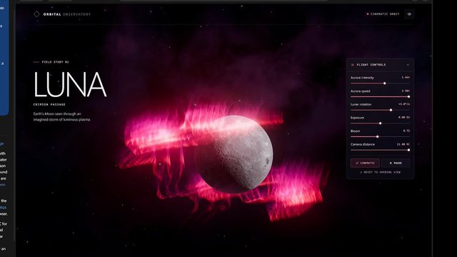 | `x-cherriessire-gpt62sol-moon-aurora-threejs` Self-contained Three.js moon scene with red aurora in one HTML file | GPT-6.2 Sol | GPT-6.2 Sol | HTML / 3D | 2026-11-08 | @cherriessire | [来源](https://x.com/cherriessire/status/2119488351057121420) |
| 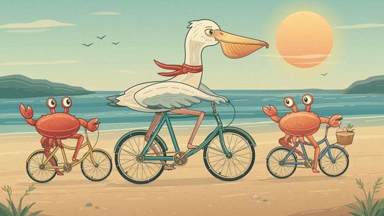 | `x-harshithlucky3-gpt62sol-pelican-svg-animation` SVG animation: pelican and 2 crabs riding bicycles (Codex routing) | GPT-6.2 Sol | GPT-6.2 Sol | 动画 / Animation | 2026-11-08 | @HarshithLucky3（Harshith） | [来源](https://x.com/HarshithLucky3/status/2119418918616150080) |
| 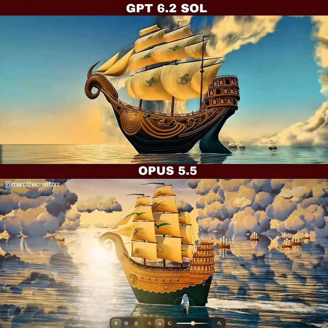 | `x-marcthecreatorr-gpt62sol-sailing-ship` GPT-6.2 Sol vs Opus 5.5 — interactive Three.js sailing ship (same prompt | GPT-6.2 Sol | GPT-6.2 Sol | HTML / 3D | 2026-11-08 | @marcthecreatorr（Marcel） | [来源](https://x.com/marcthecreatorr/status/2119503438405136765) |
| 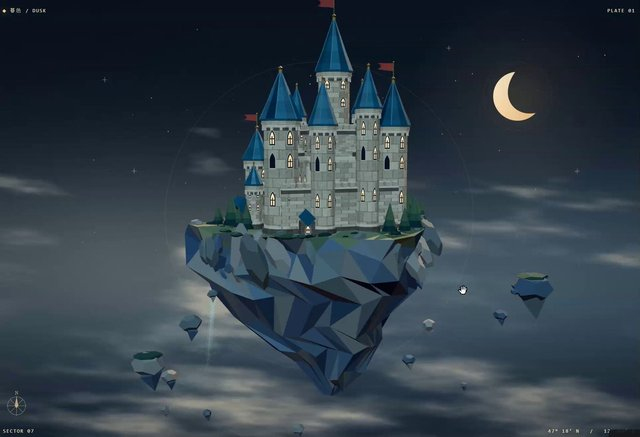 | `x-qingzhoucloud-gpt62sol-floating-castle` GPT-6.2 Sol 3D floating castle built with HTML + Three.js | GPT-6.2 Sol | GPT-6.2 Sol | HTML / 3D | 2026-11-08 | @qingzhoucloud（产品晓东） | [来源](https://x.com/qingzhoucloud/status/2119441137576579448) |
| 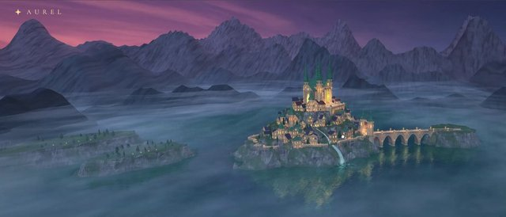 | `x-teddyaisi-gpt62sol-interactive-city` One-prompt interactive Three.js city in a single offline HTML file | GPT-6.2 Sol | GPT-6.2 Sol | HTML / 3D | 2026-11-08 | @teddyaisi（Teddy） | [来源](https://x.com/teddyaisi/status/2119503047646908664) |
| 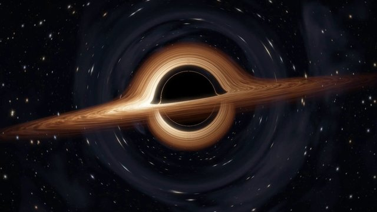 | `x-tokengremlin-gpt62sol-threejs-blackhole` One-shot Three.js black hole in a single HTML file (author routed to GPT | GPT-6.2 Sol | GPT-6.2 Sol | HTML / 3D | 2026-11-08 | @TokenGremlin（Token Gremlin） | [来源](https://x.com/TokenGremlin/status/2119395930805879165) |
| 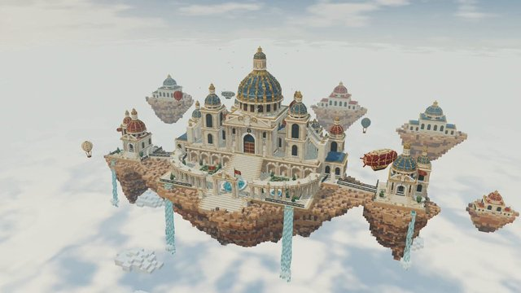 | `x-tokengremlin-gpt62sol-threejs-scenes-html` Three.js scenes from one prompt packed into one HTML file (castle / demo | GPT-6.2 Sol | GPT-6.2 Sol | HTML / 3D | 2026-11-08 | @TokenGremlin（Token Gremlin） | [来源](https://x.com/TokenGremlin/status/2119371334878744648) |
| 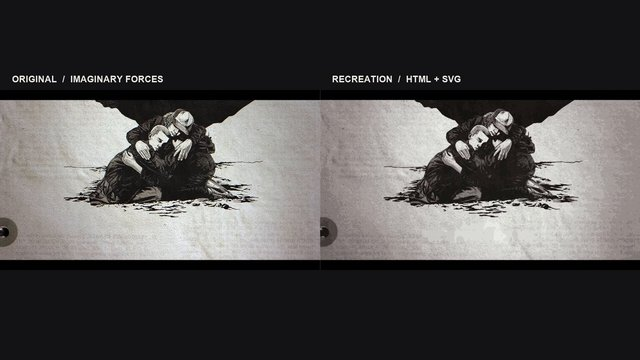 | `x-raitoox-sol-stranger-things-credits` Stranger Things 5 end credits recreated in HTML/CSS/JS + SVG (HyperFrame | GPT-6.2 Sol | GPT-6.2 Sol | HTML / 3D | 2026-11-10 | @Raitox_tech | [来源](https://x.com/Raitox_tech/status/2120125234129084492) |
|  | `x-yfeng-gpt61-sol-fable-take-flight` Let Fable take Flight — HTML/Three.js procedural animation (GPT-6.1 Sol  | GPT-6.2 Sol | GPT-6.2 Sol | HTML / 3D | 2026-11-11 | @YFeng2022（LanFeng） | [来源](https://x.com/YFeng2022/status/2120324811549225082) |
|  | `web-atelier-gpt61-sol-ten-frame-loops` Atelier — ten-frame looping sprite briefs (GPT-6.1 Sol max effort column | GPT-6.2 Sol | GPT-6.1 Sol | 动画 / Animation | 2026-11 | Marmik Shah (Atelier exhibition) | [来源](https://marmikshah.github.io/atelier/) |
| 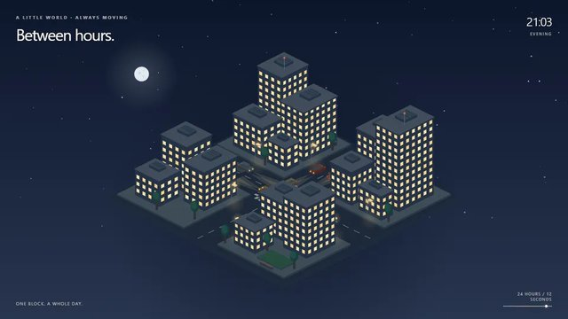 | `web-jamesgreene-code1-gpt61-sol-isometric-city` Isometric day/night city HTML loop — GPT-6.1 Sol | GPT-6.2 Sol | GPT-6.1 Sol | HTML / 3D | 2026-11-05 | James Greene (model comparison archive) | [来源](https://jamesgreene.com/models/) |
| 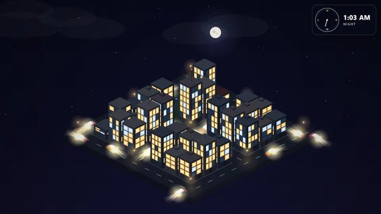 | `web-jamesgreene-code1-grok47-isometric-city` Isometric day/night city HTML loop — Grok 4.7 | Grok | Grok 4.7 | HTML / 3D | 2026-11-05 | James Greene (model comparison archive) | [来源](https://jamesgreene.com/models/) |
| 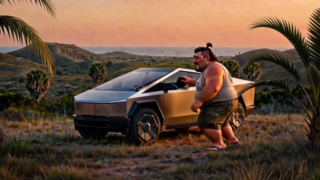 | `x-radcybertruck-grok-imagine-cybertruck-cry` Grok Imagine — pixstar Cybertruck farewell clip (partial prompt) | Grok | Grok Imagine Video | 动画 / Animation | 2026-11-11 | @RadCyberTruck | [来源](https://x.com/RadCyberTruck/status/2120350558431445006) |
| 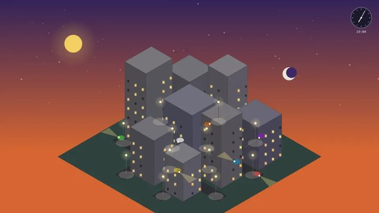 | `web-jamesgreene-code1-qwen38-27b-isometric-city` Isometric day/night city HTML loop — Qwen3.8 27B | Qwen | Qwen3.8 27B | HTML / 3D | 2026-11-05 | James Greene (model comparison archive) | [来源](https://jamesgreene.com/models/) |
| 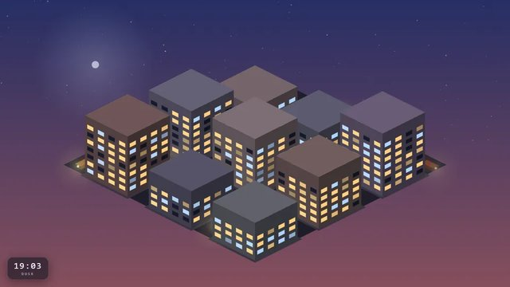 | `web-jamesgreene-code1-deepseek-v41-flash-1017-isometric-city` Isometric day/night city HTML loop — DeepSeek V4.1 Flash 1017 | DeepSeek | DeepSeek V4.1 Flash 1017 | HTML / 3D | 2026-11-05 | James Greene (model comparison archive) | [来源](https://jamesgreene.com/models/) |
| 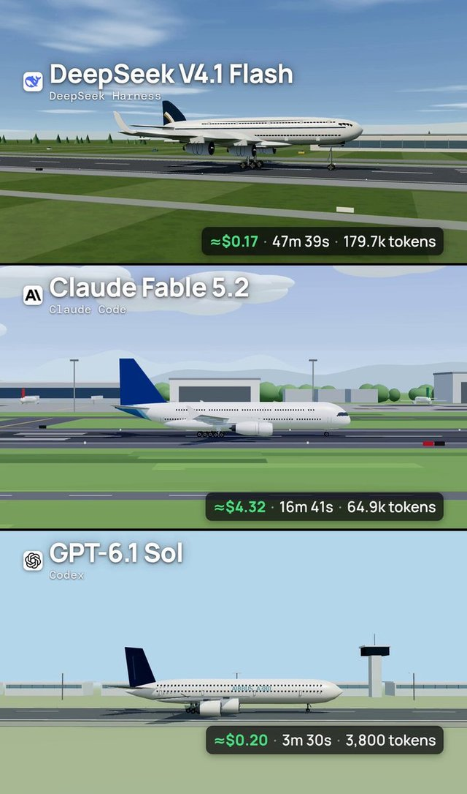 | `x-latentoperator-a380-deepseek-fable-sol` Airbus A380 takeoff in Three.js — DeepSeek V4.1 Flash vs Fable 5.2 vs GP | DeepSeek | DeepSeek V4.1 Flash | HTML / 3D | 2026-11-10 | @LatentOperatorX | [来源](https://x.com/LatentOperatorX/status/2120205377803518132) |
|  | `official-lantern-monkey-gif` 原生循环GIF：提灯小猴抬灯/眨眼/回位，固定机位 | GPT Image | GPT Image 2.6 | 动图 / GIF | — | OpenAI | [来源](https://developers.openai.com/api/docs/guides/image-prompting) |
|  | `reddit-anime-nod-gif` 参考角色图→动漫点头闭眼循环 | GPT Image | GPT Image 2.6 | 动图 / GIF | — | 未知（r/OpenAI 帖作者；本轮JSON接口被拦未能取handle） | [来源](https://www.reddit.com/r/OpenAI/comments/1xoh2u0/i_tried_the_new_image_26_gif_feature/) |
| 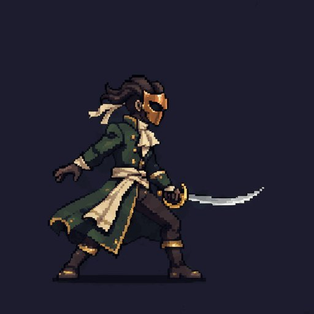 | `game-daft-pixel-combo` 像素三连击 / 翻滚 / 法术（跳跃事后压背景） | GPT Image | GPT Image 2.6 | 小游戏 / Game | 2026-11-05 | Daft_Trade @Daft_Trade · 作者声明 2.6；跳跃承认 flatten 去闪烁 · 4 条 MP4=1 案例 · 未观看 | [来源](https://x.com/Daft_Trade/status/2118283025498906800) |
| 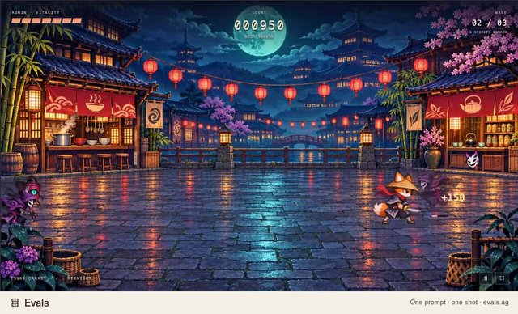 | `game-maker-evan-fox-ronin` 狐浪人网页游戏：2.6 出表、另一 agent 切帧 | GPT Image | GPT Image 2.6 | 小游戏 / Game | 2026-11-05 | maker_evan @maker_evan · 游戏 agent one-shot 已公开；图像 prompt 未公开 · 未观看 MP4 | [来源](https://x.com/maker_evan/status/2118222694345040253) |
| 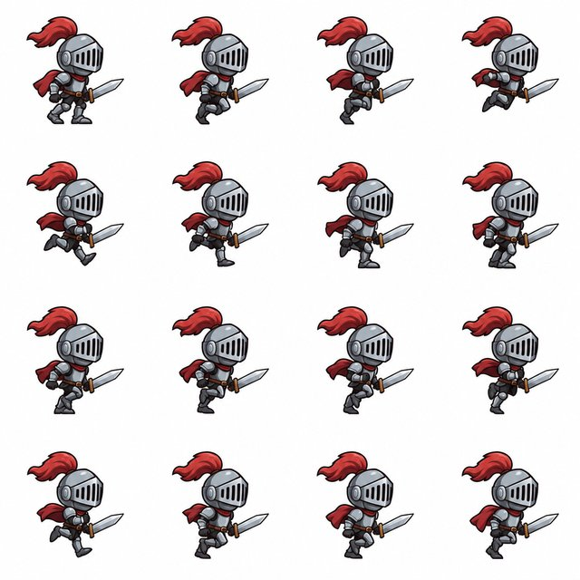 | `game-varg-knight-run` 骑士跑循环：作者声明 2.6 出表再切帧 | GPT Image | GPT Image 2.6 | 小游戏 / Game | 2026-11-05 | vargHQ gpt-image-sprite-sheet · 作者声明 gpt_image_2_6 · 非 OpenAI 官方验证 · 未复测 | [来源](https://github.com/vargHQ/skills/blob/main/gpt-image-sprite-sheet/SKILL.md) |
| 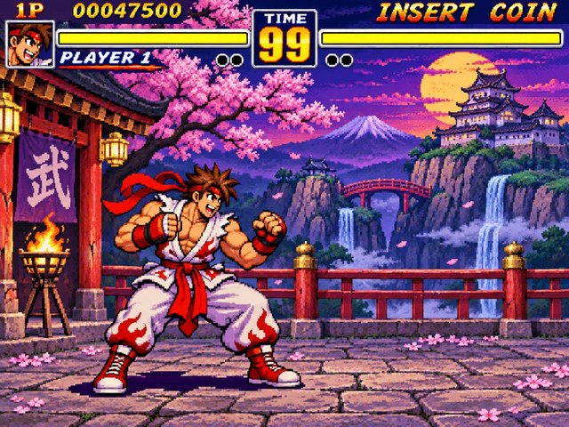 | `game-xiaomovps-fighter` 复古格斗出拳 / 蓄力循环 | GPT Image | GPT Image 2.6 | 小游戏 / Game | 2026-11-05 | 小墨同学 @xiaomovps · 作者声明 Images 2.6 · X animated_gif→MP4 · 未见引擎内运行 | [来源](https://x.com/xiaomovps/status/2118274032227471705) |
| 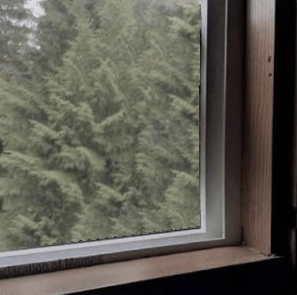 | `krouxzz-wave-ref` 角色挥手循环 | GPT Image | GPT Image 2.6 | 动图 / GIF | 2026-11-05 | @Krouxzz | [来源](https://x.com/Krouxzz/status/2118283796181053637) |
| 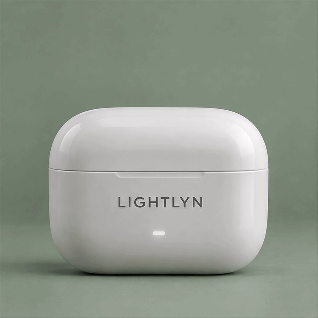 | `lightlyn-earbuds-case-gif` 商品盒开合：耳机盒开盖→耳机浮起→回位无缝循环 | GPT Image | GPT Image 2.6 | 动图 / GIF | 2026-11-05 | Linger（Lightlyn Images） | [来源](https://image.lightlyn.com/gpt-image-2-6?lang=en) |
|  | `lightlyn-orange-cat-mascot-gif` 品牌吉祥物挥手+眨眼无缝循环GIF | GPT Image | GPT Image 2.6 | 动图 / GIF | 2026-11-05 | Linger（Lightlyn Images） | [来源](https://image.lightlyn.com/gpt-image-2-6?lang=en) |
|  | `lightlyn-photo-steam-gif` 实拍图只动蒸汽与光，杯/桌/窗锁死 | GPT Image | GPT Image 2.6 | 动图 / GIF | 2026-11-05 | Linger（Lightlyn Images） | [来源](https://image.lightlyn.com/gpt-image-2-6?lang=en) |
| — | `luffy-x-article` 路飞 X Article：榨干 Image 2.6 的 10 个神级玩法（多玩法一组） | GPT Image | GPT Image 2.6 | 动图 / GIF | 2026-11-05 | @0xluffy_eth | [来源](https://x.com/i/article/2118269816821919744) |
|  | `ravivit-paper-boat-gif` API原生GIF：白纸船水面轻摇，固定机位；16帧×120ms | GPT Image | GPT Image 2.6 | 动图 / GIF | 2026-11-05 | ラビビット / AI活用メディア（Ravivit） | [来源](https://note.com/ravivit_ai/n/nb8f40b5a21b9) |
|  | `veevid-cactus-mascot-gif` 精灵表结构提示词→仙人掌吉祥物挥手循环（9帧） | GPT Image | GPT Image 2.6 | 动图 / GIF | 2026-11-05 | Veevid Team | [来源](https://veevid.ai/blog/gpt-image-2-6-gif) |
|  | `veevid-coffee-steam-gif` 咖啡杯蒸汽上升循环（文生GIF） | GPT Image | GPT Image 2.6 | 动图 / GIF | 2026-11-05 | Veevid Team | [来源](https://veevid.ai/blog/gpt-image-2-6-gif) |
|  | `veevid-dog-photo-wag-gif` 上传实拍狗→摇尾眨眼温和循环 | GPT Image | GPT Image 2.6 | 动图 / GIF | 2026-11-05 | Veevid Team | [来源](https://veevid.ai/blog/gpt-image-2-6-gif) |
|  | `veevid-fox-mascot-gif` 贴纸风狐狸吉祥物挥手眨眼 | GPT Image | GPT Image 2.6 | 动图 / GIF | 2026-11-05 | Veevid Team | [来源](https://veevid.ai/blog/gpt-image-2-6-gif) |
|  | `veevid-perfume-light-sweep-gif` 产品流光：香水瓶固定，光带扫过+尘粒上浮 | GPT Image | GPT Image 2.6 | 动图 / GIF | 2026-11-05 | Veevid Team | [来源](https://veevid.ai/blog/gpt-image-2-6-gif) |
| 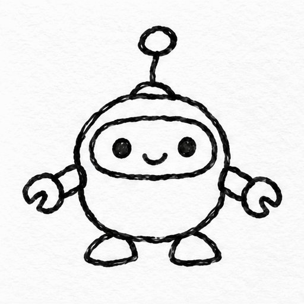 | `veevid-robot-sketch-gif` 线稿变挥手机器人，保留墨线纸感 | GPT Image | GPT Image 2.6 | 动图 / GIF | 2026-11-05 | Veevid Team | [来源](https://veevid.ai/blog/gpt-image-2-6-gif) |
|  | `x-abc123-static-to-gif` 上传静态表情包原图，一句话做成无限循环 GIF，强调角色一致性（与大肥鱼同模板族，仍单列原帖） | GPT Image | GPT Image 2.6 | 动图 / GIF | 2026-11-05 | @abc123953468547（A1terE&o） | [来源](https://x.com/abc123953468547/status/2118188053793837265) |
|  | `x-adam-7plays-thread` 七玩法串：真人动态表情、物理科普、产品展示、操作教程、天文动画、商业图表、打工人情绪包；每条附结果 GIF | GPT Image | GPT Image 2.6 | 动图 / GIF | 2026-11-05 | @Adam38363368936（Adam也叫吉米） | [来源](https://x.com/Adam38363368936/status/2118269020369817856) |
|  | `x-dokken-guitar` 日文：附图+超短「アコギを弾く男性」出吉他手 GIF | GPT Image | GPT Image 2.6 | 动图 / GIF | 2026-11-05 | @dokken92047824（HeartlessCat） | [来源](https://x.com/dokken92047824/status/2118293666456559762) |
|  | `x-gdb-images26-gif` OpenAI 联合创始人展示 Images 2.6 GIF 演示 | GPT Image | GPT Image 2.6 | 动图 / GIF | 2026-11-05 | @gdb（Greg Brockman） | [来源](https://x.com/gdb/status/2118174986544488876) |
|  | `x-gorden-sun-rice-gif` 参考角色图一句话生成「吃白米饭+真香」中文配字循环 GIF 表情包 | GPT Image | GPT Image 2.6 | 动图 / GIF | 2026-11-05 | @Gorden_Sun（Gorden Sun） | [来源](https://x.com/Gorden_Sun/status/2118166046175908016) |
| 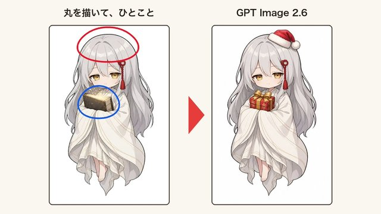 | `x-ihayato-markup-gif` 日文高互动：标记编辑演示 + 角色「まばたきして、ふわっと揺れて」GIF（markup + GIF；与 mirai 规格测不同帖） | GPT Image | GPT Image 2.6 | 动图 / GIF | 2026-11-05 | @IHayato（イケハヤ） | [来源](https://x.com/IHayato/status/2118151619212890291) |
|  | `x-kqyno7-frieren` 用芙莉莲角色试原生 GIF，作者称表情动作自然 | GPT Image | GPT Image 2.6 | 动图 / GIF | 2026-11-05 | @kqyno7（Kai） | [来源](https://x.com/kqyno7/status/2118160063835815981) |
|  | `x-meow2149-ai-girl-stickers` AI 娘四连循环表情包 GIF | GPT Image | GPT Image 2.6 | 动图 / GIF | 2026-11-05 | @meow2149（meow） | [来源](https://x.com/meow2149/status/2118254460187373747) |
|  | `x-mirai-ai2050-frame-test` 日文：同角色测 16/32 帧与尺寸；完整规格化 prompt 在评论 | GPT Image | GPT Image 2.6 | 动图 / GIF | 2026-11-05 | @mirai_ai2050（藍澤 ミライ） | [来源](https://x.com/mirai_ai2050/status/2118213713761292432) |
| 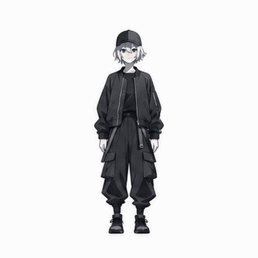 | `x-miramusic-stretch` 日文：从零提示词生成「拉伸」循环 GIF，附风格约束 | GPT Image | GPT Image 2.6 | 动图 / GIF | 2026-11-05 | @MiraMusic_AI（MiraMusic） | [来源](https://x.com/MiraMusic_AI/status/2118168013618987298) |
|  | `x-moltikuji-oc-eyebrow` 日文：用 Images 2.6 把自家角色做成 GIF，反馈眉毛一致性问题 | GPT Image | GPT Image 2.6 | 动图 / GIF | 2026-11-05 | @moltikuji（もる@ポケカ・フロム） | [来源](https://x.com/moltikuji/status/2118187059102027921) |
| 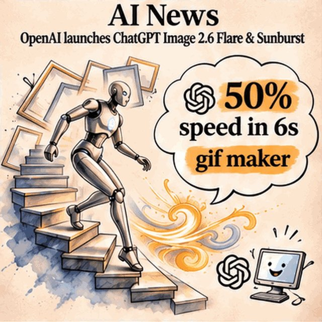 | `x-newsasart-claim-gif` 新闻卡风格帖，作者声称附件 GIF 由 Image 2.6 制作 | GPT Image | GPT Image 2.6 | 动图 / GIF | 2026-11-05 | @NewsAsArt（News As Cartoon） | [来源](https://x.com/NewsAsArt/status/2118236954383028693) |
|  | `x-okan-aitool-wave-laugh` 日文：一图+超短提示词「このキャラをGIFで動かして。手を振って笑う」（与 Krouxzz 挥手同类动作，不合并删帖） | GPT Image | GPT Image 2.6 | 动图 / GIF | 2026-11-05 | @okan_aitool（あゆ｜キャラパレ運営） | [来源](https://x.com/okan_aitool/status/2118201578406772887) |
|  | `x-op7418-fatfish-pack` 大肥鱼角色参考图 + 结构化模板批量出循环 GIF 表情包（主题可填空） | GPT Image | GPT Image 2.6 | 动图 / GIF | 2026-11-05 | @op7418（歸藏(guizang.ai)） | [来源](https://x.com/op7418/status/2118181775688241456) |
| 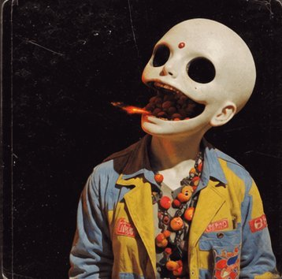 | `x-plasm0-animated-gif` 简短标注「GPT Image 2.6 animated GIF」+ 引用官方帖 | GPT Image | GPT Image 2.6 | 动图 / GIF | 2026-11-05 | @plasm0（ρŁ𝐀𝔰Ｍʘ） | [来源](https://x.com/plasm0/status/2118177268870562241) |
| 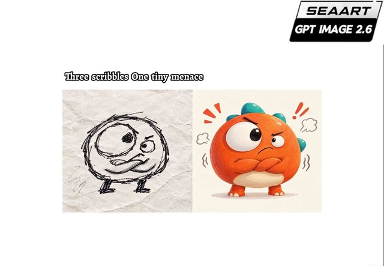 | `x-seaart-doodle-gif` 涂鸦草图 → 循环 GIF；宣称可用提示词控制时长 | GPT Image | GPT Image 2.6 | 动图 / GIF | 2026-11-05 | @SeaArt_Ai（SeaArt.Ai🐋） | [来源](https://x.com/SeaArt_Ai/status/2118267088284659733) |
| 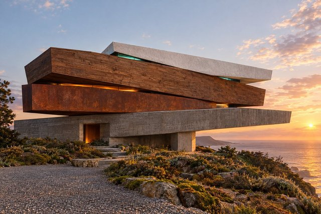 | `x-supertask-arch-timelapse` 日文：建筑效果图 → 日没时光流逝 GIF | GPT Image | GPT Image 2.6 | 动图 / GIF | 2026-11-05 | @supertask_jp（Tasuku Takahashi） | [来源](https://x.com/supertask_jp/status/2118241124133532077) |
|  | `x-thinkszyg-paperboat-verify` 用纸船循环 GIF 验证账号是否已推送 Images 2.6；并附六宫格 sprite sheet 提示词模板（与 Ravivit 纸船同题材， | GPT Image | GPT Image 2.6 | 动图 / GIF | 2026-11-05 | @thinkszyg（爆裂队长NEXT） | [来源](https://x.com/thinkszyg/status/2118166234495947044) |
|  | `x-xepher113-oc12` 日文 OC：称约 12 帧，借用他人角色图 | GPT Image | GPT Image 2.6 | 动图 / GIF | 2026-11-05 | @xepher113（ふぁーねりあん） | [来源](https://x.com/xepher113/status/2118177063727411603) |
|  | `x-xulijian-avatar-stickers` X 头像 → Q 版动态表情包两则 | GPT Image | GPT Image 2.6 | 动图 / GIF | 2026-11-05 | @xulijian1994（Kxians） | [来源](https://x.com/xulijian1994/status/2118193018167828815) |
|  | `x-yulikay-toast` 「GPT Images 2.6 is here + GIFs」附 animated_gif | GPT Image | GPT Image 2.6 | 动图 / GIF | 2026-11-05 | @yulikay（Yuli Kay） | [来源](https://x.com/yulikay/status/2118322092709994503) |
|  | `x-zone-nonsticker-plays` 非表情包向：舞蹈拆解、历史科普、像素动作、角色变身 | GPT Image | GPT Image 2.6 | 动图 / GIF | 2026-11-05 | @zone__online（SleepyZone） | [来源](https://x.com/zone__online/status/2118264293678608774) |
| 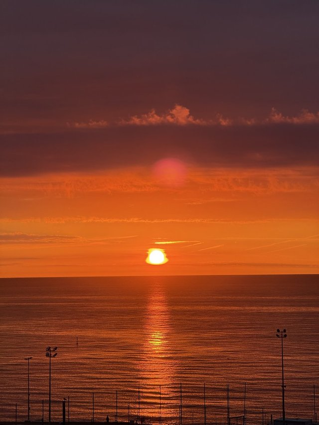 | `x-heycesr-photo-animate` 真实照片（左）→ GPT Image 2.6 动画化（右），经 @tryidem 调用 | GPT Image | GPT Image 2.6 | 动图 / GIF | 2026-11-06 | @heycesr（cesar.wtf） | [来源](https://x.com/heycesr/status/2118391412639371290) |
| 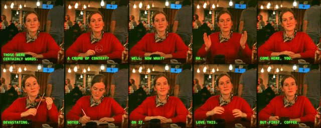 | `x-nonieengel-reaction-set` 英文：角色照+风格参考 → 一套 10 个 reaction GIF；prompt 在回复（正文截断） | GPT Image | GPT Image 2.6 | 动图 / GIF | 2026-11-06 | @nonieengel（Leonie Engel） | [来源](https://x.com/nonieengel/status/2118382251226562570) |
| 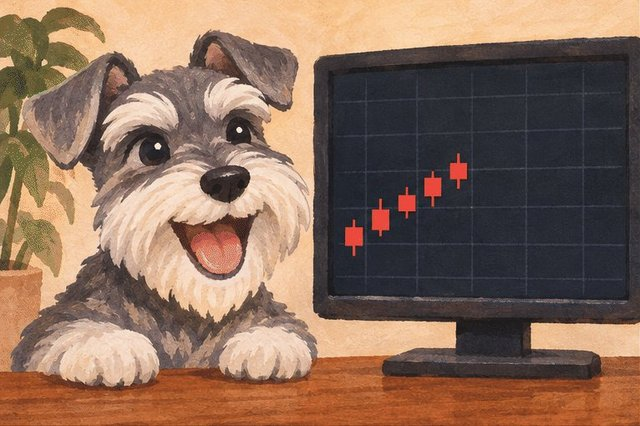 | `x-vm3jp6u04-schnauzer` 雪纳瑞狗 GIF + Images 2.6 四步用法说明 | GPT Image | GPT Image 2.6 | 动图 / GIF | 2026-11-06 | @vm3jp6u04（許文彥） | [来源](https://x.com/vm3jp6u04/status/2118390692347363396) |
|  | `ailingqu-ai-typing-indicator` AI assistant typing indicator / AI 助手正在输入 | GPT Image | GPT Image 2.6 | 动图 / GIF | 2026-11-07 | ailingqu / awesome-ai-gif-prompts | [来源](https://github.com/ailingqu/awesome-ai-gif-prompts/blob/a20f88b18a9abe8cd1531fb8a8e738a5a4701ce2/gifs/ai-typing-indicator.gif) |
| 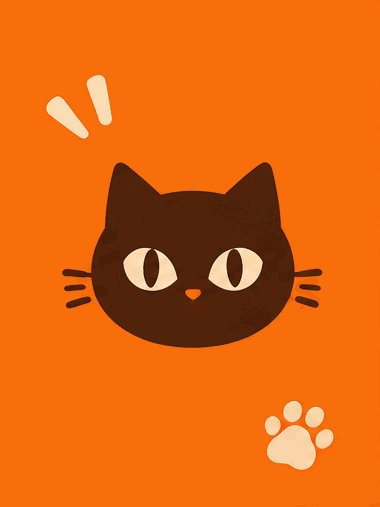 | `ailingqu-cat-brand-reel` Cat-head logo brand reel / 猫头 Logo 品牌快闪 | GPT Image | GPT Image 2.6 | 动图 / GIF | 2026-11-07 | ailingqu / awesome-ai-gif-prompts | [来源](https://github.com/ailingqu/awesome-ai-gif-prompts/blob/a20f88b18a9abe8cd1531fb8a8e738a5a4701ce2/gifs/cat-brand-reel.gif) |
| 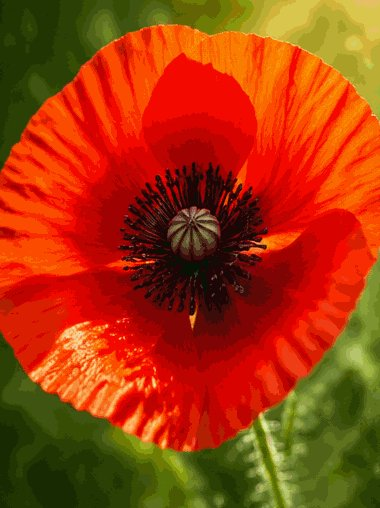 | `ailingqu-flower-macro-flash` Flower macro flash cut / 花卉微距快闪 | GPT Image | GPT Image 2.6 | 动图 / GIF | 2026-11-07 | ailingqu / awesome-ai-gif-prompts | [来源](https://github.com/ailingqu/awesome-ai-gif-prompts/blob/a20f88b18a9abe8cd1531fb8a8e738a5a4701ce2/gifs/flower-macro-flash.gif) |
| 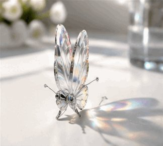 | `ailingqu-glass-butterfly` Glass butterfly with shifting shadows / 玻璃蝴蝶与投影 | GPT Image | GPT Image 2.6 | 动图 / GIF | 2026-11-07 | ailingqu / awesome-ai-gif-prompts | [来源](https://github.com/ailingqu/awesome-ai-gif-prompts/blob/a20f88b18a9abe8cd1531fb8a8e738a5a4701ce2/gifs/glass-butterfly.gif) |
| 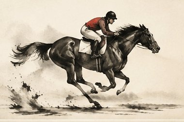 | `ailingqu-ink-wash-horse` Ink-wash galloping horse / 水墨奔马 | GPT Image | GPT Image 2.6 | 动图 / GIF | 2026-11-07 | ailingqu / awesome-ai-gif-prompts | [来源](https://github.com/ailingqu/awesome-ai-gif-prompts/blob/a20f88b18a9abe8cd1531fb8a8e738a5a4701ce2/gifs/ink-wash-horse.gif) |
|  | `ailingqu-jelly-bear-wobble` Jelly bear wobble / Q 弹果冻熊摇晃 | GPT Image | GPT Image 2.6 | 动图 / GIF | 2026-11-07 | ailingqu / awesome-ai-gif-prompts | [来源](https://github.com/ailingqu/awesome-ai-gif-prompts/blob/a20f88b18a9abe8cd1531fb8a8e738a5a4701ce2/gifs/jelly-bear-wobble.gif) |
| 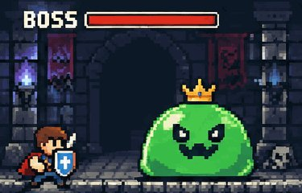 | `ailingqu-pixel-slime-boss` 8-bit slime boss battle / 8-bit 史莱姆 Boss 战 | GPT Image | GPT Image 2.6 | 动图 / GIF | 2026-11-07 | ailingqu / awesome-ai-gif-prompts | [来源](https://github.com/ailingqu/awesome-ai-gif-prompts/blob/a20f88b18a9abe8cd1531fb8a8e738a5a4701ce2/gifs/pixel-slime-boss.gif) |
|  | `ailingqu-window-day-to-night` Reading by the window, day to night / 窗边读书·白天到夜晚 | GPT Image | GPT Image 2.6 | 动图 / GIF | 2026-11-07 | ailingqu / awesome-ai-gif-prompts | [来源](https://github.com/ailingqu/awesome-ai-gif-prompts/blob/a20f88b18a9abe8cd1531fb8a8e738a5a4701ce2/gifs/window-day-to-night.gif) |
