# Showcase index / 案例总表

一行一条主表案例。缩略图链回原帖，作者列是署名。代码许可证不覆盖这些图，见 [MEDIA_RIGHTS.md](../MEDIA_RIGHTS.md)。

共 **43** 条。排序是模型家族，家族里最新一代在前。

## 按作品类型检索

- **动图 / GIF** (0): 
- **动画 / Animation** (12): `x-himanshutwtxs-fable52-motion-showreel`, `x-wshuyi-fable52-sabertooth-hunt`, `web-halil-fable52-animation-prompts`, `x-deryatr-fable52-ataturk-remembrance`, `web-ofox-fable52-svg-sailboat`, `x-deryatr-gemini-carbon-theme-park`, `x-maxblade-fable-vs-carbon`, `x-harshithlucky3-gpt62sol-pelican-svg-animation`, `web-atelier-gpt61-sol-ten-frame-loops`, `x-aiminithoughts-grok-imagine-golden-angel`, `x-radcybertruck-grok-imagine-cybertruck-cry`, `x-coffeecup2020-qwen4-sagrada`
- **HTML / 3D** (31): `x-deryatr-fable52-tcell-film`, `x-evanmilenko-fable52-dragon-game`, `x-financeyf5-fable52-bugatti-tourbillon`, `x-kloss-fable52-ocean-threejs`, `x-mengto-fable52-blender-apartment`, `x-mrtactical-fable52-mechanical-keyboard`, `x-paleknight-fable52-vs-opus55-ship`, `x-quxiaoyin-fable52-agentsky-film`, `web-jamesgreene-code1-opus55-isometric-city`, `x-aiforsuccess-gemini-carbon-v8`, `x-coodddaaaa-gemini-carbon-pelican-bike`, `x-statswire-gemini-carbon-nyc-cruiser`, `web-jamesgreene-code1-gemini4-argon-isometric-city`, `x-cherriessire-gpt62sol-moon-aurora-threejs`, `x-marcthecreatorr-gpt62sol-sailing-ship`, `x-qingzhoucloud-gpt62sol-floating-castle`, `x-teddyaisi-gpt62sol-interactive-city`, `x-tokengremlin-gpt62sol-threejs-blackhole`, `x-tokengremlin-gpt62sol-threejs-scenes-html`, `x-tokengremlin-gpt62sol-glass-seasons`, `x-cfenghub-gpt62sol-colosseum`, `x-raitoox-sol-stranger-things-credits`, `x-yfeng-gpt61-sol-fable-take-flight`, `web-jamesgreene-code1-gpt61-sol-isometric-city`, `x-takamasa045-gpt61sol-momoyama`, `web-jamesgreene-code1-grok47-isometric-city`, `web-jamesgreene-code1-qwen38-27b-isometric-city`, `x-leo114119-qwen4max-wukong-plane`, `web-jamesgreene-code1-deepseek-v41-flash-1017-isometric-city`, `x-latentoperator-a380-deepseek-fable-sol`, `x-latentoperator-deepseek-excavator`
- **小游戏 / Game** (0): 
- **图像 / Image** (0): 

## 全部案例

| 缩略图 | 标题 | 模型家族 | 版本 | 作品类型 | 日期 | 作者 | 来源 | 视频 |
|---|---|---|---|---|---|---|---|---|
|  | `x-himanshutwtxs-fable52-motion-showreel` One-prompt motion designer showreel (timing, easing, shape, type) | Claude | Claude Fable 5.2 | 动画 / Animation | 2026-11-09 | @himanshutwtxs | [来源](https://x.com/himanshutwtxs/status/2120017106804900304) | — |
|  | `x-wshuyi-fable52-sabertooth-hunt` 纯编程动画：剑齿虎捕猎野牛（自编程音效） | Claude | Claude Fable 5.2 | 动画 / Animation | 2026-11-09 | @wshuyi | [来源](https://x.com/wshuyi/status/2120014892040417720) | — |
|  | `web-halil-fable52-animation-prompts` Four single-message Fable 5.2 animation prompts (logo / promo / cinemati | Claude | Claude Fable 5.2 | 动画 / Animation | 2026-11-10 | Halil Sekeroglu | [来源](https://halilsekeroglu.com/en/fable/) | — |
| 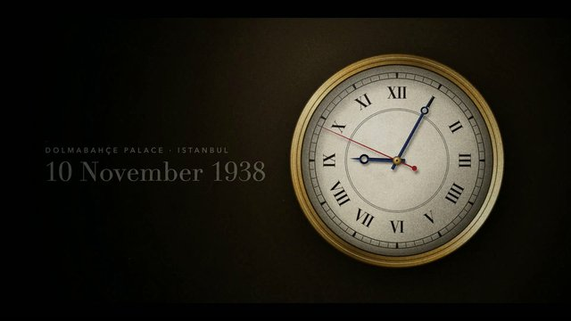 | `x-deryatr-fable52-ataturk-remembrance` 10 November remembrance video by Fable 5.2 | Claude | Claude Fable 5.2 | 动画 / Animation | 2026-11-10 | @DeryaTR_（Derya Unutmaz） | [来源](https://x.com/DeryaTR_/status/2120083276916224014) | — |
|  | `web-ofox-fable52-svg-sailboat` Editable SVG sailboat illustration with CSS motion (two API calls) | Claude | Claude Fable 5.2 | 动画 / Animation | 2026-11-11 | Ofox | [来源](https://ofox.ai/blog/claude-fable-5-2-svg-guide/) | — |
| 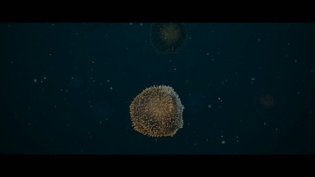 | `x-deryatr-fable52-tcell-film` T-cell life film in Blender (12,480 frames, Fable 5.2) | Claude | Claude Fable 5.2 | HTML / 3D | 2026-11-11 | @DeryaTR_（Derya Unutmaz） | [来源](https://x.com/DeryaTR_/status/2120382619082727604) | — |
| 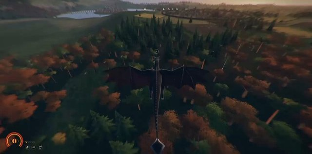 | `x-evanmilenko-fable52-dragon-game` Dragon game built from scratch in Three.js | Claude | Claude Fable 5.2 | HTML / 3D | 2026-11-11 | @EvanMilenko（Evan） | [来源](https://x.com/EvanMilenko/status/2120322640048959503) | — |
| 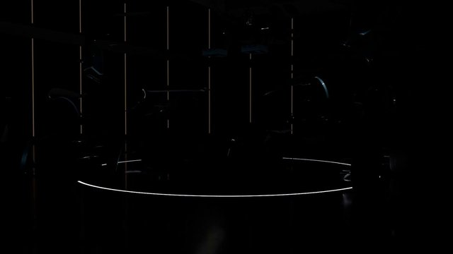 | `x-financeyf5-fable52-bugatti-tourbillon` Bugatti Tourbillon in Blender, then a short car film (Fable 5.2) | Claude | Claude Fable 5.2 | HTML / 3D | 2026-11-11 | @xikhar（Shikhar）; 中文转述 @FinanceYF5（AI Will） | [来源](https://x.com/FinanceYF5/status/2120372142147842296) | — |
| 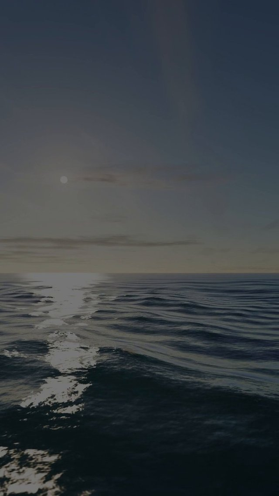 | `x-kloss-fable52-ocean-threejs` Photo-real Three.js ocean that runs from sunset to sunrise | Claude | Claude Fable 5.2 | HTML / 3D | 2026-11-11 | @kloss_xyz（klöss） | [来源](https://x.com/kloss_xyz/status/2120378126740095273) | — |
|  | `x-mengto-fable52-blender-apartment` Recreate a Three.js apartment in Blender with Fable 5.2 | Claude | Claude Fable 5.2 | HTML / 3D | 2026-11-11 | @MengTo（Meng To） | [来源](https://x.com/MengTo/status/2120316203738829180) | — |
| 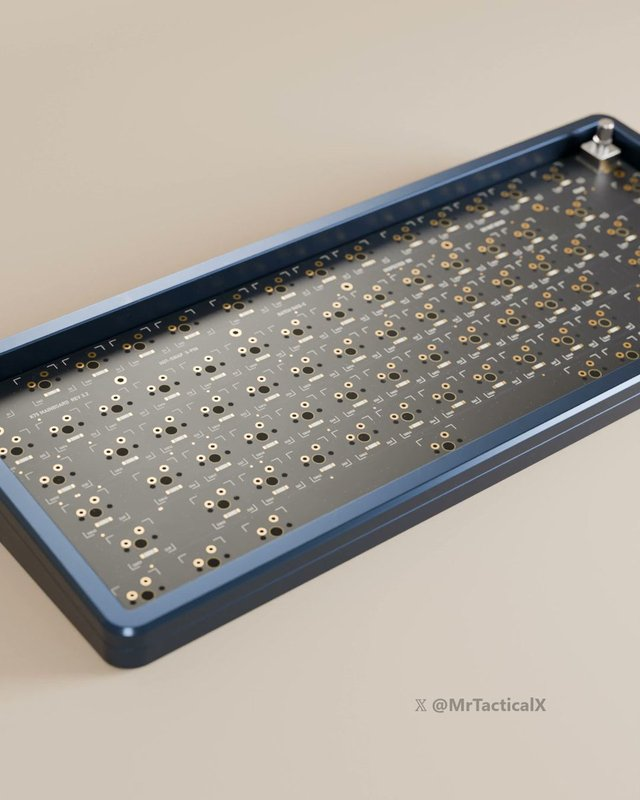 | `x-mrtactical-fable52-mechanical-keyboard` Mechanical keyboard built and typed on in Blender | Claude | Claude Fable 5.2 | HTML / 3D | 2026-11-11 | @MrTacticalX（Mr Tactical） | [来源](https://x.com/MrTacticalX/status/2120342453807157720) | — |
|  | `x-paleknight-fable52-vs-opus55-ship` Fable 5.2 vs Opus 5.5 — same prompt Three.js ship (side-by-side) | Claude | Claude Fable 5.2 | HTML / 3D | 2026-11-11 | @paleknight（Vraj） | [来源](https://x.com/paleknight/status/2120368418805174639) | — |
| 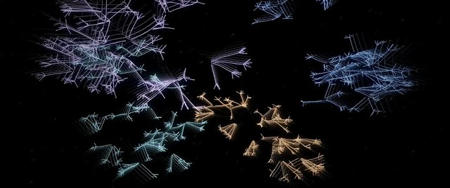 | `x-quxiaoyin-fable52-agentsky-film` Point-light 3D film about AgentSky (Blender and code) | Claude | Claude Fable 5.2 | HTML / 3D | 2026-11-11 | @quxiaoyin（Xiaoyin Qu） | [来源](https://x.com/quxiaoyin/status/2120341962314150207) | — |
|  | `web-jamesgreene-code1-opus55-isometric-city` Isometric day/night city HTML loop — Claude Opus 5.5 | Claude | Claude Opus 5.5 | HTML / 3D | 2026-11-05 | James Greene (model comparison archive) | [来源](https://jamesgreene.com/models/) | — |
| 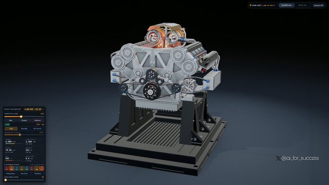 | `x-aiforsuccess-gemini-carbon-v8` V8 engine in FreeCAD and Blender | Gemini | Gemini 4 Carbon | HTML / 3D | 2026-11-11 | @ai_for_success（AshutoshShrivastava） | [来源](https://x.com/ai_for_success/status/2120317619588972867) | — |
|  | `x-coodddaaaa-gemini-carbon-pelican-bike` Gemini Carbon · 鹈鹕骑自行车 HTML 动画测试 | Gemini | Gemini 4 Carbon | HTML / 3D | 2026-11-11 | @coodddaaaa（Joe William） | [来源](https://x.com/coodddaaaa/status/2120363353142911078) | — |
| 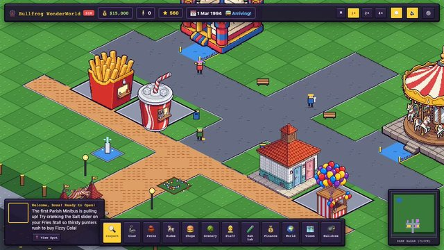 | `x-deryatr-gemini-carbon-theme-park` Theme Park HD pixel-art remake (playable) | Gemini | Gemini 4 Carbon | 动画 / Animation | 2026-11-11 | @DeryaTR_（Derya Unutmaz） | [来源](https://x.com/DeryaTR_/status/2120393810941456710) | — |
| 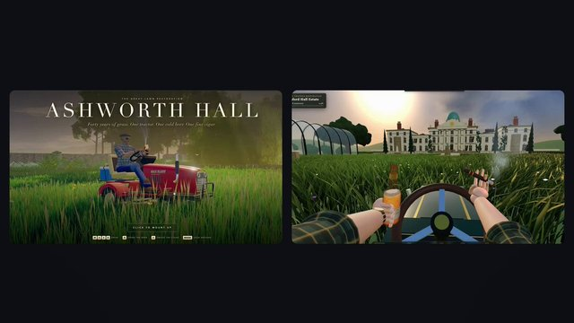 | `x-maxblade-fable-vs-carbon` Same prompt: Fable 5.2 vs Gemini 4 Carbon | Gemini | Gemini 4 Carbon | 动画 / Animation | 2026-11-11 | @_MaxBlade（Max Blade） | [来源](https://x.com/_MaxBlade/status/2120355412021231795) | — |
|  | `x-statswire-gemini-carbon-nyc-cruiser` Interactive 3D NYC cruiser tour in one HTML file (Three.js) | Gemini | Gemini 4 Carbon | HTML / 3D | 2026-11-11 | @StatsWire | [来源](https://x.com/StatsWire/status/2120344850071540152) | — |
|  | `web-jamesgreene-code1-gemini4-argon-isometric-city` Isometric day/night city HTML loop — Gemini 4 Argon | Gemini | Gemini 4 Argon | HTML / 3D | 2026-11-05 | James Greene (model comparison archive) | [来源](https://jamesgreene.com/models/) | — |
|  | `x-cherriessire-gpt62sol-moon-aurora-threejs` Self-contained Three.js moon scene with red aurora in one HTML file | GPT-6.2 Sol | GPT-6.2 Sol | HTML / 3D | 2026-11-08 | @cherriessire | [来源](https://x.com/cherriessire/status/2119488351057121420) | — |
|  | `x-harshithlucky3-gpt62sol-pelican-svg-animation` SVG animation: pelican and 2 crabs riding bicycles (Codex routing) | GPT-6.2 Sol | GPT-6.2 Sol | 动画 / Animation | 2026-11-08 | @HarshithLucky3（Harshith） | [来源](https://x.com/HarshithLucky3/status/2119418918616150080) | — |
|  | `x-marcthecreatorr-gpt62sol-sailing-ship` GPT-6.2 Sol vs Opus 5.5 — interactive Three.js sailing ship (same prompt | GPT-6.2 Sol | GPT-6.2 Sol | HTML / 3D | 2026-11-08 | @marcthecreatorr（Marcel） | [来源](https://x.com/marcthecreatorr/status/2119503438405136765) | — |
|  | `x-qingzhoucloud-gpt62sol-floating-castle` GPT-6.2 Sol 3D floating castle built with HTML + Three.js | GPT-6.2 Sol | GPT-6.2 Sol | HTML / 3D | 2026-11-08 | @qingzhoucloud（产品晓东） | [来源](https://x.com/qingzhoucloud/status/2119441137576579448) | — |
|  | `x-teddyaisi-gpt62sol-interactive-city` One-prompt interactive Three.js city in a single offline HTML file | GPT-6.2 Sol | GPT-6.2 Sol | HTML / 3D | 2026-11-08 | @teddyaisi（Teddy） | [来源](https://x.com/teddyaisi/status/2119503047646908664) | — |
|  | `x-tokengremlin-gpt62sol-threejs-blackhole` One-shot Three.js black hole in a single HTML file (author routed to GPT | GPT-6.2 Sol | GPT-6.2 Sol | HTML / 3D | 2026-11-08 | @TokenGremlin（Token Gremlin） | [来源](https://x.com/TokenGremlin/status/2119395930805879165) | — |
|  | `x-tokengremlin-gpt62sol-threejs-scenes-html` Three.js scenes from one prompt packed into one HTML file (castle / demo | GPT-6.2 Sol | GPT-6.2 Sol | HTML / 3D | 2026-11-08 | @TokenGremlin（Token Gremlin） | [来源](https://x.com/TokenGremlin/status/2119371334878744648) | — |
| 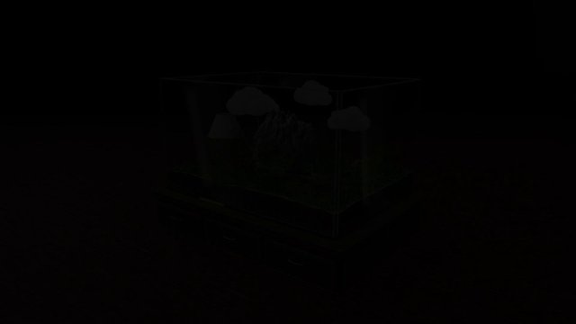 | `x-tokengremlin-gpt62sol-glass-seasons` Three.js lakeside scene with boat, waterfall, trees, and butterflies | GPT-6.2 Sol | GPT-6.2 Sol | HTML / 3D | 2026-11-09 | @TokenGremlin（Token Gremlin） | [来源](https://x.com/TokenGremlin/status/2119852532616790037) | — |
| 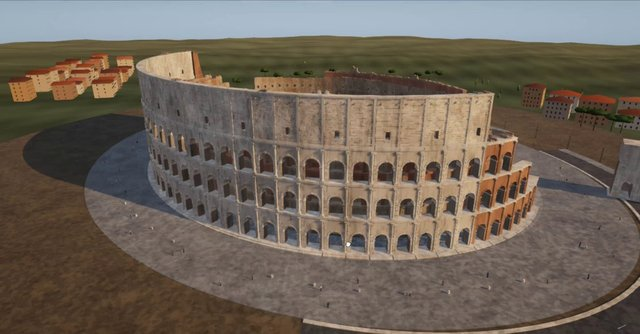 | `x-cfenghub-gpt62sol-colosseum` Rain-soaked Roman Colosseum in Three.js, GLSL, and Blender | GPT-6.2 Sol | GPT-6.2 Sol | HTML / 3D | 2026-11-10 | @cfenghub（CF长风） | [来源](https://x.com/cfenghub/status/2120069654437921152) | — |
|  | `x-raitoox-sol-stranger-things-credits` Stranger Things 5 end credits recreated in HTML/CSS/JS + SVG (HyperFrame | GPT-6.2 Sol | GPT-6.2 Sol | HTML / 3D | 2026-11-10 | @Raitox_tech | [来源](https://x.com/Raitox_tech/status/2120125234129084492) | — |
|  | `x-yfeng-gpt61-sol-fable-take-flight` Let Fable take Flight — HTML/Three.js procedural animation (GPT-6.1 Sol  | GPT-6.2 Sol | GPT-6.2 Sol | HTML / 3D | 2026-11-11 | @YFeng2022（LanFeng） | [来源](https://x.com/YFeng2022/status/2120324811549225082) | — |
|  | `web-atelier-gpt61-sol-ten-frame-loops` Atelier — ten-frame looping sprite briefs (GPT-6.1 Sol max effort column | GPT-6.2 Sol | GPT-6.1 Sol | 动画 / Animation | 2026-11 | Marmik Shah (Atelier exhibition) | [来源](https://marmikshah.github.io/atelier/) | — |
|  | `web-jamesgreene-code1-gpt61-sol-isometric-city` Isometric day/night city HTML loop — GPT-6.1 Sol | GPT-6.2 Sol | GPT-6.1 Sol | HTML / 3D | 2026-11-05 | James Greene (model comparison archive) | [来源](https://jamesgreene.com/models/) | — |
| 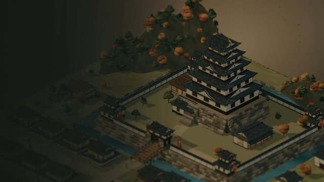 | `x-takamasa045-gpt61sol-momoyama` Azuchi-Momoyama castle town diorama in HTML and Three.js | GPT-6.2 Sol | GPT-6.1 Sol | HTML / 3D | 2026-11-09 | @takamasa045（伊藤貴將） | [来源](https://x.com/takamasa045/status/2119769277846990949) | — |
|  | `web-jamesgreene-code1-grok47-isometric-city` Isometric day/night city HTML loop — Grok 4.7 | Grok | Grok 4.7 | HTML / 3D | 2026-11-05 | James Greene (model comparison archive) | [来源](https://jamesgreene.com/models/) | — |
|  | `x-aiminithoughts-grok-imagine-golden-angel` Golden Angel Warrior — Grok Imagine clip | Grok | Grok Imagine Video | 动画 / Animation | 2026-11-11 | @Aiminithoughts | [来源](https://x.com/Aiminithoughts/status/2120329925702070425) | — |
|  | `x-radcybertruck-grok-imagine-cybertruck-cry` Grok Imagine — pixstar Cybertruck farewell clip (partial prompt) | Grok | Grok Imagine Video | 动画 / Animation | 2026-11-11 | @RadCyberTruck | [来源](https://x.com/RadCyberTruck/status/2120350558431445006) | — |
|  | `web-jamesgreene-code1-qwen38-27b-isometric-city` Isometric day/night city HTML loop — Qwen3.8 27B | Qwen | Qwen3.8 27B | HTML / 3D | 2026-11-05 | James Greene (model comparison archive) | [来源](https://jamesgreene.com/models/) | — |
| 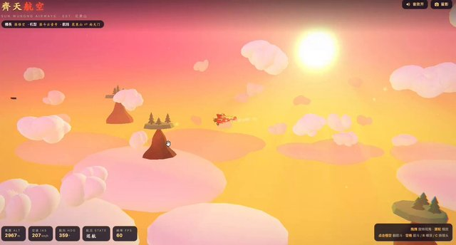 | `x-leo114119-qwen4max-wukong-plane` Sun Wukong flying a plane — HTML 3D demo | Qwen | Qwen 4 Max Preview | HTML / 3D | 2026-11-11 | @leo114119（Leo） | [来源](https://x.com/leo114119/status/2120371909624033439) | — |
| 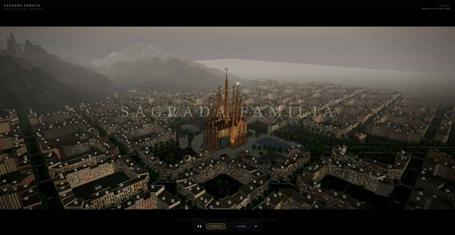 | `x-coffeecup2020-qwen4-sagrada` Sagrada Família demo from Qwen 4.0 Preview | Qwen | Qwen 4.0 Preview | 动画 / Animation | 2026-11-10 | @coffeecup2020（David Y. Tan） | [来源](https://x.com/coffeecup2020/status/2120113388629995921) | — |
|  | `web-jamesgreene-code1-deepseek-v41-flash-1017-isometric-city` Isometric day/night city HTML loop — DeepSeek V4.1 Flash 1017 | DeepSeek | DeepSeek V4.1 Flash 1017 | HTML / 3D | 2026-11-05 | James Greene (model comparison archive) | [来源](https://jamesgreene.com/models/) | — |
|  | `x-latentoperator-a380-deepseek-fable-sol` Airbus A380 takeoff in Three.js — DeepSeek V4.1 Flash vs Fable 5.2 vs GP | DeepSeek | DeepSeek V4.1 Flash | HTML / 3D | 2026-11-10 | @LatentOperatorX | [来源](https://x.com/LatentOperatorX/status/2120205377803518132) | — |
| 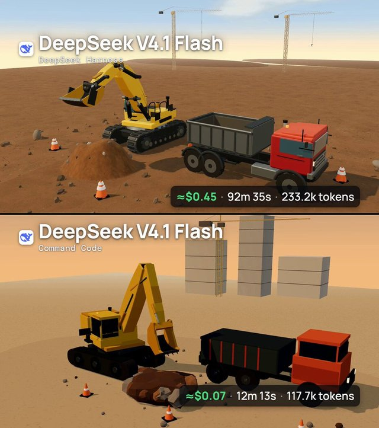 | `x-latentoperator-deepseek-excavator` Three.js excavator loading a dump truck — DeepSeek Harness vs Command Co | DeepSeek | DeepSeek V4.1 Flash | HTML / 3D | 2026-11-10 | @LatentOperatorX（Latent Operator） | [来源](https://x.com/LatentOperatorX/status/2120077800887746603) | — |
