# GPT Image 2.6 玩法与 Prompt 图像列表（38 例）

> Updated: 2026-11-06（北京时间）。`official` = OpenAI 展示方向；`tested` = 公开第三方实测或可复制提示词库；`community` = 社区案例；`concept` = 本项目原创延伸模板。Prompt 标注 `verbatim` / `reconstructed` / `empty`。不是按真实搜索量排名。

[打开交互式图像列表](https://jammyfu.github.io/awesome-gpt-image-gifs/ideas.html) · [结构化 JSON](../docs/data/ideas.json) · [来源与方法](trends-2026-11.md)

| # | 玩法 | 类别 | 来源 | Prompt | 建议模型 / 规格 |
|---:|---|---|---|---|---|
| 1 | [猫咪怒撞屏幕](../docs/gifs/cat-screen-crack.gif) | 表情梗图 | [参考](https://github.com/jammyfu/awesome-gpt-image-gifs/blob/main/docs/gifs/cat-screen-crack.gif) | [本站改写，非第三方原文](#idea-1) | Sunburst / 12f |
| 2 | [摸头循环表情包](../docs/gifs/pixel-head-pat.gif) | 表情梗图 | [参考](https://github.com/jammyfu/awesome-gpt-image-gifs/blob/main/docs/gifs/pixel-head-pat.gif) | [本站改写，非第三方原文](#idea-2) | Flare / 12f |
| 3 | [猫咪贴镜头](../docs/gifs/cat-headbutt.gif) | 表情梗图 | [参考](https://github.com/jammyfu/awesome-gpt-image-gifs/blob/main/docs/gifs/cat-headbutt.gif) | [本站改写，非第三方原文](#idea-3) | Flare / 9f |
| 4 | [动漫角色点头](../docs/previews/anime-nod.svg) | 角色动画 | [参考](https://www.reddit.com/r/OpenAI/comments/1xoh2u0/i_tried_the_new_image_26_gif_feature/) | [本站改写，非第三方原文](#idea-4) | Sunburst / 12f |
| 5 | [股票下跌崩溃](../docs/previews/stock-market-cry.svg) | 表情梗图 | [参考](https://openai.com/index/introducing-images-2-6/) | [本站改写，非第三方原文](#idea-5) | Sunburst / 12f |
| 6 | [股票上涨狂喜](../docs/previews/stock-market-cheer.svg) | 表情梗图 | [参考](https://openai.com/index/introducing-images-2-6/) | [本站改写，非第三方原文](#idea-6) | Sunburst / 12f |
| 7 | [品牌吉祥物招手](../docs/previews/mascot-wave.svg) | 角色动画 | [参考](https://veevid.ai/blog/gpt-image-2-6-gif) | [本站改写，非第三方原文](#idea-7) | Flare / 9f |
| 8 | [数字助手正在输入](../docs/previews/typing-companion.svg) | 网站交互 | [参考](https://openai.com/index/introducing-images-2-6/) | [本站改写，非第三方原文](#idea-8) | Flare / 9f |
| 9 | [手绘草图变活物](../docs/previews/sketch-owl.svg) | 角色动画 | [参考](https://openai.com/index/introducing-images-2-6/) | [本站改写，非第三方原文](#idea-9) | Sunburst / 12f |
| 10 | [耳机盒开合](../docs/previews/earbuds-product.svg) | 产品广告 | [参考](https://image.lightlyn.com/gpt-image-2-6?lang=en) | [本站改写，非第三方原文](#idea-10) | Sunburst / 12f |
| 11 | [咖啡热气微动](../docs/previews/coffee-steam.svg) | 照片微动效 | [参考](https://image.lightlyn.com/gpt-image-2-6?lang=en) | [本站改写，非第三方原文](#idea-11) | Flare / 9f |
| 12 | [香水瓶流光](../docs/previews/perfume-light.svg) | 产品广告 | [参考](https://veevid.ai/blog/gpt-image-2-6-gif) | [本站改写，非第三方原文](#idea-12) | Sunburst / 9f |
| 13 | [霓虹字切换](../docs/previews/neon-word-switch.svg) | 创意特效 | [参考](https://nowrap.ai/tools/chatgpt-images-2-6) | [本站改写，非第三方原文](#idea-13) | Sunburst / 12f |
| 14 | [鹈鹕骑自行车](../docs/previews/pelican-bicycle.svg) | 表情梗图 | [参考](https://v2ex.com/t/1254763) | [本站改写，非第三方原文](#idea-14) | Flare / 12f |
| 15 | [像素冒险家待机](../docs/previews/pixel-idle.svg) | 角色动画 | 延伸创意 | [本站改写，非第三方原文](#idea-15) | Flare / 12f |
| 16 | [捂脸表情贴纸](../docs/previews/facepalm-sticker.svg) | 表情梗图 | 延伸创意 | [本站改写，非第三方原文](#idea-16) | Flare / 9f |
| 17 | [热腾腾面条](../docs/previews/food-steam.svg) | 照片微动效 | 延伸创意 | [本站改写，非第三方原文](#idea-17) | Sunburst / 9f |
| 18 | [完成反馈动画](../docs/previews/success-check.svg) | 网站交互 | 延伸创意 | [本站改写，非第三方原文](#idea-18) | Flare / 9f |
| 19 | [魔法传送门循环](../docs/previews/portal-glow.svg) | 创意特效 | 延伸创意 | [本站改写，非第三方原文](#idea-19) | Sunburst / 12f |
| 20 | [窗边雪景循环](../docs/previews/weather-snow.svg) | 照片微动效 | 延伸创意 | [本站改写，非第三方原文](#idea-20) | Flare / 12f |
| 21 | [Sprite 分镜再转 GIF](../docs/previews/sprite-sheet-stock-crash.svg) | Sprite 分镜 | [参考](https://openai.com/index/introducing-images-2-6/) | [逐字公开提示词](#idea-21) | Sunburst / 6 格 |
| 22 | [面包师吉祥物分镜表](../docs/previews/baker-mascot-sprite.svg) | Sprite 分镜 | [参考](https://morphic.com/resources/prompts/chatgpt-images-2-6-prompts) | [逐字公开提示词](#idea-22) | Sunburst / 6 格 |
| 23 | [剪纸锦鲤环游](../docs/previews/papercraft-koi.svg) | 创意特效 | [参考](https://morphic.com/resources/prompts/chatgpt-images-2-6-prompts) | [逐字公开提示词](#idea-23) | Sunburst / 6 格 |
| 24 | [圈选花瓶改色](../docs/previews/markup-vase-recolor.svg) | 局部改图 | [参考](https://developers.openai.com/api/docs/guides/image-prompting) | [逐字公开提示词](#idea-24) | Sunburst / 编辑 |
| 25 | [圈选替换招牌字](../docs/previews/markup-sign-text.svg) | 局部改图 | [参考](https://www.nereo.io/blog/gpt-2-6-prompts) | [逐字公开提示词](#idea-25) | Sunburst / 编辑 |
| 26 | [可缩放面包店 SVG 标志](../docs/previews/svg-field-flour.svg) | SVG 与 Logo | [参考](https://developers.openai.com/api/docs/guides/image-prompting) | [逐字公开提示词](#idea-26) | Flare / SVG |
| 27 | [天气图标 SVG 套件](../docs/previews/svg-weather-icons.svg) | SVG 与 Logo | [参考](https://image.lightlyn.com/gpt-image-2-6?lang=en) | [逐字公开提示词](#idea-27) | Sunburst / SVG |
| 28 | [吉祥物三视图设定表](../docs/previews/character-ref-sheet.svg) | 角色设定 | [参考](https://morphic.com/resources/how-to/chatgpt-images-2-6-guide) | [逐字公开提示词](#idea-28) | Sunburst / 静图 |
| 29 | [同一角色换场景](../docs/previews/character-new-scene.svg) | 角色设定 | [参考](https://www.nereo.io/blog/gpt-2-6-prompts) | [逐字公开提示词](#idea-29) | Sunburst / 静图 |
| 30 | [提灯小猴循环](../docs/previews/lantern-monkey-gif.svg) | 角色动画 | [参考](https://developers.openai.com/api/docs/guides/image-prompting) | [逐字公开提示词](#idea-30) | Sunburst / 9f |
| 31 | [精确文字促销徽章](../docs/previews/sale-badge-gif.svg) | 文字海报 | [参考](https://www.nereo.io/blog/gpt-2-6-prompts) | [逐字公开提示词](#idea-31) | Flare / 9f |
| 32 | [茶叶盒展开刀模](../docs/previews/packaging-dieline.svg) | 产品广告 | [参考](https://morphic.com/resources/prompts/chatgpt-images-2-6-prompts) | [逐字公开提示词](#idea-32) | Sunburst / 静图 |
| 33 | [六区标注烘焙剖面](../docs/previews/labelled-bakery-cutaway.svg) | 文字海报 | [参考](https://morphic.com/resources/how-to/chatgpt-images-2-6-guide) | [逐字公开提示词](#idea-33) | Sunburst / 静图 |
| 34 | [只改一处的冬季版](../docs/previews/winter-edition-edit.svg) | 局部改图 | [参考](https://morphic.com/resources/prompts/chatgpt-images-2-6-prompts) | [逐字公开提示词](#idea-34) | Sunburst / 编辑 |
| 35 | [橱窗里的精确字海报](../docs/previews/autumn-bake-poster.svg) | 文字海报 | [参考](https://morphic.com/resources/prompts/chatgpt-images-2-6-prompts) | [逐字公开提示词](#idea-35) | Sunburst / 静图 |
| 36 | 上传角色让它招手 | 角色动画 | [参考](https://x.com/Krouxzz/status/2118283796181053637) | [逐字公开提示词](#idea-36) | Flare / 9f |
| 37 | [拍片前的动作分镜 GIF](../docs/previews/storyboard-pre-video.svg) | 分镜预演 | [参考](https://openai.com/index/introducing-images-2-6/) | [来源未公开完整提示词，本站不编造](#idea-37) | Sunburst / 12f |
| 38 | [实拍咖啡只动蒸汽](../docs/previews/photo-to-gif-steam.svg) | 照片微动效 | [参考](https://image.lightlyn.com/gpt-image-2-6?lang=en) | [逐字公开提示词](#idea-38) | Flare / 9f |

## 完整提示词（公开原文或本站改写）

标注 `verbatim` 的条目复制自注明来源的公开页面；`reconstructed` 是本站按创意目标改写的模板，不是第三方作者的逐字提示词；`empty` 表示来源只描述了能力、没有给出可复制提示词，本站留空。均未在此仓库逐项实测。

<a id="idea-1"></a>
### 01. 猫咪怒撞屏幕 / Cat vs. Cracked Screen

类型：表情梗图 ｜输出：GIF ｜证据：本项目已有 GIF 案例 ｜提示词：本站改写，非第三方原文 ｜推荐：`Sunburst`, `12` frames, `130` ms/frame, `4:5` ｜编辑优先级：P1


角色向镜头冲刺、头撞玻璃、裂纹扩散；可用已有猫咪动图预览。

```text
Create a funny looping animated GIF of an original black-and-white cat headbutting the camera glass. Beat 1: cat stares intensely. Beat 2: it lunges head-first without using its paws. Beat 3: a small spiderweb crack appears, then grows. Beat 4: the camera returns to the starting view to loop. Keep the eyes, whisker markings and background consistent. Fixed camera; expressive but non-graphic cartoon impact; no words or watermark.
```

参考链接（2026-11-05）：https://github.com/jammyfu/awesome-gpt-image-gifs/blob/main/docs/gifs/cat-screen-crack.gif。


<a id="idea-2"></a>
### 02. 摸头循环表情包 / Looping Head Pat Meme

类型：表情梗图 ｜输出：GIF ｜证据：本项目已有 GIF 案例 ｜提示词：本站改写，非第三方原文 ｜推荐：`Flare`, `12` frames, `180` ms/frame, `3:4` ｜编辑优先级：P1


左右角色保持站位，单手抬起、摸头、收回，天然循环。

```text
Create a seamless GIF with two ORIGINAL friendly cartoon characters. The taller blocky character on the left raises one hand, gently pats the shorter bald cartoon character on the head twice, then returns to the initial arm position. The receiver smiles and slightly nods in time. Keep faces, clothing, camera angle, grassy background and character positions unchanged. Clear contact and recovery poses, six to twelve distinct beats, no extra limbs, no captions.
```

参考链接（2026-11-05）：https://github.com/jammyfu/awesome-gpt-image-gifs/blob/main/docs/gifs/pixel-head-pat.gif。


<a id="idea-3"></a>
### 03. 猫咪贴镜头 / Funny Cat Camera Bonk

类型：表情梗图 ｜输出：GIF ｜证据：本项目已有 GIF 案例 ｜提示词：本站改写，非第三方原文 ｜推荐：`Flare`, `9` frames, `150` ms/frame, `4:5` ｜编辑优先级：P1


宠物突然凑近镜头，然后弹回起始位置。

```text
Make a short animated GIF of an original playful black-and-white cat sitting in a living room. It watches the viewer, leans quickly toward the camera until its nose nearly fills the frame, squishes its expression for one beat, then springs smoothly back to its original seated position. Preserve unique fur patches, green eyes, whiskers and the room layout. No paws on the lens, no jump cuts, no text. Smooth loop with a fixed camera.
```

参考链接（2026-11-05）：https://github.com/jammyfu/awesome-gpt-image-gifs/blob/main/docs/gifs/cat-headbutt.gif。


<a id="idea-4"></a>
### 04. 动漫角色点头 / Anime Character Nodding

类型：角色动画 ｜输出：GIF ｜证据：社区公开案例 ｜提示词：本站改写，非第三方原文 ｜推荐：`Sunburst`, `12` frames, `140` ms/frame, `1:1` ｜编辑优先级：P1

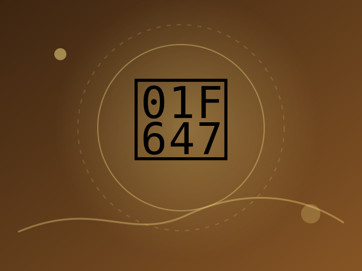

上传原创角色，微抬头、快速点头、闭眼回位，适合贴纸。

```text
Animate an ORIGINAL anime-style adult character from a consistent front three-quarter portrait. She lifts her chin slightly, makes one quick affirmative nod, closes her eyes with a soft smile, then returns to the identical first-frame expression. Preserve hair strands, face proportions, outfit and line art between frames. Only the neck, eyelids and a few hair tips move. Simple clean background, locked camera, no speech bubbles, seamless looping GIF.
```

参考链接（2026-11-05）：https://www.reddit.com/r/OpenAI/comments/1xoh2u0/i_tried_the_new_image_26_gif_feature/。


<a id="idea-5"></a>
### 05. 股票下跌崩溃 / Chibi Market Crash Reaction

类型：表情梗图 ｜输出：GIF ｜证据：OpenAI 官方发布 ｜提示词：本站改写，非第三方原文 ｜推荐：`Sunburst`, `12` frames, `170` ms/frame, `1:1` ｜编辑优先级：P1


官方示例：看见下跌曲线后眼泪汪汪；这里提供改写模板。

```text
An original kawaii adult office worker at a desk checks a computer displaying a falling generic chart. The character begins hopeful, notices the decline, widens their eyes, sheds exaggerated cartoon tears, wipes them away, and settles into the starting pose. Keep the desk, chair, chart, clothes, lighting and camera fixed. Toy-like 3D style. No readable tickers, real brand marks, captions or currency symbols. Make the end connect seamlessly to the start.
```

参考链接（2026-11-04）：https://openai.com/index/introducing-images-2-6/。


<a id="idea-6"></a>
### 06. 股票上涨狂喜 / Chibi Market Rally Celebration

类型：表情梗图 ｜输出：GIF ｜证据：OpenAI 官方发布 ｜提示词：本站改写，非第三方原文 ｜推荐：`Sunburst`, `12` frames, `170` ms/frame, `1:1` ｜编辑优先级：P1


官方示例：看到上涨箭头后举手庆祝。

```text
Make an original 3D chibi office worker watching a monitor with an upward generic line chart. First the worker looks bored, then their eyes widen, they jump up with both arms raised, cheer briefly, and settle back into the identical seated pose. The monitor and office do not shift. Exaggerated but readable poses and a clean cyclic arc. Keep all limbs anatomically consistent; no logos or text. Seamless looping GIF, fixed front three-quarter camera.
```

参考链接（2026-11-04）：https://openai.com/index/introducing-images-2-6/。


<a id="idea-7"></a>
### 07. 品牌吉祥物招手 / Brand Mascot Hello Loop

类型：角色动画 ｜输出：GIF ｜证据：公开实测案例 ｜提示词：本站改写，非第三方原文 ｜推荐：`Flare`, `9` frames, `180` ms/frame, `1:1` ｜编辑优先级：P1

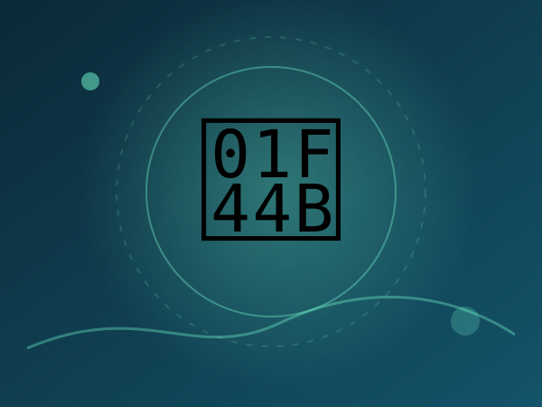

品牌吉祥物微笑、招手、眨眼，适合落地页与社交媒体。

```text
Design an ORIGINAL small rounded teal robot mascot with a cream face, simple expressive eyes and a distinctive orange scarf. Animate exactly one friendly wave: raise right arm, wave twice, blink once, then return to the identical neutral stance. Flat vector sticker style, bold clean silhouette, pastel background. Fixed camera, stable shapes, consistent number of fingers, no writing, no existing brand logos. Gentle seamless GIF loop.
```

参考链接（2026-11-05）：https://veevid.ai/blog/gpt-image-2-6-gif。


<a id="idea-8"></a>
### 08. 数字助手正在输入 / AI Assistant Typing Indicator

类型：网站交互 ｜输出：GIF ｜证据：OpenAI 官方发布 ｜提示词：本站改写，非第三方原文 ｜推荐：`Flare`, `9` frames, `160` ms/frame, `1:1` ｜编辑优先级：P1

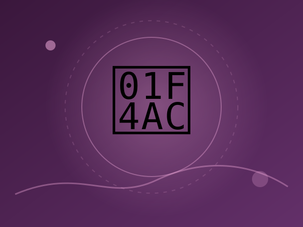

官方展示了助手小角色的输入反馈，可用于 AI Agent UI。

```text
Create an original tiny mint-green desk companion mascot for an AI chat interface. It taps an invisible keyboard with alternating paws, pauses to blink, then returns to the start. Show only its head, tiny arms and torso on a transparent-looking plain solid background. Very small readable movement, fixed alignment and scale, no text, no chat bubbles, no UI mockup. Loop must feel calm and unobtrusive like a typing indicator.
```

参考链接（2026-11-04）：https://openai.com/index/introducing-images-2-6/。


<a id="idea-9"></a>
### 09. 手绘草图变活物 / Hand-drawn Owl Comes Alive

类型：角色动画 ｜输出：GIF ｜证据：OpenAI 官方发布 ｜提示词：本站改写，非第三方原文 ｜推荐：`Sunburst`, `12` frames, `160` ms/frame, `1:1` ｜编辑优先级：P1

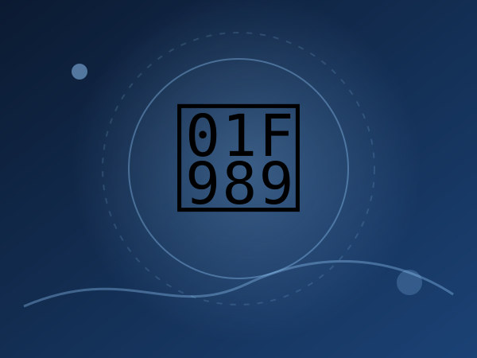

官方示例：简笔画角色保持草稿风格并眨眼转头。

```text
Make an original pencil-line owl drawing on cream notebook paper animate while preserving the hand-drawn sketch style. The owl blinks, tilts its head left, lifts one wing slightly, then returns to its original pencil pose. Keep the page fibers, outline weight and shading nearly static. No camera pan, no change of drawing identity, no extra strokes that drift between frames. Subtle, seamless looping GIF.
```

参考链接（2026-11-04）：https://openai.com/index/introducing-images-2-6/。


<a id="idea-10"></a>
### 10. 耳机盒开合 / Earbuds Case Product Loop

类型：产品广告 ｜输出：GIF ｜证据：公开实测案例 ｜提示词：本站改写，非第三方原文 ｜推荐：`Sunburst`, `12` frames, `160` ms/frame, `1:1` ｜编辑优先级：P1


第三方实测：耳机盒开启、耳机浮起、归位、合盖。

```text
Premium unbranded wireless earbuds in a pristine white charging case on a soft sage-green seamless studio backdrop. The lid opens slowly, both earbuds rise a few centimeters together, pause, lower into their slots, and the lid closes to the starting position. Same product geometry, hinges, perspective and shadow throughout. One locked three-quarter product camera, photorealistic softbox lighting, no written marks, no extra earbuds, seamless GIF loop.
```

参考链接（2026-11-05）：https://image.lightlyn.com/gpt-image-2-6?lang=en。


<a id="idea-11"></a>
### 11. 咖啡热气微动 / Coffee Steam Cinemagraph

类型：照片微动效 ｜输出：GIF ｜证据：公开实测案例 ｜提示词：本站改写，非第三方原文 ｜推荐：`Flare`, `9` frames, `200` ms/frame, `3:2` ｜编辑优先级：P1


照片保持静止，仅蒸汽自然升腾，适合餐饮品牌。

```text
A photorealistic ceramic latte with subtle heart-shaped milk art on a rustic wooden cafe table in warm window light. The cup, table, spoon, flowers and camera remain entirely still; only two thin wisps of steam curl gently upward and reset into the first shape. No changes in cup shape or drink surface, no people, no extra objects, no text. A peaceful seamless GIF micro-animation with stable lighting and shadows.
```

参考链接（2026-11-05）：https://image.lightlyn.com/gpt-image-2-6?lang=en。


<a id="idea-12"></a>
### 12. 香水瓶流光 / Perfume Highlight Sweep

类型：产品广告 ｜输出：GIF ｜证据：公开实测案例 ｜提示词：本站改写，非第三方原文 ｜推荐：`Sunburst`, `9` frames, `180` ms/frame, `1:1` ｜编辑优先级：P1

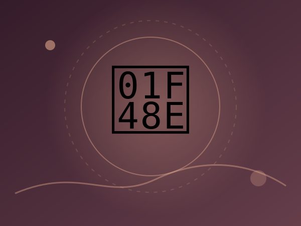

香水瓶不动，仅玻璃高光从左到右流过，突出高级感。

```text
An unbranded frosted-glass perfume bottle centered on a pale limestone pedestal in a neutral beige studio. The bottle never moves. A narrow warm highlight sweeps over the bottle from left to right while a few dust motes float upward. Return smoothly to the initial light pattern; identical logo-free bottle and pedestal in all frames. Premium luxury product photography, fixed camera, no text, no hands or morphing geometry. Seamless loop.
```

参考链接（2026-11-05）：https://veevid.ai/blog/gpt-image-2-6-gif。


<a id="idea-13"></a>
### 13. 霓虹字切换 / Neon Lettering Flicker Loop

类型：创意特效 ｜输出：GIF ｜证据：公开实测案例 ｜提示词：本站改写，非第三方原文 ｜推荐：`Sunburst`, `12` frames, `200` ms/frame, `16:9` ｜编辑优先级：P2

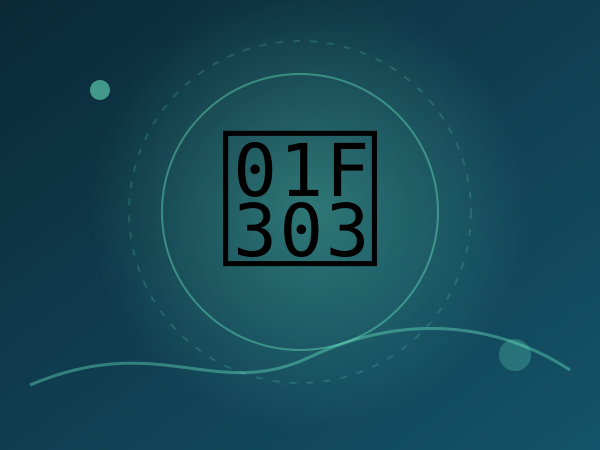

实测关注多帧文字保持一致：霓虹牌 A/B 状态切换。

```text
Nighttime rainy storefront with a single clean neon sign that alternates between the exact words OPEN and LATE, one at a time. The pink word OPEN slowly dims; blue LATE lights up, then reverses to the starting state. Keep all other lettering, reflections, windows, pavement and camera completely stable. Never display the two words at once. Crisp legible typography in every frame, no invented extra signs, seamless looping animated GIF.
```

参考链接（2026-11-05）：https://nowrap.ai/tools/chatgpt-images-2-6。


<a id="idea-14"></a>
### 14. 鹈鹕骑自行车 / Pelican Cycling Meme

类型：表情梗图 ｜输出：GIF ｜证据：社区公开案例 ｜提示词：本站改写，非第三方原文 ｜推荐：`Flare`, `12` frames, `130` ms/frame, `1:1` ｜编辑优先级：P2

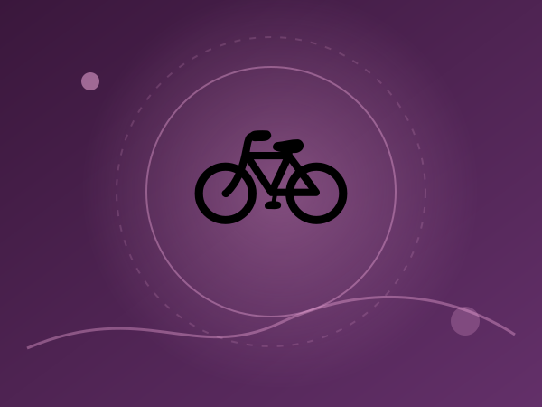

社区一句话生成案例；原始创意可扩展为完整脚踏循环。

```text
A goofy ORIGINAL cartoon pelican in a bright yellow raincoat rides a small blue bicycle on a quiet seaside path. Animate exactly one complete pedal rotation with both feet following the pedals, body gently bouncing and wheels rotating. Keep the pelican beak, bike frame, background and number of legs stable. Side-view fixed camera; the character stays centered on an endlessly looping simple path. Cheerful 2D animation, no writing or logos.
```

参考链接（2026-11-05）：https://v2ex.com/t/1254763。


<a id="idea-15"></a>
### 15. 像素冒险家待机 / Pixel RPG Idle Animation

类型：角色动画 ｜输出：GIF ｜证据：原创延伸模板 ｜提示词：本站改写，非第三方原文 ｜推荐：`Flare`, `12` frames, `140` ms/frame, `1:1` ｜编辑优先级：P2


游戏技能：待机呼吸、围巾摆动、眨眼，适合游戏开发者。

```text
Original 16-bit inspired pixel-art fantasy adventurer standing in place on a transparent-looking flat checker-free background. One idle cycle: two-pixel breathing rise and fall, a scarf tip sways, a blink, then return to the exact initial sprite pose. Keep the pixel grid, palette, body proportions and outlines stable. Strict side-front 3/4 view, no camera movement, no additional weapons, no text, perfect looping sprite-style GIF.
```

参考链接：原创延伸，无第三方参考。


<a id="idea-16"></a>
### 16. 捂脸表情贴纸 / Facepalm Reaction Sticker

类型：表情梗图 ｜输出：GIF ｜证据：原创延伸模板 ｜提示词：本站改写，非第三方原文 ｜推荐：`Flare`, `9` frames, `170` ms/frame, `1:1` ｜编辑优先级：P2

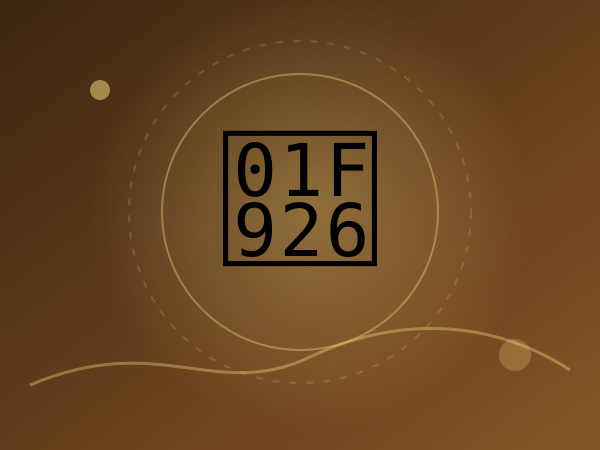

适合社群传播的低成本反应贴纸，动作简单。

```text
An original round purple chibi creature with big eyebrows and tiny arms makes a dramatic facepalm. It first stares in disbelief, slowly lifts one hand to cover its eyes, holds one beat, lowers the hand, and returns to neutral. Thick white sticker outline against a single soft lilac background, stable facial identity, no captions, no extra fingers, no camera movement, seamless loop.
```

参考链接：原创延伸，无第三方参考。


<a id="idea-17"></a>
### 17. 热腾腾面条 / Hot Noodle Food Loop

类型：照片微动效 ｜输出：GIF ｜证据：原创延伸模板 ｜提示词：本站改写，非第三方原文 ｜推荐：`Sunburst`, `9` frames, `200` ms/frame, `3:2` ｜编辑优先级：P2

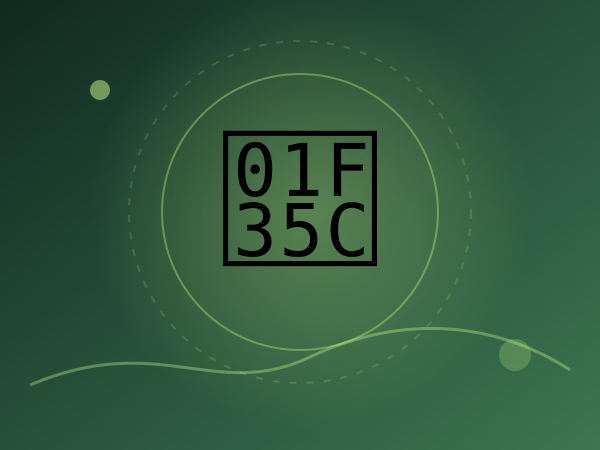

餐饮应用：筷子不动、蒸汽和少量汤面纹理运动。

```text
Photorealistic bowl of spicy noodles with scallions on a dark wooden table. Animate only wisps of steam curling upward and one gentle ripple spreading across the broth surface, then returning to the initial pattern. Keep bowl, chopsticks, noodles and background absolutely stationary; no hands, no changing ingredients, no camera movement, no text. Soft warm appetizing light and seamless looping GIF.
```

参考链接：原创延伸，无第三方参考。


<a id="idea-18"></a>
### 18. 完成反馈动画 / Success Check UI Feedback

类型：网站交互 ｜输出：GIF ｜证据：原创延伸模板 ｜提示词：本站改写，非第三方原文 ｜推荐：`Flare`, `9` frames, `130` ms/frame, `1:1` ｜编辑优先级：P2


网站交互：圆形描边和对勾逐步出现，随后无缝回到起始。

```text
Minimal original UI success indicator centered on a solid midnight-blue background. A clean thin mint circle draws clockwise, a single white check mark appears stroke-by-stroke, both glow briefly and gently disappear to the initial empty circle. Perfectly aligned fixed geometry, smooth easing with no moving camera, no text, no gradients that flicker, accessible high contrast and seamless GIF loop.
```

参考链接：原创延伸，无第三方参考。


<a id="idea-19"></a>
### 19. 魔法传送门循环 / Glowing Fantasy Portal Loop

类型：创意特效 ｜输出：GIF ｜证据：原创延伸模板 ｜提示词：本站改写，非第三方原文 ｜推荐：`Sunburst`, `12` frames, `160` ms/frame, `16:9` ｜编辑优先级：P3

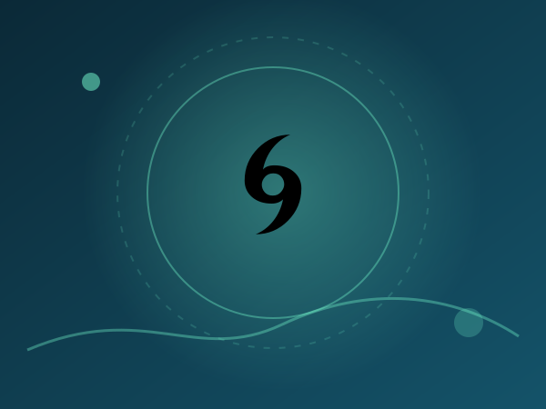

概念性游戏素材：能量环脉动、细小星光流动，背景不变。

```text
An original ring-shaped cyan-violet fantasy portal hovering in a quiet dark forest clearing. The portal rim slowly pulses, tiny sparkles orbit once and return to their starting points, and the inner surface swirls subtly. Trees, rocks and grass remain perfectly still. Cinematic fantasy illustration, centered locked wide camera, no characters walking through, no logos or writing. Seamless short GIF loop.
```

参考链接：原创延伸，无第三方参考。


<a id="idea-20"></a>
### 20. 窗边雪景循环 / Window Snow Cinemagraph

类型：照片微动效 ｜输出：GIF ｜证据：原创延伸模板 ｜提示词：本站改写，非第三方原文 ｜推荐：`Flare`, `12` frames, `170` ms/frame, `3:2` ｜编辑优先级：P3


大气氛围：雪花持续缓降、暖光轻微闪烁。

```text
Cozy interior looking through a window at a quiet snowy street. Only small snowflakes beyond the glass drift gently downward while a warm distant lamp softly breathes brighter and dimmer. All furniture, window frames, reflections, houses and camera must remain fixed. End frame matches the initial snow density and lighting. Photorealistic winter cinemagraph, no people or words, seamless GIF loop.
```

参考链接：原创延伸，无第三方参考。


<a id="idea-21"></a>
### 21. Sprite 分镜再转 GIF / Sprite Sheet Then GIF

类型：Sprite 分镜 ｜输出：Sprite 分镜 ｜证据：OpenAI 官方发布 ｜提示词：逐字公开提示词 ｜推荐：`Sunburst`, `6` frames, `1:1` ｜编辑优先级：P1


开脑洞点：官方把循环 GIF 写成 3×2 分镜表，先出齐 6 格再按序播放。与本站「股票下跌崩溃」是同一题材的分镜工作流变体，不是新梗。

```text
Create a single animation sprite sheet for a seamless looping GIF. A super-cute chibi adult office worker sits at a desk watching a computer monitor with a clearly plunging stock-market line chart. The sequence: hopeful expression, notices the chart falling, eyes widen, face crumples, large cartoon tears stream down both cheeks, then quietly wipes tears while still staring at the falling chart. Oversized round head, tiny body, big expressive eyes, soft rounded features, messy fluffy hair, white shirt and loosened tie. Exactly 6 sequential frames arranged in a precise 3-column by 2-row grid, read left-to-right then top-to-bottom. Every panel has identical dimensions. Fixed front three-quarter camera, same character, same desk, monitor, outfit, and cozy miniature office background. Clear incremental facial and tear motion; sixth frame transitions smoothly toward the first. Polished kawaii chibi 3D toy-like style, warm pastel lighting, funny and sympathetic mood. No captions, no words, no numbers, no logos, no speech bubbles, no panel labels, no borders, no gutters.
```

参考链接（2026-11-04）：https://openai.com/index/introducing-images-2-6/。


<a id="idea-22"></a>
### 22. 面包师吉祥物分镜表 / Dough Baker Mascot Sprite Sheet

类型：Sprite 分镜 ｜输出：Sprite 分镜 ｜证据：Morphic 公开提示词库（示例跑在 2.5） ｜提示词：逐字公开提示词 ｜推荐：`Sunburst`, `6` frames, `1:1` ｜编辑优先级：P1

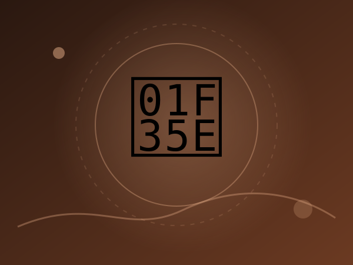

开脑洞点：先做角色设定表，再用同一顶帽/腮红/领巾出 6 帧揉面→挥手循环，比单句「吉祥物招手」更能锁身份。

```text
One animation sprite sheet for a looping GIF of the dough baker mascot from the sheet, same hat, cheeks and rust-red neckerchief: exactly 6 frames in a 3-column by 2-row grid, every panel the same size. Sequence: kneads a ball of dough, presses, folds, looks up and smiles, waves, and the sixth frame leads back into the first. Fixed front three-quarter camera, the same oak counter and plain oat-colored background in every panel, the same soft clay-like 3D render. No text, no numbers, no borders, no gutters, no panel labels.
```

参考链接（2026-11-06）：https://morphic.com/resources/prompts/chatgpt-images-2-6-prompts。


<a id="idea-23"></a>
### 23. 剪纸锦鲤环游 / Papercraft Koi Loop

类型：创意特效 ｜输出：Sprite 分镜 ｜证据：Morphic 公开提示词库（示例跑在 2.5） ｜提示词：逐字公开提示词 ｜推荐：`Sunburst`, `6` frames, `1:1` ｜编辑优先级：P1

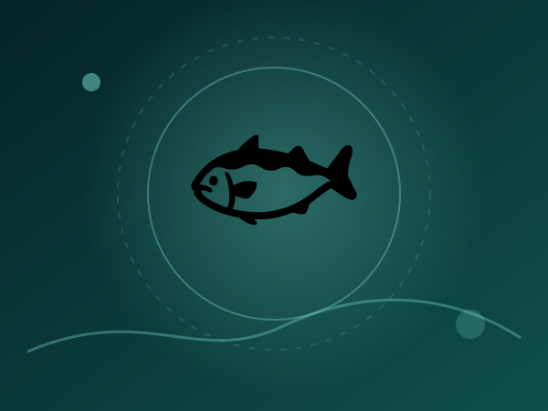

开脑洞点：不是照片微动，而是整条鱼用层叠色纸游一圈；俯视锁定、第六帧接回第一帧，适合做手工质感 sticker。

```text
One animation sprite sheet for a looping GIF: exactly 6 frames in a 3-column by 2-row grid, every panel the same size. A papercraft koi made of layered cut paper in vermilion, cream and ink black swims one slow circle through a still pond of deep teal paper ripples, its tail sweeping a little further in each frame, and the sixth frame leads smoothly back into the first. Fixed overhead camera, the same pond, lily pad and soft paper shadows in every panel, warm diffused light, tactile handmade texture. No text, no borders, no gutters, no panel labels.
```

参考链接（2026-11-06）：https://morphic.com/resources/prompts/chatgpt-images-2-6-prompts。


<a id="idea-24"></a>
### 24. 圈选花瓶改色 / Markup Recolor One Object

类型：局部改图 ｜输出：编辑 ｜证据：OpenAI 官方提示词指南 ｜提示词：逐字公开提示词 ｜推荐：`Sunburst`, `4:3` ｜编辑优先级：P1

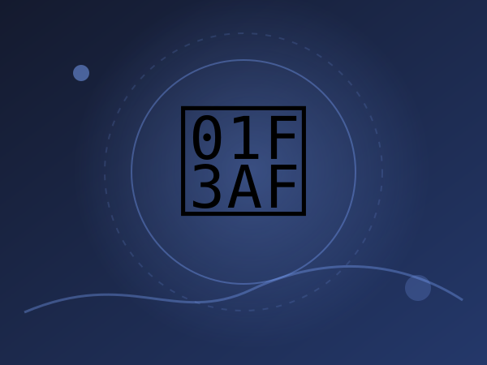

开脑洞点：2.6 把 ChatGPT 圈选 markup 接到 API。透明 PNG 叠层指出位置，提示词只说改什么、什么必须留下，并删掉红圈。

```text
Recolor the striped vase inside the red circle to solid cobalt blue ceramic. Keep its shape, the dried stems, and the rest of the kitchen unchanged. Remove the red circle from the finished photo.
```

参考链接（2026-11-04）：https://developers.openai.com/api/docs/guides/image-prompting。


<a id="idea-25"></a>
### 25. 圈选替换招牌字 / Markup Replace Sign Text

类型：局部改图 ｜输出：编辑 ｜证据：Nereo 可复制提示词 ｜提示词：逐字公开提示词 ｜推荐：`Sunburst`, `1:1` ｜编辑优先级：P1


开脑洞点：局部改图不是重画整张海报，而是圈出招牌、指定精确文案，并要求匹配原字体、颜色和透视。

```text
Change the words on the sign inside the circle to "[OPEN LATE]". Match the original lettering, color and perspective. Keep everything else unchanged.
```

参考链接（2026-11-05）：https://www.nereo.io/blog/gpt-2-6-prompts。


<a id="idea-26"></a>
### 26. 可缩放面包店 SVG 标志 / Field & Flour SVG Logo

类型：SVG 与 Logo ｜输出：SVG ｜证据：OpenAI 官方提示词指南 ｜提示词：逐字公开提示词 ｜推荐：`Flare`, `1:1` ｜编辑优先级：P1

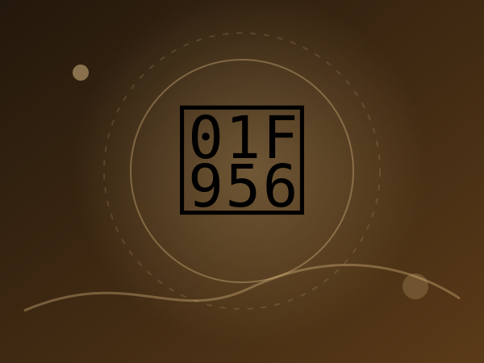

开脑洞点：生成接口可直接 output_format=svg，得到可改路径的矢量标，而不是嵌了位图的假矢量。官方同时给了 Flare/Sunburst 对照。

```text
Create an original, non-infringing logo for a company called Field & Flour, a local bakery.
The logo should feel warm, simple, and timeless. Use clean, vector-like shapes, a strong silhouette, and balanced negative space.
Favor simplicity over detail so it reads clearly at small and large sizes. Flat design, minimal strokes, no gradients unless essential.
Fully transparent background. Deliver a single centered logo with generous padding, clean alpha edges, and no solid backdrop, scenery, checkerboard, or watermark.
```

参考链接（2026-11-04）：https://developers.openai.com/api/docs/guides/image-prompting。


<a id="idea-27"></a>
### 27. 天气图标 SVG 套件 / Matching Weather Icon SVG Set

类型：SVG 与 Logo ｜输出：SVG ｜证据：公开实测案例 ｜提示词：逐字公开提示词 ｜推荐：`Sunburst`, `3:2` ｜编辑优先级：P1


开脑洞点：一次生成 6 个同线宽、同端点的图标，而不是 6 次风格漂移。Lightlyn 实测 SVG 约 2–13 KB，可进 Figma。

```text
A set of six matching line icons for a weather app arranged in a 3 by 2 grid: sun, cloud, rain, snow, thunderstorm, wind. Consistent stroke width, rounded ends, one accent colour.
```

参考链接（2026-11-05）：https://image.lightlyn.com/gpt-image-2-6?lang=en。


<a id="idea-28"></a>
### 28. 吉祥物三视图设定表 / Character Reference Sheet

类型：角色设定 ｜输出：静图 ｜证据：Morphic 公开提示词库（示例跑在 2.5） ｜提示词：逐字公开提示词 ｜推荐：`Sunburst`, `3:2` ｜编辑优先级：P1

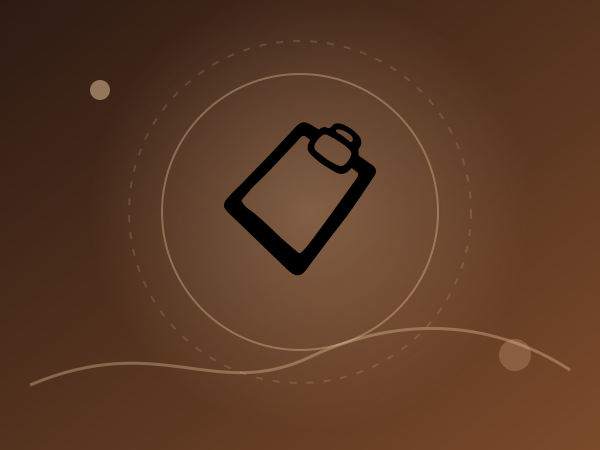

开脑洞点：2.6 可保存参考图并按名调用。先出正/侧/背 + 表情条，再拿去出分镜或新场景，比口头描述更稳。

```text
A character reference sheet for an invented bakery's mascot: a small round baker made of soft bread dough, with a tiny white chef hat, flour-dusted cheeks and a rust-red neckerchief, shown three times at the same scale, front view, side view and back view, with a row of four small facial expressions beneath (cheerful, proud, sleepy, surprised). Soft clay-like 3D render with visible fingerprint texture, warm even studio light, plain oat-colored background, identical proportions and colors in every view. No text, no labels, no logos.
```

参考链接（2026-11-06）：https://morphic.com/resources/how-to/chatgpt-images-2-6-guide。


<a id="idea-29"></a>
### 29. 同一角色换场景 / Same Character, New Scene

类型：角色设定 ｜输出：静图 ｜证据：Nereo 可复制提示词 ｜提示词：逐字公开提示词 ｜推荐：`Sunburst`, `16:9` ｜编辑优先级：P1

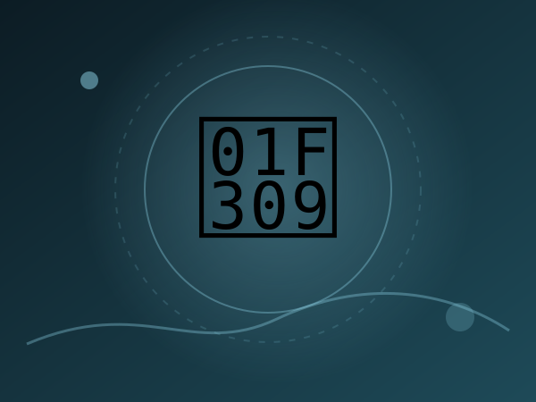

开脑洞点：把设定表当 image 输入，只改动作与环境，并逐项点名脸、头发、服装、配色不许变。

```text
Using the character in the reference image, show them [crossing a rope bridge in the rain]. Keep the face, hair, outfit and colors the same.
```

参考链接（2026-11-05）：https://www.nereo.io/blog/gpt-2-6-prompts。


<a id="idea-30"></a>
### 30. 提灯小猴循环 / Lantern Monkey Loop

类型：角色动画 ｜输出：GIF ｜证据：OpenAI 官方提示词指南 ｜提示词：逐字公开提示词 ｜推荐：`Sunburst`, `9` frames, `200` ms/frame, `1:1` ｜编辑优先级：P1


开脑洞点：官方 GIF 范例把起始姿势、提灯、眨眼、回落写进同一段，并给出 9 帧 × 200 ms = 1.8 秒、512²、Sunburst high。

```text
A little monkey in an olive-green hooded coat stands in a snowy pine forest at dusk. A wooden cabin glows in the background. The monkey holds a glowing amber paper lantern at chest height, slowly lifts it, looks up and blinks, then lowers it back to its starting pose. Keep the lantern in its hands and the camera still. Make the motion loop smoothly.
```

参考链接（2026-11-04）：https://developers.openai.com/api/docs/guides/image-prompting。


<a id="idea-31"></a>
### 31. 精确文字促销徽章 / Exact-Text Sale Badge GIF

类型：文字海报 ｜输出：GIF ｜证据：Nereo 可复制提示词 ｜提示词：逐字公开提示词 ｜推荐：`Flare`, `9` frames, `180` ms/frame, `1:1` ｜编辑优先级：P1

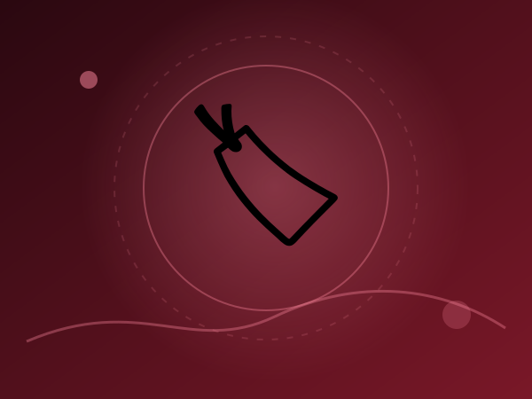

开脑洞点：短循环不是角色在动，而是徽章钉死、火花在闪，并把要印的字放进引号要求逐字拼写。

```text
Make a looping GIF of a round badge that says "[50% OFF]" with small sparkles appearing around it. Spell the text exactly. Keep the badge in one place.
```

参考链接（2026-11-05）：https://www.nereo.io/blog/gpt-2-6-prompts。


<a id="idea-32"></a>
### 32. 茶叶盒展开刀模 / Tea Carton Packaging Dieline

类型：产品广告 ｜输出：静图 ｜证据：Morphic 公开提示词库（示例跑在 2.5） ｜提示词：逐字公开提示词 ｜推荐：`Sunburst`, `16:9` ｜编辑优先级：P2

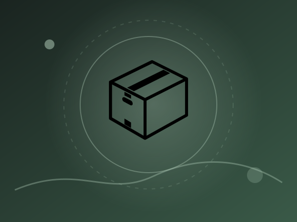

开脑洞点：不是拍成品包装，而是一次画出六面展开图、折叠虚线和两句精确文案，给包装设计预演。

```text
A flat packaging dieline for an unbranded loose-leaf tea carton laid out on a pale grey surface: front, back, two sides, top and bottom panels unfolded. Front panel reads HIGHLAND BREAKFAST with a small mountain line illustration; back panel has a short brewing guide reading STEEP 4 MINUTES AT 95 C. Sage green and cream with a thin gold rule, dotted fold lines between panels. Every word spelled correctly, no other text, no barcodes, no logos.
```

参考链接（2026-11-06）：https://morphic.com/resources/prompts/chatgpt-images-2-6-prompts。


<a id="idea-33"></a>
### 33. 六区标注烘焙剖面 / Labelled Bakery Cutaway

类型：文字海报 ｜输出：静图 ｜证据：Morphic 公开提示词库（示例跑在 2.5） ｜提示词：逐字公开提示词 ｜推荐：`Sunburst`, `16:9` ｜编辑优先级：P2

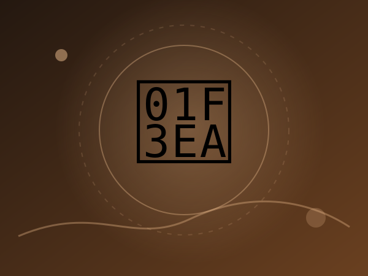

开脑洞点：把 complexity 写进提示词——六区六块牌、每词只出现一次，并禁止门窗再长字。适合信息图与空间说明。

```text
Isometric cutaway illustration of a small corner bakery seen from above at a 45-degree angle, the front wall removed. Six areas, each with one short label on a small plaque, exactly once each: OVEN, PROOFING, COUNTER, PANTRY, SINK, SEATING. A baker shaping loaves, a customer at the counter, trays of bread cooling on racks, warm pastel palette, clean line work, soft shadows, plenty of fine detail. Those six plaques are the only text in the image: the door, windows, boxes and walls carry no signs or writing. Every word spelled correctly, no logos.
```

参考链接（2026-11-06）：https://morphic.com/resources/how-to/chatgpt-images-2-6-guide。


<a id="idea-34"></a>
### 34. 只改一处的冬季版 / One-Change Winter Edition

类型：局部改图 ｜输出：编辑 ｜证据：Morphic 公开提示词库（示例跑在 2.5） ｜提示词：逐字公开提示词 ｜推荐：`Sunburst`, `2:3` ｜编辑优先级：P1

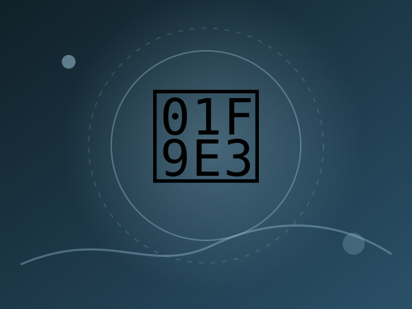

开脑洞点：分轮编辑的最小单位——上一张海报只改标题和配色，版式不动。比一次重写整张更接近生产改稿。

```text
Make it the winter edition: headline WINTER BAKE, frost blue and rust. Keep the layout.
```

参考链接（2026-11-06）：https://morphic.com/resources/prompts/chatgpt-images-2-6-prompts。


<a id="idea-35"></a>
### 35. 橱窗里的精确字海报 / In-Situ Exact-Text Poster

类型：文字海报 ｜输出：静图 ｜证据：Morphic 公开提示词库（示例跑在 2.5） ｜提示词：逐字公开提示词 ｜推荐：`Sunburst`, `2:3` ｜编辑优先级：P1

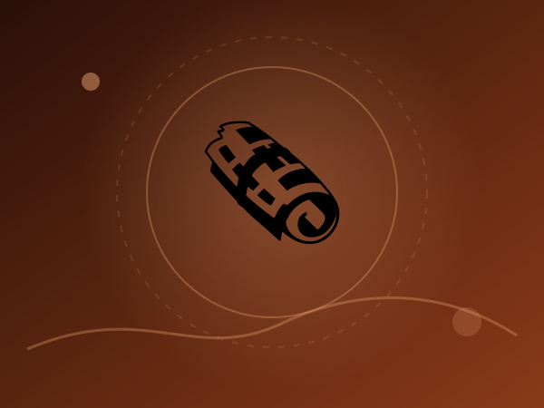

开脑洞点：不是透明背景招贴，而是把海报贴进真实橱窗，要求 AUTUMN BAKE / EMBER & OAT 拼写正确，并禁止多余日期网址。

```text
A risograph-printed seasonal poster taped inside the front window of a small bakery, photographed straight on from the street in soft morning light. Headline AUTUMN BAKE in a bold rounded serif in rust red, a smaller line beneath reading EMBER & OAT, a two-color illustration of a scored loaf and wheat stalks in rust and deep green on cream paper, visible riso grain and slight misregistration, faint reflections of the street on the glass. Every word spelled correctly, no other text, no dates, no web addresses.
```

参考链接（2026-11-06）：https://morphic.com/resources/prompts/chatgpt-images-2-6-prompts。


<a id="idea-36"></a>
### 36. 上传角色让它招手 / Reference Character Wave GIF

类型：角色动画 ｜输出：GIF ｜证据：社区公开案例 ｜提示词：逐字公开提示词 ｜推荐：`Flare`, `9` frames, `180` ms/frame, `1:1` ｜编辑优先级：P2

本地不转载第三方成品图；请打开来源链接查看。

开脑洞点：最短可用句。上传参考图后只说 loop + waving；X 帖带演示 GIF，本仓库不转载该动画。

```text
Make a looping GIF of this character waving.
```

参考链接（2026-11-05）：https://x.com/Krouxzz/status/2118283796181053637。


<a id="idea-37"></a>
### 37. 拍片前的动作分镜 GIF / Pre-Video Storyboard Loop

类型：分镜预演 ｜输出：GIF ｜证据：OpenAI 官方发布 ｜提示词：来源未公开完整提示词，本站不编造 ｜推荐：`Sunburst`, `12` frames, `160` ms/frame, `16:9` ｜编辑优先级：P2


开脑洞点：官方把 GIF 定位成视频前的动作预演（角色怎么动、镜头是否该锁死），而不是成片。公开页没有给出可复制提示词，这里留空不编造。

公开来源未给出完整提示词，本站不编造第三方原文。

参考链接（2026-11-04）：https://openai.com/index/introducing-images-2-6/。


<a id="idea-38"></a>
### 38. 实拍咖啡只动蒸汽 / Animate This Photo: Steam Only

类型：照片微动效 ｜输出：GIF ｜证据：公开实测案例 ｜提示词：逐字公开提示词 ｜推荐：`Flare`, `9` frames, `200` ms/frame, `3:2` ｜编辑优先级：P1


开脑洞点：与本站「咖啡热气微动」文生图模板不同，这条是上传实拍后只允许蒸汽和光线动。Lightlyn 2026-11-05 实测杯子/桌子/窗户保持不动。

```text
Make this photo move: gentle steam rises and curls above the latte, soft light flickers slightly. Keep the cup, the table and the window exactly as they are. Seamless loop.
```

参考链接（2026-11-05）：https://image.lightlyn.com/gpt-image-2-6?lang=en。
