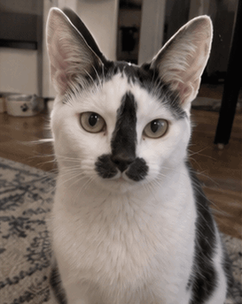
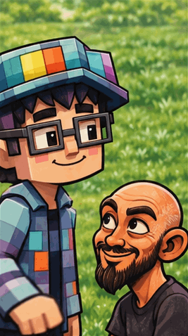
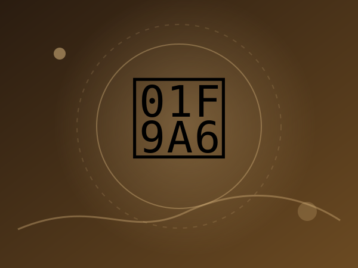
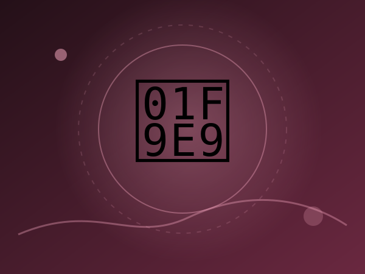
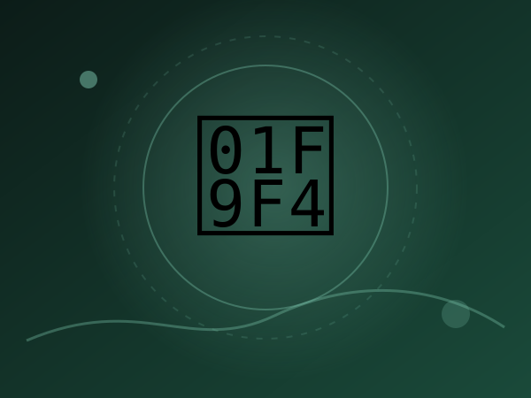
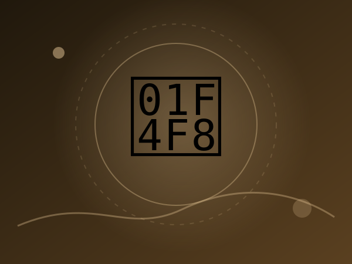

# GPT Image 2.6 玩法与 Prompt 图像列表（48 例）

> Updated: 2026-11-06（北京时间）。`official` = OpenAI 展示方向；`tested` = 公开第三方实测或可复制提示词库；`community` = 社区案例；`concept` = 本项目原创延伸模板。Prompt 标注 `verbatim` / `reconstructed` / `empty`。X 附件多为 MP4，未观看。Morphic 条目提示词面向 2.6，**示例跑在 2.5 / Ideogram Vector，不是 2.6 成品**。游戏待机/跑/攻击见 [game-sequences.md](game-sequences.md)，与普通 GIF 分开。全球热门 GIF 复刻见 [popular-gifs.md](popular-gifs.md)（四种依据分开标），不是 2.6 作品。

[打开交互式图像列表](https://jammyfu.github.io/awesome-gpt-image-gifs/ideas.html) · [游戏动作序列](https://jammyfu.github.io/awesome-gpt-image-gifs/game.html) · [结构化 JSON](../docs/data/ideas.json) · [参考出处](sources.md) · [来源与方法](trends-2026-11.md)

| # | 玩法 | 类别 | 来源 | Prompt | 建议模型 / 规格 |
|---:|---|---|---|---|---|
| 1 | [猫咪怒撞屏幕](../docs/gifs/cat-screen-crack.gif) | 表情梗图 | [参考](https://github.com/jammyfu/awesome-gpt-image-gifs/blob/main/docs/gifs/cat-screen-crack.gif) | [本站改写，非第三方原文](#idea-1) | Sunburst / 12f |
| 2 | [摸头循环表情包](../docs/gifs/pixel-head-pat.gif) | 表情梗图 | [参考](https://github.com/jammyfu/awesome-gpt-image-gifs/blob/main/docs/gifs/pixel-head-pat.gif) | [本站改写，非第三方原文](#idea-2) | Flare / 12f |
| 3 | 动漫角色点头 | 角色动画 | [参考](https://www.reddit.com/r/OpenAI/comments/1xoh2u0/i_tried_the_new_image_26_gif_feature/) | [本站改写，非第三方原文](#idea-3) | Sunburst / 9f |
| 4 | [数字助手正在输入](../docs/previews/typing-companion.svg) | 网站交互 | [参考](https://openai.com/index/introducing-images-2-6/) | [本站改写，非第三方原文](#idea-4) | Flare / 9f |
| 5 | [手绘草图变活物](../docs/previews/sketch-owl.svg) | 角色动画 | [参考](https://openai.com/index/introducing-images-2-6/) | [本站改写，非第三方原文](#idea-5) | Sunburst / 12f |
| 6 | 耳机盒开合 | 产品广告 | [参考](https://image.lightlyn.com/gpt-image-2-6?lang=en) | [逐字公开提示词](#idea-6) | Sunburst / 9f |
| 7 | 香水瓶流光 | 产品广告 | [参考](https://veevid.ai/blog/gpt-image-2-6-gif) | [逐字公开提示词](#idea-7) | Sunburst / 9f |
| 8 | [霓虹字切换](../docs/previews/neon-word-switch.svg) | 创意特效 | [参考](https://nowrap.ai/tools/chatgpt-images-2-6) | [本站改写，非第三方原文](#idea-8) | Sunburst / 12f |
| 9 | [Sprite 分镜再转 GIF](../docs/previews/sprite-sheet-stock-crash.svg) | Sprite 分镜 | [参考](https://openai.com/index/introducing-images-2-6/) | [逐字公开提示词](#idea-9) | Sunburst / 6 格 |
| 10 | [面包师吉祥物分镜表](../docs/previews/baker-mascot-sprite.svg) | Sprite 分镜 | [参考](https://morphic.com/resources/prompts/chatgpt-images-2-6-prompts) | [逐字公开提示词](#idea-10) | Sunburst / 6 格 |
| 11 | [剪纸锦鲤环游](../docs/previews/papercraft-koi.svg) | 创意特效 | [参考](https://morphic.com/resources/prompts/chatgpt-images-2-6-prompts) | [逐字公开提示词](#idea-11) | Sunburst / 6 格 |
| 12 | [圈选花瓶改色](../docs/previews/markup-vase-recolor.svg) | 局部改图 | [参考](https://developers.openai.com/api/docs/guides/image-prompting) | [逐字公开提示词](#idea-12) | Sunburst / 编辑 |
| 13 | [圈选替换招牌字](../docs/previews/markup-sign-text.svg) | 局部改图 | [参考](https://www.nereo.io/blog/gpt-2-6-prompts) | [逐字公开提示词](#idea-13) | Sunburst / 编辑 |
| 14 | [可缩放面包店 SVG 标志](../docs/previews/svg-field-flour.svg) | SVG 与 Logo | [参考](https://developers.openai.com/api/docs/guides/image-prompting) | [逐字公开提示词](#idea-14) | Flare / SVG |
| 15 | [天气图标 SVG 套件](../docs/previews/svg-weather-icons.svg) | SVG 与 Logo | [参考](https://image.lightlyn.com/gpt-image-2-6?lang=en) | [逐字公开提示词](#idea-15) | Sunburst / SVG |
| 16 | [吉祥物三视图设定表](../docs/previews/character-ref-sheet.svg) | 角色设定 | [参考](https://morphic.com/resources/how-to/chatgpt-images-2-6-guide) | [逐字公开提示词](#idea-16) | Sunburst / 静图 |
| 17 | [同一角色换场景](../docs/previews/character-new-scene.svg) | 角色设定 | [参考](https://www.nereo.io/blog/gpt-2-6-prompts) | [逐字公开提示词](#idea-17) | Sunburst / 静图 |
| 18 | 提灯小猴循环 | 角色动画 | [参考](https://developers.openai.com/api/docs/guides/image-prompting) | [逐字公开提示词](#idea-18) | Sunburst / 9f |
| 19 | [精确文字促销徽章](../docs/previews/sale-badge-gif.svg) | 文字海报 | [参考](https://www.nereo.io/blog/gpt-2-6-prompts) | [逐字公开提示词](#idea-19) | Flare / 9f |
| 20 | [茶叶盒展开刀模](../docs/previews/packaging-dieline.svg) | 产品广告 | [参考](https://morphic.com/resources/prompts/chatgpt-images-2-6-prompts) | [逐字公开提示词](#idea-20) | Sunburst / 静图 |
| 21 | [六区标注烘焙剖面](../docs/previews/labelled-bakery-cutaway.svg) | 文字海报 | [参考](https://morphic.com/resources/how-to/chatgpt-images-2-6-guide) | [逐字公开提示词](#idea-21) | Sunburst / 静图 |
| 22 | [只改一处的冬季版](../docs/previews/winter-edition-edit.svg) | 局部改图 | [参考](https://morphic.com/resources/prompts/chatgpt-images-2-6-prompts) | [逐字公开提示词](#idea-22) | Sunburst / 编辑 |
| 23 | [橱窗里的精确字海报](../docs/previews/autumn-bake-poster.svg) | 文字海报 | [参考](https://morphic.com/resources/prompts/chatgpt-images-2-6-prompts) | [逐字公开提示词](#idea-23) | Sunburst / 静图 |
| 24 | 上传角色让它招手 | 角色动画 | [参考](https://x.com/Krouxzz/status/2118283796181053637) | [逐字公开提示词](#idea-24) | Flare / 9f |
| 25 | 实拍咖啡只动蒸汽 | 照片微动效 | [参考](https://image.lightlyn.com/gpt-image-2-6?lang=en) | [逐字公开提示词](#idea-25) | Flare / 9f |
| 26 | [雨衣水獭挥手 GIF](../docs/previews/luffy-otter-wave-gif.svg) | 角色动画 | [参考](https://x.com/i/article/2118269816821919744) | [逐字公开提示词](#idea-26) | Flare / 6f |
| 27 | [六宫格连续帧再合成 GIF](../docs/previews/luffy-six-frame-then-gif.svg) | Sprite 分镜 | [参考](https://x.com/i/article/2118269816821919744) | [逐字公开提示词](#idea-27) | Sunburst / 6 格 |
| 28 | [同一角色九宫格表情包](../docs/previews/luffy-nine-stickers.svg) | 表情梗图 | [参考](https://x.com/i/article/2118269816821919744) | [逐字公开提示词](#idea-28) | Sunburst / 静图 |
| 29 | [只换背景保住商品](../docs/previews/luffy-product-bg-keep.svg) | 局部改图 | [参考](https://x.com/i/article/2118269816821919744) | [逐字公开提示词](#idea-29) | Sunburst / 编辑 |
| 30 | [清晰化但不要编造细节](../docs/previews/luffy-deblur-keep.svg) | 局部改图 | [参考](https://x.com/i/article/2118269816821919744) | [逐字公开提示词](#idea-30) | Sunburst / 编辑 |
| 31 | [软装预览不改户型](../docs/previews/luffy-interior-staging.svg) | 局部改图 | [参考](https://x.com/i/article/2118269816821919744) | [逐字公开提示词](#idea-31) | Sunburst / 编辑 |
| 32 | [同一商品放进生活场景](../docs/previews/luffy-product-lifestyle.svg) | 产品广告 | [参考](https://x.com/i/article/2118269816821919744) | [逐字公开提示词](#idea-32) | Sunburst / 静图 |
| 33 | 白纸船水面轻摇 | 创意特效 | [参考](https://note.com/ravivit_ai/n/nb8f40b5a21b9) | [逐字公开提示词](#idea-33) | Images 2.6 API / 16f |
| 34 | 规格化眨眼循环（作者测尺寸未遵守） | 角色动画 | [参考](https://x.com/mirai_ai2050/status/2118213713761292432) | [逐字公开提示词](#idea-34) | ChatGPT Images 2.6（作者声明；本仓未复测） / 16f |
| 35 | 扁平风拉伸循环 | 角色动画 | [参考](https://x.com/MiraMusic_AI/status/2118168013618987298) | [逐字公开提示词](#idea-35) | ChatGPT Images 2.6（作者声明；本仓未复测） / 9f |
| 36 | 真香吃饭循环 | 表情梗图 | [参考](https://x.com/Gorden_Sun/status/2118166046175908016) | [逐字公开提示词](#idea-36) | ChatGPT Images 2.6（作者声明；本仓未复测） / 9f |
| 37 | 大肥鱼主题表情包模板 | 表情梗图 | [参考](https://x.com/op7418/status/2118181775688241456) | [逐字公开提示词](#idea-37) | ChatGPT Images 2.6（作者声明；本仓未复测） / 12f |
| 38 | 角色+画风 → 10 张反应套装 | 表情梗图 | [参考](https://x.com/nonieengel/status/2118382251226562570) | [逐字公开提示词](#idea-38) | ChatGPT Images 2.6（作者声明；本仓未复测） / 16f |
| 39 | 建筑透视日落后退 | 照片微动效 | [参考](https://x.com/supertask_jp/status/2118241124133532077) | [逐字公开提示词](#idea-39) | ChatGPT Images 2.6（作者声明；本仓未复测） / 12f |
| 40 | 像素三连击 / 翻滚 / 法术（跳跃事后压背景） | 游戏动作序列 | [参考](https://x.com/Daft_Trade/status/2118283025498906800) | [来源未公开完整提示词，本站不编造](#idea-40) | 作者声明 GPT Image 2.6（非官方验证；跳跃有事后修帧；本仓未观看） / 16f |
| 41 | 狐浪人网页游戏：2.6 出表、另一 agent 切帧 | 游戏动作序列 | [参考](https://x.com/maker_evan/status/2118222694345040253) | [逐字公开提示词](#idea-41) | 作者声明 GPT Image 2.6 出表（切帧/游戏是 GPT-6.1 Sol；非官方验证） / 8 格 |
| 42 | 复古格斗出拳 / 蓄力循环 | 游戏动作序列 | [参考](https://x.com/xiaomovps/status/2118274032227471705) | [来源未公开完整提示词，本站不编造](#idea-42) | 作者声明 GPT Images 2.6（非官方验证；本仓未观看、未复测） / 12f |
| 43 | 像素 walk cycle 对照（含其他模型修帧） | 游戏动作序列 | [参考](https://x.com/maker_evan/status/2118235403430027495) | [来源未公开完整提示词，本站不编造](#idea-43) | 作者声明两条 GPT Image 2.6 + Claude Opus 5.5 后处理；一条无图像模型 / 8 格 |
| 44 | 【2.5 历史规格】游戏 4×4 分镜表 | 其他模型参考 | [参考](https://x.com/SSSS_CRYPTOMAN/status/2097797456117539136) | [逐字公开提示词](#idea-44) | GPT Image 2.5（原帖写明；不是 Image 2.6） / 16 格 |
| 45 | 骑士跑循环：作者声明 2.6 出表再切帧 | 游戏动作序列 | [参考](https://github.com/vargHQ/skills/blob/main/gpt-image-sprite-sheet/SKILL.md) | [逐字公开提示词](#idea-45) | 作者声明 gpt_image_2_6（非官方验证；本仓未复测） / 16 格 |
| 46 | 宣传方 9 帖游戏演示（1 组，非 9 案） | 游戏动作序列 | [参考](https://x.com/higgsfield_ai/status/2118154923070439759) | [来源未公开完整提示词，本站不编造](#idea-46) | 宣传方宣称 ChatGPT Images 2.6（未观看；非官方验证） / 9f |
| 47 | 失败样本：动态+静态同帧会崩 | 失败与注意事项 | [参考](https://x.com/AM09_21/status/2118143217434800219) | [来源未公开完整提示词，本站不编造](#idea-47) | 作者声明 GPT Image 2.6 GIF（失败/注意事项；非成功落地） / 8f |
| 48 | 失败样本：像素动画 not there yet | 失败与注意事项 | [参考](https://x.com/WrongNebula/status/2118164394400182755) | [来源未公开完整提示词，本站不编造](#idea-48) | 作者声明 GPT Image 2.6 Sunburst/Flare（失败结论：不适合 pixel art） / 8f |

## 完整提示词（公开原文或本站改写）

标注 `verbatim` 的条目复制自注明来源的公开页面；`reconstructed` 是本站按创意目标改写的模板，不是第三方作者的逐字提示词；`empty` 表示来源只描述了能力、没有给出可复制提示词，本站留空。均未在此仓库逐项实测。

<a id="idea-1"></a>
### 01. 猫咪怒撞屏幕 / Cat vs. Cracked Screen

类型：表情梗图 ｜输出：GIF ｜证据：本项目已有 GIF 案例 ｜提示词：本站改写，非第三方原文 ｜推荐：`Sunburst`, `12` frames, `130` ms/frame, `4:5` ｜编辑优先级：P1



角色向镜头冲刺、头撞玻璃、裂纹扩散；可用已有猫咪动图预览。

第三方原文：

```text
Create a funny looping animated GIF of an original black-and-white cat headbutting the camera glass. Beat 1: cat stares intensely. Beat 2: it lunges head-first without using its paws. Beat 3: a small spiderweb crack appears, then grows. Beat 4: the camera returns to the starting view to loop. Keep the eyes, whisker markings and background consistent. Fixed camera; expressive but non-graphic cartoon impact; no words or watermark.
```

参考链接（2026-11-05）：https://github.com/jammyfu/awesome-gpt-image-gifs/blob/main/docs/gifs/cat-screen-crack.gif。


<a id="idea-2"></a>
### 02. 摸头循环表情包 / Looping Head Pat Meme

类型：表情梗图 ｜输出：GIF ｜证据：本项目已有 GIF 案例 ｜提示词：本站改写，非第三方原文 ｜推荐：`Flare`, `12` frames, `180` ms/frame, `3:4` ｜编辑优先级：P1



左右角色保持站位，单手抬起、摸头、收回，天然循环。

第三方原文：

```text
Create a seamless GIF with two ORIGINAL friendly cartoon characters. The taller blocky character on the left raises one hand, gently pats the shorter bald cartoon character on the head twice, then returns to the initial arm position. The receiver smiles and slightly nods in time. Keep faces, clothing, camera angle, grassy background and character positions unchanged. Clear contact and recovery poses, six to twelve distinct beats, no extra limbs, no captions.
```

参考链接（2026-11-05）：https://github.com/jammyfu/awesome-gpt-image-gifs/blob/main/docs/gifs/pixel-head-pat.gif。


<a id="idea-3"></a>
### 03. 动漫角色点头 / Anime Character Nodding

类型：角色动画 ｜输出：GIF ｜证据：社区公开案例（Reddit r/OpenAI） ｜提示词：本站改写，非第三方原文 ｜推荐：`Sunburst`, `9` frames, `180` ms/frame, `1:1` ｜编辑优先级：P1

源站 GIF（外链播放，未入库）：https://i.redd.it/smnyo808cszh1.gif

Reddit 帖附带的可播放 GIF（9 帧·390×437）已核到。帖文 JSON 本轮 403，作者 handle 与原文提示词未能独立复核，因此提示词仍标 reconstructed，不把第三方报告里的长提示词当逐字原文。

第三方原文：

```text
Animate an ORIGINAL anime-style adult character from a consistent front three-quarter portrait. She lifts her chin slightly, makes one quick affirmative nod, closes her eyes with a soft smile, then returns to the identical first-frame expression. Preserve hair strands, face proportions, outfit and line art between frames. Only the neck, eyelids and a few hair tips move. Simple clean background, locked camera, no speech bubbles, seamless looping GIF.
```

参考链接（2026-11-05）：https://www.reddit.com/r/OpenAI/comments/1xoh2u0/i_tried_the_new_image_26_gif_feature/。


<a id="idea-4"></a>
### 04. 数字助手正在输入 / AI Assistant Typing Indicator

类型：网站交互 ｜输出：GIF ｜证据：OpenAI 官方发布 ｜提示词：本站改写，非第三方原文 ｜推荐：`Flare`, `9` frames, `160` ms/frame, `1:1` ｜编辑优先级：P1


官方 Town 助手演示是 Vimeo 视频，不是 GIF。没有可复制提示词；封面 SVG 不是生成结果。

第三方原文：

```text
Create an original tiny mint-green desk companion mascot for an AI chat interface. It taps an invisible keyboard with alternating paws, pauses to blink, then returns to the start. Show only its head, tiny arms and torso on a transparent-looking plain solid background. Very small readable movement, fixed alignment and scale, no text, no chat bubbles, no UI mockup. Loop must feel calm and unobtrusive like a typing indicator.
```

参考链接（2026-11-04）：https://openai.com/index/introducing-images-2-6/。


<a id="idea-5"></a>
### 05. 手绘草图变活物 / Hand-drawn Owl Comes Alive

类型：角色动画 ｜输出：GIF ｜证据：OpenAI 官方发布 ｜提示词：本站改写，非第三方原文 ｜推荐：`Sunburst`, `12` frames, `160` ms/frame, `1:1` ｜编辑优先级：P1


官方发布页猫头鹰演示是 Vimeo 视频，不是 GIF。封面 SVG 不是生成结果。可播放的 2.6 草图 GIF 见 Veevid 墨线机器人（另一份素材）。

第三方原文：

```text
Make an original pencil-line owl drawing on cream notebook paper animate while preserving the hand-drawn sketch style. The owl blinks, tilts its head left, lifts one wing slightly, then returns to its original pencil pose. Keep the page fibers, outline weight and shading nearly static. No camera pan, no change of drawing identity, no extra strokes that drift between frames. Subtle, seamless looping GIF.
```

参考链接（2026-11-04）：https://openai.com/index/introducing-images-2-6/。


<a id="idea-6"></a>
### 06. 耳机盒开合 / Earbuds Case Product Loop

类型：产品广告 ｜输出：GIF ｜证据：Lightlyn 公开实测（Linger · 2026-11-05） ｜提示词：逐字公开提示词 ｜推荐：`Sunburst`, `9` frames, `200` ms/frame, `1:1` ｜编辑优先级：P1

源站 GIF（外链播放，未入库）：https://image.lightlyn.com/examples/gpt-image-2-6/gif-product.gif

Lightlyn 2.6 Sunburst 真实 GIF：盒盖开合、耳机浮起归位。提示词改回实测原文；只外链。

第三方原文：

```text
A white wireless earbuds charging case labelled "LIGHTLYN" on a sage-green studio background: the lid opens, the two earbuds rise and float a little, then settle back and the lid closes. Clean product animation, seamless loop.
```

参考链接（2026-11-05）：https://image.lightlyn.com/gpt-image-2-6?lang=en。


<a id="idea-7"></a>
### 07. 香水瓶流光 / Perfume Highlight Sweep

类型：产品广告 ｜输出：GIF ｜证据：Veevid 公开实测（2026-11-05） ｜提示词：逐字公开提示词 ｜推荐：`Sunburst`, `9` frames, `200` ms/frame, `1:1` ｜编辑优先级：P1

源站 GIF（外链播放，未入库）：https://cdn.veevid.ai/gpt-image-2-6-samples/blog/gif-perfume-loop.gif

Veevid 2.6 Flare 真实 GIF：瓶子不动，高光扫过。提示词按博文原文；只外链。

第三方原文：

```text
A frosted glass perfume bottle on a round stone pedestal. The sequence: a soft band of light sweeps slowly across the glass from left to right while tiny dust particles drift upward. Fixed camera, same bottle, same pedestal, warm beige studio background. The last frame transitions smoothly back to the first for a seamless loop. Clean product photography style. No captions, no words, no logos, no borders.
```

参考链接（2026-11-05）：https://veevid.ai/blog/gpt-image-2-6-gif。


<a id="idea-8"></a>
### 08. 霓虹字切换 / Neon Lettering Flicker Loop

类型：创意特效 ｜输出：GIF ｜证据：公开实测案例 ｜提示词：本站改写，非第三方原文 ｜推荐：`Sunburst`, `12` frames, `200` ms/frame, `16:9` ｜编辑优先级：P2


实测关注多帧文字保持一致：霓虹牌 A/B 状态切换。

第三方原文：

```text
Nighttime rainy storefront with a single clean neon sign that alternates between the exact words OPEN and LATE, one at a time. The pink word OPEN slowly dims; blue LATE lights up, then reverses to the starting state. Keep all other lettering, reflections, windows, pavement and camera completely stable. Never display the two words at once. Crisp legible typography in every frame, no invented extra signs, seamless looping animated GIF.
```

参考链接（2026-11-05）：https://nowrap.ai/tools/chatgpt-images-2-6。


<a id="idea-9"></a>
### 09. Sprite 分镜再转 GIF / Sprite Sheet Then GIF

类型：Sprite 分镜 ｜输出：Sprite 分镜 ｜证据：OpenAI 官方发布 ｜提示词：逐字公开提示词 ｜推荐：`Sunburst`, `6` frames, `1:1` ｜编辑优先级：P1


官方 3×2 分镜提示词仍逐字收录。发布页股市演示是 Vimeo 视频，不是 GIF。封面 SVG 不是生成结果。

第三方原文：

```text
Create a single animation sprite sheet for a seamless looping GIF. A super-cute chibi adult office worker sits at a desk watching a computer monitor with a clearly plunging stock-market line chart. The sequence: hopeful expression, notices the chart falling, eyes widen, face crumples, large cartoon tears stream down both cheeks, then quietly wipes tears while still staring at the falling chart. Oversized round head, tiny body, big expressive eyes, soft rounded features, messy fluffy hair, white shirt and loosened tie. Exactly 6 sequential frames arranged in a precise 3-column by 2-row grid, read left-to-right then top-to-bottom. Every panel has identical dimensions. Fixed front three-quarter camera, same character, same desk, monitor, outfit, and cozy miniature office background. Clear incremental facial and tear motion; sixth frame transitions smoothly toward the first. Polished kawaii chibi 3D toy-like style, warm pastel lighting, funny and sympathetic mood. No captions, no words, no numbers, no logos, no speech bubbles, no panel labels, no borders, no gutters.
```

参考链接（2026-11-04）：https://openai.com/index/introducing-images-2-6/。


<a id="idea-10"></a>
### 10. 面包师吉祥物分镜表 / Dough Baker Mascot Sprite Sheet

类型：Sprite 分镜 ｜输出：Sprite 分镜 ｜证据：Morphic 公开提示词库（FAQ：示例不是 2.6，跑在 2.5 / Ideogram Vector） ｜提示词：逐字公开提示词 ｜推荐：`Sunburst`, `6` frames, `1:1` ｜编辑优先级：P1


开脑洞点：先做角色设定表，再用同一顶帽/腮红/领巾出 6 帧揉面→挥手循环，比单句「吉祥物招手」更能锁身份。Morphic 明示示例不是 ChatGPT Images 2.6（2.5 Flare/Sunburst 或 Ideogram Vector；Copilot 循环还用了 MiniMax 视频）。提示词面向 2.6 仍逐字收录；SVG 封面不是 2.6 成品，也不进入 2.6 GIF 画廊。

第三方原文：

```text
One animation sprite sheet for a looping GIF of the dough baker mascot from the sheet, same hat, cheeks and rust-red neckerchief: exactly 6 frames in a 3-column by 2-row grid, every panel the same size. Sequence: kneads a ball of dough, presses, folds, looks up and smiles, waves, and the sixth frame leads back into the first. Fixed front three-quarter camera, the same oak counter and plain oat-colored background in every panel, the same soft clay-like 3D render. No text, no numbers, no borders, no gutters, no panel labels.
```

参考链接（2026-11-06）：https://morphic.com/resources/prompts/chatgpt-images-2-6-prompts。


<a id="idea-11"></a>
### 11. 剪纸锦鲤环游 / Papercraft Koi Loop

类型：创意特效 ｜输出：Sprite 分镜 ｜证据：Morphic 公开提示词库（FAQ：示例不是 2.6，跑在 2.5 / Ideogram Vector） ｜提示词：逐字公开提示词 ｜推荐：`Sunburst`, `6` frames, `1:1` ｜编辑优先级：P1


开脑洞点：不是照片微动，而是整条鱼用层叠色纸游一圈；俯视锁定、第六帧接回第一帧，适合做手工质感 sticker。Morphic 明示示例不是 ChatGPT Images 2.6（2.5 Flare/Sunburst 或 Ideogram Vector；Copilot 循环还用了 MiniMax 视频）。提示词面向 2.6 仍逐字收录；SVG 封面不是 2.6 成品，也不进入 2.6 GIF 画廊。

第三方原文：

```text
One animation sprite sheet for a looping GIF: exactly 6 frames in a 3-column by 2-row grid, every panel the same size. A papercraft koi made of layered cut paper in vermilion, cream and ink black swims one slow circle through a still pond of deep teal paper ripples, its tail sweeping a little further in each frame, and the sixth frame leads smoothly back into the first. Fixed overhead camera, the same pond, lily pad and soft paper shadows in every panel, warm diffused light, tactile handmade texture. No text, no borders, no gutters, no panel labels.
```

参考链接（2026-11-06）：https://morphic.com/resources/prompts/chatgpt-images-2-6-prompts。


<a id="idea-12"></a>
### 12. 圈选花瓶改色 / Markup Recolor One Object

类型：局部改图 ｜输出：编辑 ｜证据：OpenAI 官方提示词指南 ｜提示词：逐字公开提示词 ｜推荐：`Sunburst`, `4:3` ｜编辑优先级：P1


开脑洞点：2.6 把 ChatGPT 圈选 markup 接到 API。透明 PNG 叠层指出位置，提示词只说改什么、什么必须留下，并删掉红圈。

第三方原文：

```text
Recolor the striped vase inside the red circle to solid cobalt blue ceramic. Keep its shape, the dried stems, and the rest of the kitchen unchanged. Remove the red circle from the finished photo.
```

参考链接（2026-11-04）：https://developers.openai.com/api/docs/guides/image-prompting。


<a id="idea-13"></a>
### 13. 圈选替换招牌字 / Markup Replace Sign Text

类型：局部改图 ｜输出：编辑 ｜证据：Nereo 可复制提示词 ｜提示词：逐字公开提示词 ｜推荐：`Sunburst`, `1:1` ｜编辑优先级：P1


开脑洞点：局部改图不是重画整张海报，而是圈出招牌、指定精确文案，并要求匹配原字体、颜色和透视。

第三方原文：

```text
Change the words on the sign inside the circle to "[OPEN LATE]". Match the original lettering, color and perspective. Keep everything else unchanged.
```

参考链接（2026-11-05）：https://www.nereo.io/blog/gpt-2-6-prompts。


<a id="idea-14"></a>
### 14. 可缩放面包店 SVG 标志 / Field & Flour SVG Logo

类型：SVG 与 Logo ｜输出：SVG ｜证据：OpenAI 官方提示词指南 ｜提示词：逐字公开提示词 ｜推荐：`Flare`, `1:1` ｜编辑优先级：P1


开脑洞点：生成接口可直接 output_format=svg，得到可改路径的矢量标，而不是嵌了位图的假矢量。官方同时给了 Flare/Sunburst 对照。

第三方原文：

```text
Create an original, non-infringing logo for a company called Field & Flour, a local bakery.
The logo should feel warm, simple, and timeless. Use clean, vector-like shapes, a strong silhouette, and balanced negative space.
Favor simplicity over detail so it reads clearly at small and large sizes. Flat design, minimal strokes, no gradients unless essential.
Fully transparent background. Deliver a single centered logo with generous padding, clean alpha edges, and no solid backdrop, scenery, checkerboard, or watermark.
```

参考链接（2026-11-04）：https://developers.openai.com/api/docs/guides/image-prompting。


<a id="idea-15"></a>
### 15. 天气图标 SVG 套件 / Matching Weather Icon SVG Set

类型：SVG 与 Logo ｜输出：SVG ｜证据：公开实测案例 ｜提示词：逐字公开提示词 ｜推荐：`Sunburst`, `3:2` ｜编辑优先级：P1


开脑洞点：一次生成 6 个同线宽、同端点的图标，而不是 6 次风格漂移。Lightlyn 实测 SVG 约 2–13 KB，可进 Figma。

第三方原文：

```text
A set of six matching line icons for a weather app arranged in a 3 by 2 grid: sun, cloud, rain, snow, thunderstorm, wind. Consistent stroke width, rounded ends, one accent colour.
```

参考链接（2026-11-05）：https://image.lightlyn.com/gpt-image-2-6?lang=en。


<a id="idea-16"></a>
### 16. 吉祥物三视图设定表 / Character Reference Sheet

类型：角色设定 ｜输出：静图 ｜证据：Morphic 公开提示词库（FAQ：示例不是 2.6，跑在 2.5 / Ideogram Vector） ｜提示词：逐字公开提示词 ｜推荐：`Sunburst`, `3:2` ｜编辑优先级：P1


开脑洞点：2.6 可保存参考图并按名调用。先出正/侧/背 + 表情条，再拿去出分镜或新场景，比口头描述更稳。Morphic 明示示例不是 ChatGPT Images 2.6（2.5 Flare/Sunburst 或 Ideogram Vector；Copilot 循环还用了 MiniMax 视频）。提示词面向 2.6 仍逐字收录；SVG 封面不是 2.6 成品，也不进入 2.6 GIF 画廊。

第三方原文：

```text
A character reference sheet for an invented bakery's mascot: a small round baker made of soft bread dough, with a tiny white chef hat, flour-dusted cheeks and a rust-red neckerchief, shown three times at the same scale, front view, side view and back view, with a row of four small facial expressions beneath (cheerful, proud, sleepy, surprised). Soft clay-like 3D render with visible fingerprint texture, warm even studio light, plain oat-colored background, identical proportions and colors in every view. No text, no labels, no logos.
```

参考链接（2026-11-06）：https://morphic.com/resources/how-to/chatgpt-images-2-6-guide。


<a id="idea-17"></a>
### 17. 同一角色换场景 / Same Character, New Scene

类型：角色设定 ｜输出：静图 ｜证据：Nereo 可复制提示词 ｜提示词：逐字公开提示词 ｜推荐：`Sunburst`, `16:9` ｜编辑优先级：P1


开脑洞点：把设定表当 image 输入，只改动作与环境，并逐项点名脸、头发、服装、配色不许变。

第三方原文：

```text
Using the character in the reference image, show them [crossing a rope bridge in the rain]. Keep the face, hair, outfit and colors the same.
```

参考链接（2026-11-05）：https://www.nereo.io/blog/gpt-2-6-prompts。


<a id="idea-18"></a>
### 18. 提灯小猴循环 / Lantern Monkey Loop

类型：角色动画 ｜输出：GIF ｜证据：OpenAI 官方提示词指南 ｜提示词：逐字公开提示词 ｜推荐：`Sunburst`, `9` frames, `200` ms/frame, `1:1` ｜编辑优先级：P1

源站 GIF（外链播放，未入库）：https://developers.openai.com/images/platform/guides/image-prompting/monkey-lantern-gpt-image-2-6-sunburst.gif

官方文档真实 GIF（9×200 ms、512²、Sunburst）：小猴提灯、眨眼、放回。封面改为源站 GIF 外链，不再用 SVG 冒充生成结果。Sogni 另有哈希不同的第三方重跑。xianyu110 镜像与官方字节一致，不另收。

第三方原文：

```text
A little monkey in an olive-green hooded coat stands in a snowy pine forest at dusk. A wooden cabin glows in the background. The monkey holds a glowing amber paper lantern at chest height, slowly lifts it, looks up and blinks, then lowers it back to its starting pose. Keep the lantern in its hands and the camera still. Make the motion loop smoothly.
```

参考链接（2026-11-04）：https://developers.openai.com/api/docs/guides/image-prompting。


<a id="idea-19"></a>
### 19. 精确文字促销徽章 / Exact-Text Sale Badge GIF

类型：文字海报 ｜输出：GIF ｜证据：Nereo 可复制提示词 ｜提示词：逐字公开提示词 ｜推荐：`Flare`, `9` frames, `180` ms/frame, `1:1` ｜编辑优先级：P1


开脑洞点：短循环不是角色在动，而是徽章钉死、火花在闪，并把要印的字放进引号要求逐字拼写。

第三方原文：

```text
Make a looping GIF of a round badge that says "[50% OFF]" with small sparkles appearing around it. Spell the text exactly. Keep the badge in one place.
```

参考链接（2026-11-05）：https://www.nereo.io/blog/gpt-2-6-prompts。


<a id="idea-20"></a>
### 20. 茶叶盒展开刀模 / Tea Carton Packaging Dieline

类型：产品广告 ｜输出：静图 ｜证据：Morphic 公开提示词库（FAQ：示例不是 2.6，跑在 2.5 / Ideogram Vector） ｜提示词：逐字公开提示词 ｜推荐：`Sunburst`, `16:9` ｜编辑优先级：P2


开脑洞点：不是拍成品包装，而是一次画出六面展开图、折叠虚线和两句精确文案，给包装设计预演。Morphic 明示示例不是 ChatGPT Images 2.6（2.5 Flare/Sunburst 或 Ideogram Vector；Copilot 循环还用了 MiniMax 视频）。提示词面向 2.6 仍逐字收录；SVG 封面不是 2.6 成品，也不进入 2.6 GIF 画廊。

第三方原文：

```text
A flat packaging dieline for an unbranded loose-leaf tea carton laid out on a pale grey surface: front, back, two sides, top and bottom panels unfolded. Front panel reads HIGHLAND BREAKFAST with a small mountain line illustration; back panel has a short brewing guide reading STEEP 4 MINUTES AT 95 C. Sage green and cream with a thin gold rule, dotted fold lines between panels. Every word spelled correctly, no other text, no barcodes, no logos.
```

参考链接（2026-11-06）：https://morphic.com/resources/prompts/chatgpt-images-2-6-prompts。


<a id="idea-21"></a>
### 21. 六区标注烘焙剖面 / Labelled Bakery Cutaway

类型：文字海报 ｜输出：静图 ｜证据：Morphic 公开提示词库（FAQ：示例不是 2.6，跑在 2.5 / Ideogram Vector） ｜提示词：逐字公开提示词 ｜推荐：`Sunburst`, `16:9` ｜编辑优先级：P2


开脑洞点：把 complexity 写进提示词——六区六块牌、每词只出现一次，并禁止门窗再长字。适合信息图与空间说明。Morphic 明示示例不是 ChatGPT Images 2.6（2.5 Flare/Sunburst 或 Ideogram Vector；Copilot 循环还用了 MiniMax 视频）。提示词面向 2.6 仍逐字收录；SVG 封面不是 2.6 成品，也不进入 2.6 GIF 画廊。

第三方原文：

```text
Isometric cutaway illustration of a small corner bakery seen from above at a 45-degree angle, the front wall removed. Six areas, each with one short label on a small plaque, exactly once each: OVEN, PROOFING, COUNTER, PANTRY, SINK, SEATING. A baker shaping loaves, a customer at the counter, trays of bread cooling on racks, warm pastel palette, clean line work, soft shadows, plenty of fine detail. Those six plaques are the only text in the image: the door, windows, boxes and walls carry no signs or writing. Every word spelled correctly, no logos.
```

参考链接（2026-11-06）：https://morphic.com/resources/how-to/chatgpt-images-2-6-guide。


<a id="idea-22"></a>
### 22. 只改一处的冬季版 / One-Change Winter Edition

类型：局部改图 ｜输出：编辑 ｜证据：Morphic 公开提示词库（FAQ：示例不是 2.6，跑在 2.5 / Ideogram Vector） ｜提示词：逐字公开提示词 ｜推荐：`Sunburst`, `2:3` ｜编辑优先级：P1


开脑洞点：分轮编辑的最小单位——上一张海报只改标题和配色，版式不动。比一次重写整张更接近生产改稿。Morphic 明示示例不是 ChatGPT Images 2.6（2.5 Flare/Sunburst 或 Ideogram Vector；Copilot 循环还用了 MiniMax 视频）。提示词面向 2.6 仍逐字收录；SVG 封面不是 2.6 成品，也不进入 2.6 GIF 画廊。

第三方原文：

```text
Make it the winter edition: headline WINTER BAKE, frost blue and rust. Keep the layout.
```

参考链接（2026-11-06）：https://morphic.com/resources/prompts/chatgpt-images-2-6-prompts。


<a id="idea-23"></a>
### 23. 橱窗里的精确字海报 / In-Situ Exact-Text Poster

类型：文字海报 ｜输出：静图 ｜证据：Morphic 公开提示词库（FAQ：示例不是 2.6，跑在 2.5 / Ideogram Vector） ｜提示词：逐字公开提示词 ｜推荐：`Sunburst`, `2:3` ｜编辑优先级：P1


开脑洞点：不是透明背景招贴，而是把海报贴进真实橱窗，要求 AUTUMN BAKE / EMBER & OAT 拼写正确，并禁止多余日期网址。Morphic 明示示例不是 ChatGPT Images 2.6（2.5 Flare/Sunburst 或 Ideogram Vector；Copilot 循环还用了 MiniMax 视频）。提示词面向 2.6 仍逐字收录；SVG 封面不是 2.6 成品，也不进入 2.6 GIF 画廊。

第三方原文：

```text
A risograph-printed seasonal poster taped inside the front window of a small bakery, photographed straight on from the street in soft morning light. Headline AUTUMN BAKE in a bold rounded serif in rust red, a smaller line beneath reading EMBER & OAT, a two-color illustration of a scored loaf and wheat stalks in rust and deep green on cream paper, visible riso grain and slight misregistration, faint reflections of the street on the glass. Every word spelled correctly, no other text, no dates, no web addresses.
```

参考链接（2026-11-06）：https://morphic.com/resources/prompts/chatgpt-images-2-6-prompts。


<a id="idea-24"></a>
### 24. 上传角色让它招手 / Reference Character Wave GIF

类型：角色动画 ｜输出：GIF ｜证据：Max Goldstein @Krouxzz · 作者声明 2.6 · X API animated_gif · HEAD video/mp4 · 未视觉复核 ｜提示词：逐字公开提示词 ｜推荐：`Flare`, `9` frames, `180` ms/frame, `1:1` ｜编辑优先级：P2

本地不转载第三方成品图（实测为 mp4，不是 GIF）；请打开来源链接查看。

最短参考图挥手句。X 把附件标成 GIF，HEAD Content-Type 是 video/mp4。作者声明走 2.6。本仓未把附件当 GIF 观看；不入库、不称为已拿到 .gif。

状态：作者声明 2.6 · 媒体元数据已核（X API 类型 + HEAD） · 未视觉复核 · 未复测生成 · 对外媒体是 MP4，不是 .gif

第三方原文：

```text
Make a looping GIF of this character waving.
```

参考链接（2026-11-05）：https://x.com/Krouxzz/status/2118283796181053637。


<a id="idea-25"></a>
### 25. 实拍咖啡只动蒸汽 / Animate This Photo: Steam Only

类型：照片微动效 ｜输出：GIF ｜证据：Lightlyn 公开实测（Linger · 2026-11-05） ｜提示词：逐字公开提示词 ｜推荐：`Flare`, `9` frames, `200` ms/frame, `3:2` ｜编辑优先级：P1

源站 GIF（外链播放，未入库）：https://image.lightlyn.com/examples/gpt-image-2-6/gif-photo.gif

Lightlyn 2.6 Flare 真实图生 GIF：杯子/桌子/窗户不动，只动蒸汽和光。Veevid 文生咖啡蒸汽、狗摇尾是同一「微动」玩法的样本，不另开蒸汽/摇尾卡。

第三方原文：

```text
Make this photo move: gentle steam rises and curls above the latte, soft light flickers slightly. Keep the cup, the table and the window exactly as they are. Seamless loop.
```

参考链接（2026-11-05）：https://image.lightlyn.com/gpt-image-2-6?lang=en。


<a id="idea-26"></a>
### 26. 雨衣水獭挥手 GIF / Raincoat Otter Wave GIF

类型：角色动画 ｜输出：GIF ｜证据：路飞 @0xluffy_eth · X Article ｜提示词：逐字公开提示词 ｜推荐：`Flare`, `6` frames, `160` ms/frame, `1:1` ｜编辑优先级：P1



路飞中文挥手玩法（逐字提示词）。封面仍为原创 SVG，不转载路飞 GIF。同玩法的 2.6 真 GIF 样本见画廊：Lightlyn 橘猫、Veevid 仙人掌/狐狸，不另开挥手卡。

第三方原文：

```text
生成一个约 1 秒、可循环播放的 GIF 聊天表情。
角色：原创小水獭，奶咖色皮毛、奶油白嘴部、短圆耳朵，穿向日葵黄色连帽雨衣，头顶一只很小的蓝色纸船。
风格：软萌 3D 黏土玩具，大头小身体，轮廓干净。
动作：水獭面朝镜头微笑，举起右手，左右轻轻挥手，再放回胸口，接回开头。
正方形画面，纯白背景，全身完整。
相机固定，角色的大小、位置、服装和配色不变。
只做挥手，不跳跃、不转身、不切镜头。
不要文字、编号、边框、水印或额外角色。
请输出可以下载和播放的 GIF 文件，不要只给静态预览图。
```

参考链接（2026-11-05）：https://x.com/i/article/2118269816821919744。


<a id="idea-27"></a>
### 27. 六宫格连续帧再合成 GIF / Six-Frame Sheet Then GIF

类型：Sprite 分镜 ｜输出：Sprite 分镜 ｜证据：路飞 @0xluffy_eth · X Article ｜提示词：逐字公开提示词 ｜推荐：`Sunburst`, `6` frames, `3:2` ｜编辑优先级：P1


开脑洞点：表情轮播≠连续运动。先出无间隔 3×2 六格，再切帧对齐身体中心合成循环。下面两段按原文发表顺序收录，不是本站改写；封面为原创 SVG。

第三方原文：

```text
以上传图片为角色参考，生成一张连续动作分镜图。
横向 3:2 画面，严格 3 列 2 行，共 6 个等大的正方形格子。
每格纯白背景，不画分隔线，不留格子之间的间隔。
按从左到右、从上到下排列。
第 1 格：右手放在胸口。
第 2 格：右手抬到肩膀。
第 3 格：抬至脸旁，向外摆。
第 4 格：向内摆。
第 5 格：再向外摆。
第 6 格：放回胸口附近，方便接回第 1 格。
所有格子保持同一个角色、同一服装和表情。
身体中心、脚底位置、镜头距离和角色大小固定。
左手自然垂下，不增加道具、文字、编号或边框。

请按 3 列 2 行切出这 6 帧，从左到右、从上到下播放。
每秒约 6 帧，合成为无限循环的 GIF。
保留纯白背景，画布大小一致。
如果角色位置有轻微偏移，先对齐身体中心和脚底，再合成。
给我可下载的 GIF 文件。
```

参考链接（2026-11-05）：https://x.com/i/article/2118269816821919744。


<a id="idea-28"></a>
### 28. 同一角色九宫格表情包 / Nine-Grid Chat Stickers

类型：表情梗图 ｜输出：静图 ｜证据：路飞 @0xluffy_eth · X Article ｜提示词：逐字公开提示词 ｜推荐：`Sunburst`, `1:1` ｜编辑优先级：P1



开脑洞点：先锁脸型/毛色/衣服，再换九种聊天情绪，中文短词固定在角色上方。比每次从零描述人物更不容易长歪。不转载原文九宫格成品。

第三方原文：

```text
以上传图片为唯一角色参考，制作一张九宫格聊天表情包。
先提取角色最容易辨认的特征：脸型、发型或毛色、衣服、配饰、主要配色。
把这些特征保留在每一个表情中，不更换人物。
风格：软萌 3D 黏土玩具，大头小身体，轮廓清楚。
严格 3 列 3 行，每个格子等大，纯白背景，不画网格线。
从左到右、从上到下依次制作：
挥手，文字“早呀”。
双手合十，文字“谢谢”。
敬礼，文字“收到”。
委屈掉泪，文字“委屈”。
瘫坐，文字“累了”。
兴奋挥拳，文字“好耶”。
抱着爱心，文字“爱你”。
叉腰，文字“不干”。
盖着小毯子，文字“晚安”。
中文位于每个角色上方，清晰准确。
每个表情独立完整，四周留白，不重叠、不裁切。
不要水印、品牌标志、编号或多余角色。
```

参考链接（2026-11-05）：https://x.com/i/article/2118269816821919744。


<a id="idea-29"></a>
### 29. 只换背景保住商品 / Swap Backdrop, Keep the Product

类型：局部改图 ｜输出：编辑 ｜证据：路飞 @0xluffy_eth · X Article ｜提示词：逐字公开提示词 ｜推荐：`Sunburst`, `3:2` ｜编辑优先级：P1



开脑洞点：改图把「改什么」和「保留什么」拆开写。这段只换墙色，瓶子形状、水珠、豆粒数量和台面颜色都点名留下。

第三方原文：

```text
只把背景墙从奶油米色改为低饱和的深墨绿色。
保留原图瓶子的形状、尺寸、位置、银色瓶盖、水珠、琥珀色液体、台面纹理、咖啡豆数量与位置。
镜头角度、光照方向和画面构图保持不变。
不要改变台面颜色，不要增加文字、Logo、花草、杯子或额外瓶子。
输出与原图相同比例的照片。
```

参考链接（2026-11-05）：https://x.com/i/article/2118269816821919744。


<a id="idea-30"></a>
### 30. 清晰化但不要编造细节 / Sharpen Without Inventing Detail

类型：局部改图 ｜输出：编辑 ｜证据：路飞 @0xluffy_eth · X Article ｜提示词：逐字公开提示词 ｜推荐：`Sunburst`, `3:2` ｜编辑优先级：P1


开脑洞点：低清修复要禁止「8K 堆砌」和编造看不清的标签/人脸。适合整理压缩图，不能把补出来的纹理当成原图信息。

第三方原文：

```text
请对这张低清图片做自然的清晰化处理。
去除明显压缩块和模糊感，整理主体边缘、材质和色彩层次。
保留原图主体的形状、比例、位置、配色、背景、光线方向和画面裁切。
不要换一种画风，不要过度锐化，不要增加原图没有的文字、装饰或物品。
如果某处细节已经看不清，不要自行编造标签内容或人脸特征。
输出与原图相同比例的高清晰度图片。
```

参考链接（2026-11-05）：https://x.com/i/article/2118269816821919744。


<a id="idea-31"></a>
### 31. 软装预览不改户型 / Stage Soft Furnishings, Keep the Room

类型：局部改图 ｜输出：编辑 ｜证据：路飞 @0xluffy_eth · X Article ｜提示词：逐字公开提示词 ｜推荐：`Sunburst`, `3:2` ｜编辑优先级：P2


开脑洞点：室内改图先锁门窗、墙角、尺度和透视，只换地毯/靠垫/茶几。比一句「改成豪宅」更接近能下单的搭配预览。

第三方原文：

```text
基于这张客厅照片做软装搭配预览，只更换软装和茶几，不改变空间结构。
保持原有门窗、墙角、天花板、房间尺度、地板和镜头透视位置。
保留同一张沙发的位置与外形。
把黑色长方茶几换成浅橡木椭圆茶几。
沙发前增加奶油白短绒地毯。
靠垫换成鼠尾草绿与米白色。
沙发后墙挂两幅小尺寸抽象植物装饰画。
窗边放一盆中等大小绿植，加轻薄白纱帘。
保留原有自然光方向，不移门窗，不增加壁炉、隔断或吊顶，不把房间扩大。
输出与原照片相同比例的真实室内效果图。
```

参考链接（2026-11-05）：https://x.com/i/article/2118269816821919744。


<a id="idea-32"></a>
### 32. 同一商品放进生活场景 / Same Product, Lifestyle Scene

类型：产品广告 ｜输出：静图 ｜证据：路飞 @0xluffy_eth · X Article ｜提示词：逐字公开提示词 ｜推荐：`Sunburst`, `3:2` ｜编辑优先级：P1



开脑洞点：白底图负责认得出商品，场景图只搬家不重新设计。点名保留外形、盖子、标签和真实比例，手不能挡产品、不能把瓶子放大成道具。

第三方原文：

```text
将参考照片中的同一件商品放进真实的生活场景，输出横向 3:2 照片。
保留商品的外形、材质、颜色、盖子、标签及真实比例，不重新设计商品。
场景：午后窗边的木桌。
一位成年人只有手和浅米色针织袖口进入画面，自然拿着商品展示。
背景有一本虚化的合上杂志和少量绿植，暖调自然光，像手机拍下的生活片段。
手的结构自然，不遮住整件商品，不把商品放大成巨型道具。
不出现人物面部，不添加额外商品、宣传文字或使用评价。
```

参考链接（2026-11-05）：https://x.com/i/article/2118269816821919744。


<a id="idea-33"></a>
### 33. 白纸船水面轻摇 / Paper Boat Rocking Loop

类型：创意特效 ｜输出：GIF ｜证据：ラビビット | AI活用メディア · note（2026-11-05） ｜提示词：逐字公开提示词 ｜推荐：`Images 2.6 API`, `16` frames, `120` ms/frame, `1:1` ｜编辑优先级：P1

源站 GIF（外链播放，未入库）：https://static.atlascloud.ai/uploads/03_paper_boat_2_6_c19a8b768b.gif

Ravivit 用 Images 2.6 API 生成的 16 帧×120ms 真 GIF：白纸船在水面左右轻摇、镜头锁死。Atlas 检视托管同一文件，并写明同页粘土机器人/茶杯循环是更早工作流、不是 2.6。动图只外链。

第三方原文：

```text
白い紙の船が水面でゆっくり左右に揺れる。カメラは固定。短いループGIF。文字は入れない
```

参考链接（2026-11-05）：https://note.com/ravivit_ai/n/nb8f40b5a21b9。


<a id="idea-34"></a>
### 34. 规格化眨眼循环（作者测尺寸未遵守） / Spec'd Blink Loop (Size Not Honored)

类型：角色动画 ｜输出：GIF ｜证据：藍澤 ミライ @mirai_ai2050 · 作者声明 GPT Image 2.6 · X API animated_gif · HEAD video/mp4 · 未视觉复核 ｜提示词：逐字公开提示词 ｜推荐：`ChatGPT Images 2.6（作者声明；本仓未复测）`, `16` frames, `200` ms/frame, `9:16` ｜编辑优先级：P1

本地不转载第三方成品图（实测为 mp4，不是 GIF）；请打开来源链接查看。

完整日文规格提示词（288×512、16 帧×200ms、眨眼+发梢微动）。作者反馈指定尺寸未被遵守。X 两枚附件类型是 animated_gif，HEAD 均为 video/mp4。本仓未观看、未解码数帧、未复测生成；静帧预览不是动图。提示词在回复帖。

状态：作者声明 2.6 · 媒体元数据已核（X API 类型 + HEAD） · 未视觉复核 · 未复测生成 · 对外媒体是 MP4，不是 .gif

第三方原文：

```text
添付画像を基準に、アニメーションGIFファイルを生成してください。

【出力仕様】
・各フレームの幅：288px
・各フレームの高さ：512px
・総フレーム数：16フレーム
・各フレームの表示時間：200ミリ秒
・合計再生時間：3.2秒
・無限ループ
・この寸法をGIFファイルそのもののピクセル寸法として使用する。表示上のサイズだけを変えたり、余白を追加して寸法を合わせたりしない。

【映像内容】
参考画像と同じミライ、同じ顔、短いボブ、衣装、秋の街並み、日差しを維持する。

構図は胸から上。顔全体と頭の上が入り、右手に持った赤いモミジが胸元に見える。
カメラ固定、ワンカット。

ミライがカメラを見ながら口元を少しほころばせ、一度だけ自然に瞬きをする。
風でボブの毛先と背景の紅葉が少し揺れる。
最後は最初の表情と姿勢へ戻り、自然につながるループにする。

全フレームを同じ人物の連続動作として描く。
フレームを単純に複製して枚数だけを増やさず、毛先や背景の葉の動きを時間に沿って少しずつ変える。
顔立ちや衣装を途中で変更しない。

静止画、分割画像、絵コンテではなく、動くGIFを出力する。
字幕、文字、ロゴ、透かし、音楽なし。
```

本站改编（不是第三方原文）：

```text
以我上传的角色参考图生成循环 GIF（本站改写，不是蓝澤ミライ原文）。

【输出规格】
- 文件像素 288×512，不要靠加边或只改显示尺寸
- 16 帧，每帧 200ms，总长 3.2 秒，无限循环

【画面】
胸上构图，固定镜头。角色看镜头、轻轻微笑、自然眨眼一次；发梢与背景轻微随风。最后一帧回到第一帧。不要复制同一帧凑数。不要字幕、水印。

作者实测：ChatGPT 对话里 288×512 / 576×1024 指定可能不被遵守；指定 16 帧得到约 267×358，指定 32 帧得到约 217×217。本仓未复测生成，也未观看附件。
```

参考链接（2026-11-05）：https://x.com/mirai_ai2050/status/2118213713761292432。


<a id="idea-35"></a>
### 35. 扁平风拉伸循环 / Flat Stretch Loop

类型：角色动画 ｜输出：GIF ｜证据：MiraMusic @MiraMusic_AI · 作者声明 GPTimage2.6 · X API animated_gif · HEAD video/mp4 · 未视觉复核 ｜提示词：逐字公开提示词 ｜推荐：`ChatGPT Images 2.6（作者声明；本仓未复测）`, `9` frames, `180` ms/frame, `1:1` ｜编辑优先级：P1

本地不转载第三方成品图（实测为 mp4，不是 GIF）；请打开来源链接查看。

从零日文提示词做拉伸 GIF，并写明不要微细纹理、粒状噪点和斜网格。作者另附静图。X 标 GIF，HEAD 为 video/mp4（512²）。9 帧是本站玩法建议，不是观看计数。未观看、未复测。

状态：作者声明 2.6 · 媒体元数据已核（X API 类型 + HEAD） · 未视觉复核 · 未复测生成 · 对外媒体是 MP4，不是 .gif

第三方原文：

```text
ストレッチをしているGIFを製作してください。
仕上げはフラットでクリーンに。
複雑な微細テクスチャ、過剰な細密描写、粒状ノイズ、ザラつき、斜めグリッド状の模様なし
```

本站改编（不是第三方原文）：

```text
做一个拉伸运动的循环 GIF。平面、干净。不要复杂微细纹理、过度细描、颗粒噪声、粗糙感和斜网格纹。（本站中文改写）
建议 9 帧、每帧约 180ms；固定镜头，首尾衔接。本仓未观看作者附件，也未复测生成。
```

参考链接（2026-11-05）：https://x.com/MiraMusic_AI/status/2118168013618987298。


<a id="idea-36"></a>
### 36. 真香吃饭循环 / So Good Rice Loop

类型：表情梗图 ｜输出：GIF ｜证据：Gorden Sun @Gorden_Sun · 作者声明 GPT Image 2.6 · X API animated_gif · HEAD video/mp4 · 未视觉复核 ｜提示词：逐字公开提示词 ｜推荐：`ChatGPT Images 2.6（作者声明；本仓未复测）`, `9` frames, `180` ms/frame, `1:1` ｜编辑优先级：P1

本地不转载第三方成品图（实测为 mp4，不是 GIF）；请打开来源链接查看。

上传角色参考图，一句话生成「吃大白米饭 + 真香！」表情包。作者标明图 1 是生成结果、图 2 是参考图。X 标 GIF，HEAD 为 video/mp4。未观看、未复测。9 帧是玩法建议。

状态：作者声明 2.6 · 媒体元数据已核（X API 类型 + HEAD） · 未视觉复核 · 未复测生成 · 对外媒体是 MP4，不是 .gif

第三方原文：

```text
使用这个角色，生成一张GIF图，内容是她吃大白米饭，图片里有文字：真香！
```

本站改编（不是第三方原文）：

```text
使用我上传的角色，生成一张循环 GIF：她在吃大白米饭，画面里有文字「真香！」。保持角色一致，固定镜头，首尾衔接。（本站补了循环约束，不是原文。）本仓未观看作者附件。
```

参考链接（2026-11-05）：https://x.com/Gorden_Sun/status/2118166046175908016。


<a id="idea-37"></a>
### 37. 大肥鱼主题表情包模板 / Fat Fish Sticker Template

类型：表情梗图 ｜输出：GIF ｜证据：歸藏 @op7418 · 作者声明 GPT-image-2.6 · X API animated_gif×4 · HEAD video/mp4 · 未视觉复核 ｜提示词：逐字公开提示词 ｜推荐：`ChatGPT Images 2.6（作者声明；本仓未复测）`, `12` frames, `180` ms/frame, `1:1` ｜编辑优先级：P1

本地不转载第三方成品图（实测为 mp4，不是 GIF）；请打开来源链接查看。

完整填空模板：上传两张大肥鱼参考图，改最后一行主题即可出循环表情包（角色锁定、自动动作、自动配字）。同一帖 4 条 animated_gif 算 1 个玩法，不拆 4 张卡。回复里的 iskunzhenbai 衍生与 abc123 静图转动图只记相关样本。X 附件 HEAD 均为 video/mp4，未观看、未拿到 .gif。12 帧是按「约 2–3 秒」估的玩法建议。

状态：作者声明 2.6 · 媒体元数据已核（X API 类型 + HEAD） · 未视觉复核 · 未复测生成 · 对外媒体是 MP4，不是 .gif

第三方原文：

```text
请以我上传的大肥鱼图片为角色和画风参考，根据最后一行的「表情包主题」，直接制作一张可下载的动态 GIF 表情包。

【角色保持一致】
保留参考图中的蓝色渐变长发、呆毛、鲸鱼耳鳍、蓝色蝴蝶结、白色女仆头饰、蓝白女仆裙和大鲸鱼尾巴。
保持原图的大头小身体 Q 版比例、圆脸和可爱画风，人物外观在所有帧中保持一致。

【自动设计动作】
理解我想表达的情绪或梗，将它设计成一个简单、有趣、一眼能看懂的短动作。
突出一个核心笑点，用夸张表情、动作反差和轻微的压缩回弹增加喜感。头发、呆毛、耳鳍和尾巴自然跟随动作。
根据主题添加必要的少量道具，保持画面简洁。
主动设计首尾衔接，让动画能够自然循环播放。

【自动配字】
根据主题提炼一句简短、有网感的中文配字，优先控制在 2～8 个字。
如果主题中用引号指定了台词，直接使用该台词。
字幕放在顶部，使用粗圆体、深蓝字、白色描边；文字、字形和位置全程稳定，角色与道具不遮挡字幕。

【画面与输出】
正方形画面，纯白背景，固定镜头，主体居中并保留足够边距。
动画约 2～3 秒，无限循环，动作清晰，适合聊天时作为表情包发送。
最终交付实际会播放的多帧 GIF 文件，并提供下载。

表情包主题：【在这里填一句话，描述你想表达的梗、情绪或动作】
```

本站改编（不是第三方原文）：

```text
请以我上传的角色图为外形和画风参考，根据最后一行的「表情包主题」，直接制作一张可下载的动态 GIF 表情包。（本站改写：去掉大肥鱼专属外形，换成你的角色。）

【角色保持一致】
保留参考图的发型、配色、服装、标志性配件和画风。人物外观在所有帧中保持一致。

【自动设计动作】
把主题收成一个简单、一眼能看懂的短动作。夸张表情、轻微压缩回弹；配件跟随运动。首尾衔接，可循环。

【自动配字】
2～8 个字的中文配字；若主题用引号指定台词，直接用该台词。顶部粗圆体、深色字白描边，位置稳定。

【画面与输出】
正方形、纯白背景、固定镜头。约 2～3 秒无限循环。交付会播放的多帧 GIF，不要只给分镜静图。

表情包主题：【在这里填一句话】
```

参考链接（2026-11-05）：https://x.com/op7418/status/2118181775688241456。


<a id="idea-38"></a>
### 38. 角色+画风 → 10 张反应套装 / 10-Reaction Set From Two References

类型：表情梗图 ｜输出：GIF ｜证据：Leonie Engel @nonieengel · 作者声明 Images 2.6（引用官方发布帖）· X API animated_gif · HEAD video/mp4 · 未视觉复核 ｜提示词：逐字公开提示词 ｜推荐：`ChatGPT Images 2.6（作者声明；本仓未复测）`, `16` frames, `200` ms/frame, `1:1` ｜编辑优先级：P1

本地不转载第三方成品图（实测为 mp4，不是 GIF）；请打开来源链接查看。

一张角色照 + 一张风格参考，一次出 8 个固定情境 + 2 个按图发明的反应 GIF，并要求 5×2 总览。完整英文提示词在回复帖（主帖 API 截断）。作者附件 1280×512，符合总览条的比例，但对外是 MP4 不是 .gif。提示词写约 4 秒；16 帧是本站按接口上限估的建议，不是观看计数。未观看、未复测。

状态：作者声明 2.6 · 媒体元数据已核（X API 类型 + HEAD） · 未视觉复核 · 未复测生成 · 对外媒体是 MP4，不是 .gif

第三方原文：

```text
Create a coordinated set of 10 animated reaction GIFs featuring the main character in Image 1, using Image 2 as the visual style reference.

How to use the references

Image 1 defines the character: preserve their recognizable identity, distinctive features, clothing, and accessories while translating them into the target style. Adapt gestures to the character’s anatomy.
Image 2 defines the visual style: match its medium, rendering, shapes, proportions, color palette, lighting, textures, level of detail, and overall mood. Let this reference determine whether the result is photographic, illustrated, cartoon-like, painterly, pixel art, clay, plush, or another aesthetic.
Apply that style consistently to the character, setting, props, and captions.
Draw the setting from Image 1 where useful, simplifying or restyling it to suit Image 2.
Keep the same character design, camera angle, framing, and visual treatment across all ten GIFs.
Keep the reactions funny, expressive, and uncluttered. Let gestures, expressions, and timing carry the humor.

Create these eight fixed reactions with short captions:

(1) When I didn’t understand anything the other person said.
(2) When I need more context.
(3) When I don’t know what to do.
(4) When something was probably supposed to be funny, but wasn’t.
(5) When the other person is sad.
(6) When someone complains yet again about their actually pretty good life.
(7) When acknowledging information or instructions.
(8) When getting started on a task.

Invent two additional reactions inspired specifically by Image 1.

Find distinctive gestures, objects, clothing, or details in the setting. Turn two of those cues into useful, funny chat reactions with short captions. Make them distinct from the eight above.

For example, a hand-heart pose might inspire “LOVE THIS.” and a coffee mug might inspire “BUT FIRST, COFFEE.” Choose reactions that fit the actual input image.

Animation and captions:

Each GIF must be 1:1, 512 × 512 pixels, approximately four seconds long, and loop forever.
Give each reaction a readable beginning, gesture, brief hold, and return. Animate the character’s face and limbs, rather than relying on camera movement.
Match the movement and timing to the visual style: subtle expressions, exaggerated cartoon gestures, stepped stop-motion, or another appropriate approach.

Choose caption typography, color, and treatment that complement Image 2. If it contains no typography, select a simple, readable treatment that fits its aesthetic.
Keep captions consistent and legible at small sizes, positioned away from faces and important gestures. Include only the requested caption.

Deliverables

Use image generation to create the visuals and assemble them into actual animated GIF files. Do not stop at concepts, still images, or sprite sheets.

Deliver:

All ten individual GIFs.
A ZIP containing all ten.
One animated gallery GIF arranged in 5 columns × 2 rows, in the order listed above.

Input Images:
```

本站改编（不是第三方原文）：

```text
用图 1 的角色 + 图 2 的画风，做一套 10 张循环反应 GIF。（本站中文改写，不是 Leonie Engel 原文。）

图 1 定角色外形，图 2 定媒介/比例/配色/光影。十张保持同一角色、同一机位、同一画风。动作和表情负责笑点，画面别堆。

八个固定情境（短字幕）：
1. 完全没听懂
2. 需要更多上下文
3. 不知道该怎么办
4. 这大概该好笑，但并不
5. 对方难过时
6. 又在抱怨其实还不错的生活
7. 收到信息/指令，表示收到
8. 开始动手干活

再根据图 1 里两件独特道具或姿势发明两张，不要和上面重复。

每张 512×512、约 4 秒、无限循环；起势—动作—停顿—回位。交付 10 个会动的 GIF + 一个压缩包 + 一张 5×2 总览 GIF。不要只出静帧或分镜表。

作者附件是 X animated_gif→MP4（1280×512），本仓未观看、未复测生成。
```

参考链接（2026-11-05）：https://x.com/nonieengel/status/2118382251226562570。


<a id="idea-39"></a>
### 39. 建筑透视日落后退 / Architecture Sunset Timelapse

类型：照片微动效 ｜输出：GIF ｜证据：Tasuku Takahashi @supertask_jp · 作者声明 GPT Image 2.6 · X API animated_gif · HEAD video/mp4 · 未视觉复核 ｜提示词：逐字公开提示词 ｜推荐：`ChatGPT Images 2.6（作者声明；本仓未复测）`, `12` frames, `200` ms/frame, `3:2` ｜编辑优先级：P2

本地不转载第三方成品图（实测为 mp4，不是 GIF）；请打开来源链接查看。

建筑透视，不是表情包：一句话把静帧做成「太阳慢慢落下」的延时 GIF。与挥手/蒸汽/贴纸玩法不重复。原文很短。X 标 GIF，HEAD 为 video/mp4。未观看、未复测。12 帧是玩法建议。

状态：作者声明 2.6 · 媒体元数据已核（X API 类型 + HEAD） · 未视觉复核 · 未复测生成 · 对外媒体是 MP4，不是 .gif

第三方原文：

```text
タイムラプスでゆっくり日が変わるような感じのGIFにして
```

本站改编（不是第三方原文）：

```text
把这张建筑透视图做成循环 GIF：光线像延时摄影一样慢慢从白天转到黄昏，建筑形体、构图和镜头锁死，不要加人。（本站补了锁镜头约束。）建议 12 帧。本仓未观看作者附件。
```

参考链接（2026-11-05）：https://x.com/supertask_jp/status/2118241124133532077。


<a id="idea-40"></a>
### 40. 像素三连击 / 翻滚 / 法术（跳跃事后压背景） / Pixel combo, roll and spell — jump flattened afterward

类型：游戏动作序列 ｜输出：GIF ｜证据：Daft_Trade @Daft_Trade · 作者声明 2.6；跳跃承认 flatten 去闪烁 · 4 条 MP4=1 案例 · 未观看 ｜提示词：来源未公开完整提示词，本站不编造 ｜推荐：`作者声明 GPT Image 2.6（非官方验证；跳跃有事后修帧；本仓未观看）`, `16` frames, `40` ms/frame, `1:1` ｜编辑优先级：P1

本地不转载第三方成品图（实测为 mp4，不是 GIF）；请打开来源链接查看。

像素三连击、法环、跳跃翻滚。作者写 straight to GIF，但跳跃回复原文：I flattened the background color afterward to remove flicker。不能写成所有动作无需后处理。完整 prompt 仍空；只有设置（512²、opaque、16×40 / 12×80 / 16×80ms）。四条 MP4 计 1 案。演示站 gameslash.app 本仓未运行。未见引擎工程。

状态：作者声明 2.6 · 媒体元数据已核（X API 类型 + HEAD） · 未视觉复核 · 未复测生成 · 对外媒体是 MP4，不是 .gif · 原作者声明 2.6 · 非官方验证 · 真实制作需后处理工序

真实制作要补：真实制作至少还要：跳跃循环压背景去闪烁；完整图像 prompt 仍未公开；不能假设直出即可进引擎。

演示站（本仓未运行）：https://gameslash.app/

公开规格摘录（不是完整 prompt）：

```text
Lock the camera… 512×512, high quality, opaque background. Sword combo 16×40 ms. Looping spell 12×80 ms. Jump: Run → push off → tuck → flip → land, 16×80 ms. I flattened the background color afterward to remove flicker.
```

公开来源未给出完整提示词，本站不编造第三方原文。

本站改编（不是第三方原文）：

```text
用原创像素角色做游戏动作循环（本站策划，不是 Daft_Trade 原文；原帖没有完整 prompt）。

固定镜头，不透明背景，正方形。一次只做一个动作。
跳跃如果出现背景闪烁，需要事后统一底色——作者自己就做了这一步，不要写成「全部动作无需后处理」。

X 附件是 MP4。本仓未观看、未运行 gameslash.app。
```

参考链接（2026-11-05）：https://x.com/Daft_Trade/status/2118283025498906800。


<a id="idea-41"></a>
### 41. 狐浪人网页游戏：2.6 出表、另一 agent 切帧 / Fox ronin web game: 2.6 sheets, another agent slices

类型：游戏动作序列 ｜输出：Sprite 分镜 ｜证据：maker_evan @maker_evan · 游戏 agent one-shot 已公开；图像 prompt 未公开 · 未观看 MP4 ｜提示词：逐字公开提示词 ｜推荐：`作者声明 GPT Image 2.6 出表（切帧/游戏是 GPT-6.1 Sol；非官方验证）`, `8` frames, `16:9` ｜编辑优先级：P1

本地不转载第三方成品图（实测为 mp4，不是 GIF）；请打开来源链接查看。

狐浪人夜市网页街机。2.6 出 sheet/背景，Sol 切帧组装，绝非原生 GIF。公开全文是给游戏 agent 的 one-shot（Do not draw characters in code），不是发给图像模型的 sprite prompt；Sol 每次自写图像 prompt，原文未公开。evals 文章 4×4 品红底模板是据干净 sheet 共性重建，不是实发原文。同团队 @evals_ag 44 游戏场报是旧工作流补证，不计新案例。演示站本仓未运行。

状态：作者声明 2.6 · 媒体元数据已核（X API 类型 + HEAD） · 未视觉复核 · 未复测生成 · 对外媒体是 MP4，不是 .gif · 原作者声明 2.6 · 非官方验证 · 原文受众是游戏 agent，不是图像模型 · 真实制作需后处理工序

真实制作要补：真实制作还要：让游戏 agent 自写图像 prompt（原文未公开）；品红键色→去边→切格→缩放→图集→canvas；切帧不是 2.6 完成的。文章模板只能当重建规格。

演示站（本仓未运行）：https://evals.ag/runs/run_5XGCQ6DH4CMSS4B3D0AXJ65FN3

给游戏 agent 的原文（不是发给图像模型的 prompt）：

```text
Make a small arcade action game in one web page: a fox ronin defending a night market from ink spirits. Arrow keys move, space attacks. All the art must come from the image model selected for this run: sprite sheets for the hero (idle, run, attack, hurt), three enemies and a boss, plus a background. Cut the sheets into frames and animate them in the game. Do not draw characters in code. Add a HUD, a score, and win and game over screens. It should feel fun the moment it loads.
```

文章重建模板（不是实发原文）：

```text
A 4x4 sprite sheet of [character], [art style].
Rows, top to bottom: idle, run, attack, hurt. 4 frames per row.
Same character, same size, same facing in every cell, centered in equal cells.
Flat solid magenta background (FF00FF). No grid lines, no borders, no text, no shadows outside the cell.
```

本站改编（不是第三方原文）：

```text
做一页可玩的小街机（本站中文改写，受众是游戏 agent，不是图像模型原文）：狐浪人守夜市，方向键移动、空格攻击。

图像模型只负责美术表。不要在代码里画角色。另一个步骤再切帧。

发给 2.6 的逐次 sprite prompt 原作者未公开，本站不编造。下面重建模板来自同团队文章共性，不是实发原文。本仓未运行演示站。
```

参考链接（2026-11-05）：https://x.com/maker_evan/status/2118222694345040253。


<a id="idea-42"></a>
### 42. 复古格斗出拳 / 蓄力循环 / Retro fighter punch and charge loops

类型：游戏动作序列 ｜输出：GIF ｜证据：小墨同学 @xiaomovps · 作者声明 Images 2.6 · X animated_gif→MP4 · 未见引擎内运行 ｜提示词：来源未公开完整提示词，本站不编造 ｜推荐：`作者声明 GPT Images 2.6（非官方验证；本仓未观看、未复测）`, `12` frames, `120` ms/frame, `1:1` ｜编辑优先级：P1

本地不转载第三方成品图（实测为 mp4，不是 GIF）；请打开来源链接查看。

复古格斗出拳/蓄力。深挖后会话 7 条回复作者未补 prompt；from:xiaomovps 后续为 ESP32/Grok，无新 2.6 游戏动作。仍无原文 prompt，仍无 Unity/Godot 实机画面。两条 MP4 + 静图。不能说已经用于游戏。

状态：作者声明 2.6 · 媒体元数据已核（X API 类型 + HEAD） · 未视觉复核 · 未复测生成 · 对外媒体是 MP4，不是 .gif · 原作者声明 2.6 · 非官方验证 · 真实制作需后处理工序

真实制作要补：真实制作缺口：完整图像 prompt；引擎导入与碰撞区；连续动作形象一致性。深挖未补上这些。

公开来源未给出完整提示词，本站不编造第三方原文。

本站改编（不是第三方原文）：

```text
用原创复古 16 位格斗角色各做一张循环（本站策划，原帖无完整 prompt）：出拳、蓄力。

固定中景，全身入画，脚底对齐。一次一个动作。循环回到第一帧。

若走分镜表：等大格、透明或声明非真 alpha 的底。作者提到可拆进 Unity/Godot，但本仓未见引擎内运行证据。X 附件是 MP4。未观看、未复测。
```

参考链接（2026-11-05）：https://x.com/xiaomovps/status/2118274032227471705。


<a id="idea-43"></a>
### 43. 像素 walk cycle 对照（含其他模型修帧） / Pixel walk-cycle comparison — multi-model postprocess

类型：游戏动作序列 ｜输出：Sprite 分镜 ｜证据：maker_evan @maker_evan · 多模型后处理 walk cycle · 纯代码对照不算 2.6 · 未观看 MP4 ｜提示词：来源未公开完整提示词，本站不编造 ｜推荐：`作者声明两条 GPT Image 2.6 + Claude Opus 5.5 后处理；一条无图像模型`, `8` frames, `16:9` ｜编辑优先级：P1

本地不转载第三方成品图（实测为 mp4，不是 GIF）；请打开来源链接查看。

32×32 / 8 帧 walk。作者：Neither image model got there alone。sheet 看似像素却含 130,647 与 81,053 色；Opus 量化到 7 色、锁头、镜像第 5–8 帧腿、手修 14 个头部像素。像素质量失败局限要保留：2.6 在像素上是在假象。纯代码对照和 @tuzhenzhao Pocketworld（最终 idle/attack 由代码画）都不是纯 2.6 动画。完整 prompt 空。

状态：作者声明 2.6 · 媒体元数据已核（X API 类型 + HEAD） · 未视觉复核 · 未复测生成 · 对外媒体是 MP4，不是 .gif · 含其他模型后处理，不是纯 2.6 · 真实制作需后处理工序

真实制作要补：真实制作还要：量化到网格与 7 色、锁头、镜像腿、手修像素。2.6 单独交不出合格像素循环。Pocketworld 最终循环是代码绘制，只作混合参考。

演示站（本仓未运行）：https://evals.ag/runs/run_52B3CEGJ9WW16WPDQNWKMXPWB1

公开规格摘录（不是完整 prompt）：

```text
Same prompt: 32x32 grid, at most 8 colours, seamless 8-frame loop.
```

公开来源未给出完整提示词，本站不编造第三方原文。

本站改编（不是第三方原文）：

```text
像素 walk cycle 规格（本站策划；原帖只有规格摘录）：32×32、最多 8 色、无缝 8 帧。

2.6 出表后必须另做：量化、锁头、镜像腿、手修。不要把纯代码对照或 Pocketworld 代码循环标成 2.6 结果。本仓未观看、未运行演示站。
```

参考链接（2026-11-05）：https://x.com/maker_evan/status/2118235403430027495。


<a id="idea-44"></a>
### 44. 【2.5 历史规格】游戏 4×4 分镜表 / Historical 2.5 spec: 4×4 game sheet

类型：其他模型参考 ｜输出：Sprite 分镜 ｜证据：SSSS.CRYPTOMAN @SSSS_CRYPTOMAN · 原帖写明 GPT Image 2.5 · 不是 2.6 · 默认隐藏 · 未观看 MP4 ｜提示词：逐字公开提示词 ｜推荐：`GPT Image 2.5（原帖写明；不是 Image 2.6）`, `16` frames, `1:1` ｜编辑优先级：P1

本地不转载第三方成品图（实测为 mp4，不是 GIF）；请打开来源链接查看。

历史参考，默认不出现在 Image 2.6 玩法列表。原作者 2026-09-09 公开的游戏用 4×4/16 帧规格：等大格子、10px 边距、固定倍率与脚底基准线。原帖写明 GPT Image 2.5，不能计入 2.6 游戏案例。规格仍可供 2.6 出表时对照。X 附件 animated_gif→MP4，未观看、未转载。

状态：作者声明 2.6 · 媒体元数据已核（X API 类型 + HEAD） · 未视觉复核 · 未复测生成 · 对外媒体是 MP4，不是 .gif · 不是 Image 2.6 · 默认隐藏

第三方原文：

```text
このキャラクターを参照して、ゲーム用の2Dアニメーションスプライトシートを作成して。
内容は「🔴アクションを記入」

1つの連続したアクションを、4列×4行の合計16フレームで表現する。

【スプライトシート仕様】
・正方形キャンバス
・4列×4行、合計16フレーム
・16個のセルは完全に同じ大きさ
・各セルの上下左右に最低10pxの余白を確保する
・枠線、グリッド線、数字、文字、記号、UIは一切不要
・背景は全フレームで統一された単色の白
・各フレームは左上から右へ、上段から下段へ、時間順に並べる

【最重要：サイズと位置の固定】
・16フレームすべてでキャラクターの表示倍率を統一する
・カメラのズームイン、ズームアウトは禁止
・足元の接地面の基準線を同じ高さに固定する
・キャラクターの中心位置がフレームの前後で大きく移動しない
・動きに必要な範囲だけポーズを変える

【最重要：セル内に完全に収める】
・髪、服、手足、武器、小物、エフェクト、残光、粒子を含むすべてを各セルの内部だけに収める
・隣のセルにはみ出さない
・余白10pxの安全領域を侵さない
・アクションが大きくなっても、キャラクターを縮小して調整しない
・必要ならエフェクトや腕の振り幅を控えめにして、セル内に収める

【描画方針】
・2Dゲーム用スプライトとして読みやすい、明快なシルエット
・フレーム間で自然につながる動き
・1枚絵ではなく、アニメーション素材として破綻のない連続性を重視
・各フレームの描き込み密度、線、塗り、陰影を統一する
```

本站改编（不是第三方原文）：

```text
用我上传的原创角色全身图生成一张游戏用 2D 分镜表（本站改写，不是 SSSS.CRYPTOMAN 原文）。动作栏只填一个动作，例如待机呼吸、侧面跑、跳跃起落、或一次攻击。

正方形、严格 4 列×4 行共 16 格，格子一样大，每格四周至少 10px 空白。不要框线、数字、文字。背景用统一白底（这不是真 alpha；若接口支持 transparent 再改这一句）。从左到右、从上到下按时间排。

全帧同一角色、同一服装、同一镜头距离、同一脚底高度。不要缩放角色来迁就大动作。头发、武器、特效不得画出格子。

切帧后按阅读顺序播：先对齐脚底再合成循环。待机/走/攻击可用自动对齐；跑跳腾空帧不要把脚硬拉回地面。
```

参考链接（2026-09-09）：https://x.com/SSSS_CRYPTOMAN/status/2097797456117539136。


<a id="idea-45"></a>
### 45. 骑士跑循环：作者声明 2.6 出表再切帧 / Knight run cycle: author-claimed 2.6 sheet

类型：游戏动作序列 ｜输出：Sprite 分镜 ｜证据：vargHQ gpt-image-sprite-sheet · 作者声明 gpt_image_2_6 · 非 OpenAI 官方验证 · 未复测 ｜提示词：逐字公开提示词 ｜推荐：`作者声明 gpt_image_2_6（非官方验证；本仓未复测）`, `16` frames, `1:1` ｜编辑优先级：P1

本地不转载第三方成品图（实测为 png，不是 GIF）；请打开来源链接查看。

工作流作者声明用 gpt_image_2_6 把 4×4 规格跑成骑士跑循环 PNG 再切帧。这是作者声明，不是 OpenAI 官方验证的 2.6 游戏成品，本仓未复测生成。白底抠色不是真 alpha。技能写了 Phaser/Godot 步骤但写明未跑引擎，不能说已经用于游戏。HEAD 核到 PNG 签名与短 MP4；未观看、未转载。

状态：作者声明 2.6 · 未视觉复核 · 未复测生成 · 原作者声明 2.6 · 非官方验证

第三方原文：

```text
Using this character as the reference, create a 2D animation sprite sheet for a game.
Action: "[🔴 write the action here]"

Show one continuous action in 4 columns × 4 rows, 16 frames in total.

[Sprite sheet spec]
- Square canvas
- 4 columns × 4 rows, 16 frames in total
- All 16 cells exactly the same size
- At least 10 px of margin on every side of each cell
- No borders, grid lines, numbers, letters, symbols or UI at all
- One plain white background, the same in every frame
- Frames in time order: left to right, top row to bottom row

[Most important: fixed size and position]
- The same character scale in all 16 frames
- No camera zoom in or out
- The ground line under the feet fixed at the same height
- The character's centre does not move much from one frame to the next
- Change the pose only as much as the motion needs

[Most important: everything inside its cell]
- Hair, clothes, arms and legs, weapons, props, effects, afterimages and particles all stay inside their own cell
- Nothing spills into the next cell
- Nothing enters the 10 px safety margin
- Even when the action gets bigger, do not shrink the character to make it fit
- If needed, tone down effects and arm swings so they stay in the cell

[Drawing]
- A clear silhouette that reads well as a 2D game sprite
- Motion that flows naturally from frame to frame
- Not a single illustration: unbroken continuity as animation material comes first
- The same detail, line, colour and shading in every frame
```

本站改编（不是第三方原文）：

```text
用我上传的原创角色全身侧面图，按同一规格各出一张表，不要混在一张里（本站策划，不是 varg 原文）：

1) 待机：原地呼吸与重心微移，4–6 个有效关键帧即可，其余格重复过渡。
2) 跑：侧面循环跑，接触→下沉→交换→上提，再对侧。腾空帧不要事后把脚拉回地面。
3) 攻击：预备→挥击→命中→回收。武器不得画出格子。

正方形 4×4、等大格、10px 边距、脚底基准线固定、禁止变焦。白底（非真 alpha）或在支持时写 transparent background。一格一个动作，不要待机和跑画在同一张。切帧后对齐脚底，导出循环 GIF 只作预览；游戏导入用图集 PNG+JSON。未实测生成。
```

参考链接（2026-11-05）：https://github.com/vargHQ/skills/blob/main/gpt-image-sprite-sheet/SKILL.md。


<a id="idea-46"></a>
### 46. 宣传方 9 帖游戏演示（1 组，非 9 案） / Higgsfield promo series — 9 posts, one group

类型：游戏动作序列 ｜输出：GIF ｜证据：Higgsfield @higgsfield_ai · 9 帖=1 组宣传演示 · 未观看 MP4 · 无原文 prompt ｜提示词：来源未公开完整提示词，本站不编造 ｜推荐：`宣传方宣称 ChatGPT Images 2.6（未观看；非官方验证）`, `9` frames, `120` ms/frame, `16:9` ｜编辑优先级：P1

本地不转载第三方成品图（实测为 mp4，不是 GIF）；请打开来源链接查看。

Higgsfield 9 帖游戏向视频（废料场变色龙、花灯、僵尸猎人、太空射击、武士对决、剪影对打、角色一致性、平底锅打鸡、第一人称拳击）计 1 组宣传演示，不拆成 9 案。引用链无独立原作者。无原文 prompt。附件是 amplify MP4。本仓未观看。

状态：媒体元数据已核（X API 类型 + HEAD） · 未视觉复核 · 未复测生成 · 对外媒体是 MP4，不是 .gif · 宣传方宣称 · 未观看 · 真实制作需后处理工序

真实制作要补：宣传组没有可复制图像 prompt，也没有已观看的引擎工程。不要按帖数加案例。

公开来源未给出完整提示词，本站不编造第三方原文。

参考链接（2026-11-05）：https://x.com/higgsfield_ai/status/2118154923070439759。


<a id="idea-47"></a>
### 47. 失败样本：动态+静态同帧会崩 / Failure: mixed static/dynamic GIF collapses

类型：失败与注意事项 ｜输出：GIF ｜证据：AM09:21 @AM09_21 · 作者声明 2.6 GIF 失败验证 · 未观看 MP4 ｜提示词：来源未公开完整提示词，本站不编造 ｜推荐：`作者声明 GPT Image 2.6 GIF（失败/注意事项；非成功落地）`, `8` frames, `120` ms/frame, `1:1` ｜编辑优先级：P1

本地不转载第三方成品图（实测为 mp4，不是 GIF）；请打开来源链接查看。

独立失败样本，不计入成功游戏。作者：动态与静态同帧的 GIF 易崩；ゲームとかに応用するならスプライトごとに生成。约 2 分钟出图。无原文 prompt。媒体 MP4 未观看。

状态：作者声明 2.6 · 媒体元数据已核（X API 类型 + HEAD） · 未视觉复核 · 未复测生成 · 对外媒体是 MP4，不是 .gif · 失败样本 · 不计成功 · 真实制作需后处理工序

真实制作要补：游戏向不要把待机和动作画进同一张会动的 GIF；按动作分开出 sprite。这不是成功案例。

公开来源未给出完整提示词，本站不编造第三方原文。

参考链接（2026-11-05）：https://x.com/AM09_21/status/2118143217434800219。


<a id="idea-48"></a>
### 48. 失败样本：像素动画 not there yet / Failure: pixel-art animation not there yet

类型：失败与注意事项 ｜输出：GIF ｜证据：WrongNebula · Sunburst/Flare 像素动画失败 · 未观看 MP4 ｜提示词：来源未公开完整提示词，本站不编造 ｜推荐：`作者声明 GPT Image 2.6 Sunburst/Flare（失败结论：不适合 pixel art）`, `8` frames, `120` ms/frame, `16:9` ｜编辑优先级：P1

本地不转载第三方成品图（实测为 mp4，不是 GIF）；请打开来源链接查看。

独立失败样本，不计入成功游戏。作者测 Sunburst/Flare 做 pixel art animation，结论 not there yet；后写 GPT 2.6 image isn't fit for pixel art，建议 pixeldiffusion。无原文 prompt。与 maker walk 的像素假象相互印证，不是新成功工作流。

状态：作者声明 2.6 · 媒体元数据已核（X API 类型 + HEAD） · 未视觉复核 · 未复测生成 · 对外媒体是 MP4，不是 .gif · 失败样本 · 不计成功 · 真实制作需后处理工序

真实制作要补：严格像素循环不要指望 2.6 直出。作者建议 pixeldiffusion。evals 回复只说 painted sprite 更干净，不能把失败帖改写成成功。

公开来源未给出完整提示词，本站不编造第三方原文。

参考链接（2026-11-05）：https://x.com/WrongNebula/status/2118164394400182755。


## 参考出处 / Sources

完整列表见 [sources.md](sources.md)。本页卡片若引用路飞 X Article，出处统一为：

- 路飞 [@0xluffy_eth](https://x.com/0xluffy_eth)，《榨干 Image 2.6 的 10 个神级玩法！【附完整提示词】》
- [X Article](https://x.com/i/article/2118269816821919744) · [介绍帖](https://x.com/0xluffy_eth/status/2118274913337552992) · 2026-11-05
- 中文提示词按原文逐字收录；封面为原创 SVG，不转载文中 GIF。
